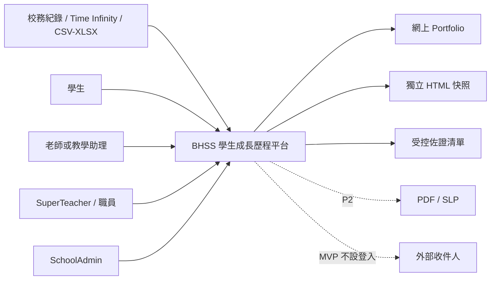

# SRS-00 產品範圍及需求索引

## 1. 產品目標

平台用來記錄學術及非學術活動，保留佐證、評語及覆核來源，並按八項 Universal Framework 技能展示學生成長。平台以具來源的資料補足學業成績及教職員印象，協助獲授權教育人員更全面了解學生的參與、能力及成長。平台不是分數排行榜；問卷答案、證書、AI 內容或缺漏資料，都不可直接變成正式的 1–16 階段結果。

產品方向：BHSS 是牽頭學校及首個參考個案。若 JC 接納方案，可提供撥款，讓計劃落地及供參與學校使用；Octopus Infotech 則以產品供應商身份開發並持有這套可重用產品。擁有權、授權及品牌安排仍須以書面協議確認。**Discussed on Meeting Oct 26 - kickstart**。

### 1.1 需求權威及驗證警示

**本 SRS 不是已經市場驗證的產品規格。** 目前唯一已收到的產品層面方向，是 Octopus Infotech Limited 擬開發一套可重用的產品，並以 JC 或一間或多間參與 JC 計劃的學校作為預期首個客戶／採用情境。除此以外，現時的產品定義、範圍、分階段計劃、優先次序、工作流程、架構及跨校適用性，均來自內部獨立分析。現時未收到任何市場研究報告、訪談樣本、研究結果紀錄、驗證結果、商業論證，或 BHSS／JC 書面批准，足以支持這些假設。

會後逐字稿曾出現「市場研究已做」的未核實說法，但沒有指明負責人，亦沒有提及任何研究交付物。後續對話提及透過 JC、牽頭學校、Victor 及馮校長收集其他學校意見；這只是可能的需求探索渠道，不足以證明正式市場研究已經完成。在收到可追溯證據前，受影響的 SRS 內容均須維持標示為 `assumption`、`recommended` 或 `open`，不得對外表述為 BHSS 要求、JC 要求、已驗證市場需求、採購承諾或已批准產品基線。**Discussed on Meeting Oct 26 - kickstart**。

## 2. 分階段範圍

| 階段 | 交付內容 |
|---|---|
| P0 — POC 修整 | 修正導覽及伺服器權限；清楚列出欄位限制；活動名單及問卷匯入；JPG/PNG 上載與預覽；敏感操作審計。 |
| P1 — 精簡 MVP | 完整活動、表格、提交、佐證、評估生命週期；按權限範圍處理覆核；Portfolio 快照；HTML 及受控 XLSX 匯出；學年轉換；學校隔離及按校功能政策；供應商中立的文字擷取與 Portfolio 生成合約。 |
| P2 — 後續階段 | 在 P1 合約後接入正式 OCR／轉錄及 LLM 供應商；PDF/SLP 排版、音訊／影片處理、外部門戶、家長流程及分析。 |

## 3. 系統邊界



## 4. 共通要求

| ID | 要求 | 狀態 | 階段 |
|---|---|---|---|
| PRD-FR-001 | 每項重要紀錄須保留建立人、來源、時間、生命週期狀態及不可變更的歷史參照。 | 已確認工作決定 | P1 |
| PRD-FR-002 | 是否納入計算、內容覆核及學生是否看見，必須分開管理。 | 已確認 M-09/M-19 | P0 |
| PRD-FR-003 | 缺漏、未收集、沒有佐證、不適用、排除及零分不可當成同一情況。 | 缺漏規則已確認；其餘政策待定 M-13 | P1 |
| PRD-FR-004 | 正式輸出須取自已凍結及有版本的快照，不可每次以可變動的即時資料重建。 | 建議架構 | P1 |
| PRD-FR-005 | 每個頁面及 API 操作均須檢查角色、獲分配範圍、生命週期；讀取原始媒體另須檢查同意及授權。 | 建議架構 | P0 |
| PRD-FR-006 | 所有數字欄位均須在介面、API 及資料層顯示並執行最小值與最大值。 | 建議架構 | P0 |
| PRD-FR-007 | 未決事項須標示「政策待定」；臨時上限須可設定並另行標示。 | 已確認文件規則 | P0 |
| PRD-FR-008 | 中英文版本須採用相同需求編號、列舉值、限制及意思。 | 已確認文件規則 | P0 |
| PRD-FR-009 | 現階段採用一套活動核心輸入規格，不接受每校任意更改資料結構。學校整理資料、平台驗證、預覽及批核須分開處理。 | 已批准 POC 解讀 V2-A01 | P0 |
| PRD-FR-010 | 即使標籤名稱來自 Rubric 範疇，描述標籤與正式評估紀錄仍須分開。 | 已批准 POC 解讀 V2-B01 | P0 |
| PRD-FR-011 | 模型輔助處理只可產生附來源的候選結果，不可自動發布學生身份、佐證結論或能力階段。 | 已批准 POC 解讀 V2-B05–B08 | P0 |
| PRD-FR-012 | Portfolio 須集中校務、老師、學生及獲授權職員提供的佐證，讓非學術參與及已展示的能力清楚呈現，並可追溯來源。 | Discussed on Meeting Oct 26 - kickstart | P1 |
| PRD-FR-013 | 媒體可透過伺服器端連接器，從校方認可的外部儲存位置取得；不可把實際路徑或儲存服務憑證傳送至瀏覽器。 | 部分已有方向 L-08；Discussed on Meeting Oct 26 - kickstart | P1 |
| PRD-FR-014 | 每項屬於學校的紀錄均須直接保存 `school_id`，或經受強制約束的上層紀錄推導所屬學校；如識別碼屬於另一間學校，系統須拒絕要求而不披露該紀錄。 | 系統分析架構決定已批准（2026-10-27） | P0 |
| PRD-FR-015 | 學校被停用，或某項功能對該校停用／尚未開放時，伺服器須在執行 service/use-case 前封鎖；只在介面隱藏按鈕並不構成控制。 | 系統分析架構決定已批准（2026-10-27） | P0/P1 |
| PRD-FR-016 | 核心系統只依賴供應商中立的文字擷取及 Portfolio 生成合約，負責驗證標準化輸入／輸出、來源、學校範圍及人工覆核狀態，毋須知道供應商如何實作 AI。 | 系統分析架構決定已批准（2026-10-27）；承接 Discussed on Meeting Oct 26 - kickstart | P1 |
| PRD-FR-017 | Portfolio 視覺化及匯出只可讀取已批核及已凍結的快照 DTO，不可自行呼叫 LLM 或解讀未經覆核的擷取結果。 | 系統分析架構決定已批准（2026-10-27） | P1 |
| PRD-FR-018 | 正式 Rubric 結果須與各輸入／佐證類型的候選最高支持階段及已選用最高支持階段分開。正式結果只可採用已明確納入、合資格並經人員確認的觀察，並保留實際選用來源及覆核決定。 | 系統分析架構決定已批准（2026-10-27） | P1 |
| PRD-FR-019 | 先前已接納的佐證、身份關聯、觀察或 AI 候選，日後仍可逐項更正、排除或由新紀錄取代，並保留原因及審計歷史。受影響的即時結果轉為 `needs_review`／`stale`；已發布內容須撤回或由新批核快照取代，不得暗中改寫。 | 系統分析架構決定已批准（2026-10-27） | P1/P2 |
| PRD-FR-020 | 校內職位／職銜、可疊加功能角色／權限、分派範圍及具名批核分派須分開保存，並設生效日期。職銜本身不可直接授予內容權限。 | 系統分析架構決定已批准（2026-10-28）；並非 BHSS／JC 批准 | P0/P1 |
| PRD-FR-021 | 有效授權須支援全校、部門、科目、級別、班別、群組、課程、活動及學生範圍；同一情況下，適用的明確拒絕優先於允許。 | 系統分析架構決定已批准（2026-10-28）；並非 BHSS／JC 批准 | P1 |
| PRD-FR-022 | 每間學校須分別設定活動、表格、提交、Portfolio 及發布批核；精簡 MVP 只採用 `not_required`、`automatic`、`single_reviewer` 或 `two_stage_sequential`。批核與發布可分屬不同權限；自行批核由政策控制。 | 系統分析架構決定已批准（2026-10-28）；並非 BHSS／JC 批准 | P1 |
| PRD-FR-023 | 活動作重大修改時須建立後繼修訂及重新批核，但不更改 `activity_id`，亦不會令佐證／媒體脫離活動。Portfolio 未批核工作版本不得在正式畫面取代最新已批核版本。 | 系統分析架構決定已批准（2026-10-28）；並非 BHSS／JC 批准 | P1 |
| PRD-FR-024 | 未分派、被拒接、逾期及 `no_approved_version` 工作須進入可篩選的預設／升級處理佇列，並保存負責人、到期狀態及審計歷史。 | 系統分析架構決定已批准（2026-10-28）；並非 BHSS／JC 批准 | P1 |

## 5. 共通生命週期

| 紀錄 | 狀態 |
|---|---|
| 活動容器／修訂 | 穩定 `activity_id`；每個受管制修訂按 `draft → pending_review → approved / changes_requested / rejected → superseded`，活動運作狀態則按 `approved → active → completed → archived` |
| 表格內容 | `draft → in_review → changes_requested / approved / rejected → retired` |
| 表格發布 | `unpublished → published → withdrawn` |
| 提交內容 | `not_submitted → draft → submitted → in_review → changes_requested / approved / rejected` |
| 匯入回應 | `received → identity_matched / needs_identity_resolution → corrected → validated → included_in_assessment / excluded` |
| 學生可見狀態 | `unpublished → published_to_portfolio → withdrawn` |
| Portfolio 工作版本 | `draft → student_submitted → class_teacher_review → staff_review → approved / changes_requested / rejected → published / superseded` |

所有狀態轉換均須以追加方式記錄。不可用一個籠統的 `status` 取代以上各條生命週期。

## 6. 已確定的數值範圍

| 欄位 | 最小值 | 最大值 | 規則／狀態 |
|---|---:|---:|---|
| Framework 技能數目 | 8 | 8 | 固定來源模型 |
| 技能階段 | 1 | 16 | 整數 |
| 現有問卷回應 | 1 | 6 | 來源量表；整數 |
| 表現一致程度 | 1 | 6 | 現行架構；整數 |
| 每個題目版本的能力定義 | 1 | 1 | 一個有效能力代碼／名稱；不是 Rubric 對應 |
| Rubric 範疇數目 | 1 | 由目錄定義 | 用作評估／雷達圖時必須提供 |
| Rubric 階段次序／數值 | 由目錄定義 | 由目錄定義 | 須有版本、排序及具體條件 |
| 每項佐證的連結數目 | 0 | 可設定 | 具類型的連結；不會自動影響評估 |
| 顯示次序 | 1 | 2,147,483,647 | 正整數，毋須連續 |
| 版本號碼 | 1 | 9,999 | 臨時技術上限 |

其他回應或學科評分，必須先設定量表名稱、最小值、最大值、標籤及方向，才可輸入。

## 7. 臨時可設定上限

以下數值尚未成為校方政策。

| 設定鍵 | 臨時值 | 介面提示 |
|---|---:|---|
| `text.code.max_chars` | 64 | 最多 64 個字元 |
| `text.title.max_chars` | 200 | 最多 200 個字元 |
| `text.comment.max_chars` | 4,000 | 最多 4,000 個字元 |
| `text.long_report.max_chars` | 20,000 | 最多 20,000 個字元 |
| `file.name.max_chars` | 255 | 最多 255 個字元 |
| `url.max_chars` | 2,048 | 最多 2,048 個字元 |
| `form.blocks.max` | 50 | 最多 50 個問題區塊 |
| `form.questions.max` | 200 | 最多 200 題 |
| `question.options.max` | 20 | 每題最多 20 個選項 |
| `activity.participants.max` | 1,000 | 每項活動最多 1,000 名參加者 |
| `import.rows.max` | 5,000 | 最多 5,000 行資料 |
| `import.columns.max` | 100 | 最多 100 欄 |
| `upload.spreadsheet.max_bytes` | 4 MiB | 最大 4 MB |
| `upload.image.max_bytes` | 8 MiB | 最大 8 MB |
| `upload.document.max_bytes` | 20 MiB | 最大 20 MB |
| `upload.audio.max_bytes` | 100 MiB | 最大 100 MB |
| `upload.video.max_bytes` | 500 MiB | 最大 500 MB |
| `upload.files_per_action.max` | 20 | 每次最多上載 20 個檔案 |
| `pagination.default` | 20 | 每頁 20 項 |
| `pagination.max` | 100 | 每頁最多 100 項 |
| `export.sync_rows.max` | 50,000 | 超出後改用背景工作 |
| `portfolio.proud_moments.max` | 24 | 臨時上限；最終政策待定 |
| `session.idle_minutes` | 30 | 閒置 30 分鐘後重新登入 |
| `session.absolute_hours` | 8 | 每次登入最長 8 小時 |
| `auth.failed_attempts.max` | 每 15 分鐘 5 次 | 臨時登入保護 |
| `auth.password.min_chars` | 12 | 最少 12 個字元 |
| `auth.password.max_chars` | 128 | 最多 128 個字元 |

## 8. 共通欄位規格

每個欄位均須列明：資料類型、單位、是否必填、空值含意、預設值、最小值、最大值、精確度、可用值、可編輯角色、鎖定時點、錯誤訊息及要求狀態。必填文字會先移除前後空格，並至少包含一個非空白字元。介面不得出現沒有範圍的數字輸入。

API 驗證錯誤格式：

```json
{
  "error": {
    "code": "VALIDATION_OUT_OF_RANGE",
    "field": "observed_step",
    "message": "請輸入 1 至 16 的整數。",
    "minimum": 1,
    "maximum": 16
  }
}
```

## 9. 未決事項對照

| 範疇 | 決策編號 |
|---|---|
| 正式輸出及外部收件人 | H-01, H-09, L-07 |
| 評估權限及人工把關 | H-03, H-04, H-05, M-02, M-07 |
| 問卷權威及完整定義 | H-02, M-03, M-04, M-05, M-06 |
| 同意、檔案及保留期 | H-07, L-02 |
| 學年及快照 | H-08 |
| AI 使用界線 | H-10 |
| 活動、分類及鎖定 | M-08, M-12, M-14, L-01, L-04 |
| 缺漏狀態及通知 | M-13, L-05 |
| 輸入／佐證類型目錄及 Rubric 合資格規則 | M-25 |
| 識別碼及匯入格式 | L-03, L-06 |

## 10. 驗收準則

- SRS-12 列出所有角色頁面，SRS-01 則列出相應伺服器權限。
- 所有數字欄位均採用已確定範圍或清楚設定的量表。
- 介面在相關欄位旁顯示當時生效的最大值。
- 臨時上限不得被寫成校方已確認政策。
- 所有未決事項均連結至穩定的問題編號。
- 日後修改表格或對應關係，不會破壞舊提交及已發布快照。
- API 及背景工作對跨校識別碼、已停用學校及已停用功能採用一致的拒絕規則。
- 替換文字擷取或 Portfolio 生成供應商時，只須通過同一套合約測試，毋須修改核心流程或視覺化 DTO。
- 每類來源的最高支持階段不可在欠缺已選取且經人員確認的觀察及來源紀錄下，被誤當或複製為正式階段。
- 更正錯誤人臉／學生關聯時，系統保留原有決定、找出所有受影響項目，並要求先撤回或批核後續版本，才可處理受影響的已發布內容。

