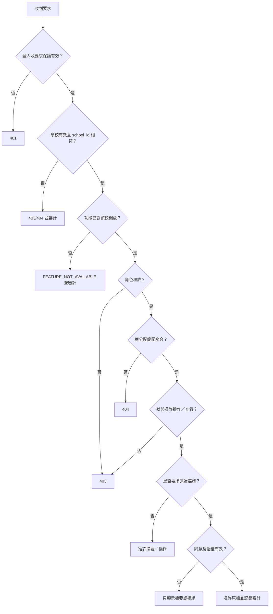

# SRS-01 身份、登入工作階段及存取控制

## 1. 目的

界定誰可以查看或修改每項紀錄。權限不可只看角色；每次要求均須檢查角色、獲分配範圍、紀錄狀態，以及原始媒體的同意與授權。

## 2. 角色及權限範圍

| 角色 | 預設範圍 |
|---|---|
| 學生 | 本人資料、已參加活動、獲分配任務及已發布的個人紀錄 |
| 老師 | 以負責老師、協作老師、教學助理、評估人或班主任身份獲分配的活動／學生 |
| SuperTeacher／職員 | 獲委派的課程、班別、級別、覆核佇列或校務工作 |
| SchoolAdmin | 全校行政範圍；原始媒體仍須另行授權 |
| 平台營運管理員 | 只負責多校服務的學校可用狀態及按校功能政策；預設無權查看校內內容、媒體或評估 |
| 外部收件人 | P1 不設帳戶，只收取已批核輸出 |

帳戶身份、共用角色定義、具生效日期的使用者角色分派及具名工作批核分派須分開保存。`class_teacher`、`activity_teacher`、`TA` 及 `assessor` 可屬具生效日期的角色／範圍分派；要擔任某項紀錄的 `reviewer` 或 `approver`，還須有該項工作的具名分派。同一人可兼任多個角色，但敏感操作須記錄當時採用的角色及範圍。**Discussed on Meeting Oct 26 - kickstart。**

以下校內角色矩陣不包括平台營運管理員。該權限只限處理多校服務的學校可用狀態及功能政策，另行接受審計，亦不會因此取得校內內容存取權。

## 3. 功能要求

| ID | 要求 | 狀態 | 階段 |
|---|---|---|---|
| IAM-FR-001 | 所有受保護要求均由伺服器驗權；隱藏介面按鈕不等同授權。 | 建議架構 | P0 |
| IAM-FR-002 | 授權須同時符合角色、工作範圍、生命週期；原始媒體另須有效同意／授權。 | 建議架構 | P0 |
| IAM-FR-003 | 超出範圍的紀錄回傳 `404`；知道紀錄但無權執行的操作回傳 `403`。 | 建議架構 | P0 |
| IAM-FR-004 | 學生只可查看本人或明確分配給自己的紀錄。 | 符合來源 | P0 |
| IAM-FR-005 | 班主任可查看現時所屬學生的已發布摘要，但不會自動取得原始媒體。 | 建議架構 | P0 |
| IAM-FR-006 | 活動老師／教學助理可查看獲分配活動的名單、提交及評估所需佐證。 | 符合來源 | P0 |
| IAM-FR-007 | 職員只可查看獲委派的課程、班別、級別或覆核佇列，除非另獲全校營運權限。 | 建議架構 | P1 |
| IAM-FR-008 | SchoolAdmin 可管理身份及政策，但管理員角色本身不等同原始媒體或老師評估權。 | 已確認工作模型 | P1 |
| IAM-FR-009 | 預設情況下，表格作者不可批核自己建立的版本。 | 建議；最終表格權責待定 | P1 |
| IAM-FR-010 | 登入工作階段須可由伺服器撤銷；正式環境使用 Secure、HttpOnly、SameSite Cookie。 | 建議架構 | P0 |
| IAM-FR-011 | 登入、登出、失敗登入、權限變更、敏感讀取、批核、匯入、匯出、修正及停用均須審計。 | 符合來源 | P0/P1 |
| IAM-FR-012 | 匯入用戶只建立啟用／邀請流程；匯入檔不可載有明文密碼。 | 符合來源 | P1 |
| IAM-FR-013 | 角色定義、具生效日期的角色分派，以及表格／佐證／Rubric 工作批核分派須分開保存及審計。 | 10 月 26 日修訂已確認 | P0 |
| IAM-FR-014 | 每個已登入要求須解析至唯一一個有效 `school_id`；要求讀取的紀錄及所引用識別碼均須屬於該校。 | 系統分析架構決定已批准（2026-10-27） | P0 |
| IAM-FR-015 | 當 `schools.is_disabled = true`，伺服器須拒絕該校的新登入、受保護要求及新背景工作，同時保留資料及審計歷史。 | 系統分析架構決定已批准（2026-10-27） | P0 |
| IAM-FR-016 | 除一般授權外，系統另須檢查功能是否對該校開放。功能已開放不代表任何用戶自動取得使用權。 | 系統分析架構決定已批准（2026-10-27） | P0/P1 |

## 4. 權限矩陣

| 功能 | 學生 | 老師 | 職員 | SchoolAdmin |
|---|---|---|---|---|
| 查看 Portfolio | 本人 | 獲分配學生 | 委派範圍 | 按政策 |
| 查看活動 | 已參加 | 已分配 | 委派範圍 | 全校行政資料 |
| 查看原始媒體 | 本人／獲准 | 已分配兼獲准 | 覆核範圍兼獲准 | 須明確授權 |
| 提交自評 | 本人任務 | 否 | 否 | 否 |
| 提交同儕互評 | 指定任務 | 否 | 否 | 否 |
| 提交老師觀察 | 否 | 已分配 | 已分配／覆核範圍 | 單憑管理員角色不可 |
| 建立活動草稿 | 否 | 是 | 是 | 是 |
| 批核活動 | 否 | 預設否 | 委派範圍 | 政策權限 |
| 批核／發布表格 | 否 | 預設否 | 獲委派 | 是 |
| 發布技能／Portfolio | 否 | 提議 | 獲委派 | 設定／執行政策 |
| 管理用戶／學年／政策 | 否 | 否 | 有限委派 | 是 |

## 5. 授權流程

## 6. 登入及密碼限制

| 項目 | 最小值 | 最大值 | 狀態 |
|---|---:|---:|---|
| 用戶名稱 | 3 個字元 | 64 個字元 | 臨時上限 |
| 密碼 | 12 個字元 | 128 個字元 | 臨時正式環境基準 |
| 閒置時限 | — | 30 分鐘 | 政策待定；臨時上限 |
| 絕對時限 | — | 8 小時 | 與現有 POC 相容的臨時上限 |
| 失敗登入 | — | 15 分鐘內 5 次 | 臨時保護 |
| 當前角色／範圍 | 1 | 每次操作 1 個 | 建議架構 |

POC 的示範帳戶切換只供開發，不得帶入正式環境。

## 7. 介面要求

- 登入資料 API 回傳用戶、學校、當前角色、有效範圍及功能清單，但不洩露敏感權限規則。
- 回應可提供有效功能清單供介面顯示，但 API 及背景工作在實際使用時仍須重新讀取權威政策。
- 前端按功能清單建立導覽，同時正確處理 `403/404`。
- 角色／範圍更改後，相關工作階段須失效或更新。
- 原始媒體每次讀取均重新驗權；連結須短期有效且不可猜測。

## 8. 驗收情境

1. 學生修改網址查看另一名學生時，不會收到任何紀錄資料。
2. 班主任可看所屬學生已發布摘要，但未獲授權時不可看相片。
3. 活動老師不可藉修改網址查看無關活動或班別。
4. 未有媒體授權的 SchoolAdmin 不可下載原檔。
5. 預設分工規則下，表格作者不可自行批核。
6. 撤銷工作階段後，下一個受保護要求即被拒絕。
7. 停用學校後，下一個受保護要求及新領取的背景工作均被拒絕，但不刪除校內紀錄。
8. 即使某項功能已為示範學校開啟，沒有相關角色／工作範圍的用戶仍不可使用。

