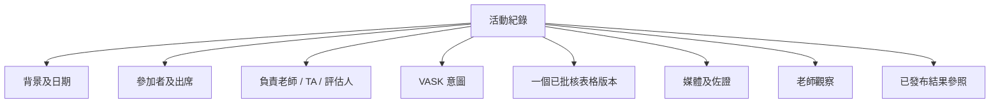

# SRS-04 活動、參加者及 VASK

## 1. 目的

校本活動是連繫活動背景、學生、負責人、VASK、指定表格、佐證及評估的主要容器。

## 2. 功能要求

| ID | 要求 | 狀態 | 階段 |
|---|---|---|---|
| ACT-FR-001 | 系統須分開可重用活動範本及有實際日期的活動紀錄。 | 建議架構 | P1 |
| ACT-FR-002 | 每項校本活動啟用前，須連結一個已批核、已發布且不可變更的表格版本。 | 已確認工作模型 | P1 |
| ACT-FR-003 | 參加學生及負責教職員須以明確多對多分配記錄。 | 已確認架構 | P0 |
| ACT-FR-004 | 出席／參與狀態須與表格完成及評估分開。 | 已確認架構 | P1 |
| ACT-FR-005 | 活動可選多項 VASK，並記錄來源、原因、版本及批核狀態。 | 已確認工作模型 | P1 |
| ACT-FR-006 | VASK 描述活動意圖及背景，不可直接設定八項技能階段。 | 已確認工作模型 | P0 |
| ACT-FR-007 | 技能目標只表示預期可收集的佐證，不會直接給予階段。 | 已確認架構 | P1 |
| ACT-FR-008 | 是否需要人工批核，按風險標示決定。 | 建議架構；M-14 待定 | P1 |
| ACT-FR-009 | 學生開放、截止及到期時間須可按活動設定。 | 已確認結構需要 | P1 |
| ACT-FR-010 | 學術／非學術分類在 M-08 決定前維持可設定。 | 政策待定 | P1 |

## 3. 活動資料組合

## 4. 欄位規則

| 欄位 | 規則 | 限制／狀態 |
|---|---|---|
| 活動代碼 | 必填，同校唯一 | 1–64 個字元 |
| 名稱 | 必填 | 1–200 個字元 |
| 簡介 | 提交覆核前必填 | 1–20,000 個字元 |
| 類別 | 提交覆核前必填 | 學術／非學術雙重分類待定 M-08 |
| 開始／結束 | 必填 | 開始不得遲於結束 |
| 地點 | 一般可留空；校外活動批核時必填 | 0–200 個字元 |
| 負責人 | 必填 | 1 名有效主要負責人 |
| 其他職員 | 可留空 | 臨時上限 50 人 |
| 參加者 | 啟用前必填 | 1–1,000 人 |
| VASK | 啟用前必填 | 1–100 項臨時上限 |
| 表格版本 | 啟用前必填 | 恰好 1 個不可變版本 |
| 開放／到期時間 | 按需要 | 開放 ≤ 截止；具體政策待定 |
| 風險標示 | 批核前必填 | 可多選設定值 |

最終必填活動欄位仍屬 L-01 未決事項；上表是 P1 建議最低要求。

## 5. 生命週期及鎖定

| 狀態 | 可改內容 | 可操作角色 |
|---|---|---|
| `draft` | 全部 | 負責人／獲授權職員 |
| `pending_review` | 覆核意見；作者可撤回 | 作者／覆核人 |
| `approved` | 啟用前可改名單及開放時間；重大改動須再覆核 | 負責人／職員 |
| `active` | 出席、佐證及提交；更改表格／VASK 須另立版本 | 獲分配職員 |
| `completed` | 只可覆核、修正及發布 | 獲分配覆核人 |
| `archived` | 只讀／匯出；行政修正須審計 | 獲授權職員／管理員 |

重開權限待定 M-12/L-04。

## 6. 風險批核

如採用已批核預設表格而沒有新增敏感媒體，校方可設定自動批核。自訂表格、更改對應、校外活動、外來參加者、相片／錄音／影片或新保留期需要，均須人工覆核。

## 7. 驗收情境

- 未有參加者、負責人、VASK 或有效表格版本的活動不可啟用。
- 活動啟用後修改表格，不會改動該活動的歷史版本。
- 學生可以缺席，但提交狀態仍獨立存在。
- 新增影片收集會觸發人工覆核。
- 活動可設定技能目標，但不可直接提升學生階段。

