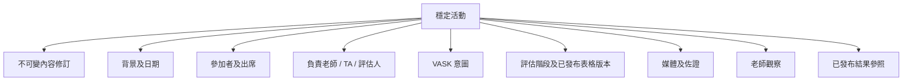

# SRS-04 活動、參加者及 VASK

## 1. 目的

校本活動是連繫有版本的活動背景、學生、負責人、VASK、指定表格、佐證及評估的穩定容器。

## 2. 功能要求

| ID | 要求 | 狀態 | 階段 |
|---|---|---|---|
| ACT-FR-001 | 系統須分開可重用活動範本及有實際日期的活動紀錄。 | 建議架構 | P1 |
| ACT-FR-002 | 每項校本活動須有預設評估階段；各階段開放作答前須固定引用已批核、已發布的表格版本。 | 已確認工作模型 | P1 |
| ACT-FR-003 | 參加學生及負責教職員須以明確多對多分配記錄。 | 已確認架構 | P0 |
| ACT-FR-004 | 出席／參與狀態須與表格完成及評估分開。 | 已確認架構 | P1 |
| ACT-FR-005 | 活動可選多項 VASK，並記錄來源、原因、版本及批核狀態。 | 已確認工作模型 | P1 |
| ACT-FR-006 | VASK 描述活動意圖及背景，不可直接設定八項技能階段。 | 已確認工作模型 | P0 |
| ACT-FR-007 | 技能目標只表示預期可收集的佐證，不會直接給予階段。 | 已確認架構 | P1 |
| ACT-FR-008 | 是否需要人工批核，按風險標示決定。 | 建議架構；M-14 待定 | P1 |
| ACT-FR-009 | 學生開放、截止及到期時間須可按活動設定。 | 已確認結構需要 | P1 |
| ACT-FR-010 | 學術／非學術分類在 M-08 決定前維持可設定。 | 政策待定 | P1 |
| ACT-FR-011 | 獲授權職員須可更正先前已確認的出席／參與狀態或學生—活動關聯，並保存修改前後值、原因、操作人及時間；原定名單不可改寫，受影響佐證／結果須進入影響覆核。 | 系統分析架構決定已批准（2026-10-27） | P1 |
| ACT-FR-012 | `activity_id` 在內容修訂之間保持穩定，避免因更正標題／簡介而令佐證、媒體、提交及出席紀錄脫離活動。 | 系統分析架構決定已批准（2026-10-28） | P0/P1 |
| ACT-FR-013 | 受管制活動內容須保存為不可變更的編號修訂。活動根紀錄分別指出最新修訂及目前已批核修訂。 | 系統分析架構決定已批准（2026-10-28） | P1 |
| ACT-FR-014 | 已批核／進行中活動作重大修改時，須建立後繼草稿及新批核流程；批核前，正式畫面仍採用上一個已批核修訂。 | 系統分析架構決定已批准（2026-10-28） | P1 |
| ACT-FR-015 | 建立／修改活動須具備有效功能權限及相符範圍，不由特定老師職銜決定。 | 系統分析架構決定已批准（2026-10-28） | P1 |
| ACT-FR-016 | 獲分派但沒有修改權的老師須向擁有人／獲授權編輯者提交有版本的修改要求，保存欄位、建議值、原因、提出人及處理結果。 | 系統分析架構決定已批准（2026-10-28） | P1 |
| ACT-FR-017 | 活動批核政策須獨立支援 `not_required`、`automatic`、`single_reviewer` 及 `two_stage_sequential`；批核與發布可分開分派，亦可交予同一合資格人員。 | 系統分析架構決定已批准（2026-10-28） | P1 |
| ACT-FR-018 | 自行分派／自行批核須按有效校本政策處理。即使政策容許，建立者仍須有批核權限、相符範圍及具名審計分派。 | 系統分析架構決定已批准（2026-10-28） | P1 |
| ACT-FR-019 | SchoolAdmin 須從已通過匯入驗證的目錄中，選擇一套有版本的生效活動能力標籤。老師新增或修訂活動時，只可選擇該生效組合內的標籤；現有活動修訂保留當時所選標籤組合的確實版本。 | 系統分析員方向已確認（2026-10-29）；並非 BHSS／JC 批准 | P1 |
| ACT-FR-020 | 啟用新活動能力標籤組合只會更改老師日後可選項目；不可重新標示現有活動、建立評估結果，亦不可改變目前技能 Rubric。 | 系統分析員方向已確認（2026-10-29）；並非 BHSS／JC 批准 | P0/P1 |
| ACT-FR-021 | VASK 須作為系統預載的預設活動能力標籤組合。老師新增活動時，系統須自動套用該校目前生效的標籤組合版本並顯示當中標籤；建立活動畫面不可要求老師在 VASK 與評估 Rubric 之間選擇。SchoolAdmin 上載的後繼標籤組合，只有在通過驗證及明確啟用後，才可供新的活動修訂使用。 | 系統分析員方向已確認（2026-10-29）；並非 BHSS／JC 批准 | P0/P1 |
| ACT-FR-022 | 每個活動修訂可以有多項已鎖定版本的標籤分派。每項分派須記錄所屬目錄、範疇、用途（`descriptor` 或 `intended_assessment_axis`）、來源、理由、批核狀態、操作人及時間。標籤只說明背景，不會成為學生評估結果。 | 系統分析架構決定已批准（2026-10-30）；並非 BHSS／JC 批准 | P1 |
| ACT-FR-023 | 新活動及後繼修訂只可選擇現時生效且可選的標籤。歷史修訂可繼續引用其後已停用的目錄或範疇；如引用未有改動，驗證只顯示「僅供歷史引用」警告，不會重寫或拒絕該紀錄。 | 系統分析架構決定已批准（2026-10-30）；並非 BHSS／JC 批准 | P0/P1 |
| ACT-FR-024 | 批核活動只會確認所選問卷版本已經批核及發布，不會同時批核、發布或修改問卷。即使由同一人處理，活動與表格仍須有各自的批核紀錄。 | 系統分析架構決定已批准（2026-10-30）；並非 BHSS／JC 批准 | P0/P1 |
| ACT-FR-025 | 活動編寫人選擇老師／職員時，伺服器須按姓名／識別碼、狀態、職位、功能角色、權限、部門、科目、群組、課程、範圍及批核資格等條件進行篩選及分頁。獲准使用此選擇器，不等於獲准進入教職員管理。 | 系統分析架構決定已批准（2026-10-30）；並非 BHSS／JC 批准 | P1 |
| ACT-FR-026 | 學生／老師回應預設於活動結束後一個曆月到期。獲授權延期（包括到期後延期）須保存前後期限、操作人、原因、生效時間及所需批核。到期不代表自動關閉，亦不是活動修改期限；確實曆法計算及權責仍按 L-04／M-12 待確認。 | 系統分析員方向；2026-11-18 對齊；並非 BHSS／JC 批准 | P1 |
| ACT-FR-027 | 系統須支援下述階段流程及不可改寫的階段／表格／回應版本：預設一個結束階段，可新增評估，問卷修改獨立管治，不可自動比較不同量表。 | 系統分析員方向，2026-11-18；並非 BHSS／JC 批准 | P1 |

### 到期時間及延期

活動回應預設於活動結束後一個曆月到期。獲授權職員可為個別活動設定更長期限，原定日期已過後亦可延期。每次變更以一項可審計操作記錄前後期限、操作人、原因、時間及所需批核。到期只表示任務可能逾期，不會自動關閉。誰有權延期、月底／時區計算及是否另設硬性關閉仍須校方確認。提交是否逾期按 SRS-06 由時間及期限歷史推算；已發布快照不可改寫。

## 3. 活動資料組合

## 4. 欄位規則

| 欄位 | 規則 | 限制／狀態 |
|---|---|---|
| 活動代碼 | 必填，同校唯一 | 1–64 個字元 |
| 名稱 | 必填 | 1–200 個字元 |
| 簡介 | 提交覆核前必填 | 1–20,000 個字元 |
| 類別 | 提交覆核前必填 | 學術／非學術雙重分類待定 M-08 |
| 開始／結束 | 必填 | 開始不得遲於結束 |
| 地點 | 一般可留空；校外活動批核時必填 | 0–200 個字元 |
| 負責人 | 必填 | 1 名有效主要負責人 |
| 其他職員 | 可留空 | 臨時上限 50 人 |
| 參加者 | 啟用前必填 | 1–1,000 人 |
| VASK | 啟用前必填 | 1–100 項臨時上限 |
| 表格版本 | 啟用前必填 | 恰好 1 個不可變版本 |
| 開放／到期時間 | 按需要 | 如設關閉時間，開放須早於或等於關閉；回應預設期限見 ACT-FR-026，曆法細節待定 |
| 風險標示 | 批核前必填 | 可多選設定值 |
| 最新／目前已批核修訂 | 系統管理 | 後繼版本待批時兩者可以不同 |
| 修改要求 | 條件必填 | 提出人沒有直接修改權時必須建立；原因 1–4,000 字元 |

最終必填活動欄位仍屬 L-01 未決事項；上表是 P1 建議最低要求。

## 5. 生命週期及鎖定

| 狀態 | 可改內容 | 可操作角色 |
|---|---|---|
| `draft` | 全部 | 負責人／獲授權職員 |
| `pending_review` | 覆核意見；作者可撤回 | 作者／覆核人 |
| `approved` | 啟用前可改名單及開放時間；重大內容改動須建立後繼修訂及重新覆核 | 負責人／獲授權編輯者 |
| `active` | 出席、佐證及提交；更改表格／VASK 須另立版本 | 獲分配職員 |
| `completed` | 只可覆核、修正及發布 | 獲分配覆核人 |
| `archived` | 只讀／匯出；行政修正須審計 | 獲授權職員／管理員 |

重開權限待定 M-12/L-04。

## 6. 風險批核

如採用已批核預設表格而沒有新增敏感媒體，校方可設定自動批核。自訂表格、更改對應、校外活動、外來參加者、相片／錄音／影片或新保留期需要，均須人工覆核。未分派、被拒接或逾期的決定進入設定的預設／升級處理佇列；每項人工決定及重大改動批核均須填寫理由。

## 7. 驗收情境

- 未有參加者、負責人、VASK 或有效表格版本的活動不可啟用。
- 活動啟用後修改表格，不會改動該活動的歷史版本。
- 學生可以缺席，但提交狀態仍獨立存在。
- 新增影片收集會觸發人工覆核。
- 活動可設定技能目標，但不可直接提升學生階段。
- 更正錯誤學生／活動關聯時，只會把它從目前評估用途移除，不會刪除原定名單、出席決定或審計歷史。
- 修改已批核簡介會建立修訂 2；修訂 1 在新版本獲批前仍是正式版本，而原有佐證繼續由同一 `activity_id` 管理。
- 獲分派至職員建立活動但沒有修改權的老師只可提交修改要求，不可直接覆蓋簡介。
- 老師只要具備校方設定的批核權限便可批核活動，毋須職銜是「職員」；自行批核只在政策明確容許時成立。
- 新增活動會自動顯示該校生效 VASK 標籤版本的標籤；Skills Builder 及 RC360 評估 Rubric 不會成為可替代的活動標籤目錄。
- 批核一項引用已發布問卷的活動，不會產生新的問卷批核或發布事件。
- 已停用標籤仍可在舊修訂顯示為歷史背景，但新修訂不可再選取。
- 活動建立人可搜尋其範圍內的分頁分派名錄，但不會因此獲得教職員管理權。

### 活動修改時間釐清

活動修改已由 ACT-FR-012–016 規管。一個曆月的回應期限並非活動修改期限。重大修改須建立後繼修訂並重新批核；沒有修改權的人須提出修改要求。是否另設修改期限仍按 M-12／L-04 待確認。

## 活動階段評估

**系統分析員方向，2026-11-18；並非 BHSS／JC 批准。** 此方向取代「每項活動只能使用一份問卷」的限制。活動可有一個或多個評估／回饋階段，預設只設一個結束階段，安排於相關匯報學段結束時評估。獲授權的活動編輯者可新增開始、過程、結束或自訂階段，並調整日期。不同階段可採用不同問卷；每個已發布階段固定引用一個已批核、已發布且不可改寫的表格版本，內含學生、老師及同儕區塊。同一階段暫不假設可放多份問卷；有需要時分設具名階段。

關係為：活動 → 評估階段 → 階段修訂 → 表格分派 → 作答對象 → 提交 → 答案／佐證。階段須記錄穩定識別碼、活動、名稱／類型、次序、覆核／匯報學段、評估日期、佐證涵蓋起迄日期、開放／到期／可選關閉時間、問卷版本、作答群組及具名覆核分派。階段修訂保留作者、原因、批核、發布及被取代版本。分派、提交、佐證及觀察均須保留階段和確實的階段／表格版本。以上為概念模型新增要求，資料庫遷移及 API／介面尚待實作。

活動歸屬學段與評估階段的匯報學段須分開。橫跨 P1–P2 的同一活動，可在 P1 作過程評估、P2 作結束評估。P1 階段答案仍可作回饋比較，但仍在進行的 P1–P2 活動不納入 P1 學段評估，除非負責人提出的提早結束已生效。合資格已完成活動須凍結佐證範圍及覆核決定。評估階段不是另一項活動，亦不會自動產生正式評級或發布報告。

活動批核後新增或更換階段／問卷，屬受管制活動修改。活動負責人或獲授權編輯者提出活動／階段後繼修訂，按政策送批；沒有修改權的老師提出修改要求。草稿或未獲批問卷不可分派作答，問卷批核及發布仍獨立處理。既有分派、答案及已發布結果保留原版本。已有提交的階段不可改名、覆寫或刪除來冒充新一次評估；須記錄原因以取消／停用未來工作，或建立後繼階段／分派並明確指定作答人。後繼版本獲批及發布前，原已批核設定繼續生效。

評估日期、回應到期日及關閉時間須分開。預設結束階段沿用活動完結後一個曆月的回應期限，除非明確修改；新增階段須明訂開放及到期日，並與評估日期核對，不可把最終活動期限靜默套用到開始／過程階段。如學段末評估日期與預設回應期限衝突，發布前須明確處理時間安排。各階段沿用延期審計及逾期推算規則。同儕期限、日期預設值的優先次序及延期權責仍按 M-28／L-04 待確認。

比較畫面並列各階段的問卷／版本、題目／能力、答案量表、觀點、日期及佐證。可用不同問卷，但不可直接相減或平均不相關答案。數值變化須建基於明確獲批的可比較題目／量表，或相同 Rubric 版本及範疇；否則只作質性比較。同一佐證跨階段引用仍保留相同識別碼，不可因出現兩次而重複計算。採用階段內或累積佐證、結束評估是否取代早期結果，以及正式匯總規則仍待設定；本次不引入新的自動升級公式。

### 活動結束及提早結束

**系統分析員補充，2026-11-18；並非 BHSS／JC 批准。** 活動負責人可提出提早結束要求，記錄建議實際結束日期、原因、提出人及時間，並按既有活動修改／批核流程處理。只有已生效的完成／結束狀態，才符合納入學段評估的資格；待批的提早結束要求不等於完成。如負責人未結束活動而活動仍在進行，該活動不納入該次學段評估輸入及計算。顯示「進行中 — 未納入」，不當作零分；活動歷史、媒體、階段答案及回饋仍保留。

此規則取代先前「仍在進行的 P1–P2 活動可憑 P1 階段納入 P1 正式結果」的假設。開始／過程階段仍可收集及比較回饋，但不可繞過活動完成資格。已完成活動仍須有獲接納佐證、經人員確認的觀察及正常發布決定；結束活動不會自動給予階段。如沒有其他合資格結果，沿用既有「上一學年評級／尚未評估」顯示規則。

提早結束生效時，記錄前後結束日期，以及後續階段和未完成任務的處理。按已生效的實際結束日期，經既有期限變更審計流程重新處理預設回應期限；明確延期及已提交歷史須保留供覆核，不可靜默縮短。後續階段須明確改期或取消並記錄原因，不可靜默刪除。學段末評估可在不納入進行中活動的情況下繼續。確實完成截點、報告發布後才完成的活動如何處理，以及獨立關閉／重開權責，仍按 M-28／L-04 待確認；已發布結果不可靜默改寫。
