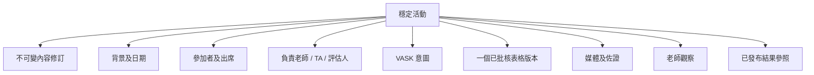

# SRS-04 活動、參加者及 VASK

## 1. 目的

校本活動是連繫有版本的活動背景、學生、負責人、VASK、指定表格、佐證及評估的穩定容器。

## 2. 功能要求

| ID | 要求 | 狀態 | 階段 |
|---|---|---|---|
| ACT-FR-001 | 系統須分開可重用活動範本及有實際日期的活動紀錄。 | 建議架構 | P1 |
| ACT-FR-002 | 每項校本活動啟用前，須連結一個已批核、已發布且不可變更的表格版本。 | 已確認工作模型 | P1 |
| ACT-FR-003 | 參加學生及負責教職員須以明確多對多分配記錄。 | 已確認架構 | P0 |
| ACT-FR-004 | 出席／參與狀態須與表格完成及評估分開。 | 已確認架構 | P1 |
| ACT-FR-005 | 活動可選多項 VASK，並記錄來源、原因、版本及批核狀態。 | 已確認工作模型 | P1 |
| ACT-FR-006 | VASK 描述活動意圖及背景，不可直接設定八項技能階段。 | 已確認工作模型 | P0 |
| ACT-FR-007 | 技能目標只表示預期可收集的佐證，不會直接給予階段。 | 已確認架構 | P1 |
| ACT-FR-008 | 是否需要人工批核，按風險標示決定。 | 建議架構；M-14 待定 | P1 |
| ACT-FR-009 | 學生開放、截止及到期時間須可按活動設定。 | 已確認結構需要 | P1 |
| ACT-FR-010 | 學術／非學術分類在 M-08 決定前維持可設定。 | 政策待定 | P1 |
| ACT-FR-011 | 獲授權職員須可更正先前已確認的出席／參與狀態或學生—活動關聯，並保存修改前後值、原因、操作人及時間；原定名單不可改寫，受影響佐證／結果須進入影響覆核。 | 系統分析架構決定已批准（2026-10-27） | P1 |
| ACT-FR-012 | `activity_id` 在內容修訂之間保持穩定，避免因更正標題／簡介而令佐證、媒體、提交及出席紀錄脫離活動。 | 系統分析架構決定已批准（2026-10-28） | P0/P1 |
| ACT-FR-013 | 受管制活動內容須保存為不可變更的編號修訂。活動根紀錄分別指出最新修訂及目前已批核修訂。 | 系統分析架構決定已批准（2026-10-28） | P1 |
| ACT-FR-014 | 已批核／進行中活動作重大修改時，須建立後繼草稿及新批核流程；批核前，正式畫面仍採用上一個已批核修訂。 | 系統分析架構決定已批准（2026-10-28） | P1 |
| ACT-FR-015 | 建立／修改活動須具備有效功能權限及相符範圍，不由特定老師職銜決定。 | 系統分析架構決定已批准（2026-10-28） | P1 |
| ACT-FR-016 | 獲分派但沒有修改權的老師須向擁有人／獲授權編輯者提交有版本的修改要求，保存欄位、建議值、原因、提出人及處理結果。 | 系統分析架構決定已批准（2026-10-28） | P1 |
| ACT-FR-017 | 活動批核政策須獨立支援 `not_required`、`automatic`、`single_reviewer` 及 `two_stage_sequential`；批核與發布可分開分派，亦可交予同一合資格人員。 | 系統分析架構決定已批准（2026-10-28） | P1 |
| ACT-FR-018 | 自行分派／自行批核須按有效校本政策處理。即使政策容許，建立者仍須有批核權限、相符範圍及具名審計分派。 | 系統分析架構決定已批准（2026-10-28） | P1 |
| ACT-FR-019 | SchoolAdmin 須從已通過匯入驗證的目錄中，選擇一套有版本的生效活動能力標籤。老師新增或修訂活動時，只可選擇該生效組合內的標籤；現有活動修訂保留當時所選標籤組合的確實版本。 | 系統分析員方向已確認（2026-10-29）；並非 BHSS／JC 批准 | P1 |
| ACT-FR-020 | 啟用新活動能力標籤組合只會更改老師日後可選項目；不可重新標示現有活動、建立評估結果，亦不可改變目前技能 Rubric。 | 系統分析員方向已確認（2026-10-29）；並非 BHSS／JC 批准 | P0/P1 |
| ACT-FR-021 | VASK 須作為系統預載的預設活動能力標籤組合。老師新增活動時，系統須自動套用該校目前生效的標籤組合版本並顯示當中標籤；建立活動畫面不可要求老師在 VASK 與評估 Rubric 之間選擇。SchoolAdmin 上載的後繼標籤組合，只有在通過驗證及明確啟用後，才可供新的活動修訂使用。 | 系統分析員方向已確認（2026-10-29）；並非 BHSS／JC 批准 | P0/P1 |

## 3. 活動資料組合

## 4. 欄位規則

| 欄位 | 規則 | 限制／狀態 |
|---|---|---|
| 活動代碼 | 必填，同校唯一 | 1–64 個字元 |
| 名稱 | 必填 | 1–200 個字元 |
| 簡介 | 提交覆核前必填 | 1–20,000 個字元 |
| 類別 | 提交覆核前必填 | 學術／非學術雙重分類待定 M-08 |
| 開始／結束 | 必填 | 開始不得遲於結束 |
| 地點 | 一般可留空；校外活動批核時必填 | 0–200 個字元 |
| 負責人 | 必填 | 1 名有效主要負責人 |
| 其他職員 | 可留空 | 臨時上限 50 人 |
| 參加者 | 啟用前必填 | 1–1,000 人 |
| VASK | 啟用前必填 | 1–100 項臨時上限 |
| 表格版本 | 啟用前必填 | 恰好 1 個不可變版本 |
| 開放／到期時間 | 按需要 | 開放 ≤ 截止；具體政策待定 |
| 風險標示 | 批核前必填 | 可多選設定值 |
| 最新／目前已批核修訂 | 系統管理 | 後繼版本待批時兩者可以不同 |
| 修改要求 | 條件必填 | 提出人沒有直接修改權時必須建立；原因 1–4,000 字元 |

最終必填活動欄位仍屬 L-01 未決事項；上表是 P1 建議最低要求。

## 5. 生命週期及鎖定

| 狀態 | 可改內容 | 可操作角色 |
|---|---|---|
| `draft` | 全部 | 負責人／獲授權職員 |
| `pending_review` | 覆核意見；作者可撤回 | 作者／覆核人 |
| `approved` | 啟用前可改名單及開放時間；重大內容改動須建立後繼修訂及重新覆核 | 負責人／獲授權編輯者 |
| `active` | 出席、佐證及提交；更改表格／VASK 須另立版本 | 獲分配職員 |
| `completed` | 只可覆核、修正及發布 | 獲分配覆核人 |
| `archived` | 只讀／匯出；行政修正須審計 | 獲授權職員／管理員 |

重開權限待定 M-12/L-04。

## 6. 風險批核

如採用已批核預設表格而沒有新增敏感媒體，校方可設定自動批核。自訂表格、更改對應、校外活動、外來參加者、相片／錄音／影片或新保留期需要，均須人工覆核。未分派、被拒接或逾期的決定進入設定的預設／升級處理佇列；每項人工決定及重大改動批核均須填寫理由。

## 7. 驗收情境

- 未有參加者、負責人、VASK 或有效表格版本的活動不可啟用。
- 活動啟用後修改表格，不會改動該活動的歷史版本。
- 學生可以缺席，但提交狀態仍獨立存在。
- 新增影片收集會觸發人工覆核。
- 活動可設定技能目標，但不可直接提升學生階段。
- 更正錯誤學生／活動關聯時，只會把它從目前評估用途移除，不會刪除原定名單、出席決定或審計歷史。
- 修改已批核簡介會建立修訂 2；修訂 1 在新版本獲批前仍是正式版本，而原有佐證繼續由同一 `activity_id` 管理。
- 獲分派至職員建立活動但沒有修改權的老師只可提交修改要求，不可直接覆蓋簡介。
- 老師只要具備校方設定的批核權限便可批核活動，毋須職銜是「職員」；自行批核只在政策明確容許時成立。
- 新增活動會自動顯示該校生效 VASK 標籤版本的標籤；Skills Builder 及 RC360 評估 Rubric 不會成為可替代的活動標籤目錄。

