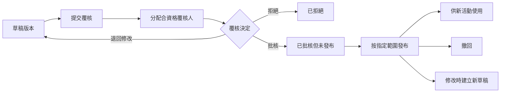

# SRS-05 表格、問題區塊及管治

## 1. 名詞

- **問卷來源（questionnaire source）**：校方提供的一整套問卷或來源試算表。
- **表格（form）**：分配給活動使用、有版本控制的數碼評估工具。
- **問題區塊／部分（question block/section）**：表格內有次序的一組問題。
- **問題（question）**：可重用的題目，包含答題方式、量表、對象及對應關係。
- **構念（construct）**：來源問卷希望量度的特質，不會自動等同八項技能。

## 2. 功能要求

| ID | 要求 | 狀態 | 階段 |
|---|---|---|---|
| FRM-FR-001 | 每份表格在臨時上限內包含 1–50 個問題區塊及 1–200 題。 | 臨時上限；完整定義待定 M-06 | P1 |
| FRM-FR-002 | 表格分配須指向一個不可變更的指定版本。 | 已確認架構 | P1 |
| FRM-FR-003 | 修改已批核／已發布版本時須建立後繼草稿，不可影響舊提交。 | 已確認架構 | P1 |
| FRM-FR-004 | 老師以 XLSX 上載所屬活動的已填問卷；學生只在驗證及發布後看見結果。 | 已確認 POC 方向 | P0 |
| FRM-FR-005 | 問題可分別對應構念、VASK 及八項技能中的一項或多項。 | 已確認架構 | P1 |
| FRM-FR-006 | 每題總權重預設為 1.0；如對應多項技能，平均分配。 | 已確認 M-01 | P1 |
| FRM-FR-007 | 可設定 1–16 的佐證範圍，但不會自動給予階段。 | 建議；M-02 待定 | P1 |
| FRM-FR-008 | 對應版本須記錄作者、理由、覆核人、批核狀態及有效期。 | 建議；H-05 待定 | P1 |
| FRM-FR-009 | 正式發布前須明確決定每題適用的作答對象。 | 政策待定 M-05；POC 暫時全部可用 | P1 |
| FRM-FR-010 | 表格內容批核及發布須分開處理。 | 已確認架構 | P1 |

## 3. 問題欄位

| 欄位 | 必填 | 範圍／可用值 |
|---|---|---|
| 問題代碼 | 是 | 1–64 個字元；版本命名空間內唯一 |
| 題目 | 是 | 1–4,000 個字元 |
| 回應類型 | 是 | `scale`, `single_choice`, `multiple_choice`, `short_text`, `long_text`, `boolean`, `number`, `date`, `file_reference` |
| 作答對象 | 發布前必填 | `student`, `peer`, `teacher`, `staff` 的獲批組合；M-05 待定 |
| 必答 | 是 | 布林值 |
| 量表 | 按類型 | 須有最小／最大值；現有問卷用 1–6 |
| 選項 | 按類型 | 2–20 個臨時上限 |
| 技能對應 | 可留空 | 1–8；合計 1.0／100% |
| 佐證範圍 | 可留空 | 兩者均為 1–16 整數；最小 ≤ 最大 |
| VASK 對應 | 可留空 | 1–100 項臨時上限 |
| 顯示次序 | 是 | ≥1 的整數 |

## 4. 管治流程

預設分工：老師建立；獲授權職員／SchoolAdmin 分配覆核；合資格覆核人作決定；獲授權職員／SchoolAdmin 發布。作者能否自行批核仍待 H-05 決定。

## 5. XLSX 問卷流程

1. 獲分配老師下載指定活動及表格版本的範本。
2. 檔案包括學生 ID、供核對的姓名、問題代碼、答案欄及指引。
3. 上載一個 `.xlsx`／`.csv`，最多 4 MiB、5,000 行、100 欄。
4. 系統預覽配對及錯誤；老師可修正暫存行。
5. 老師提交批次；其後只可透過審計修正。
6. 職員／覆核人驗證及處理例外。
7. 是否計算與是否讓學生看見，分開決定。

## 6. 存取

- 學生只回答獲分配表格，不可瀏覽全校題庫。
- 老師查看所屬活動需要的已批核表格及自己的草稿。
- 職員管理委派範圍的表格、對應及覆核。
- SchoolAdmin 設定權限及發布範圍。

## 7. 驗收情境

- 一題對應兩項技能時，每項佔 0.5，而非各佔 1.0。
- 量表無效或權重合計 90% 的表格不可發布。
- 老師批次未發布前，學生不可看答案。
- 撤回表格後不可再建立新分配，但舊提交完整保留。

