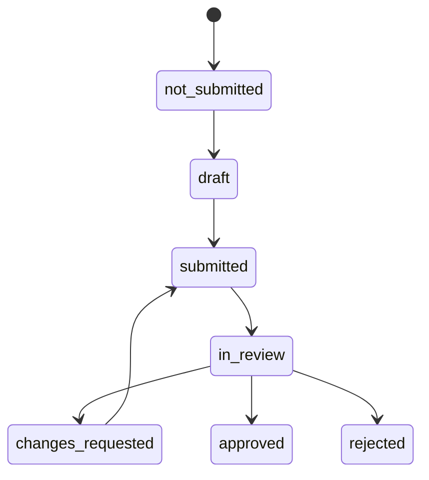

# SRS-06 任務、提交及同儕互評

## 1. 目的

把正確版本的表格分配給指定作答人及被評學生，保留自評、同儕及老師觀察的來源，並把內容覆核與發布分開。

## 2. 功能要求

| ID | 要求 | 狀態 | 階段 |
|---|---|---|---|
| SUB-FR-001 | 每項任務須記錄活動、表格版本、分配人、開放／到期時間及資格規則。 | 已確認架構 | P1 |
| SUB-FR-002 | 每名收件人須分開記錄作答人及被評學生。 | 已確認架構 | P1 |
| SUB-FR-003 | 觀點採用 `student_self_report`、`teacher_observation`、`peer_observation` 或日後獲批值。 | 已確認架構 | P1 |
| SUB-FR-004 | 內容、處理及可見狀態須分開。 | 已確認 M-09/M-19 | P0 |
| SUB-FR-005 | 同儕互評須由老師／TA 明確分配指定同學；只參加同一活動並不足以取得互評權。 | 已確認架構 | P1 |
| SUB-FR-006 | 同儕只可看該項任務所需資料，不可看被評學生的其他紀錄。 | 建議架構 | P1 |
| SUB-FR-007 | 按政策需要，負面或敏感同儕內容先進入審核。 | 建議；互評政策待定 | P1 |
| SUB-FR-008 | 未交紀錄保持缺漏，並在負責老師待辦顯示。 | 已確認 M-11 | P0 |
| SUB-FR-009 | 退回修改時建立新版本，不可刪去原提交。 | 建議架構 | P1 |
| SUB-FR-010 | 提交覆核須使用校方獨立設定的精簡流程；符合政策條件時可自動處理，所有例外則進入人工佇列。 | 系統分析架構決定已批准（2026-10-28） | P1 |
| SUB-FR-011 | 人工作出提交決定時須有具名合資格分派及記錄理由；未分派、被拒接或逾期工作須進入設定的升級處理佇列。 | 系統分析架構決定已批准（2026-10-28） | P1 |

## 3. 生命週期

批核不等同可見。發布另按 `unpublished → published_to_portfolio → withdrawn` 處理。

## 4. 欄位規則

| 欄位 | 規則 | 限制 |
|---|---|---|
| 任務名稱／指引 | 必填 | 1–4,000 個字元 |
| 開放／到期時間 | 學生／互評任務必填 | 開放 ≤ 到期；具體時間政策待定 |
| 作答人 | 必填 | 每行恰好 1 名有效用戶 |
| 被評學生 | 必填 | 恰好 1 名學生 |
| 同儕覆核人 | 同儕觀察必填 | 1 名指定同學；不可與被評人相同 |
| 表格版本 | 必填 | 1 個已批核、已發布、有效版本 |
| 數字答案 | 按問題類型 | 只可用量表最小／最大值 |
| 文字答案 | 按問題類型 | 1–4,000 個字元 |
| 修訂版本 | 必填 | 1–9,999 整數 |
| 退回／拒絕原因 | 必填 | 1–4,000 個字元 |

## 5. 鎖定及修正

- 草稿由作答人修改。
- 提交後凍結該版本。
- 覆核人可按範圍退回、批核或拒絕。
- 退回後建立引用舊版本的新草稿。
- 行政修正只可追加，並記錄原因及處理人。
- 最終重開權限待定 L-04/M-12。

## 6. 驗收情境

- 學生不可搜尋或評核未獲分配的同學。
- 遲交會被標示，但除非政策指定，不會靜默刪除。
- 已批核提交仍須另行發布才可讓學生看見。
- 老師看到未交名單，但系統不會把它們計作零分。
- 退回及再提交後，兩個版本均可追溯。

