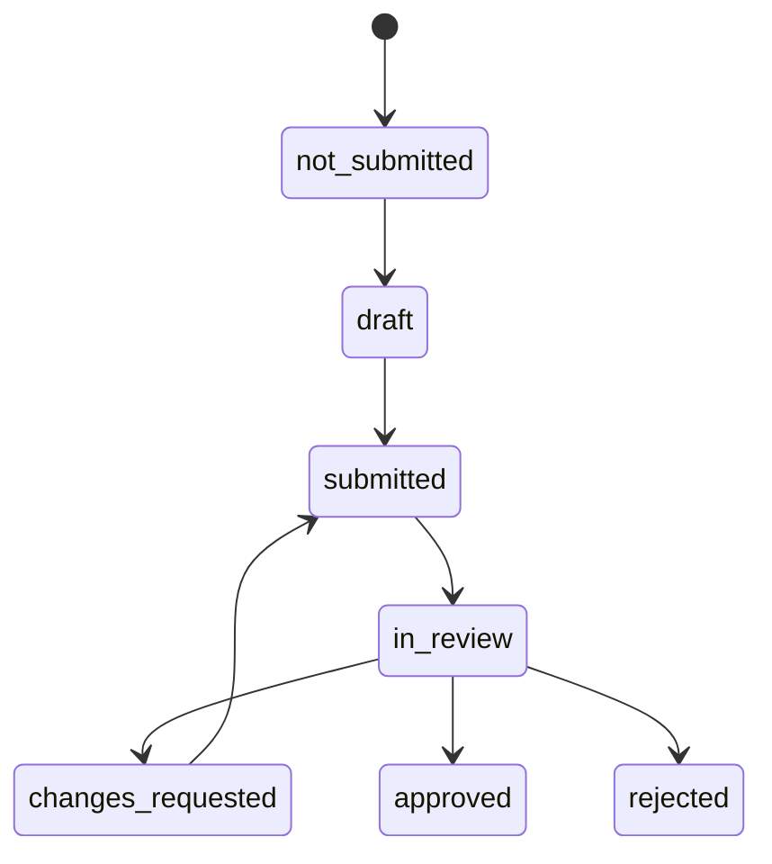

# SRS-06 任務、提交及同儕互評

## 1. 目的

把正確版本的表格分配給指定作答人及被評學生，保留自評、同儕及老師觀察的來源，並把內容覆核與發布分開。

## 2. 功能要求

| ID | 要求 | 狀態 | 階段 |
|---|---|---|---|
| SUB-FR-001 | 每項任務須記錄活動、表格版本、分配人、開放／到期時間及資格規則。 | 已確認架構 | P1 |
| SUB-FR-002 | 每名收件人須分開記錄作答人及被評學生。 | 已確認架構 | P1 |
| SUB-FR-003 | 觀點採用 `student_self_report`、`teacher_observation`、`peer_observation` 或日後獲批值。 | 已確認架構 | P1 |
| SUB-FR-004 | 內容、處理及可見狀態須分開。 | 已確認 M-09/M-19 | P0 |
| SUB-FR-005 | 同儕互評須由老師／TA 明確分配指定同學；只參加同一活動並不足以取得互評權。 | 已確認架構 | P1 |
| SUB-FR-006 | 同儕只可看該項任務所需資料，不可看被評學生的其他紀錄。 | 建議架構 | P1 |
| SUB-FR-007 | 按政策需要，負面或敏感同儕內容先進入審核。 | 建議；互評政策待定 | P1 |
| SUB-FR-008 | 未交紀錄保持缺漏，並在負責老師待辦顯示。 | 已確認 M-11 | P0 |
| SUB-FR-009 | 退回修改時建立新版本，不可刪去原提交。 | 建議架構 | P1 |
| SUB-FR-010 | 提交覆核須使用校方獨立設定的精簡流程；符合政策條件時可自動處理，所有例外則進入人工佇列。 | 系統分析架構決定已批准（2026-10-28） | P1 |
| SUB-FR-011 | 人工作出提交決定時須有具名合資格分派及記錄理由；未分派、被拒接或逾期工作須進入設定的升級處理佇列。 | 系統分析架構決定已批准（2026-10-28） | P1 |
| SUB-FR-012 | 逾期狀態須由提交時間及不可改寫的期限歷史推算。未完成任務採用現行有效期限；已提交修訂須區分提交當時與現行期限。日後延期不可抹去歷史比較結果。 | 系統分析員方向；2026-11-18 對齊；並非 BHSS／JC 批准 | P1 |
| SUB-FR-013 | 除非另有關閉或狀態規則限制，逾期草稿仍可儲存／提交。已提交內容維持凍結，須經獲授權退回／重開建立後繼修訂；遲交回應不可靜默改寫已發布快照。 | 系統分析員方向；2026-11-18 對齊；並非 BHSS／JC 批准 | P1 |
| SUB-FR-014 | 系統須支援下述階段流程及不可改寫的階段／表格／回應版本：預設一個結束階段，可新增評估，問卷修改獨立管治，不可自動比較不同量表。 | 系統分析員方向，2026-11-18；並非 BHSS／JC 批准 | P1 |

## 3. 生命週期

批核不等同可見。發布另按 `unpublished → published_to_portfolio → withdrawn` 處理。

## 4. 欄位規則

| 欄位 | 規則 | 限制 |
|---|---|---|
| 任務名稱／指引 | 必填 | 1–4,000 個字元 |
| 開放／到期時間 | 學生／互評任務必填 | 開放 ≤ 到期；具體時間政策待定 |
| 作答人 | 必填 | 每行恰好 1 名有效用戶 |
| 被評學生 | 必填 | 恰好 1 名學生 |
| 同儕覆核人 | 同儕觀察必填 | 1 名指定同學；不可與被評人相同 |
| 表格版本 | 必填 | 1 個已批核、已發布、有效版本 |
| 數字答案 | 按問題類型 | 只可用量表最小／最大值 |
| 文字答案 | 按問題類型 | 1–4,000 個字元 |
| 修訂版本 | 必填 | 1–9,999 整數 |
| 退回／拒絕原因 | 必填 | 1–4,000 個字元 |

## 5. 鎖定及修正

- 草稿由作答人修改。
- 提交後凍結該版本。
- 覆核人可按範圍退回、批核或拒絕。
- 退回後建立引用舊版本的新草稿。
- 行政修正只可追加，並記錄原因及處理人。
- 最終重開權限待定 L-04/M-12。

### 推算逾期狀態

學生及老師的活動回應預設於活動結束後一個曆月到期；獲授權人員可延長個別活動期限，即使原定期限已過亦可處理。每次期限變更須以一項審計紀錄保存前後值、操作人、原因、生效時間及所需批核。到期與另行設定的關閉時間不同；如沒有獨立關閉規則，逾期草稿仍可儲存及提交。已提交修訂仍須先退回或重開才可更改。

保存實際提交時間及不可改寫的期限變更；不以提交紀錄內的逾期標記作權威依據。未完成任務按目前時間與現行有效期限推算；已提交修訂則可分別比較及標示提交當時的有效期限，以及需要時的現行期限。日後延期不會抹去原始審計資料或改變提交當時的比較結果。伺服器須按學校範圍及政策驗證；已發布快照須透過後續覆核處理。曆月底、截止時刻是否包含、時區、延期權責及是否硬性關閉仍待確認。

驗收例子：活動 3 月 1 日結束，原期限 4 月 1 日，4 月 5 日提交；4 月 10 日延期至 6 月 1 日。該提交按 4 月 5 日當時期限屬逾期，按現行 6 月 1 日期限則屬準時；兩者均由時間及歷史推算，不永久標記在提交上。

## 6. 驗收情境

- 學生不可搜尋或評核未獲分配的同學。
- 遲交會被標示，但除非政策指定，不會靜默刪除。
- 已批核提交仍須另行發布才可讓學生看見。
- 老師看到未交名單，但系統不會把它們計作零分。
- 退回及再提交後，兩個版本均可追溯。

### 跨文件待決事項

DOCX 的學生發起活動碼屬內部方向；SRS-06 SUB-FR-005 目前要求教師／TA 分派。保留明確評閱人與對象分派；以活動碼建立分派的授權人、有效期及資格須先釐清。

## 活動階段評估

**系統分析員方向，2026-11-18；並非 BHSS／JC 批准。** 此方向取代「每項活動只能使用一份問卷」的限制。活動可有一個或多個評估／回饋階段，預設只設一個結束階段，安排於相關匯報學段結束時評估。獲授權的活動編輯者可新增開始、過程、結束或自訂階段，並調整日期。不同階段可採用不同問卷；每個已發布階段固定引用一個已批核、已發布且不可改寫的表格版本，內含學生、老師及同儕區塊。同一階段暫不假設可放多份問卷；有需要時分設具名階段。

關係為：活動 → 評估階段 → 階段修訂 → 表格分派 → 作答對象 → 提交 → 答案／佐證。階段須記錄穩定識別碼、活動、名稱／類型、次序、覆核／匯報學段、評估日期、佐證涵蓋起迄日期、開放／到期／可選關閉時間、問卷版本、作答群組及具名覆核分派。階段修訂保留作者、原因、批核、發布及被取代版本。分派、提交、佐證及觀察均須保留階段和確實的階段／表格版本。以上為概念模型新增要求，資料庫遷移及 API／介面尚待實作。

活動歸屬學段與評估階段的匯報學段須分開。橫跨 P1–P2 的同一活動，可在 P1 作過程評估、P2 作結束評估。P1 階段答案仍可作回饋比較，但仍在進行的 P1–P2 活動不納入 P1 學段評估，除非負責人提出的提早結束已生效。合資格已完成活動須凍結佐證範圍及覆核決定。評估階段不是另一項活動，亦不會自動產生正式評級或發布報告。

活動批核後新增或更換階段／問卷，屬受管制活動修改。活動負責人或獲授權編輯者提出活動／階段後繼修訂，按政策送批；沒有修改權的老師提出修改要求。草稿或未獲批問卷不可分派作答，問卷批核及發布仍獨立處理。既有分派、答案及已發布結果保留原版本。已有提交的階段不可改名、覆寫或刪除來冒充新一次評估；須記錄原因以取消／停用未來工作，或建立後繼階段／分派並明確指定作答人。後繼版本獲批及發布前，原已批核設定繼續生效。

評估日期、回應到期日及關閉時間須分開。預設結束階段沿用活動完結後一個曆月的回應期限，除非明確修改；新增階段須明訂開放及到期日，並與評估日期核對，不可把最終活動期限靜默套用到開始／過程階段。如學段末評估日期與預設回應期限衝突，發布前須明確處理時間安排。各階段沿用延期審計及逾期推算規則。同儕期限、日期預設值的優先次序及延期權責仍按 M-28／L-04 待確認。

比較畫面並列各階段的問卷／版本、題目／能力、答案量表、觀點、日期及佐證。可用不同問卷，但不可直接相減或平均不相關答案。數值變化須建基於明確獲批的可比較題目／量表，或相同 Rubric 版本及範疇；否則只作質性比較。同一佐證跨階段引用仍保留相同識別碼，不可因出現兩次而重複計算。採用階段內或累積佐證、結束評估是否取代早期結果，以及正式匯總規則仍待設定；本次不引入新的自動升級公式。

### 活動結束及提早結束

**系統分析員補充，2026-11-18；並非 BHSS／JC 批准。** 活動負責人可提出提早結束要求，記錄建議實際結束日期、原因、提出人及時間，並按既有活動修改／批核流程處理。只有已生效的完成／結束狀態，才符合納入學段評估的資格；待批的提早結束要求不等於完成。如負責人未結束活動而活動仍在進行，該活動不納入該次學段評估輸入及計算。顯示「進行中 — 未納入」，不當作零分；活動歷史、媒體、階段答案及回饋仍保留。

此規則取代先前「仍在進行的 P1–P2 活動可憑 P1 階段納入 P1 正式結果」的假設。開始／過程階段仍可收集及比較回饋，但不可繞過活動完成資格。已完成活動仍須有獲接納佐證、經人員確認的觀察及正常發布決定；結束活動不會自動給予階段。如沒有其他合資格結果，沿用既有「上一學年評級／尚未評估」顯示規則。

提早結束生效時，記錄前後結束日期，以及後續階段和未完成任務的處理。按已生效的實際結束日期，經既有期限變更審計流程重新處理預設回應期限；明確延期及已提交歷史須保留供覆核，不可靜默縮短。後續階段須明確改期或取消並記錄原因，不可靜默刪除。學段末評估可在不納入進行中活動的情況下繼續。確實完成截點、報告發布後才完成的活動如何處理，以及獨立關閉／重開權責，仍按 M-28／L-04 待確認；已發布結果不可靜默改寫。
