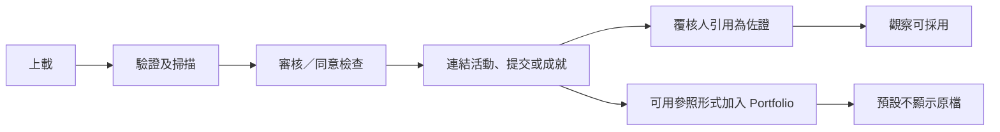

# SRS-07 佐證、媒體、同意及校外成就

## 1. 目的

安全保留佐證，同時把擁有權、評估用途、Portfolio 顯示及原始媒體存取分開決定。

## 2. 功能要求

| ID | 要求 | 狀態 | 階段 |
|---|---|---|---|
| EVD-FR-001 | 媒體須記錄擁有人、上載人、來源、MIME、大小、雜湊、儲存鍵、審核／可見狀態及時間。 | 已確認架構 | P0 |
| EVD-FR-002 | 活動、提交、評語及 Portfolio 以關聯紀錄引用同一資產，不複製檔案。 | 已確認架構 | P1 |
| EVD-FR-003 | 查看原檔須同時符合紀錄範圍及有效同意／授權。 | 已確認存取模型 | P0 |
| EVD-FR-004 | 刪除預設為軟性停用，記錄原因、處理人及時間；歷史引用保留。 | 已確認工作模型 | P0 |
| EVD-FR-005 | 開放檔案前驗證聲稱及偵測到的 MIME、大小、副檔名及惡意內容。 | 建議架構 | P1 |
| EVD-FR-006 | JPG/PNG 產生安全預覽圖；介面不直接使用原檔。 | POC 對齊建議 | P0 |
| EVD-FR-007 | 只有被評語／觀察明確引用的資料，才成為評估佐證。 | 已確認架構 | P1 |
| EVD-FR-008 | 校外成就保留發出機構、日期、類別、級別／難度、結果、證書、反思及學生自選 VASK。 | 已確認 H-06/M-15 | P1 |
| EVD-FR-009 | 校外成就會建立佐證清單項目；沒有合適的人員觀察及發布權責時，不會產生正式 Rubric 結果。 | 已確認 H-06/M-15；10 月 26 日修訂 | P1 |
| EVD-FR-010 | 同意、保留期及家長規則保持可設定。 | 政策待定 H-07/L-02 | P1 |
| EVD-FR-011 | 媒體可由平台管理，亦可保留在校方認可的外部儲存位置，並由連接器按媒體識別碼取得。 | 部分已有方向 L-08；Discussed on Meeting Oct 26 - kickstart | P1 |
| EVD-FR-012 | 每次讀取外部媒體時，均須重新檢查使用者角色、獲分配範圍、同意狀態、紀錄生命週期及連接器是否可用。 | 建議架構 | P1 |
| EVD-FR-013 | 連接器可提供 metadata（中繼資料）、短效授權 URL，或經平台轉送媒體內容；瀏覽器回應不可包含伺服器實際路徑或儲存服務憑證。 | 部分已有方向 L-08；Discussed on Meeting Oct 26 - kickstart | P1 |
| EVD-FR-014 | 外部來源失效或存取權被撤銷時，系統仍須保留歷史佐證連結及資料來源，並把原始媒體標示為無法讀取。 | 建議架構 | P1 |

## 3. 佐證及可見流程

## 4. 上載限制

| 類型 | 格式 | 最大值 | 階段／狀態 |
|---|---|---:|---|
| 圖片 | `.jpg`, `.jpeg`, `.png` | 8 MiB | P0 臨時上限 |
| 試算表 | `.xlsx`, `.csv` | 4 MiB | P0 臨時上限 |
| 文件／證書 | `.pdf` 及獲批文件類型 | 20 MiB | P1 臨時上限；類型待定 |
| 音訊 | 獲批音訊類型 | 100 MiB | P2 臨時上限 |
| 影片 | 獲批影片類型 | 500 MiB | P2 臨時上限 |
| 每次上載數量 | 可用類型 | 20 | 臨時上限 |
| 檔案名稱 | 任何獲准檔案 | 255 個字元 | 臨時上限 |

介面須在選檔前列出有效格式及最大值，錯誤亦在操作旁顯示；不得把臨時數值寫成最終政策。

## 5. 校外成就欄位

| 欄位 | 規則 | 限制 |
|---|---|---|
| 名稱／機構／類別／結果 | 必填 | 每項 1–200 個字元 |
| 日期 | 必填 | 有效日期，不可不合理地在未來 |
| 級別／難度 | 可留空但應提示 | 0–200 個字元 |
| 反思 | 要求發布時必填 | 1–4,000 個字元；內容最低要求待定 |
| VASK | 提交時最少一項 | 1–100 項臨時上限 |
| 證書／佐證 | 聲稱證書時最少一項 | 每次最多 20 個檔案 |
| Rubric 貢獻 | 預設 `none` | 須另有由人員確認的觀察及獲授權發布 |

## 6. 存取及停用

- 學生：本人上載及獲准活動媒體。
- 老師／TA：評估所需且同意範圍准許的佐證。
- 職員：委派審核佇列。
- SchoolAdmin：資料及政策；原檔仍須授權。
- 停用原因 1–4,000 個字元，並記錄 `disabled_by`、`disabled_at`；復原也須審計。

## 7. 驗收情境

- 偽裝成 PNG 的可執行檔會被拒絕。
- 圖片會產生預覽，原檔保持受保護。
- 老師刪除媒體時實際作軟性停用，原因及處理人可追溯。
- 鋼琴比賽證書不會自行推算 1–16 階段。

