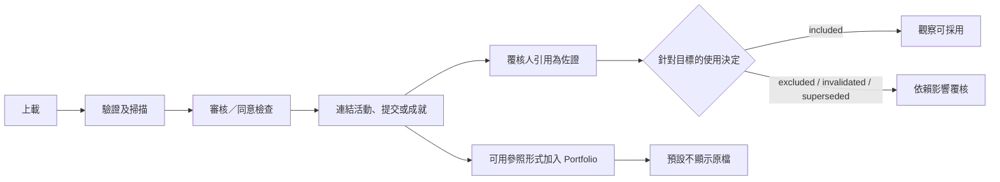

# SRS-07 佐證、媒體、同意及校外成就

## 1. 目的

安全保留佐證，同時把擁有權、評估用途、Portfolio 顯示及原始媒體存取分開決定。

## 2. 功能要求

| ID | 要求 | 狀態 | 階段 |
|---|---|---|---|
| EVD-FR-001 | 媒體須記錄擁有人、上載人、來源、MIME、大小、雜湊、儲存鍵、審核／可見狀態及時間。 | 已確認架構 | P0 |
| EVD-FR-002 | 活動、提交、評語及 Portfolio 以關聯紀錄引用同一資產，不複製檔案。 | 已確認架構 | P1 |
| EVD-FR-003 | 查看原檔須同時符合紀錄範圍及有效同意／授權。 | 已確認存取模型 | P0 |
| EVD-FR-004 | 刪除預設為軟性停用，記錄原因、處理人及時間；歷史引用保留。 | 已確認工作模型 | P0 |
| EVD-FR-005 | 開放檔案前驗證聲稱及偵測到的 MIME、大小、副檔名及惡意內容。 | 建議架構 | P1 |
| EVD-FR-006 | JPG/PNG 產生安全預覽圖；介面不直接使用原檔。 | POC 對齊建議 | P0 |
| EVD-FR-007 | 只有被評語／觀察明確引用的資料，才成為評估佐證。 | 已確認架構 | P1 |
| EVD-FR-008 | 校外成就保留發出機構、日期、類別、級別／難度、結果、證書、反思及學生自選 VASK。 | 已確認 H-06/M-15 | P1 |
| EVD-FR-009 | 校外成就會建立佐證清單項目；沒有合適的人員觀察及發布權責時，不會產生正式 Rubric 結果。 | 已確認 H-06/M-15；10 月 26 日修訂 | P1 |
| EVD-FR-010 | 同意、保留期及家長規則保持可設定。 | 政策待定 H-07/L-02 | P1 |
| EVD-FR-011 | 媒體可由平台管理，亦可保留在校方認可的外部儲存位置，並由連接器按媒體識別碼取得。 | 部分已有方向 L-08；Discussed on Meeting Oct 26 - kickstart | P1 |
| EVD-FR-012 | 每次讀取外部媒體時，均須重新檢查使用者角色、獲分配範圍、同意狀態、紀錄生命週期及連接器是否可用。 | 建議架構 | P1 |
| EVD-FR-013 | 連接器可提供 metadata（中繼資料）、短效授權 URL，或經平台轉送媒體內容；瀏覽器回應不可包含伺服器實際路徑或儲存服務憑證。 | 部分已有方向 L-08；Discussed on Meeting Oct 26 - kickstart | P1 |
| EVD-FR-014 | 外部來源失效或存取權被撤銷時，系統仍須保留歷史佐證連結及資料來源，並把原始媒體標示為無法讀取。 | 建議架構 | P1 |
| EVD-FR-015 | 文字／媒體擷取供應商的結果只可保存為連結原始資產及處理工作的「未接納候選」；不可直接建立已接納佐證、學生身份連結或已發布評估。 | 系統分析架構決定已批准（2026-10-27） | P1/P2 |
| EVD-FR-016 | 每項媒體資產、外部連接器、擷取工作及衍生結果均須限定所屬學校；當目前 `school_id` 不相符時，存取必須失敗。 | 系統分析架構決定已批准（2026-10-27） | P0/P1 |
| EVD-FR-017 | 每項佐證清單紀錄須採用可設定的 `proof_type_definition`，並分開保存觀點、來源及申報的作者／AI 輔助情況。AI 分析輸出須標示為衍生內容，不會因為提出 Rubric 階段便成為一種佐證。 | 系統分析架構決定已批准（2026-10-27） | P1 |
| EVD-FR-018 | 獲分派而具權限的覆核人須可針對某項觀察、Portfolio 陳述或生成清單，建立 `included`、`excluded`、`invalidated` 或 `superseded` 的佐證使用決定，並保存原因、操作人及時間，而不刪除原始佐證。 | 系統分析架構決定已批准（2026-10-27） | P1 |
| EVD-FR-019 | 如身份／佐證關聯全域有誤，包括錯誤人臉配對，系統須更正或使該關聯本身失效；原始候選及決定歷史仍須可追溯。 | 系統分析架構決定已批准（2026-10-27） | P1/P2 |
| EVD-FR-020 | 已使用佐證被排除、更正或判定無效時，系統須執行依賴影響檢查，並把受影響的建議、觀察、陳述及目前快照標記為 `needs_review` 或 `stale`；不可自動改用其他來源或結果。 | 系統分析架構決定已批准（2026-10-27） | P1 |
| EVD-FR-021 | 媒體資料須使用穩定資產紀錄，並另以關聯紀錄連結活動。資產須保留標題、原始檔名、類型、來源／參照、擁有人、上載人／時間、同意、可見範圍、審核、處理、擷取／保留日期、更新及軟性停用資料。 | 系統分析架構決定已批准（2026-10-30）；並非 BHSS／JC 批准 | P0/P1 |
| EVD-FR-022 | 每項擷取須保留媒體資產、擷取類型、供應商／版本、要求人／時間、處理狀態、開始時間、完成時間、候選內容、覆核狀態、覆核人／時間／原因、修正內容及取代關係。 | 系統分析架構決定已批准（2026-10-30）；並非 BHSS／JC 批准 | P1/P2 |
| EVD-FR-023 | 媒體資料查詢須由伺服器按已獲准活動、類型、生命週期、處理狀態、同意狀態及搜尋字詞篩選並分頁。回傳紀錄前須先驗證分派、權限、學校及同意範圍；資料回應不得包含儲存參照或伺服器實際路徑。 | 系統分析架構決定已批准（2026-10-30）；並非 BHSS／JC 批准 | P0/P1 |
| EVD-FR-024 | 建立媒體資料、要求擷取、覆核擷取及軟性停用須是四項分開的受保護操作。尚在排隊或未完成的擷取不可獲接納；已接納擷取仍只是經覆核候選，不是正式評估。 | 系統分析架構決定已批准（2026-10-30）；並非 BHSS／JC 批准 | P1/P2 |
| EVD-FR-025 | 系統須支援下述逐人臉區域選取、身份更正、未知／非學生分類、漏偵測區域編輯及後續影響覆核；更正不可變成共用人物標籤改名。 | 系統分析員方向，2026-11-18；並非 BHSS／JC 批准 | P1 |

## 3. 佐證及可見流程

## 4. 上載限制

| 類型 | 格式 | 最大值 | 階段／狀態 |
|---|---|---:|---|
| 圖片 | `.jpg`, `.jpeg`, `.png` | 8 MiB | P0 臨時上限 |
| 試算表 | `.xlsx`, `.csv` | 4 MiB | P0 臨時上限 |
| 文件／證書 | `.pdf` 及獲批文件類型 | 20 MiB | P1 臨時上限；類型待定 |
| 音訊 | 獲批音訊類型 | 100 MiB | P2 臨時上限 |
| 影片 | 獲批影片類型 | 500 MiB | P2 臨時上限 |
| 每次上載數量 | 可用類型 | 20 | 臨時上限 |
| 檔案名稱 | 任何獲准檔案 | 255 個字元 | 臨時上限 |

介面須在選檔前列出有效格式及最大值，錯誤亦在操作旁顯示；不得把臨時數值寫成最終政策。

## 5. 校外成就欄位

| 欄位 | 規則 | 限制 |
|---|---|---|
| 名稱／機構／類別／結果 | 必填 | 每項 1–200 個字元 |
| 日期 | 必填 | 有效日期，不可不合理地在未來 |
| 級別／難度 | 可留空但應提示 | 0–200 個字元 |
| 反思 | 要求發布時必填 | 1–4,000 個字元；內容最低要求待定 |
| VASK | 提交時最少一項 | 1–100 項臨時上限 |
| 證書／佐證 | 聲稱證書時最少一項 | 每次最多 20 個檔案 |
| Rubric 貢獻 | 預設 `none` | 須另有由人員確認的觀察及獲授權發布 |

## 6. 存取及停用

- 學生：本人上載及獲准活動媒體。
- 老師／TA：評估所需且同意範圍准許的佐證。
- 職員：委派審核佇列。
- SchoolAdmin：資料及政策；原檔仍須授權。
- 停用原因 1–4,000 個字元，並記錄 `disabled_by`、`disabled_at`；復原也須審計。

同一操作畫面只顯示該紀錄適用的人工操作：排除某一次使用、更正擷取文字／講者、更正或拒絕身份關聯、停用／限制媒體、取代觀察，或要求撤回／重新發出受影響發布內容。所有操作均保留原始紀錄並追加決定；介面所稱「移除」不代表硬刪除。

## 7. 驗收情境

- 偽裝成 PNG 的可執行檔會被拒絕。
- 圖片會產生預覽，原檔保持受保護。
- 老師刪除媒體時實際作軟性停用，原因及處理人可追溯。
- 鋼琴比賽證書不會自行推算 1–16 階段。
- 從一項 Rubric 觀察排除佐證，不會移除該佐證在其他有效用途的關係。
- 拒絕一項先前確認但其後證實錯誤的人臉配對時，須移除由此產生的學生／活動佐證關聯，並把依賴結果送往影響覆核。
- 只列資料的清單不會顯示資產儲存參照；登記資產時，如不透明參照外觀似本機檔案路徑，系統須拒絕。
- 擷取須分開記錄要求、開始及完成階段，並不可在處理完成前覆核。
- 停用媒體資產時須新增生命週期事件，並保留活動連結、擷取歷史、操作人、原因及時間。

### 跨文件待決事項

未決差異：DOCX 建議圖片 50 MB／影片 2 GB 及較廣格式；SRS-07 保留圖片 8 MiB／影片 500 MiB 臨時上限。不可靜默當作正式政策啟用；須由 L-02 選定及統一合約。

## 相片人臉區域辨識及更正

**系統分析員方向，2026-11-18；並非 BHSS／JC 批准。** 更正對象是相片內指定的人臉區域，不是共用標籤或整張相片。每項媒體可有零個或多個偵測／手動框選區域，各有穩定識別碼、原圖／版本、標準化座標框及偵測來源。身份候選及人工決定分開並保留版本；重新處理不可靜默移動或取代已確認的區域／身份連結。

獲授權活動負責人／老師開啟相片，看到編號人臉框及目前建議／已確認身份或「未知」，點選一個框後搜尋現有獲准查看的名單／學生身份。同時顯示局部圖、原圖背景及可用而獲准的參考相片。覆核人可改為另一學生、標示非學生／訪客（包括長者）、保留未知或拒絕錯誤偵測。可重用現有身份標籤，但未知人臉毋須先有學生標籤；不可按外貌建立學生或猜測長者身份。

編輯器須支援補畫漏偵測的人臉框及調整所選框，並記錄原因，原圖保持不變。學生可提出更正要求，但不可自行把人臉改派給他人。老師職位或活動擁有權不會取代所需的覆核分派／功能權限。重複人臉、同一學生有多個框、遮擋及無法辨識均屬有效覆核情況；不在活動名單內的學生須先處理身份／名單問題，不可靜默加入。保存前後連結、操作人、時間及原因；更正只作用於該區域，不會全域改名或自動更改其他相片。

撤銷錯誤學生連結，經覆核處理適用連結，並把相關佐證、AI 候選、觀察及報告標示為待影響覆核。原始候選及歷次決定須保留；已發布結果須撤回或建立經覆核的後繼版本，不可靜默重算。辨認學生出現在相片中，不代表學生已展示某項技能。正式保安、資料保留及生物辨識／供應商政策細節仍延後處理；此節只界定功能更正流程。

## 第二批修訂 相片用途及描述資料

**系統分析員補充，2026-11-18；並非 BHSS／JC 批准。** 現階段相片用途是找出學生人臉，經人員確認學生連結後，把獲准查看的相片顯示給該學生。確認人臉連結不等於確認出席、行為、活動成果或 Rubric 階段。學生配對忽略老師、未知及非學生人士，毋須為他們命名、登記參加或建立人物檔案。忽略身份不代表已從原圖移除或模糊處理他們。

相片最好附有描述，但並非必填。除媒體標題外，保存人手提供的相片說明／描述、來源／作者、記錄時間及修訂歷史，並連結活動代碼及已知拍攝時間。相片情境須與活動簡介及預期 VASK 標籤分開。說明只代表作者提供的內容，不會獨立證實行為或辨認相中每個人。缺少說明須保持缺漏，不阻礙學生相片配對。以上為擬定資料要求，不代表 v2 已有相應欄位。

本地視覺模型仍可掃描畫面，產生「兩個人正在互動」一類概括觀察。這類輸出另存為未經確認的機器描述，保留模型／提示版本、處理時間及原圖來源；不可填入人手描述欄位、確認身份、推斷活動目的，或斷言指定學生的行為、意圖、技能或成就。概括畫面描述不可當作已接納的行為佐證或 Rubric 結果依據。人臉配對與畫面描述須分開處理及覆核。

利用標籤輔助辨認行為不在現階段範圍：不把 VASK 或學生身份標籤傳給本地模型，以產生個人化行為解釋。日後如客戶提出需要，須另行決定範圍及驗證準確度與私隱安排；本地部署本身不代表已適合此用途。此限制不影響活動的描述標籤或向學生顯示相片所需的身份連結。

逐人臉區域更正流程保留：獲授權覆核人選定人臉框並更正學生連結。老師／未知人士的區域不參與學生相片分發，毋須建立訪客身份目錄。錯配更正須移除錯誤學生連結，並標示其依賴資料供覆核；人臉出現不會自動產生評估。
