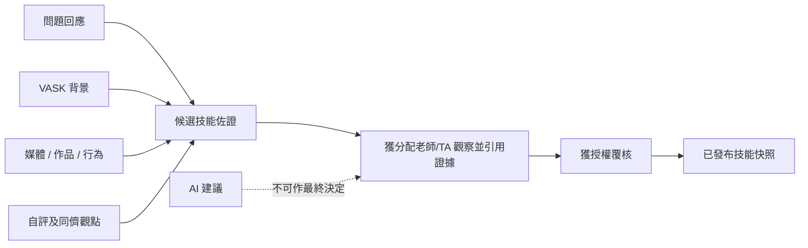

# SRS-08 評估、八項技能及十六階段

## 1. 目的

按八項技能及各自 16 個階段記錄有佐證的觀察，同時保留不同觀點及人工評核權。

## 2. 固定 Framework 模型

| 規則 | 數值 |
|---|---|
| 技能 | 恰好 8 項，按獲批次序 1–8 顯示 |
| 每項技能階段 | 恰好 16 個，整數 1–16 |
| 發展顯示分組 | 1–4 起步；5–8 中階；9–12 進階；13–16 熟練 |
| 表現一致程度 | 整數 1–6 |
| 現有問卷量表 | 整數 1–6 |

以上分組只方便顯示，不是另一套分數。

## 3. 功能要求

| ID | 要求 | 狀態 | 階段 |
|---|---|---|---|
| ASM-FR-001 | Framework、技能及階段定義須以版本化參考資料保存。 | 已確認架構 | P1 |
| ASM-FR-002 | 觀察須記錄學生、活動、作者、觀點、技能、階段、一致程度、時間、評語及佐證。 | 已確認架構 | P1 |
| ASM-FR-003 | 觀察階段及表現一致程度須分開儲存。 | 已確認架構 | P1 |
| ASM-FR-004 | 自評、同儕、老師及外部專業意見保持為不同來源紀錄。 | 已確認 M-07 方向 | P1 |
| ASM-FR-005 | 缺少佐證或評級時顯示缺漏／未確認，不可當作零。 | 已確認 M-11／H-04 建議 | P0 |
| ASM-FR-006 | 問題對應、VASK、學科成績、證書或 AI 內容均不可自動發布技能階段。 | 已確認工作模型 | P0 |
| ASM-FR-007 | 現行架構要求老師／TA 人工確認後，活動佐證才可影響正式階段。 | 建議；最終權限 H-03/H-04 待定 | P1 |
| ASM-FR-008 | 學科成績只可作輔助佐證，並須使用指定評分制度。 | 已確認工作模型 | P1 |
| ASM-FR-009 | 已發布階段須引用所用佐證及評核來源／工具。 | 已確認架構 | P1 |
| ASM-FR-010 | 未確認觀察合併公式、上限、門檻或時間衰減前，不可實作自動匯總。 | 政策待定 H-03/M-07 | P1 |

## 4. 觀察欄位

| 欄位 | 必填 | 範圍 |
|---|---|---|
| 技能 | 是 | 8 項有效技能之一 |
| 觀察階段 | 按情況 | 1–16 整數；空值表示未評 |
| 一致程度 | 有階段時必填 | 1–6 整數 |
| 信心程度 | 可留空 | 設定列舉值，不可取代一致程度 |
| 評語 | 用於進展時必填 | 1–4,000 個字元 |
| 佐證引用 | 用於進展時必填 | 1–100 項臨時上限 |
| 建議下一階段 | 可留空 | 1–16；一般不低於現階段，例外須交代理由 |
| 來源工具 | 正式使用時必填 | 1–64 個字元代碼 |

## 5. 由佐證至發布

## 6. 結果顯示

- 候選／未確認佐證可向獲授權覆核人顯示，但須清楚標示。
- 學生只在發布後看見老師答案、評語及技能結果。
- 雷達圖取自已發布快照；草稿佐證不可暗中改變圖表。
- 已發布紀錄退回修改時，按 M-19 撤回或由新版本取代，舊版本仍可追溯。

## 7. 驗收情境

- 介面及 API 拒絕 0、17 及小數階段，並顯示「請輸入 1 至 16 的整數」。
- 1–6 的問卷答案不可直接顯示為 1–16 階段。
- 缺少老師評級時，自評／互評只作未確認佐證。
- 同一項佐證可支持多項技能，但每項技能有獨立觀察。
- 重新計算不可覆蓋已發出的歷史快照。

