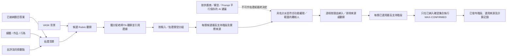

# SRS-08 評估、八項技能及十六階段

## 1. 目的

以可互換、有版本的 Rubric 記錄有佐證的觀察；首條正式流程先採用 Skills Builder 八項技能及各自 16 個階段，同時保留不同觀點及人工評核權。

## 2. 固定 Framework 模型

| 規則 | 數值 |
|---|---|
| 技能 | 恰好 8 項，按獲批次序 1–8 顯示 |
| 每項技能階段 | 恰好 16 個，整數 1–16 |
| 發展顯示分組 | 1–4 起步；5–8 中階；9–12 進階；13–16 熟練 |
| 表現一致程度 | 整數 1–6 |
| 現有問卷量表 | 整數 1–6 |

以上分組只方便顯示，不是另一套分數。

## 3. 功能要求

| ID | 要求 | 狀態 | 階段 |
|---|---|---|---|
| ASM-FR-001 | Framework、技能及階段定義須以版本化參考資料保存。 | 已確認架構 | P1 |
| ASM-FR-002 | 觀察須記錄學生、活動、作者、觀點、技能、階段、一致程度、時間、評語及佐證。 | 已確認架構 | P1 |
| ASM-FR-003 | 觀察階段及表現一致程度須分開儲存。 | 已確認架構 | P1 |
| ASM-FR-004 | 自評、同儕、老師及外部專業意見保持為不同來源紀錄。 | 已確認 M-07 方向 | P1 |
| ASM-FR-005 | 缺少佐證或評級時顯示缺漏／未確認，不可當作零。 | 已確認 M-11／H-04 建議 | P0 |
| ASM-FR-006 | 題目答案、VASK、學科成績、證書或 AI 內容均不可自動發布技能階段。 | 已確認工作模型 | P0 |
| ASM-FR-007 | 活動佐證如要影響正式階段，必須先由持有有效評估功能權限、相符工作範圍及具名分派的人員作人手確認；單是老師或教學助理職位不會取得此權限。 | 建議；最終權限 H-03/H-04 待定；已與 H-17 對齊 | P1 |
| ASM-FR-008 | 學科成績只可作輔助佐證，並須使用指定評分制度。 | 已確認工作模型 | P1 |
| ASM-FR-009 | 已發布階段須引用所用佐證及評核來源／工具。 | 已確認架構 | P1 |
| ASM-FR-010 | Skills Builder 現行政策只從獲分派而具權限的覆核人明確納入之觀察中，按每個範疇採用最高的已由人員確認符合階段；之前階段不是先決條件。 | 已確認 M-21；按 2026-10-27 系統分析架構決定釐清 | P0 |
| ASM-FR-011 | 日後如採用平均、上限、門檻或時間衰減，須另建有版本的政策；不同 Rubric 預設不可互相合併。 | 已確認 M-21；其他方法待定 | P1 |
| ASM-FR-012 | 目錄只有在具備評估能力、有版本範疇、排序階段及具體條件時，才可輸出雷達圖。 | 已確認 M-20 | P0 |
| ASM-FR-013 | 每項用作評估的佐證須保留可設定的輸入／佐證類型、觀點、來源及申報的作者來源（`human_authored`、`ai_assisted`、`ai_generated`、`unknown`）；以上資料不可合併成一個籠統來源標籤。 | 系統分析架構決定已批准（2026-10-27）；類型目錄 M-25 待確認 | P1 |
| ASM-FR-014 | 對於每個 Rubric 版本及範疇，獲授權覆核畫面須按輸入／佐證類型分組顯示所有合資格並經人員確認的候選觀察，以及每項目前的納入決定及實際來源連結。 | 系統分析架構決定已批准（2026-10-27） | P1 |
| ASM-FR-015 | 每類來源須顯示「候選最高支持階段」，並在已有取捨決定後另列「已選用最高支持階段」。兩者均須標示為佐證摘要而非正式結果；相關集合沒有合資格已確認觀察時須顯示 `not_enough_evidence`。 | 系統分析架構決定已批准（2026-10-27） | P1 |
| ASM-FR-016 | 獲具名分派、並持有所需功能權限及相符工作範圍的覆核人，可按單一「佐證—觀察」連結或整項觀察決定納入／排除，並記錄原因、操作人及時間。持有有效評估功能權限的人員可在獲分派範圍內提出／確認；SchoolAdmin 只具政策權限，除非另符合資格並獲覆核分派。 | 系統分析架構決定已批准（2026-10-27 至 2026-10-28）；校方最終權責仍按 H-03/H-04 待定 | P1 |
| ASM-FR-017 | `MAX-CONFIRMED` 只可計算同一 Rubric 版本及範疇內，已納入、合資格、未被撤銷且經人員確認的觀察。原始候選、已排除佐證、AI 建議及不同 Rubric 均不得納入。 | 系統分析架構決定已批准（2026-10-27） | P0/P1 |
| ASM-FR-018 | 正式結果須保留已納入觀察 ID、佐證連結、按來源類型分組的摘要、覆核決定／理由及完整計算記錄。 | 系統分析架構決定已批准（2026-10-27） | P1 |
| ASM-FR-019 | 系統須禁止沒有來源的階段覆蓋值。如要採用不同階段，只可透過納入／排除決定，或建立連結合資格佐證的新人員確認觀察。 | 系統分析架構決定已批准（2026-10-27） | P0/P1 |
| ASM-FR-020 | 已使用的佐證、身份關聯或觀察其後被排除、更正、判定無效或取代時，受影響結果須轉為 `needs_review`／`stale`；系統不可自動選取另一個階段。 | 系統分析架構決定已批准（2026-10-27） | P1 |
| ASM-FR-021 | SchoolAdmin 須從已驗證目錄中選擇校本生效並具評估能力的 Rubric 版本。新上載 Rubric 在範疇、排序階段、具體條件及發布能力通過驗證並經明確啟用前，維持草稿／不可用。 | 系統分析員方向已確認（2026-10-29）；並非 BHSS／JC 批准 | P0/P1 |
| ASM-FR-022 | 生效技能 Rubric 與生效活動能力標籤組合須分開設定並清楚顯示。更改任何一項均不可靜默重新解讀歷史觀察、標籤或已發布結果。 | 系統分析員方向已確認（2026-10-29）；並非 BHSS／JC 批准 | P0/P1 |
| ASM-FR-023 | SchoolAdmin 參考資料設定須提供兩個互相獨立、可由使用者管理的設定位置：`activity_labelling`（活動標籤）及 `assessment_rubric`（評估 Rubric）。每個上載目錄須申報所提供的功能；啟用其中一個設定，不會啟用或取代另一個。Skills Builder 1–16 及日後通過驗證的 RC360 目錄只屬評估 Rubric 候選；內容仍未確認的 RC360 不可啟用作正式評估。 | 系統分析員方向已確認（2026-10-29）；並非 BHSS／JC 批准 | P0/P1 |

## 4. 觀察欄位

| 欄位 | 必填 | 範圍 |
|---|---|---|
| 技能 | 是 | 8 項有效技能之一 |
| 觀察階段 | 按情況 | 1–16 整數；空值表示未評 |
| 一致程度 | 有階段時必填 | 1–6 整數 |
| 信心程度 | 可留空 | 設定列舉值，不可取代一致程度 |
| 評語 | 用於進展時必填 | 1–4,000 個字元 |
| 佐證引用 | 用於進展時必填 | 1–100 項臨時上限 |
| 輸入／佐證類型 | 用作比較時必填 | 一項有效 `proof_type_definition` |
| 作者來源 | 適用於提交作品／佐證時必填 | `human_authored`、`ai_assisted`、`ai_generated`、`unknown` |
| 使用決定 | 正式彙總前必填 | `included`、`excluded`、`invalidated`、`superseded` |
| 使用決定原因 | 非 `included` 時必填 | 1–4,000 個字元 |
| 建議下一階段 | 可留空 | 1–16；一般不低於現階段，例外須交代理由 |
| 來源工具 | 正式使用時必填 | 1–64 個字元代碼 |

## 5. 由佐證至發布

## 6. 結果顯示

- 候選／未確認佐證可向獲授權覆核人顯示，但須清楚標示。
- 覆核畫面須把每類來源的候選最高支持階段、已選用最高支持階段及正式採用結果分開顯示。
- 不同 LLM 建議只供職員比較；只有在保留原始佐證連結並轉為人員覆核觀察後，才可進一步採用。
- 學生只在發布後看見老師答案、評語及技能結果。
- 雷達圖取自已發布快照；草稿佐證不可暗中改變圖表。
- 已發布紀錄退回修改時，按 M-19 撤回或由新版本取代，舊版本仍可追溯。

## 7. 驗收情境

- 介面及 API 拒絕 0、17 及小數階段，並顯示「請輸入 1 至 16 的整數」。
- 1–6 的問卷答案不可直接顯示為 1–16 階段。
- 缺少老師評級時，自評／互評只作未確認佐證。
- 同一項佐證可支持多項技能，但每項技能有獨立觀察。
- 重新計算不可覆蓋已發出的歷史快照。
- 即使之前階段未全部符合，只要第 8 階段的條件已由人員確認，仍可發布第 8 階段。
- 同一範疇已有第 4 及第 8 階段的已確認觀察時，`MAX-CONFIRMED` 發布 8，並保存計算紀錄。
- 如第 8 階段觀察按理由被排除，而第 4 階段仍獲納入，`MAX-CONFIRMED` 發布 4；系統不會另存一個沒有來源的人工覆蓋值。
- 如媒體／人臉關聯其後證實屬於另一名學生，所有依賴該關聯的觀察及目前快照均須轉為待覆核，系統不可自動選用下一個可用階段。
- 兩個 LLM 可對同一凍結輸入提出不同建議；兩者均連同來源資料保留，互不覆蓋，也不會覆蓋正式結果。

## 8. Rubric 階段選取模式及生命週期

**狀態：2026 年 10 月 29 日確認的系統分析方向；不代表 BHSS 或 JC 已批准。** 每個不可變更的 Rubric 版本只可申報一種模式：

- `definition_only`：獲分派且具權限的覆核人，按有次序的階段定義及已引用的合資格佐證作決定；不需要數值分數。
- `score_range`：每項生效技能均須有完整、有效而不重疊的分數範圍，涵蓋 0 至 `score_out_of`。如沒有申報滿分，預設為 10 分；所選階段、定義及實際分數均保留於決定記錄。

生效版本不可直接修改。匯入或平台內修改會建立已驗證的後繼草稿；獲授權 SchoolAdmin 啟用後，舊版本只會對日後新用途被取代。先前已確認的觀察及已發布結果保留原有 Rubric 目錄／版本，不會自動轉換。

驗收：只按定義的覆核可在沒有分數下完成；如分數範圍缺漏、重疊、有空隙、起點高於 0 或終點低於申報滿分，分數模式不得啟用；更改生效 Rubric 不可改動歷史結果。

