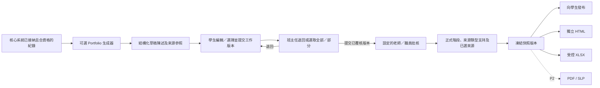

# SRS-09 Portfolio、Proud Moments 及匯出

## 1. 目的

發布可重現的時段 Portfolio，展示學生的活動、評語及有佐證的成長；預設不公開內部草稿及原始媒體。

## 2. 功能要求

| ID | 要求 | 狀態 | 階段 |
|---|---|---|---|
| PRT-FR-001 | Portfolio 須按學生及報告時段發布為有版本的快照。 | 已確認架構 | P1 |
| PRT-FR-002 | 每項快照內容須保留來源類型／ID、顯示部分／次序、納入決定及批核人。 | 已確認架構 | P1 |
| PRT-FR-003 | 學生及所屬班主任覆核內容後，由獲授權職員發布。 | 建議架構 | P1 |
| PRT-FR-004 | 預設隱藏原始媒體；Portfolio 可顯示佐證參照或附件數量。 | 已確認 M-18 | P1 |
| PRT-FR-005 | Proud Moments 記錄學生認為重要的選擇及反思，本身不會改變技能階段。 | 已確認工作模型 | P1 |
| PRT-FR-006 | Proud Moments 選擇期由職員明確開啟／關閉，不會自動啟用。 | 已確認 POC 方向 | P0 |
| PRT-FR-007 | 發布及撤回均須審計，並保留過往已發出版本。 | 已確認 M-19 | P1 |
| PRT-FR-008 | P1 支援獨立 HTML 快照及受控 XLSX 佐證清單；PDF/SLP 按 H-01 留待 P2。 | 建議 | P1/P2 |
| PRT-FR-009 | P1 外部收件人收取已批核輸出，不設平台帳戶。 | 建議 H-09 | P1 |
| PRT-FR-010 | Portfolio 生成工作只可接收核心系統已標示為「已接納且可納入 Portfolio」的佐證，並限定所選學生、學校及時段；未覆核的供應商輸出及被拒候選不得傳入。 | 系統分析架構決定已批准（2026-10-27） | P1 合約／P2 供應商 |
| PRT-FR-011 | 生成結果須為結構化草稿部分／陳述；每項以佐證為基礎的陳述須有一項或以上依次排列的來源參照，並保存生成器／Prompt 資料及警告。每個來源參照均須能在凍結輸入清單中找到。 | 系統分析架構決定已批准（2026-10-27） | P1 合約／P2 供應商 |
| PRT-FR-012 | 視覺化及匯出只可讀取經人工批核、有版本的快照 DTO，不可自行呼叫生成器或從原始佐證推導 Portfolio 陳述。 | 系統分析架構決定已批准（2026-10-27） | P1 |
| PRT-FR-013 | 每項已發布 Rubric／技能結果須保存正式階段、Rubric／版本／範疇、彙總政策、已納入觀察／佐證連結、覆核理由，以及按來源類型分組的摘要；每類顯示已選用最高支持階段或 `not_enough_evidence`。候選最高值及已排除項目只保留作覆核／審計資料，不會成為已發布評估值。 | 系統分析架構決定已批准（2026-10-27） | P1 |
| PRT-FR-014 | 已發布 Portfolio 可顯示正式階段，以及按類型分組、經私隱篩選的已選來源參照。已排除來源、被拒模型候選及內部理由只供獲授權覆核人查看，除非政策另行批准擴大披露。 | 系統分析架構決定已批准（2026-10-27） | P1 |
| PRT-FR-015 | 目前快照所使用的來源其後被排除、更正或判定無效時，快照須轉為 `stale`／`needs_review`，並撤回目前發布狀態，直至完成明確覆核及發布後繼版本；已發出版本仍須可重現。 | 系統分析架構決定已批准（2026-10-27） | P1 |
| PRT-FR-016 | 後繼快照／匯出須指出所取代版本及更正原因，不可靜默修改任何已發出檔案。 | 系統分析架構決定已批准（2026-10-27） | P1 |
| PRT-FR-017 | 系統須分開保存不可變 Portfolio 工作版本及已發布快照。學生編輯／提交、班主任覆核、職員批核及發布是互相獨立的狀態／操作。 | 系統分析架構決定已批准（2026-10-28） | P1 |
| PRT-FR-018 | 學生可自行編寫自我介紹，並從合資格難忘活動選取全部或部分內容。提交時須凍結供班主任覆核的版本。 | 系統分析架構決定已批准（2026-10-28） | P1 |
| PRT-FR-019 | 獲分派班主任可退回版本、從學生提交內容選取全部或部分項目，再把班主任已覆核後繼版本提交至設定的批核流程。 | 系統分析架構決定已批准（2026-10-28） | P1 |
| PRT-FR-020 | 學生工作區可顯示本人最新草稿／提交。所有正式、職員發布或對外畫面均須採用最新已批核版本；未批核版本不得覆蓋它。 | 系統分析架構決定已批准（2026-10-28） | P0/P1 |
| PRT-FR-021 | 如指定學生／時段從未有已批核版本，系統須在可篩選的職員及升級處理畫面顯示 `no_approved_version`，不可發布最新草稿。 | 系統分析架構決定已批准（2026-10-28） | P1 |
| PRT-FR-022 | Portfolio 批核採用校方設定的精簡流程。獲分派的合資格老師可作批核；批核與發布可分開，亦可由同一人兼任。 | 系統分析架構決定已批准（2026-10-28） | P1 |
| PRT-FR-023 | 學生原文須保留申報的人工作者身份；清楚標示為學生自述時，毋須為文字本身引用外部佐證。系統／LLM／Rubric 推導陳述須保留可追溯佐證／來源。 | 系統分析架構決定已批准（2026-10-28） | P1/P2 |
| PRT-FR-024 | 「作為學習者的我」須分開保存生成、老師修訂及最終批核敘述版本。獲授權班主任／編輯者只可修改該生成敘述／Prompt 內容，不可改動學生原文或其他教育人員觀察。 | 系統分析架構決定已批准（2026-10-28） | P1 合約／P2 生成 |
| PRT-FR-025 | 經老師修改的生成敘述在設定的老師／職員批核完成前仍屬草稿；系統須審計編輯者、原因、來源清單及文字差異。 | 系統分析架構決定已批准（2026-10-28） | P1/P2 |

## 3. 建議 Portfolio 內容

- 學生及報告時段資料
- 學術及非學術活動歷程
- 已發布老師評語
- 八項技能快照、正式階段、按來源類型分組的已選用支持摘要，以及經私隱篩選的已選佐證參照
- 學生反思、回顧與展望
- 學生選擇並獲准發布的 Proud Moments
- 快照版本、批核及匯出日期

最終正式輸出組合仍屬 H-01 待定。

## 4. Proud Moments 欄位

| 欄位 | 規則 | 限制 |
|---|---|---|
| 選擇來源 | 必填 | 已覆核活動、校外成就或合資格佐證 |
| 反思 | 必填 | 1–4,000 個字元；內容最低要求待定 |
| 顯示次序 | 必填 | 1–24 整數臨時上限 |
| 最多選擇 | 可設定 | 臨時 24；最終政策待定 |
| 發布狀態 | 必填 | `unpublished`, `published_to_portfolio`, `withdrawn` |

## 5. 發布流程

## 6. 匯出控制

| 項目 | 上限／狀態 |
|---|---|
| 即時匯出行數 | 50,000；超出改用背景工作 |
| 檔案名稱 | 255 個字元 |
| 匯出原因／收件人 | 1–4,000 個字元；對外匯出必填 |
| 下載有效期 | 政策待定 L-07；採用有時限及需登入連結 |
| 類型 | `self_contained_html`, `evidence_xlsx`；`pdf_slp` 屬 P2 |

每份匯出記錄快照版本、產生人、收件人類別、範圍、檔案雜湊及時間。

## 7. 驗收情境

- 發布後建立不可變版本，即使即時活動資料繼續改動也不受影響。
- 撤回內容會從目前版本移除，但不刪除已發出歷史。
- 除非匯出政策明確准許，HTML/XLSX 不包含原始媒體。
- Proud Moment 不可提升技能階段。
- 外部收件人不能用匯出連結瀏覽平台。
- 如生成陳述引用不存在或不在輸入清單內的來源，系統須在人工覆核前拒絕該結果。
- 更換 Portfolio 生成器後，網頁及匯出使用的已批核快照 DTO 維持不變。
- Portfolio 會顯示正式階段所依據的已選來源，亦可分開列出例如老師觀察與學生反思各自的最高支持階段，但不會把兩者都當成正式階段。
- 一項已選來源其後被判定無效時，受影響的目前發布內容須撤回覆核；系統不可改寫已發出快照，也不可靜默改用另一個階段。
- 學生可繼續編輯新工作版本，而正式畫面仍顯示最新已批核版本。
- 班主任可一次提交 25 名已覆核學生，其餘學生繼續留在可篩選的未完成／沒有已批核版本佇列。
- 修改「作為學習者的我」時須保留生成文字、來源、老師修訂文字及最終批核，亦不會因此取得修改學生自我介紹的權限。

## 8. Portfolio Rubric 版本鎖定

**狀態：2026 年 10 月 29 日確認的系統分析方向；不代表 BHSS 或 JC 已批准。** 建立 Portfolio 工作版本時，系統保存當時生效並可作評估的 `rubric_catalogue_id`。學生提交、班主任覆核、批核紀錄、已發布快照、視覺化及匯出均沿用同一 ID／版本。啟用後繼 Rubric 只會影響其後新建立的工作版本；現有草稿、已提交版本及已發布快照不可被靜默重算、重新標籤或遷移。

編輯器、覆核畫面及已發布視覺化須向獲授權查看者顯示已鎖定的 Rubric 名稱、版本及 ID。已發布結果須保存所選技能範疇／階段、定義快照、實際納入的觀察／佐證、覆核決定，以及適用時的分數。

驗收：啟用後繼版本後，新建立的工作版本使用新版本；較早的工作版本及其已發布快照繼續解析並顯示原有 Rubric 版本。

## 學習者 Portfolio 區塊及欄位目錄

**系統分析員方向，2026-11-18；並非 BHSS／JC 批准。** Rethinking Assessment 圖片只供結構參考，不是最終頁面規格。新 Portfolio 會與參考圖及現有 POC 不同。本次未指定學科分數區塊；學術強項／待發展之處建基於有佐證的學習經歷，不可杜撰分數或假設已有成績匯入。

**核對結果：** Core 已有 portfolio_template_sections（內容／來源類型、次序、版面及顯示方式）、portfolio_version_items（來源、選取、作者及學生文字）及 learner_narrative_versions（生成／修改／批核版本）。SRS-09 已有 Portfolio 版本覆核，SRS-13 V2-FR-044 的興趣規則仍待定。這些是共用基礎，並非以下完整區塊欄位合約。下列欄名為有版本範本／內容合約的建議語意鍵，不代表已建立資料庫欄位；應重用既有來源識別碼及版本，不複製活動資料。

所有 AI 文字先以建議呈現。分開保存生成文字、學生修改文字、老師覆核修訂及最終批核文字，保留作者／編輯者、時間、來源清單及模型／提示版本。學生可修改自己的「作為學習者的我」，明確擴展先前只描述老師修改生成敘述的方向；學生不可改動原始觀察或已發布 Rubric 階段。學生填寫的動力屬自述，不是模型推斷的心理事實。AI 提出的待發展之處須具建設性、有來源並交代不確定性，不可診斷或斷言沒有佐證的弱點。此方向容許原有正面敘述政策下的發展建議，不容許自動降級。資料不足時標示草稿佐證不足，不生成虛構內容。

系統選取區塊由合資格來源填入，不代表需要 AI 杜撰項目。保存選取原因、來源／活動類型及政策版本。卡片數目、相關性排序、分類、匯報範圍及學生能否覆寫選取仍待定。正式學段內容沿用活動完成資格，不可因自動填入區塊而靜默納入進行中活動。

新增圖片要求須記錄提出學生、目標老師／活動、所需圖片或描述、狀態、處理人、理由、時間及結果媒體連結。提出要求不等於獲得存取權；老師連結仍須符合媒體可見範圍及身份確認。相片供作品選取，不構成行為辨認或技能判斷。此要求／處理流程尚未實作。

尚需客戶／產品決定（M-30）：學習基礎／課程／成就／興趣分類、卡片數目及相關性排序、學生能否確認／隱藏／重排、專題分類例子及 NLP 的意思、可顯示一個或多個專題、圖片要求的接收／轉交方式，以及最終區塊名稱。推薦評語、參考圖的社區改變題目及獨立成績區塊未列為已確認新增項目。學生簡介保留既有功能；本次未批准確實版面或自動欄位與 Rubric 對應。

| 區塊 | 行為及來源 | 建議欄位 |
|---|---|---|
| 學生簡介 | 學生身份／相片及自我介紹；沿用既有作者及覆核規則。 | `student_id; display_name; profile_media_id; introduction_text` |
| 技能雷達圖 | 採用 Skills Builder 或已驗證 RC360 的已發布結果及各自範疇，不把參考圖的 3Cs 當作本系統結果。 | `rubric_id/version; axis_id; published_result_id; level; assessment_state` |
| 作為學習者的我 | AI 先建議學術強項、學術待發展之處、非學術強項、非學術待發展之處、下一步改善方向及學習動力；學生可修改自己的六項內容，再提交覆核。 | `academic_strengths; academic_development_needs; nonacademic_strengths; nonacademic_development_needs; next_steps; motivation` |
| 學習基礎 | 系統選取相關活動及有佐證的基礎學習資料；分類及選取規則待確認。 | `activity_ids; activity_type; category_code; summary; source_refs` |
| 課程 | 系統選取相關課程／學習活動，顯示已記錄的活動類型；不可推斷正式課程註冊。 | `activity_ids; activity_type; course_title; summary; source_refs` |
| 我的成就 | 系統選取有佐證的相關活動成就；參與不等於獲獎。 | `activity_ids; activity_type; achievement_title; result_type; source_refs` |
| 我的興趣 | 系統從相關活動提出興趣建議，保留活動類型及來源；次數不等於興趣，分類及學生確認方式待定。 | `interest_code/label; activity_ids; activity_type; selection_reason; confirmation_state` |
| 個人專題 | 擷取 activity_type = project 的合資格活動；SBA、NLP 及專題相關比賽須明確列作專題才納入，不推斷 NLP 的意思。 | `activity_id; activity_type=project; project_subtype; title; summary; media_refs` |
| 我的作品 | 顯示獲准且已連結學生的媒體庫相片。學生可向老師要求新增圖片；獲授權活動老師上載／連結及確認學生連結後，才可供選取。 | `media_asset_id; activity_id; student_id; caption; media_request_id; association_review_state` |
