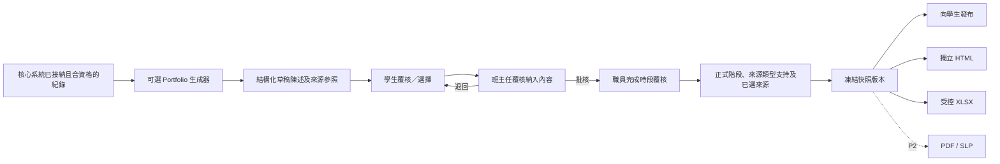

# SRS-09 Portfolio、Proud Moments 及匯出

## 1. 目的

發布可重現的時段 Portfolio，展示學生的活動、評語及有佐證的成長；預設不公開內部草稿及原始媒體。

## 2. 功能要求

| ID | 要求 | 狀態 | 階段 |
|---|---|---|---|
| PRT-FR-001 | Portfolio 須按學生及報告時段發布為有版本的快照。 | 已確認架構 | P1 |
| PRT-FR-002 | 每項快照內容須保留來源類型／ID、顯示部分／次序、納入決定及批核人。 | 已確認架構 | P1 |
| PRT-FR-003 | 學生及所屬班主任覆核內容後，由獲授權職員發布。 | 建議架構 | P1 |
| PRT-FR-004 | 預設隱藏原始媒體；Portfolio 可顯示佐證參照或附件數量。 | 已確認 M-18 | P1 |
| PRT-FR-005 | Proud Moments 記錄學生認為重要的選擇及反思，本身不會改變技能階段。 | 已確認工作模型 | P1 |
| PRT-FR-006 | Proud Moments 選擇期由職員明確開啟／關閉，不會自動啟用。 | 已確認 POC 方向 | P0 |
| PRT-FR-007 | 發布及撤回均須審計，並保留過往已發出版本。 | 已確認 M-19 | P1 |
| PRT-FR-008 | P1 支援獨立 HTML 快照及受控 XLSX 佐證清單；PDF/SLP 按 H-01 留待 P2。 | 建議 | P1/P2 |
| PRT-FR-009 | P1 外部收件人收取已批核輸出，不設平台帳戶。 | 建議 H-09 | P1 |
| PRT-FR-010 | Portfolio 生成工作只可接收核心系統已標示為「已接納且可納入 Portfolio」的佐證，並限定所選學生、學校及時段；未覆核的供應商輸出及被拒候選不得傳入。 | 系統分析架構決定已批准（2026-10-27） | P1 合約／P2 供應商 |
| PRT-FR-011 | 生成結果須為結構化草稿部分／陳述；每項以佐證為基礎的陳述須有一項或以上依次排列的來源參照，並保存生成器／Prompt 資料及警告。每個來源參照均須能在凍結輸入清單中找到。 | 系統分析架構決定已批准（2026-10-27） | P1 合約／P2 供應商 |
| PRT-FR-012 | 視覺化及匯出只可讀取經人工批核、有版本的快照 DTO，不可自行呼叫生成器或從原始佐證推導 Portfolio 陳述。 | 系統分析架構決定已批准（2026-10-27） | P1 |
| PRT-FR-013 | 每項已發布 Rubric／技能結果須保存正式階段、Rubric／版本／範疇、彙總政策、已納入觀察／佐證連結、覆核理由，以及按來源類型分組的摘要；每類顯示已選用最高支持階段或 `not_enough_evidence`。候選最高值及已排除項目只保留作覆核／審計資料，不會成為已發布評估值。 | 系統分析架構決定已批准（2026-10-27） | P1 |
| PRT-FR-014 | 已發布 Portfolio 可顯示正式階段，以及按類型分組、經私隱篩選的已選來源參照。已排除來源、被拒模型候選及內部理由只供獲授權覆核人查看，除非政策另行批准擴大披露。 | 系統分析架構決定已批准（2026-10-27） | P1 |
| PRT-FR-015 | 目前快照所使用的來源其後被排除、更正或判定無效時，快照須轉為 `stale`／`needs_review`，並撤回目前發布狀態，直至完成明確覆核及發布後繼版本；已發出版本仍須可重現。 | 系統分析架構決定已批准（2026-10-27） | P1 |
| PRT-FR-016 | 後繼快照／匯出須指出所取代版本及更正原因，不可靜默修改任何已發出檔案。 | 系統分析架構決定已批准（2026-10-27） | P1 |

## 3. 建議 Portfolio 內容

- 學生及報告時段資料
- 學術及非學術活動歷程
- 已發布老師評語
- 八項技能快照、正式階段、按來源類型分組的已選用支持摘要，以及經私隱篩選的已選佐證參照
- 學生反思、回顧與展望
- 學生選擇並獲准發布的 Proud Moments
- 快照版本、批核及匯出日期

最終正式輸出組合仍屬 H-01 待定。

## 4. Proud Moments 欄位

| 欄位 | 規則 | 限制 |
|---|---|---|
| 選擇來源 | 必填 | 已覆核活動、校外成就或合資格佐證 |
| 反思 | 必填 | 1–4,000 個字元；內容最低要求待定 |
| 顯示次序 | 必填 | 1–24 整數臨時上限 |
| 最多選擇 | 可設定 | 臨時 24；最終政策待定 |
| 發布狀態 | 必填 | `unpublished`, `published_to_portfolio`, `withdrawn` |

## 5. 發布流程

## 6. 匯出控制

| 項目 | 上限／狀態 |
|---|---|
| 即時匯出行數 | 50,000；超出改用背景工作 |
| 檔案名稱 | 255 個字元 |
| 匯出原因／收件人 | 1–4,000 個字元；對外匯出必填 |
| 下載有效期 | 政策待定 L-07；採用有時限及需登入連結 |
| 類型 | `self_contained_html`, `evidence_xlsx`；`pdf_slp` 屬 P2 |

每份匯出記錄快照版本、產生人、收件人類別、範圍、檔案雜湊及時間。

## 7. 驗收情境

- 發布後建立不可變版本，即使即時活動資料繼續改動也不受影響。
- 撤回內容會從目前版本移除，但不刪除已發出歷史。
- 除非匯出政策明確准許，HTML/XLSX 不包含原始媒體。
- Proud Moment 不可提升技能階段。
- 外部收件人不能用匯出連結瀏覽平台。
- 如生成陳述引用不存在或不在輸入清單內的來源，系統須在人工覆核前拒絕該結果。
- 更換 Portfolio 生成器後，網頁及匯出使用的已批核快照 DTO 維持不變。
- Portfolio 會顯示正式階段所依據的已選來源，亦可分開列出例如老師觀察與學生反思各自的最高支持階段，但不會把兩者都當成正式階段。
- 一項已選來源其後被判定無效時，受影響的目前發布內容須撤回覆核；系統不可改寫已發出快照，也不可靜默改用另一個階段。

