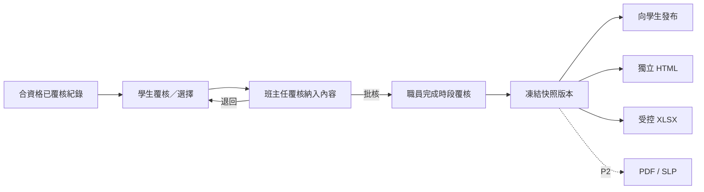

# SRS-09 Portfolio、Proud Moments 及匯出

## 1. 目的

發布可重現的時段 Portfolio，展示學生的活動、評語及有佐證的成長；預設不公開內部草稿及原始媒體。

## 2. 功能要求

| ID | 要求 | 狀態 | 階段 |
|---|---|---|---|
| PRT-FR-001 | Portfolio 須按學生及報告時段發布為有版本的快照。 | 已確認架構 | P1 |
| PRT-FR-002 | 每項快照內容須保留來源類型／ID、顯示部分／次序、納入決定及批核人。 | 已確認架構 | P1 |
| PRT-FR-003 | 學生及所屬班主任覆核內容後，由獲授權職員發布。 | 建議架構 | P1 |
| PRT-FR-004 | 預設隱藏原始媒體；Portfolio 可顯示佐證參照或附件數量。 | 已確認 M-18 | P1 |
| PRT-FR-005 | Proud Moments 記錄學生認為重要的選擇及反思，本身不會改變技能階段。 | 已確認工作模型 | P1 |
| PRT-FR-006 | Proud Moments 選擇期由職員明確開啟／關閉，不會自動啟用。 | 已確認 POC 方向 | P0 |
| PRT-FR-007 | 發布及撤回均須審計，並保留過往已發出版本。 | 已確認 M-19 | P1 |
| PRT-FR-008 | P1 支援獨立 HTML 快照及受控 XLSX 佐證清單；PDF/SLP 按 H-01 留待 P2。 | 建議 | P1/P2 |
| PRT-FR-009 | P1 外部收件人收取已批核輸出，不設平台帳戶。 | 建議 H-09 | P1 |

## 3. 建議 Portfolio 內容

- 學生及報告時段資料
- 學術及非學術活動歷程
- 已發布老師評語
- 八項技能快照及佐證參照
- 學生反思、回顧與展望
- 學生選擇並獲准發布的 Proud Moments
- 快照版本、批核及匯出日期

最終正式輸出組合仍屬 H-01 待定。

## 4. Proud Moments 欄位

| 欄位 | 規則 | 限制 |
|---|---|---|
| 選擇來源 | 必填 | 已覆核活動、校外成就或合資格佐證 |
| 反思 | 必填 | 1–4,000 個字元；內容最低要求待定 |
| 顯示次序 | 必填 | 1–24 整數臨時上限 |
| 最多選擇 | 可設定 | 臨時 24；最終政策待定 |
| 發布狀態 | 必填 | `unpublished`, `published_to_portfolio`, `withdrawn` |

## 5. 發布流程

## 6. 匯出控制

| 項目 | 上限／狀態 |
|---|---|
| 即時匯出行數 | 50,000；超出改用背景工作 |
| 檔案名稱 | 255 個字元 |
| 匯出原因／收件人 | 1–4,000 個字元；對外匯出必填 |
| 下載有效期 | 政策待定 L-07；採用有時限及需登入連結 |
| 類型 | `self_contained_html`, `evidence_xlsx`；`pdf_slp` 屬 P2 |

每份匯出記錄快照版本、產生人、收件人類別、範圍、檔案雜湊及時間。

## 7. 驗收情境

- 發布後建立不可變版本，即使即時活動資料繼續改動也不受影響。
- 撤回內容會從目前版本移除，但不刪除已發出歷史。
- 除非匯出政策明確准許，HTML/XLSX 不包含原始媒體。
- Proud Moment 不可提升技能階段。
- 外部收件人不能用匯出連結瀏覽平台。

