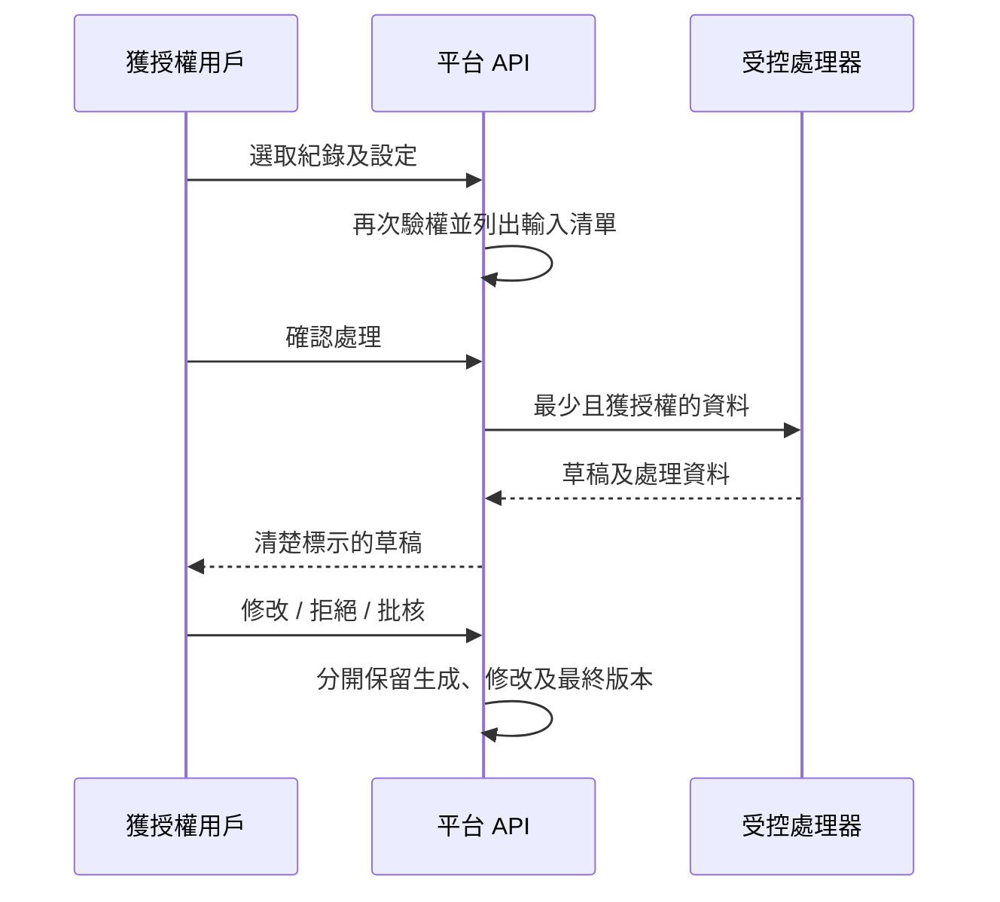

# SRS-10 AI 輔助處理及來源記錄

## 1. 目的

在保留人工決定身份、接納佐證及正式評估的前提下，以受控方式協助擷取及撰寫草稿。

## 2. 使用界線

| 功能 | 階段 | 權限定位 |
|---|---|---|
| 證書／文件 OCR | P2 | 只產生擷取草稿，須人工覆核 |
| 錄音轉錄／分辨講者 | P2 | 草稿；講者身份須人工確認 |
| 分類／佐證標籤 | P2 | 只作建議 |
| Rubric／技能配對 | P2 | 只作建議，不可設定階段 |
| 摘要／報告草稿 | P2 | 經人工修改及發布 |
| 身份配對／正式階段 | 不包括 | 只可由人決定 |

最終可用 AI 功能仍待 H-10 決定。

## 3. 功能要求

| ID | 要求 | 狀態 | 階段 |
|---|---|---|---|
| AI-FR-001 | 執行前，介面須列出將送往處理器的所有紀錄及欄位。 | 已確認 POC 方向 | P0/P2 |
| AI-FR-002 | 用戶只可選取有權讀取的資料；伺服器在執行前再次驗權。 | 建議架構 | P2 |
| AI-FR-003 | 輸出須記錄服務／模型、版本、提示範本／版本、參數、輸入參照、操作人及時間。 | 已確認架構 | P2 |
| AI-FR-004 | `generated_text`、`teacher_edited_text` 及 `final_published_text` 分開保留。 | 已確認 M-17 | P2 |
| AI-FR-005 | 提供三個受控設定：學術學習與推理；非學術參與及個人成長；人際協作及自我發展。 | 已確認 M-16 | P2 |
| AI-FR-006 | 老師可調整重點、年齡／班別、語氣、長度及排除項目；未經處理的任意高權限指令不得直接傳送。 | 已確認 M-16／建議保安 | P2 |
| AI-FR-007 | AI 內容用棕色系背景及清楚草稿標籤，直至人工批核。 | 已確認介面規則 | P0/P2 |
| AI-FR-008 | AI 失效不得阻礙人工評估或 Portfolio 發布。 | 建議架構 | P2 |
| AI-FR-009 | 向外部處理器傳送敏感資料前，須符合校方同意、地區、保留期及供應商政策。 | 政策待定 H-07/H-10 | P2 |

## 4. 輸入／輸出限制

| 欄位 | 最小值 | 最大值／狀態 |
|---|---:|---|
| 提示設定 | 1 | 每次工作恰好 1 個獲批設定 |
| 老師補充指示 | 0 | 4,000 個字元 |
| 來源項目 | 1 | 100 項臨時上限 |
| 生成草稿 | 0 | 20,000 個字元 |
| 人工修改 | 0 | 20,000 個字元 |
| 重試 | 0 | 3 次臨時上限 |

大型媒體由背景工作處理，不會把檔案直接塞入瀏覽器端提示。處理器只收獲授權的儲存參照或衍生文字，不會取得資料庫憑證或 SQL。

## 5. 來源記錄流程

## 6. 驗收情境

- 老師開始前看見完整輸入清單。
- 移除一項來源後，清單及工作來源記錄隨之更新。
- AI 建議不能直接觸發評估發布。
- 老師修改不會覆蓋原生成內容。
- AI 服務失效時，人工流程仍可使用，錯誤在相關操作旁顯示。

