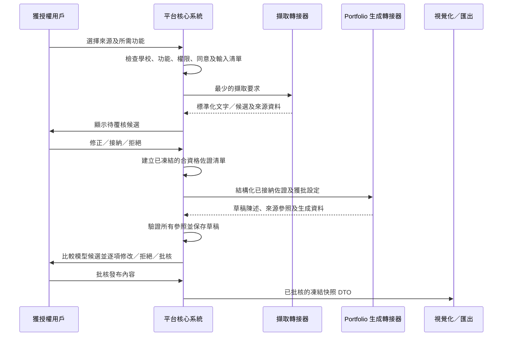

# SRS-10 AI 輔助處理及來源記錄

## 1. 目的

界定供應商中立的文字／媒體擷取及 Portfolio 生成邊界，讓核心系統只需驗證及傳遞標準化文字／結果，毋須知道 AI 供應商如何處理。學生身份、佐證接納、陳述批核及正式評估仍由人員決定。

## 2. 使用界線

| 功能 | 階段 | 權限定位 |
|---|---|---|
| 供應商中立的擷取／生成合約及測試替身 | P1 | 由核心系統掌握驗證邊界 |
| 證書／文件 OCR | P2 實作 | 只產生擷取草稿，須人工覆核 |
| 錄音轉錄／分辨講者 | P2 實作 | 草稿；講者身份須人工確認 |
| 分類／佐證標籤 | P2 實作 | 只作建議 |
| Rubric／技能配對 | P2 實作 | 只作建議，不可設定階段 |
| 摘要／報告草稿 | P2 實作 | 經人工修改及發布 |
| 身份配對／正式階段 | 不包括 | 只可由人決定 |

最終可用 AI 功能仍待 H-10 決定。

P1 的合約不代表 MVP 必須完成正式 AI。P1 只先固定輸入／輸出格式、驗證、來源記錄、覆核狀態及失敗處理，讓本地規則式測試替身或日後供應商可以互換，而毋須改動核心系統。

本 SRS 不會指定正式供應商功能由哪一方實作。供應商選擇、自建或採購責任、憑證、服務條款及營運支援，仍屬 H-07／H-10 下的 P2 交付決定；核心系統團隊只負責本文件所述合約及平台端控制。

## 3. 功能要求

| ID | 要求 | 狀態 | 階段 |
|---|---|---|---|
| AI-FR-001 | 執行前，介面須列出將送往處理器的所有紀錄及欄位。 | 已確認 POC 方向 | P0/P2 |
| AI-FR-002 | 用戶只可選取有權讀取的資料；伺服器在執行前再次驗權。 | 建議架構 | P2 |
| AI-FR-003 | 輸出須記錄服務／模型、版本、提示範本／版本、參數、輸入參照、操作人及時間。 | 已確認架構 | P2 |
| AI-FR-004 | `generated_text`、`teacher_edited_text` 及 `final_published_text` 分開保留。 | 已確認 M-17 | P2 |
| AI-FR-005 | 提供三個受控設定：學術學習與推理；非學術參與及個人成長；人際協作及自我發展。 | 已確認 M-16 | P2 |
| AI-FR-006 | 老師可調整重點、年齡／班別、語氣、長度及排除項目；未經處理的任意高權限指令不得直接傳送。 | 已確認 M-16／建議保安 | P2 |
| AI-FR-007 | AI 內容用棕色系背景及清楚草稿標籤，直至人工批核。 | 已確認介面規則 | P0/P2 |
| AI-FR-008 | AI 失效不得阻礙人工評估或 Portfolio 發布。 | 建議架構 | P2 |
| AI-FR-009 | 向外部處理器傳送敏感資料前，須符合校方同意、地區、保留期及供應商政策。 | 政策待定 H-07/H-10 | P2 |
| AI-FR-010 | Portfolio LLM 只可產生正面、附來源的候選文字，不可降低學生評級、接納佐證或發布 Rubric 階段。 | 已確認 M-23；10 月 26 日修訂 | P0/P2 |
| AI-FR-011 | 回望／展望須由老師選擇開始／完結學段及明確資料類別。 | 已確認 M-24 | P0/P2 |
| AI-FR-012 | 每次產生回望／展望時，須凍結實際使用的活動簡介、已確認成果、已接納佐證摘要、已發布 Rubric 結果及 Prompt 版本。 | 已確認 M-24 | P0/P2 |
| AI-FR-013 | 核心系統須分別呼叫 `ExtractionProvider` 及 `PortfolioGenerator` 端口；供應商 SDK、Prompt 細節及憑證只可放在 adapter（轉接器）內。 | 系統分析架構決定已批准（2026-10-27） | P1 合約／P2 供應商 |
| AI-FR-014 | `ExtractionProvider` 須回傳標準化結果，包括工作／來源 ID、擷取文字、可選的依次排列文字片段／候選、語言、可用的信心值、供應商／版本、警告及時間；不得直接寫入平台紀錄。 | 系統分析架構決定已批准（2026-10-27） | P1 合約／P2 供應商 |
| AI-FR-015 | 接納擷取結果前，核心系統須重新檢查學校狀態、功能政策、權限、同意、輸入雜湊、schema 及供應商來源，然後把結果保存為待覆核候選。 | 系統分析架構決定已批准（2026-10-27） | P1/P2 |
| AI-FR-016 | `PortfolioGenerator` 只可收到一份凍結清單，當中只包含核心系統已接納、可納入 Portfolio，而且屬於同一學校、學生及時段／時段範圍的佐證；生成器不得直接查詢資料庫或物件儲存。 | 系統分析架構決定已批准（2026-10-27） | P1 合約／P2 供應商 |
| AI-FR-017 | `PortfolioGenerator` 須回傳結構化草稿部分及陳述；每項以佐證為基礎的陳述須包含文字、一項或以上依次排列的來源參照及可選警告，並在整體結果保存生成器／Prompt／版本資料。 | 系統分析架構決定已批准（2026-10-27） | P1 合約／P2 供應商 |
| AI-FR-018 | 核心系統須拒絕未知、跨校、不合資格或不在輸入清單內的來源參照，並分開保存生成、修改、批核及發布狀態。 | 系統分析架構決定已批准（2026-10-27） | P1/P2 |
| AI-FR-019 | 視覺化只接收核心系統已批核的快照 DTO，毋須知道擷取供應商、LLM 供應商、Prompt 或生成方法。 | 系統分析架構決定已批准（2026-10-27） | P1 |
| AI-FR-020 | API 及背景工作在建立、領取及提交擷取／生成工作結果前，均須檢查目前學校的功能政策。 | 系統分析架構決定已批准（2026-10-27） | P1/P2 |
| AI-FR-021 | 不同供應商／模型／Prompt 版本如根據同一批佐證提出建議，須保存為互不覆蓋的獨立候選，並向獲分派的 SuperTeacher／獲授權職員並列顯示。 | 系統分析架構決定已批准（2026-10-27） | P1 合約／P2 供應商 |
| AI-FR-022 | 覆核人可逐項拒絕或忽略生成陳述／Rubric 建議。接納某項建議時，只可在保留原有合資格佐證連結的情況下建立／更新人員覆核觀察；模型輸出本身不會成為佐證。 | 系統分析架構決定已批准（2026-10-27） | P1/P2 |
| AI-FR-023 | 提交作品／佐證須保留申報的作者來源（`human_authored`、`ai_assisted`、`ai_generated`、`unknown`）及可選工具／模型資料。使用 AI 不會自動令作品獲納入／排除或決定階段；實際評估方式仍待校本政策確認。 | 系統分析架構決定已批准（2026-10-27）；評估方式按 H-10 政策待定 | P1 |
| AI-FR-024 | 輸入來源其後被排除、更正或判定無效時，所有曾使用該來源的生成工作均須標記為 `stale`／`needs_review`。職員可排除該來源並建立後繼工作；原有輸入清單及輸出不可改寫。 | 系統分析架構決定已批准（2026-10-27） | P1/P2 |
| AI-FR-025 | AI 的合適程度、信心值或不同模型的一致程度只供參考，不可當作輸入／佐證類型、覆蓋其他建議的理由，或沒有來源的 Rubric 階段覆蓋值。 | 系統分析架構決定已批准（2026-10-27） | P0/P2 |

## 4. 輸入／輸出限制

| 欄位 | 最小值 | 最大值／狀態 |
|---|---:|---|
| 提示設定 | 1 | 每次工作恰好 1 個獲批設定 |
| 老師補充指示 | 0 | 4,000 個字元 |
| 來源項目 | 1 | 100 項臨時上限 |
| 生成草稿 | 0 | 20,000 個字元 |
| 人工修改 | 0 | 20,000 個字元 |
| 重試 | 0 | 3 次臨時上限 |

大型媒體由背景工作處理，不會把檔案直接塞入瀏覽器端提示。核心系統先建立最少而獲授權的要求；轉接器只可按政策取得短效來源參照或衍生內容，不會取得資料庫憑證或 SQL。Portfolio 生成器只取得標準化及已接納的文字／佐證項目，不會收到原始媒體。

## 5. 來源記錄流程

## 6. 驗收情境

- 老師開始前看見完整輸入清單。
- 移除一項來源後，清單及工作來源記錄隨之更新。
- AI 建議不能直接觸發評估發布。
- 老師修改不會覆蓋原生成內容。
- AI 服務失效時，人工流程仍可使用，錯誤在相關操作旁顯示。
- 模擬擷取轉接器與日後正式供應商均須通過同一套合約測試。
- 供應商不可自行把輸出變成已接納佐證，亦不可寫入 Portfolio 快照。
- 功能在工作排隊後被停用時，背景工作不得提交結果。
- 同一已批核快照不論早前使用哪個生成器，均應產生相同資料內容的展示。
- 兩個供應商可對同一清單提出不同 Rubric 建議；兩者均可追溯，只有人員覆核觀察引用原始佐證後，才可能影響正式階段。
- 一項輸入被判定無效時，受影響工作須標記過期；建立後繼工作亦不可改寫舊輸入清單或輸出。
- 學生申報曾使用 AI 輔助的作品繼續作獨立標示的來源；所用 LLM／工具本身不會令作品變得更符合 Rubric。

