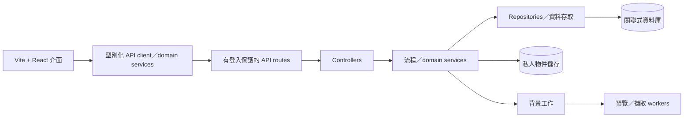

# SRS-11 基礎設施、保安及營運

## 1. 目標結構

瀏覽器程式不得包含 SQL、資料庫憑證、直接資料庫連線或高權限篩選規則。

## 2. 功能及非功能要求

| ID | 要求 | 狀態 | 階段 |
|---|---|---|---|
| OPS-FR-001 | 前端預設採用 Vite + React，配合共用型別化 API service 及可重用 domain component。 | Repository 規則 | P0 |
| OPS-FR-002 | 重複視覺規則以 Tailwind 及 `@apply` 組成語意化 class；頁面不可重複大段 utility class。 | Repository 規則 | P0 |
| OPS-FR-003 | 伺服器採用 `route → controller → service/use-case → repository → database` 分層。 | Repository 規則 | P0 |
| OPS-FR-004 | SQL 只可放在 repository／資料存取層，並使用參數化語句。 | Repository 規則 | P0 |
| OPS-FR-005 | 受保護 API 在伺服器執行權限及驗證，並共用列舉值及政策限制。 | 建議架構 | P0 |
| OPS-FR-006 | 檔案放在私人物件儲存；資料庫只保存資料及非公開鍵，不保存永久公開 URL。 | 建議架構 | P1 |
| OPS-FR-007 | 預覽、掃描、匯出、OCR 及轉錄如可能超出一般要求時間，須以可重試且不重複的背景工作處理。 | 建議架構 | P1/P2 |
| OPS-FR-008 | 正式環境須有加密傳輸、秘密管理、備份、復原測試、監察及結構化審計。 | 建議架構 | P1 |
| OPS-FR-009 | H-07 未確認前停用自動刪除／保留期工作；仍可人工審計停用。 | 安全預設 | P1 |
| OPS-FR-010 | 健康／就緒檢查不得洩露秘密、個人資料或相依服務憑證。 | 建議架構 | P1 |

## 3. API 及元件規則

- 頁面負責組合單一職責元件；元件處理顯示及本地互動，不直接持久化資料。
- Domain hook／service 按資源整合讀寫，以範圍及篩選參數共用邏輯，不在各角色頁面複製 `fetch`。
- Route 只處理傳輸及 middleware；controller 轉換 HTTP；service 執行流程；repository 負責 SQL 及儲存。
- API 使用清楚 DTO，不可不加篩選地把資料庫列原樣輸出。
- UI 及伺服器共用列舉值、最小／最大值及驗證 schema；最終以伺服器為準。
- 錯誤採用 SRS-00 格式。全頁／系統錯誤可置頂浮層；輸入及檔案錯誤在相關按鈕旁顯示。

## 4. 視覺基礎

- 頁面背景用白色，不加裝飾性灰調底色。
- 主色採低刺激的粉彩橙色，文字仍須有足夠對比。
- 粉紅／紅色底只標示未決要求，不用來表示一般重要性。
- 棕色系底標示 AI 生成／草稿內容。
- 優先使用分隔線、留白及限高滾動，不堆疊相同圓角及邊框的容器。
- 只有真正成組的內容才使用卡片；卡片內每行不重複相同圓角框。

## 5. 營運限制

| 控制 | 臨時要求 |
|---|---|
| JSON request body | 最多 1 MiB；檔案用 multipart 政策 |
| 互動 API 時限 | 30 秒；較長工作改用背景 job |
| 分頁 | 預設 20，最多 100 |
| 即時匯出 | 最多 50,000 行 |
| 審計保留期 | 政策待定 H-07；未批核前不自動清除 |
| 備份 | 每日加密備份；保留期及 RPO/RTO 待定 |
| 復原測試 | 臨時營運基準：最少每季一次 |

## 6. 保安控制

- 密碼使用現行自適應雜湊，不儲存或記錄明文。
- 正式 Cookie 採 Secure、HttpOnly、SameSite；修改資料的要求須有 CSRF／request protection。
- 驗證檔案內容、限制登入及敏感工作頻率，並從 log 移除秘密及個人資料。
- 一般用戶不可修改審計；審計包括操作人、當前角色、範圍、動作、目標、結果及時間。
- 採用依賴掃描、資料庫 migration、環境分開設定及最小權限 service account。

## 7. 驗收情境

- 正式前端 bundle 內找不到 SQL 或憑證。
- 頁面元件使用 domain API service，不會 import repository／database。
- 直接呼叫 API 與介面操作得到相同權限結果。
- 200 MB 影片在 500 MB 上限內按政策進入背景處理，不會阻塞 web process。
- 備份可在測試中復原快照及相連媒體資料。

