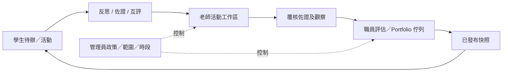

# SRS-12 頁面目錄及角色可見範圍

## 1. 目的

清楚界定各角色看見的產品，並修正 POC 中所有登入用戶都看見活動、學生、問題、媒體、Portfolio 及 AI 的假設。

## 2. 頁面目錄

| 範疇／頁面 | 學生 | 老師 | 職員 | SchoolAdmin | 階段 |
|---|---|---|---|---|---|
| 首頁及待辦 | 本人任務／結果 | 已分配工作 | 營運佇列 | 全校營運 | P0/P1 |
| 我的活動／活動 | 已參加及可見 | 按功能權限／範圍查看及建立 | 委派目錄／批核 | 全校資料／政策 | P0/P1 |
| 活動工作區 | 本人詳情／回應 | 名單、表格、VASK、佐證、評估 | 覆核／例外 | 政策／行政檢視 | P1 |
| 學生 | 只看本人 | 獲分配學生 | 委派學生 | 行政名錄 | P0/P1 |
| 班別 | 不設班級名錄 | 獲分配班別 | 委派班別 | 管理全部 | P1 |
| 題庫／表格庫 | 只看獲分配題目 | 已批核目錄及自己的草稿 | 覆核／發布委派表格 | 設定權限 | P1 |
| 我的媒體／佐證 | 本人／獲准 | 已分配／獲准 | 審核範圍 | 資料；原檔須授權 | P0/P1 |
| 校外成就 | 建立／查看本人 | 覆核所屬學生 | 審核 | 政策／行政 | P1 |
| 同儕互評 | 只有指定任務 | 分配／跟進 | 審核 | 只設政策 | P1 |
| 評語及技能確認 | 已發布本人結果 | 提交所屬活動 | 覆核／發布 | 只設政策 | P1 |
| Rubric 來源比較及更正影響 | 只看已發布來源摘要 | 所屬觀察／佐證 | 比較類型、納入／排除及處理受影響結果 | 政策／審計；另獲分派才可決定 | P1/P2 |
| Proud Moments | 開放期內 | 獲分配時作班主任覆核 | 開啟／覆核 | 設定時段 | P0/P1 |
| 我的 Portfolio／發布 | 本人最新草稿及已批核正式畫面 | 班主任覆核所屬學生；選取全部／部分 | 按分派批核／發布／撤回 | 政策／匯出 | P1 |
| 匯入／數據質素 | 否 | 所屬活動匯入 | 處理委派例外 | 設定／全面匯入 | P0/P1 |
| AI 草稿 | 只看已批核最終文字 | 所屬範圍的獲准草稿 | 覆核委派草稿 | 設定政策 | P2 |
| 決策／待定清單 | 否 | 只看相關提示 | 維護決策 | 維護／批核政策 | P0 |
| 教職員名錄／搜尋 | 否 | 只在獲授權工作及範圍搜尋 | 委派名錄 | 全校教職員名錄 | P1 |
| 職位、角色、功能權限及範圍 | 否 | 查看本人有效分派 | 委派查看 | 設定及預覽受影響用戶 | P1 |
| 批核收件箱／升級處理 | 否 | 具名分派 | 委派／預設佇列 | 設定政策／佇列；另獲分派才可決定 | P1 |
| 用戶、群組、時段、審計 | 否 | 否 | 只限委派營運 | 全面管理 | P1 |
| 學校及功能可用狀態 | 否 | 否 | 查看獲委派狀態 | 查看有效政策；只可在獲委派時修改 | P1 |

## 3. 各角色導覽

### 學生

首頁；我的活動；我的媒體；校外成就；同儕互評；開放時的 Proud Moments；我的 Portfolio；私隱及資料修正。

### 老師

老師首頁；活動；活動工作區；批量評估／匯入；佐證覆核；評語及技能確認；互評分配；所屬學生／班別。

### SuperTeacher／職員

營運首頁；活動目錄／批核；表格庫；佐證審核；評估覆核；Portfolio 發布；匯入／數據質素；報告／匯出；決策清單。

### SchoolAdmin

職員導覽，加上用戶／職位／群組／時段；角色／功能權限／工作範圍；批核政策／預設及升級處理佇列；同意／保留期／上載政策；來源系統／匯入設定；有效學校／功能可用狀態；審計／登入工作階段／保安。

## 4. 介面要求

| ID | 要求 | 狀態 | 階段 |
|---|---|---|---|
| UI-FR-001 | 導覽按伺服器提供的功能清單產生。 | 建議架構 | P0 |
| UI-FR-002 | 路由設功能 guard，但最終仍由 API 決定。 | 建議架構 | P0 |
| UI-FR-003 | 每頁須定義載入中、沒有資料、無權限、驗證錯誤、系統錯誤及資料過期狀態。 | 建議架構 | P0 |
| UI-FR-004 | 數字欄顯示有效範圍，例如「整數，1–16」，並在 HTML／API 使用相同驗證。 | 已確認 SRS 規則 | P0 |
| UI-FR-005 | 未決規則用粉紅／紅底並顯示決策編號。 | 已確認設計規則 | P0 |
| UI-FR-006 | AI 生成內容用棕色系底並列出來源。 | 已確認設計規則 | P0/P2 |
| UI-FR-007 | 輸入／檔案錯誤顯示在操作旁；全頁系統錯誤可用頂部浮層。 | 已確認設計規則 | P0 |
| UI-FR-008 | 表格／清單以分隔線及限高滾動為主，不使用層層相同圓角框。 | 已確認設計規則 | P0 |
| UI-FR-009 | 當伺服器的按校功能政策封鎖頁面或操作，介面須按情況隱藏／停用入口，並以清楚的非故障說明處理 `FEATURE_NOT_AVAILABLE`；不得把隱藏入口描述為保安控制。 | 系統分析架構決定已批准（2026-10-27） | P0/P1 |
| UI-FR-010 | 評估覆核介面須把正式採用結果與每項輸入／佐證類型的「候選最高支持階段」及「已選用最高支持階段」分開顯示，並提供實際候選／已納入觀察、來源連結及決定狀態。 | 系統分析架構決定已批准（2026-10-27） | P1 |
| UI-FR-011 | 獲授權覆核人須按情況獲提供逐項納入、排除、判定無效、取代及以新決定恢復的操作。提交更正前，介面須預覽受影響的觀察、Portfolio 陳述、生成工作及已發布快照，並要求填寫原因。 | 系統分析架構決定已批准（2026-10-27） | P1 |
| UI-FR-012 | 平行 LLM 建議須列出供應商、模型、Prompt 版本、凍結輸入清單及人工決定。介面不可預先選定任何建議為正式結果，亦不可用覆蓋方式隱藏互相矛盾的建議。 | 系統分析架構決定已批准（2026-10-27） | P2 |
| UI-FR-013 | 第一階段沿用同一個老師工作介面。導覽及操作按功能權限產生；職銜只作背景顯示，不會選擇硬編碼介面。 | 系統分析架構決定已批准（2026-10-28） | P0/P1 |
| UI-FR-014 | 教職員搜尋須支援組合篩選姓名／識別碼、有效狀態、職位、功能角色、權限、部門、科目、級別、班別、群組、課程及批核資格，並設分頁及伺服器端範圍控制。 | 系統分析架構決定已批准（2026-10-28） | P1 |
| UI-FR-015 | 活動詳情須分開顯示最新及目前已批核修訂、重大改動批核狀態、擁有人／修改權；沒有直接修改權時顯示提交修改要求。 | 系統分析架構決定已批准（2026-10-28） | P1 |
| UI-FR-016 | Portfolio 覆核須顯示學生提交版本、班主任全部／部分納入決定、最新已批核後備版本及 `no_approved_version` 狀態，不可把未批核草稿顯示為正式版本。 | 系統分析架構決定已批准（2026-10-28） | P1 |
| UI-FR-017 | 批核收件箱須按流程類型、校內範圍、獲分派人、未分派／被拒接／逾期狀態、到期日及升級狀態篩選。接受、退回、批核、拒絕及重新分派須按設定填寫理由。 | 系統分析架構決定已批准（2026-10-28） | P1 |
| UI-FR-018 | 全校權限政策變更啟用前須顯示暫存差異及受影響用戶預覽；獲授權管理員可查看明確拒絕及其來源。 | 系統分析架構決定已批准（2026-10-28） | P1 |

## 5. 現有 POC 差距

| POC 範疇 | 評估 | 所需修正 |
|---|---|---|
| 所有角色共用選單 | 不符 | 改為按功能及角色產生導覽 |
| 活動／詳情 | 部分 | 加入生命週期、批核、範圍及完整工作區 |
| 學生／班別 | 部分 | 移除學生查閱名錄；按有效工作分配限制 |
| 問題 | 部分／不符 | 學生不可看全校題庫；加入表格／版本／對應管治 |
| 媒體庫 | 部分 | 加入同意、審核、校外成就分流及私人原檔 |
| Portfolio 選擇 | 部分 | 加入工作版本、班主任全部／部分覆核、最新已批核後備、職員發布及撤回 |
| AI 頁 | POC 示範 | 限於 P2 獲授權流程；學生只看已批核文字 |
| 決策／管理 | 部分 | 補上職位／角色／功能權限／範圍分離、批核政策、來源、審計及保安管理 |
| 未有頁面 | 欠缺 | 待辦、教職員搜尋／篩選、批核／升級處理收件箱、校外成就、互評、私隱修正、批量評估及匯出 |

## 6. 頁面流程

## 7. 驗收情境

- 學生選單不會出現學生名錄、班別、全校題庫、決策、管理或 AI 草稿。
- 班主任及活動老師即使用同一老師介面，也只看到各自獲分配紀錄。
- 已發布紀錄被退回修改後，現時發布狀態即時取消，歷史仍保留。
- 每個數字欄均顯示範圍或指定量表。
- 直接輸入隱藏頁面的網址時，route guard 及 API 均會拒絕。
- 示範學校只可看到伺服器已開放的試行／正式功能；複製網址亦不可打開被停用功能。
- 覆核人可比較各類來源的候選及已選用最高支持階段，而不會把任何一個數值誤認為正式階段；每個最高值均可開啟實際支持來源。
- 排除已使用的人臉配對或佐證前，介面先顯示下游影響；確認後，受影響的已發布內容須進入撤回／重新發出流程，不可靜默重算。
- 兩項互相矛盾的 LLM 建議仍以獨立候選顯示，並各自附有來源及決定紀錄。
- 以英文科活動批核人為條件搜尋時，只會回傳目前合資格且在範圍內的人員，不會披露範圍外教職員。
- 老師即使有較窄的明確拒絕仍使用相同老師版面，但不會看見被拒活動或操作。
- 學生有較新未批核草稿時，正式 Portfolio 預覽清楚採用上一個已批核版本；如從未有已批核版本，則顯示 `no_approved_version` 並把個案加入佇列。

