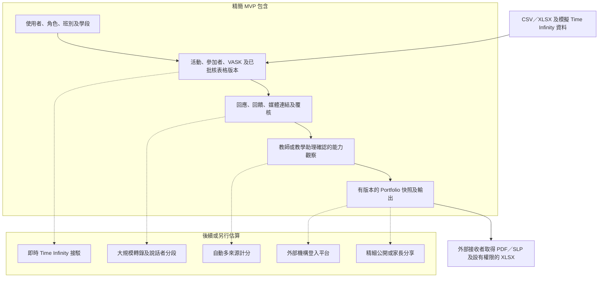

# BHSS 內部系統檢視及人日估算

## 結論

`output/Questions.docx` 與 `Design ideas.docx` 的大方向一致，但前者並非已批核的需求文件。筆記把已知要求、可能流程、校方政策問題、技術選項和建議數值放在一起。第一階段最穩妥的做法，是先建立一套由學校操作、由人員覆核、由證據整理至 Portfolio 發布的流程，而不是直接開發自動 AI 評分平台。

MVP 不會為外部機構開設帳戶。獲授權職員可輸出已批核的 PDF／SLP；只有在需要詳細覆核時，才輸出設有權限控制的 XLSX。這樣可減少身份驗證、轉授權、帳戶有效期、同意傳遞及逐個檔案設定權限的開發工作。

## 文件一致之處

- 收集校內外活動、學科資料、學生反思、教師回饋及媒體證據。
- 使用 VASK 描述活動發展意向。
- 使用八項能力及 16 階段描述已有證據支持的成長。
- 提供學生 Portfolio、重要時刻及跨學段紀錄。
- AI 可協助轉錄、分類及草擬，但最終身份、證據及能力判斷由人員確認。

## 大方向一致但仍待確認

- 哪些題目能力適合各活動及作答對象，以及覆核人員如何引用佐證至具體 Rubric 條件。
- 教師、學生、同儕、學科成績及外部評估的權重。
- HKEAA 的實際身份及權限。
- 班主任可查看全部活動還是只看已發布摘要。
- 同儕互評的分派、匿名及覆核安排。
- 學年轉換、首份 Portfolio 發布時間及跨年計算。
- 媒體同意、保存、撤回及刪除後對衍生證據的影響。
- 實際部署及寄存方式，以及 Time Infinity 的接駁資料。

## 功能組件清單

### 身份及存取

使用者、角色、班別、小組、學年、學段、登入、工作階段撤銷、角色範圍及操作紀錄。

### 資料來源及匯入

CSV／XLSX 上載、Time Infinity 暫存、來源識別、欄位驗證、重複資料處理、錯誤清單及原始資料保存。

### 活動管理

活動範本、活動實例、類別、日期、地點、負責教師、支援職員、參加者、出席、VASK、活動批核及狀態。

### 表格及題目

表格、一經發布便不可原地修改的版本、題目區塊、題目、評分量尺、問卷來源、構念、題目本身的能力定義、覆核分派、批核、發布、撤回及有效期。**Discussed on Meeting Oct 26 - kickstart：** 不再保存固定的 Question → VASK／RC360／Skills Builder 對應或題目權重。

### 分派及提交

活動表格分派、填寫者、被評估學生、教師評估、學生反思、同儕互評、題目答案、草稿、提交、退回、批核及發布。

### 證據及媒體

檔案資料、擁有人、上載者、活動連結、同意、可見範圍、停用原因、文字擷取、身份確認及證據引用。

### 校外成就

學生自行上載證書、頒發機構、級別、結果類型、VASK、覆核及發布；預設沒有正式八項能力對應。

### 評估及框架觀察

教師回饋、能力觀察、觀察階段、一致性、下一步、證據連結及人工確認。缺少證據須保持空白，而不是零分。

### Portfolio 及輸出

學生活動歷史、Proud Moments、已發布回饋、八項能力摘要、學段快照、PDF／SLP、XLSX 證據清單及撤回後重發。

### AI 輔助

OCR、錄音轉錄、說話者分段、系統建議的身份配對及摘要。所有會影響正式紀錄的結果，都必須由獲授權人員確認。

## 各角色建議頁面

### 學生

1. 首頁及待辦事項。
2. 我的活動。
3. 活動反思及證據提交。
4. 校外證書或成就提交。
5. 獲分派同儕互評。
6. Proud Moments。
7. 我的 Portfolio。
8. 私隱及更正要求。

### 教師

1. 教師總覽及待辦工作。
2. 我的活動。
3. 活動名單、出席、VASK 及表格。
4. 直接填寫或 Excel 批量評估。
5. 學生證據及媒體覆核。
6. 回饋及能力階段確認。
7. 同儕互評分派。
8. 獲分派學生摘要。

### SuperTeacher 或職員

1. 覆核工作總覽。
2. 活動批核。
3. 表格及題目對應批核。
4. 證據身份及擷取覆核。
5. 評估例外及退回修改。
6. Portfolio 預覽、批核、發布、撤回及重發。
7. 匯入驗證及錯誤處理。

### SchoolAdmin

1. 使用者、角色、班別及學段管理。
2. 來源系統及匯入設定。
3. 同意、媒體、保存及刪除政策。
4. 登入、工作階段及操作紀錄。
5. 全校發布狀態及資料完整性摘要。

### 外部機構

MVP 不設外部登入頁面，只接收已批核的 PDF／SLP 及按需要提供的 XLSX。紙本應由已批核 PDF 產生，不作資料輸入來源。

## 精簡流程

```text
職員匯入使用者、學段及 Time Infinity 活動
  -> 職員建立或確認活動及預設表格
  -> 教師確認名單、出席、VASK 及填寫日期
  -> 學生提交反思或獲准證據
  -> 指定同儕按需要提交受覆核回饋
  -> 教師覆核證據並確認能力觀察
  -> 職員處理例外及結束匯報學段
  -> 職員發布已鎖定的 Portfolio 快照
  -> 系統產生學生 Portfolio、PDF／SLP 及證據 XLSX
```

## MVP 系統邊界



虛線表示後續功能，不是試行所需依賴。

## 人日估算

### 估算前提

- 一所學校及一套響應式網頁應用程式。
- 四類內部角色共用一個身份系統。
- 先用 CSV／XLSX，不包括正式即時 Time Infinity API。
- 一份已批核預設活動表格；可建立版本，但沒有通用拖放式表格設計器。
- 1 至 16 階段由教師或教學助理確認。
- 基本檔案上載及可設定政策，不包括大型錄音處理平台。
- 學校提供並確認框架文字、BHSS 題目及正式報告格式。

### 建議精簡 MVP

| 工作範疇 | 人日 |
| --- | ---: |
| 需求確認、流程及資料模型 | 8–12 |
| 身份、角色、登入及基本操作紀錄 | 10–14 |
| 學年、學段、活動及參加者 | 10–14 |
| 表格版本、題目、分派及提交 | 14–18 |
| 證據、媒體資料、同意及停用 | 10–14 |
| 教師回饋、能力觀察及人工確認 | 10–14 |
| Portfolio、學段快照及匯出 | 10–14 |
| CSV／XLSX 匯入及驗證 | 6–9 |
| 測試、保安檢查、驗收修正及部署 | 17–21 |
| **合計** | **95–130** |

### 會明顯增加工作量的項目

| 擴展 | 額外人日 |
| --- | ---: |
| 正式即時 Time Infinity 接駁 | 15–30 |
| 大規模錄音轉錄及說話者分段 | 20–35 |
| 自動多來源能力計算及解釋 | 20–40 |
| 外部機構帳戶及入口 | 20–35 |
| 逐檔分享及同意撤回傳遞 | 12–20 |
| 通用表格設計器及複雜版本管理 | 20–35 |

### AI 輔助功能分項估算

原始設計提出 OCR、錄音轉錄、分類、配對、摘要及報告草稿等可能用途。下列數字只供工程規劃，不代表這些功能已獲確認納入。估算假設系統沿用 MVP 的登入、活動、上載、證據及審計功能，由人員覆核所有正式結果，亦不包括自行訓練模型。

| AI 輔助功能 | 額外人日 |
| --- | ---: |
| 圖片／PDF OCR、處理狀態、文字修正及批核畫面 | 7–12 |
| 錄音轉錄及逐字稿修正 | 8–14 |
| 說話者分段及由人員確認說話者身份 | 10–18 |
| 分類及證據／VASK 標籤建議 | 7–11 |
| 三種可選摘要取向、預覽及教師修改 | 10–16 |
| 評分準則／八項能力配對建議及證據引用 | 12–20 |
| Portfolio／報告草稿及修訂紀錄 | 10–16 |
| 共用工作隊列、重試、審計、提示詞／模型版本及監察 | 14–22 |
| 使用 BHSS 樣本測試、校準提示詞及驗收 | 12–20 |

以上項目會共用部分基建，不應逐項直接相加。較合理的整體範圍如下：

| AI 範圍 | 合併額外人日 |
| --- | ---: |
| 不包括說話者分段、全程由人員覆核的 AI POC | 70–105 |
| 加入說話者分段及較完整的正式環境控制 | 90–135 |
| 校內部署、同時處理 400 至 600 份紀錄，以及大量圖片／錄音分析 | 120–180+ |

POC 建議先提供三種受控撰寫取向：學術學習與思考、非學術參與與個人成長，以及人際協作與自我管理。教師可調整重點、年級／班別、語氣、篇幅及需要略去的內容。若容許教師任意修改正式環境的完整提示詞，便需要額外處理提示詞保安、測試、版本批核及回復舊版本。

每次生成都要保留提示詞／取向版本，並分開保存 `generated_text`、`teacher_edited_text` 及 `final_published_text`。AI 只提供草稿；身份配對、證據接納及正式 1 至 16 階段仍由人員確認。

### 至 2027 年復活節前的 AI 版試行修訂方案

本情境於 2026 年 10 月 28 日加入，反映最新 SRS 對學校資料隔離、學校功能政策、供應商中立的擷取及 Portfolio 生成合約、可獨立覆核的 AI 候選結果，以及更正來源後的依賴影響審查要求。這與上文 95 至 130 人日的精簡 MVP 目標不同：本方案要求指定 AI 功能接駁真實供應商，完成端對端驗證，而不只是決定性 POC 輸出或 P1 合約及測試替身。

交付原則是先完成 BHSS 試行所需的固定流程，同時保留版本紀錄、穩定的供應商合約、功能控制及人工覆核邊界，方便日後擴展。試行版無須預先完成所有表格、評分準則、供應商、批核流程或學校變體的通用設定介面。

#### 分階段交付及累計規劃範圍

| 目標成果 | 目標時間 | 累計人日 | 驗收邊界 |
| --- | --- | ---: | --- |
| 鎖定範圍及 POC 技術檢視 | 2026 年 10 月 27 日至 11 月 13 日 | 8–12 | 確定試行情境、真實 AI 功能組合、樣本資料、供應商及驗收矩陣。 |
| 保安核心及 12 月最小可示範流程 | 2026 年 12 月 11 日前 | 42–60 | 完成一條由活動／證據、真實 AI 輸出、人工覆核、一項已確認能力觀察，至一份有來源引用 Portfolio 草稿的端對端流程。 |
| 限定範圍 AI 版 MVP | 2027 年 1 月 22 日前 | 75–105 | BHSS 人員無須直接改動資料庫，便可操作指定的活動、證據、評估、AI 覆核及已凍結 Portfolio 流程。 |
| 試行功能完備版 | 2027 年 2 月 19 日前 | 100–140 | 已完成所有協定試行必需功能；通用靈活性留待後續階段。 |
| 已完成 UAT 的復活節前版本 | 2027 年 3 月 19 至 22 日 | **125–175** | 完成至少一個月的情境式 UAT、AI 效果評估、保安檢查、修正、部署演練、培訓及交接。 |

上表為累計範圍，不應直接相加。估算假設 POC 程式碼只有在通過技術檢視後才沿用，範圍為一所學校、一條主要 Skills Builder 路徑、一個受控制的正式 AI 供應商，首階段以 HTML／XLSX 作已驗證輸出，並且相關決定及 BHSS 代表性樣本能按時提供。

#### AI 版試行的元件規劃範圍

| 元件 | 人日 |
| --- | ---: |
| 需求鎖定、POC 檢視及驗收設計 | 8–12 |
| 平台核心、工作階段、學校隔離及功能政策 | 14–20 |
| 學校結構、用戶、學年／學段及匯入 | 8–12 |
| 活動、名單、出席及 VASK | 10–14 |
| 表格、題目、版本及發布 | 10–14 |
| 分派、提交及同儕互評流程 | 9–13 |
| 證據、媒體、同意、Proof List 及更正 | 12–17 |
| 評分準則、觀察及正式結果覆核 | 11–16 |
| AI 作業架構及供應商適配器 | 15–22 |
| AI 擷取、建議及覆核介面 | 12–18 |
| AI Portfolio 生成及聲明來源記錄 | 10–15 |
| 學習者 Portfolio、快照、HTML 及 XLSX 輸出 | 10–15 |
| 員工工作佇列及營運頁面 | 7–11 |
| 部署、監察、備份及保安加固 | 8–12 |
| UAT 支援、修正、培訓及交接 | 20–30 |
| **元件逐項估算（重疊／沿用調整前）** | **164–239** |

元件合計採用較保守的算法，而且不同視角共用部分基礎工作。在日程及商業規劃上，扣除工作重疊、可沿用成果及透過限定範圍控制工作量後，建議復活節前 AI 版試行以 **125 至 175 人日**規劃。如包括正式人臉／說話者處理、多個供應商、校內大量媒體處理或通用靈活設定，則屬於 **180 至 250+ 人日**的較廣泛正式環境解讀。

最低真實 AI 驗證應包括一條擷取路徑、有來源引用的證據或評分建議、有來源引用的 Portfolio 生成、供應商／提示詞來源記錄、人工更正及批核，以及人工備用流程。除非已確認私隱權限、供應商條款、正式資料使用許可及驗收樣本，否則正式人臉辨識及說話者身份識別不列入已承諾試行範圍。

在預留一個月 UAT 後，可用開發時間約為 16 至 17 週。125 至 175 人日方案通常需要兩名全職開發人員，加上兼職系統分析／QA 支援；如再配置一名 AI／系統整合專員，可明顯降低 12 月／1 月提前交付的風險。單靠一名開發人員可能完成受控制示範，但復活節前試行目標的風險很高。

## 報價前必須確認

1. 試行的正式輸出及接收者。
2. 預設活動表格、題目、量尺及填寫角色。
3. 活動、表格、評估及 Portfolio 的批核人。
4. 教師能力評級是否為所有活動必填，還是只適用於進展證據。
5. 同意、媒體存取、保存、刪除及更正政策。
6. 學年及學段轉換安排。
7. Time Infinity 的實際檔案、欄位、識別碼及更新方式。
8. 寄存、登入及校內網絡限制。
9. 正式 PDF／SLP 版面及 Excel 欄位。
10. 哪些功能明確留待第二階段。
