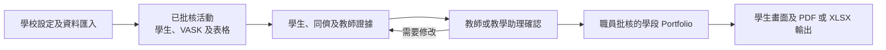

# BHSS 學生成長 Portfolio 精簡 MVP 方案

## 建議成果

第一階段會建立一套由學校管理的流程，把活動、反思、證據和教師回饋整理成經覆核的學生 Portfolio，並連繫至八項能力。系統以具來源的資料補足學業成績及教職員印象，協助老師更全面了解學生的參與、能力及成長，同時支援師生檢視學習歷程，並保存每個學段的正式版本。能力階段仍由人員確認，不會交由系統自動決定。

現時產品方向：BHSS 是牽頭學校及首個參考個案。若 JC 接納方案，可提供撥款，讓計劃落地及供參與學校使用；Octopus Infotech 則以產品供應商身份開發並持有這套可重用產品。合約上的擁有權、授權及品牌安排仍待確認。**Discussed on Meeting Oct 26 - kickstart**。

## 推行方式

MVP 採用響應式網頁，供學生、教師、獲授權職員及 SchoolAdmin 使用。外部接收者毋須開設平台帳戶。獲授權職員可輸出已批核的 SLP／PDF；只有在需要詳細覆核時，才提供設有權限控制的 XLSX 證據清單。

這種安排可省卻第一階段開發外部帳戶及複雜存取權限的工作，同時保留資料追溯及正式匯報功能。

## 建議流程

1. 職員以 CSV 或 XLSX 匯入使用者、班別、學段及 Time Infinity 活動資料。
   校方認可的媒體可保留在外部儲存位置，再由受控的伺服器端連接器按媒體識別碼取得。
2. 職員或獲分派教師使用已批核預設表格建立活動，並選擇相關 VASK。
3. 教師確認參加者、出席、活動日期及學生填寫時段。
4. 學生提交指定反思及獲准證據。
5. 只有獲教師點名分派的同儕才可提交互評。
6. 教師覆核回應及證據、提供回饋，並按 16 階段框架確認相關能力觀察。
7. 獲授權職員處理例外並發布學段 Portfolio。
8. 系統產生學生 Portfolio 及正式輸出。

活動表格用來統一收集資料，不會自動決定學生處於哪一個能力階段。每項已發布的評估結果都會保留來源活動、證據、提交者及覆核人資料。

## 使用者頁面

### 學生

- 首頁及待辦事項。
- 我的活動。
- 活動反思及證據提交。
- 校外證書或成就提交。
- 獲分派的同儕互評。
- Proud Moments 選擇。
- 已發布 Portfolio 及回饋。
- 私隱及資料更正要求。

### 教師

- 獲分派活動及評估工作。
- 活動名單、出席、VASK 及表格。
- 直接填寫或以 Excel 批量提交評估。
- 學生證據覆核。
- 回饋及能力階段確認。
- 同儕互評分派。
- 獲分派學生的已發布摘要。

### 獲授權職員

- 覆核工作總覽。
- 活動及表格批核。
- 證據及文字擷取覆核。
- 評估例外處理。
- 使用者、學段及匯入管理。
- Portfolio 發布。
- PDF／SLP 及 Excel 匯出。

### SchoolAdmin

- 使用者、角色、班別及學段管理。
- 存取、上載、同意及資料保存政策。
- 來源系統及匯入設定。
- 保安及操作紀錄覆核。

## 評估規則

VASK 說明活動希望培養的範疇；每條題目保存自己的有效能力定義，不預設對應 VASK 或任何 Rubric。答案獲接納後連同其他佐證，由獲授權人員在 Portfolio 覆核時引用至所選八項能力 Rubric 的具體條件；16 階段則描述每項能力已有佐證支持的發展。**Discussed on Meeting Oct 26 - kickstart。**

學生自評、同儕互評、問卷、學科成績及媒體都是輔助證據。任何會影響已發布能力階段的觀察，均須由教師或指定職員確認。缺少證據時顯示「證據不足」，不會轉換成低分或零分。

## 正式輸出

每個匯報學段產生一份有版本的 Portfolio，內容包括：

- 校內及校外活動紀錄；
- 獲選反思及 Proud Moments；
- 已覆核教師回饋；
- 有證據支持的能力觀察及下一步；
- 每項已發布結論的來源及覆核人。

供人閱讀的正式版本是可列印的 PDF／SLP。Excel 則用於設有權限控制的資料交換、教師批量輸入及證據覆核。只有在需要實體文件或簽署時，才列印已批核的 PDF。

## 第一階段範圍限制

MVP 使用一份已批核的預設活動表格，並先以 CSV／XLSX 匯入取代即時 Time Infinity 接駁。能力評定由人員確認，不使用自動多來源計分公式。第一階段不包括外部機構登入、公開 Portfolio 連結、通用拖放式表格設計器、聲音身份配對或自動決定能力階段。

## 預計工作量

本方案所述的精簡 MVP 如不包括正式 AI 供應商實作，預計為 **95 至 130 人日**。如試行版還需驗證指定的真實 AI 擷取、證據／評分建議及有來源引用的 Portfolio 生成，則建議以 **125 至 175 人日**規劃復活節前的受控制 AI 版試行，其中包括至少一個月 UAT。

AI 版範圍假設一所學校、一條主要 Skills Builder 路徑、一個受控制 AI 供應商，所有正式結果由人員批核，而通用表格／評分準則／供應商靈活設定留待後續階段。估算須視乎校方確認預設表格、來源資料、批核角色、同意政策、正式報告格式、AI 供應商條款及寄存環境。估算包括需求確認、開發、測試、基本保安檢查、使用者驗收修正、部署及交接；不包括等待校方決策、硬件採購、歷史資料清理及法律審閱。
