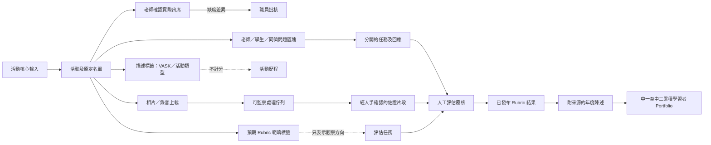

# 最新發現及問題 v2

## 文件用途

本文件獨立整理 2026 年 10 月 26 日 kickstart 會議後的新方向，並與原始設計資料及舊有問題清單分開。它不會改寫 `Design ideas.docx`、`output/Questions.docx` 或 `討論問題.md`。

以下項目使用的追溯標籤為：**Discussed on Meeting Oct 26 - kickstart**。

- **A — 會議確認方向：** 最新會議已明確提出的內容。
- **B — 已採納的架構解讀：** 已批准用於 POC 的實作方法。
- **C — 產品建議：** 以 BHSS 為首間示範學校，同時預留日後服務其他學校的方案。
- **D — 尚待確認：** 仍欠資料、政策或決策權責的項目。

## A — 會議確認方向

| 完成 | ID | 發現 | 對系統的影響 |
| --- | --- | --- | --- |
| [x] | V2-A01 | 採用一套活動核心輸入格式，不建立「每校自訂欄位對應及版本」引擎。 | 學校先整理來源資料；平台列明必填欄位、驗證內容、預覽學生配對結果及保存批核紀錄。 |
| [x] | V2-A02 | 活動核心資料包括名稱、公開簡介、時間、學生可上載時段、媒體批核、活動批核，以及參加者／出席確認。 | 活動封面或特別版面、只供內部及 LLM 參考的補充背景，仍屬活動描述的屬性。 |
| [x] | V2-A03 | 老師按原定名單確認實際出席。 | 原定參加者如缺席，須由職員批核最終出席名單；現階段不假設另設缺席解釋表。 |
| [x] | V2-A04 | VASK 是參考詞彙及活動描述標籤。 | VASK 可協助描述經歷，但沒有階段，不能單獨評估進展。 |
| [x] | V2-A05 | Skills Builder 八項技能／16 階段，以及稍後提供的 RC360，屬評估參考。 | 系統必須把描述標籤與可評估 Rubric 分開。 |
| [x] | V2-A06 | 相片或錄音上載後，應即時開始處理或加入可監察的工作佇列。 | 保存工作狀態、重試次數、輸入清單、處理器、候選結果及人工決定。 |
| [x] | V2-A07 | 即使活動已有參加者名單，相片仍可能需要辨認畫面中的學生。 | 只有經人手確認後，人臉候選才可連結至個別學生的佐證。 |
| [x] | V2-A08 | 錄音主要包含廣東話、英語及普通話，交流活動亦可能出現其他語言。 | 轉錄結果按時間及講者分段，並容許老師更正講者身份或角色。 |
| [x] | V2-A09 | 同一份活動表格可同時包括老師、學生及同儕問題區塊。 | 區塊有指定對象；作答任務則另外記錄誰作答及評核哪位學生。 |
| [x] | V2-A10 | 學習者 Portfolio 可在中三凍結一份涵蓋中一至中三的累積版本。 | 各學年的陳述保持可追溯；中三總結引用舊快照，不會改寫歷史。 |
| [x] | V2-A11 | 正式 RC360 Rubric 及真實學生資料稍後提供。 | 收到並檢視資料後，才展開逐日開發安排。 |

## B — 已採納的架構解讀

| 完成 | ID | 決定 | 限制及保障 |
| --- | --- | --- | --- |
| [x] | V2-B01 | VASK、活動類型及 Rubric 範疇共用「標籤目錄」結構。 | `標籤` 與 `評估` 是兩種不同關係。活動標上某個 Rubric 範疇，只表示預期觀察方向，不會產生分數。 |
| [x] | V2-B02 | 目錄只有在具備版本、範疇、有效階段、佐證規則及發布權責時，才可標示為「可評估」。 | VASK 不具評估能力；RC360 在收到正式內容前維持 `pending_source`。 |
| [x] | V2-B03 | 先完成一條 Skills Builder 1–16 串行評估流程。 | 資料結構保留 Rubric 及版本鍵；單一路徑穩定後才加入 RC360 平行結果。不同 Rubric 不預設互相平均。 |
| [x] | V2-B04 | 活動老師提交實際出席，職員批核名單差異。 | POC 把缺席視為差異；遲到及部分出席會如實保存。 |
| [x] | V2-B05 | 圖像預覽、人臉配對、語音轉錄及 Rubric 建議均採用可追蹤的處理工作。 | 模型結果只屬候選；工作完成不等於內容已發布或評估已獲批。 |
| [x] | V2-B06 | 人臉配對採用可更換供應商的介面，並必須由人手確認。 | 服務只回傳人臉位置、候選學生 ID 及信心值；老師／職員可確認、拒絕、標示不明或非學生。 |
| [x] | V2-B07 | 語音佐證採用兩階段建議。 | 保留原文及整理後文字；先建議廣泛技能，再建議可能支持的最高階段。覆核時列出所有相關句子。 |
| [x] | V2-B08 | 每項系統產生的結論都要說明「為何得出這個結果」。 | 顯示佐證片段、活動背景、Rubric 及版本、Prompt／模型、信心值、人工決定、編輯者及時間。 |
| [x] | V2-B09 | 學生可用句子開首或系統產生的初稿撰寫自我介紹。 | 學生修改及提交，再由指定老師批核或退回；系統保存產生初稿時使用的資料清單。 |
| [x] | V2-B10 | 老師、學生及同儕問題區塊可放在同一份活動表格內。 | 草稿只供編寫人查看；區塊發布並完成對象分配後，學生才會看見。 |
| [x] | V2-B11 | 每條題目保存自己的來源、意思及有效能力定義，不固定對應 VASK、RC360 或 Skills Builder。 | **Discussed on Meeting Oct 26 - kickstart**。獲接納的答案先成為佐證，到 Portfolio 覆核時才按選用的 Rubric 解讀。 |
| [x] | V2-B12 | 目錄的標籤能力與評估能力分開設定。 | **Discussed on Meeting Oct 26 - kickstart**。只有具備有版本的範疇、排序階段及具體條件，才可用作雷達圖。 |
| [x] | V2-B13 | 在來源紀錄與 Rubric 觀察之間加入具類型的「佐證清單」。 | **Discussed on Meeting Oct 26 - kickstart**。日後加入答案、回饋、媒體、證書或外部系統等新類型時，毋須重寫評估演算法。 |
| [x] | V2-B14 | Skills Builder 現行彙總政策為 `MAX-CONFIRMED`，之前階段不是先決條件。 | **Discussed on Meeting Oct 26 - kickstart**。每個範疇採用最高的已確認符合階段；日後如改用平均或其他方法，須另建政策版本。 |
| [x] | V2-B15 | AI 只可產生正面、附來源的候選內容。 | **Discussed on Meeting Oct 26 - kickstart**。AI 不可降低學生評級、接納佐證或發布 Rubric 結果。 |
| [x] | V2-B16 | 回望／展望按老師選擇的學段記憶範圍及資料類別產生。 | **Discussed on Meeting Oct 26 - kickstart**。凍結當次使用的活動簡介、已確認成果、已接納佐證摘要、已發布結果及 Prompt 版本。 |
| [x] | V2-B17 | 帳戶身份、角色定義、具生效日期的角色分派及工作批核分開保存。 | **Discussed on Meeting Oct 26 - kickstart**。角色範圍及生效日期，不等同已獲分派某項批核責任。 |
| [x] | V2-B18 | 活動所屬學段由職員輸入的開始／完結日期自動找出。 | **Discussed on Meeting Oct 26 - kickstart**。只可自動歸入一個完整涵蓋活動的學段；跨學段活動須拆分或明確批核為例外。 |

## C — 產品及學習者 Portfolio 建議

| 完成 | ID | 建議 | POC 現時處理 |
| --- | --- | --- | --- |
| [x] | V2-C01 | 以 BHSS 作首間示範學校，同時把活動、標籤目錄、處理工作、佐證及 Portfolio 做成可重用組件。 | 採用單一核心輸入規格及可設定目錄；現階段不接受每校任意更改資料結構。 |
| [x] | V2-C02 | 參考 Rethinking Assessment 學習者檔案的資訊架構，不直接複製其視覺設計。 | POC 包括身份／自我介紹、技能雷達圖、學習者陳述、Building Blocks、課程／個人專題、評語、代表作品、成就、興趣及學年版本。 |
| [x] | V2-C03 | Portfolio 每句總結均視為一項可追溯陳述，並連結一項或多項來源。 | 來源可包括學生自評、老師評語、同儕互評、轉錄片段、已批核媒體、專題或過往年度陳述。 |
| [x] | V2-C04 | Portfolio 預設不直接顯示原始媒體。 | 顯示已批核陳述及來源提示；查看原始媒體須經另一套權限控制。 |
| [x] | V2-C05 | 如 Rubric 提供範疇標籤，建立活動時可選取。 | 它們只說明預期觀察方向；正式評估仍須另行建立及覆核。 |
| [x] | V2-C06 | BHSS 是牽頭學校及首個參考個案。若 JC 接納方案，可提供撥款，讓計劃落地及供參與學校使用；Octopus Infotech 則負責開發及供應產品。 | **Discussed on Meeting Oct 26 - kickstart**。這是現階段的產品方向，不代表 JC 已批核產品或承擔任何合約責任。 |
| [x] | V2-C07 | Octopus Infotech 制定並持有產品的共通核心；BHSS 負責驗證牽頭學校的實際使用情境，但不會決定所有技術要求。 | **Discussed on Meeting Oct 26 - kickstart**。校本政策、評估權責、同意安排及日常流程仍須明確確認；法律上的擁有權、授權及採購條款，以日後書面協議為準。 |
| [x] | V2-C08 | 核心成果是一份有佐證支持的 Portfolio，協助老師了解學業成績及教職員印象未必能反映的學生能力、參與及成長。 | **Discussed on Meeting Oct 26 - kickstart**。平台把校務、老師、學生及獲授權職員提供的佐證集中整理，並保留來源；沒有佐證時，不可為學生作出沒有根據的正面判斷。 |
| [x] | V2-C09 | 佐證媒體可保留在校方認可的不同儲存位置，毋須全部複製到平台的單一儲存庫。 | **Discussed on Meeting Oct 26 - kickstart**。平台透過可設定的來源連接器，按獲授權的媒體識別碼取得或轉送內容；不可把伺服器實際路徑或存取憑證傳送至瀏覽器，亦不可繞過同意及權限檢查。 |

## D — 尚待確認及未處理問題

| 完成 | ID | 問題／依賴 | 現時處理 |
| --- | --- | --- | --- |
| [ ] | V2-D01 | RC360 的正式範疇、階段、描述、計分、佐證規則及發布權責是甚麼？ | 等候正式來源；POC 不把任何 RC360 分數當作正式結果。 |
| [ ] | V2-D02 | 校方會提供哪些真實學生／活動檔案？資料質素有甚麼實際問題？ | 收到並完成資料剖析後，才制定詳細開發日程。 |
| [ ] | V2-D03 | 正式人臉處理須遵守哪些私隱、同意、家長授權、保留、刪除、參考相片來源及供應商條款？ | 只使用校方提供並與正式資料分隔的測試相片；這只驗證操作，不代表正式合規。 |
| [ ] | V2-D04 | 各校會使用 Google、其他供應商，還是校內人臉服務？ | 採用供應商介面並保留人工確認。 |
| [ ] | V2-D05 | 交流活動還需支援哪些語言？可接受的轉錄準確度是多少？ | POC 先處理廣東話、英語及普通話，並顯示語言偵測結果。 |
| [ ] | V2-D06 | 整理後文字可否影響 Rubric 建議，還是只供閱讀？ | 同時保存原文、整理版本及刪減紀錄，並要求人手覆核。 |
| [ ] | V2-D07 | 老師的起始階段評級是否必填？老師、學生和同儕觀點如何整合？ | 各種觀點分開保存；不會用學生／同儕平均值填補欠缺的老師評級。 |
| [ ] | V2-D08 | 誰可批核標籤、Rubric 預期範疇、佐證及最終發布階段？ | 角色身份不等於獲分配批核權。 |
| [ ] | V2-D09 | 中一、中二及中三的正式凍結日期是甚麼？凍結後如何修正？ | 建議保留不可改寫的年度快照，修正時新增版本及原因。 |
| [ ] | V2-D10 | 「我的興趣」由甚麼資料產生？分類由誰制定？ | POC 清楚標示為未決，不會暗中從活動推斷。 |
| [ ] | V2-D11 | Portfolio 哪些部分必須出現？評語、代表作品、興趣及成就由誰批核？ | 各部分保持可設定，並顯示來源及批核狀態。 |
| [ ] | V2-D12 | 面對 400–600 名學生，應採用哪種佇列容量、重試、通知及並行設定？ | POC 只示範工作狀態；正式容量按真實媒體數量及所選服務估算。 |
| [ ] | V2-D13 | Octopus Infotech、BHSS 與 JC 之間正式的擁有權、授權、支援及資助期後安排是甚麼？ | Octopus Infotech 擁有產品是現時內部方向。**Discussed on Meeting Oct 26 - kickstart**。仍須合約確認。 |
| [ ] | V2-D14 | 產品名稱或商標應由 Octopus Infotech 持有、採用聯合品牌，還是以 JC 專屬品牌方式授權？ | 系統分析員（System Analyst）認為日後採用 JC 專屬品牌並非沒有可能，但目前只屬個人判斷。**Discussed on Meeting Oct 26 - kickstart**。未有書面批准前，不可使用 JC 品牌。 |
| [ ] | V2-D15 | 須支援哪些外部儲存服務及 API？來源會回傳媒體識別碼、短效 URL、metadata（中繼資料），還是直接回傳媒體內容？ | 須確定連接器的認證方式、准許存取的路徑／端點、身份配對、同意安排、保留期、服務可用性、快取、撤銷及審計要求。**Discussed on Meeting Oct 26 - kickstart**。 |

## 關係摘要

