# 核心資料關係

## 文件範圍

本文件是平台核心操作流程及資料關係的權威來源。雷達圖彙總、進展計算、自動建議等分析功能不在這一層處理。`資料欄位修訂.md` 只保留修改前後的說明及實作參考；如欄位或關係有差異，以本文件為準，匯入合約亦須跟隨本文件更新。`Design ideas.docx` 是原始設計資料；`output/Questions.docx` 是後期探索筆記，當中同時包含需求、建議和未決問題，不能全部視為校方已確認的要求。

所有尚待確認的高層次、中層次及操作問題，集中記錄在 `output/Chinese/討論問題.md`。本文件只保存現階段已採用的規則及建議架構；清單內的問題未有正式答案前，不會自動變成系統要求。

2026 年 10 月 26 日 kickstart 會議後的新方向另見 `output/Chinese/最新發現及問題 v2.md`。該文件分開列出會議確認方向、已採納的架構解讀、產品建議及尚待確認事項。

## 平台組成概覽

現階段可把平台分為 **10 個核心功能組件**。下表按 `輸入 → 處理 → 輸出` 排列，方便簡報時由資料來源一路講到最終 Portfolio。這是用來說明職責及資料關係的功能劃分，不代表正式部署時必須建立 10 個獨立系統或服務。

| 階段 | # | 功能組件 | 主要工作 | 與下一步的關係 |
| --- | ---: | --- | --- | --- |
| 輸入 | 1 | 身份及學校架構 | 管理學生、老師、職員、角色、班別、群組及在校狀態 | 確定誰可參與活動、提交資料、覆核及批核 |
| 輸入 | 2 | 學年及匯報時段 | 管理學年、學期／匯報時段、轉學年及歷史快照 | 為活動、提交紀錄、評估結果及 Portfolio 指定所屬時段 |
| 輸入 | 3 | VASK、技能框架及 Rubric | 保存 VASK、Skills Builder 八項技能／16 階段，以及日後的 RC360 版本 | 為活動標籤、Portfolio 覆核、觀察及能力評估提供共同參考 |
| 輸入 | 4 | 活動、參加者及出席 | 建立活動、安排負責人和參加者，並由老師確認實際出席 | 建立收集學生回應、媒體及評估資料的活動情境 |
| 輸入 | 5 | 表格、題目及提交 | 管理表格版本、問題區塊、老師／學生／同儕題目，以及各項提交 | 收集結構化回應，並保留作答人、被評學生及版本 |
| 輸入 | 6 | 佐證、媒體及外部儲存 | 保存或引用相片、錄音、影片、文件、作品及證書，並管理同意和存取 | 把不同來源的證明連繫至活動、提交、校外成就及學生 |
| 處理 | 7 | 資料整合及自動處理 | 驗證匯入資料、配對身份、產生預覽，並進行文字擷取、語音轉錄、人臉候選、分類及摘要 | 整理成可供老師或職員覆核的資料及建議，不會直接發布結果 |
| 處理 | 8 | 覆核、回饋及能力評估 | 由獲分派的老師／職員核實佐證、給予回饋及確認能力觀察 | 把已核實的回應和佐證整理成有來源、有版本的評估紀錄 |
| 輸出 | 9 | Portfolio、快照及正式輸出 | 整理活動歷程、學生反思、已批核回饋、能力狀態及年度／學段快照 | 產生學生 Portfolio、HTML、PDF／SLP 或 XLSX |
| 全流程 | 10 | 管治、權限及審計 | 管理資料來源、批核分派、同意、政策、操作紀錄及系統設定 | 貫穿輸入、處理及輸出，確保每項操作有權限、有狀態並可追溯 |

整體關係可簡化如下：

```text
輸入
  身份／學校架構 + 學年時段 + VASK／技能框架／Rubric
  活動、參加者及出席 + 表格回應 + 媒體佐證
      ↓
處理
  資料驗證及整合 + 自動處理建議 + 人工覆核及能力評估
      ↓
輸出
  已發布 Portfolio + 學段／年度快照 + HTML／PDF／SLP／XLSX

管治、權限及審計貫穿輸入、處理及輸出。
```

## 2026 年 10 月 26 日 kickstart 架構摘要

**狀態：已採納作為架構方向；正式 RC360 文件及正式環境的私隱規則仍待確認。**

- 現階段採用一套共通的活動輸入格式，不為每間學校另建一套欄位對應及版本轉換機制。學校先按指定格式整理來源資料；平台則負責列明欄位要求、驗證內容、預覽配對結果及保存批核紀錄。
- 每項活動保存公開簡介、可選填的內部補充資料、活動時間、學生上載時段、封面顯示方式、原定參加者、批核狀態及媒體狀態。內部補充資料只供獲授權人員查看；如要交由 AI 或其他處理服務使用，須按用途、同意及權限另行明確批准。
- 老師按原定名單確認實際出席。原定參加者如被標示為缺席，系統建立職員批核例外；現時不假設另設缺席解釋表。
- VASK 及活動類型目錄只作描述。只有具備版本、範疇、階段、佐證規則及發布權責的 Rubric 目錄，才可用作評估。活動選取某個 Rubric 範疇，只表示預期觀察方向，不等於給分。
- 首要目標是完成一條可靠的 Skills Builder 八項技能／16 階段流程。資料結構保留 Rubric 及版本鍵，方便日後加入 RC360 平行結果，但不同 Rubric 不會預設互相平均。
- 同一份活動表格可包含老師、學生及同儕問題區塊；每項作答任務仍須分開記錄作答人、觀點及被評學生。草稿區塊在發布前只供編寫人查看。
- 圖像預覽、人臉配對、語音轉錄及 Rubric 建議均以可追蹤的背景工作處理。自動處理結果只作建議；學生身份、講者、佐證及正式評估仍須由獲授權人員確認。
- 學習者 Portfolio 的每項陳述都保存佐證連結、Rubric 及版本、相關 Prompt／模型、編輯者、批核者及時間。中三累積版本可引用中一至中三快照，但不會改寫舊版本。
- 學生自我介紹可由句子開首或系統產生的初稿開始，經學生修改和提交後，再由指定老師批核或退回。

POC 可使用校方提供並與正式資料分隔的測試相片，驗證人臉候選及人工確認流程。這不代表正式環境的同意、保留期、家長授權、參考相片來源或供應商條款已獲確認。

### 已確認的關聯資料修訂

**狀態：現階段已確認，標籤為 `Discussed on Meeting Oct 26 - kickstart`。**

- **角色：** 帳戶身份、角色定義和具生效日期的使用者角色分派分開保存。工作批核另設分派紀錄；擁有某個角色，不代表已獲分派某項批核工作。
- **學段：** 職員只需輸入活動開始及完結日期，系統會找出完整涵蓋該日期範圍的單一學段，例如 `2025-26-P1`。如活動橫跨兩個學段，系統會建立例外，要求拆分活動或由獲授權人員明確批核，不能由職員隨意選一個學段。
- **題目：** 每條題目保存來源、文字、意思及一項有效的能力定義，不預設固定對應 VASK、RC360 或 Skills Builder，也不再計算題目對應權重。Portfolio 會引用題目、答案、作答人、活動及相關佐證，再於覆核時按選用的 Rubric 作解讀。
- **Rubric：** 同一目錄可只供標籤、只供評估、兩者皆可，或暫時兩者皆不可。用作評估及雷達圖的 Rubric，必須具備有版本的範疇、排序階段和具體條件。VASK 一類詞彙可為 LLM 提供背景，但不會因此變成分數。
- **進展規則：** Skills Builder 現行政策只在獲分派而具權限的覆核人明確納入、屬於同一 Rubric 版本及範疇的觀察中，採用最高的「已由人員確認符合」階段。學生可以符合第 8 階段，而不必先逐一符合之前所有階段。日後如改用平均或其他算法，須另建有版本的政策，不能無聲改動現行結果。
- **佐證清單：** 題目回應、老師／同儕／學生回饋、觀察、平台媒體、外部媒體參照及證書，統一經 `proof_type_definitions`、`proof_items` 和 `proof_links` 管理。每項佐證保留輸入／佐證類型、觀點、來源，以及申報的作者／AI 輔助情況。日後加入新佐證類型時，毋須重寫整套 Rubric 演算法。
- **AI 界線：** LLM 只可提出正面、附來源的候選內容或 Rubric 建議。不同供應商、模型及 Prompt 版本的結果須平行保存，不可互相覆蓋。LLM 不可降低學生評級、接納佐證、選擇正式納入的佐證，或發布 Rubric 階段；所有正式決定仍由人員確認。
- **回望／展望記憶範圍：** 老師可選擇學段範圍，以及是否納入活動簡介、已確認／整理的活動成果、已接納佐證摘要和已發布 Rubric 結果。每次產生內容時，系統須凍結當次實際使用的來源項目及 Prompt 版本。

### 已批准的學校邊界及自動處理合約

**狀態：系統分析於 2026 年 10 月 27 日批准的架構決定；本節把 `Discussed on Meeting Oct 26 - kickstart` 的方向落實為技術邊界，並不代表 BHSS 或 JC 已批准校本政策。**

- **穩定學校邊界：** 每種部署均有一筆 `schools` 紀錄及穩定 `SchoolId`，並在資料庫保存為 `school_id`。這個識別碼不包含業務意思、不可變更，也不由學校名稱／代碼推算。即使是單校本地安裝，也只是在設定上使用一間學校，不會刪去學校邊界；多校服務則沿用同一識別碼，隔離各校紀錄、連接器、背景工作、政策及快照。
- **整校停用：** `schools.is_disabled` 是營運層的整體停止控制，並保存原因、操作人及時間。停用後，系統拒絕新登入、受保護操作，以及新領取／提交的背景工作，但保留所有資料、歷史及審計紀錄。重新啟用須具平台營運權限，不能單憑一般 SchoolAdmin 角色執行。
- **按校開放功能：** `feature_definitions` 保存產品功能目錄；`school_feature_policies` 按 `school_id + feature_key + availability` 記錄某校可用功能。開發中、試行中及未知功能預設關閉，直至獲明確開放。因此，示範學校可只試用已準備好的功能，而未完成部分仍不會顯示或執行。
- **功能開放不等同授權：** 核心系統先檢查學校是否有效及功能政策，然後仍須通過角色、工作範圍、生命週期、同意及批核規則。API 及背景工作均須重新檢查權威政策；介面只反映結果，並非控制本身。
- **擷取合約：** 核心系統以最少而獲授權的要求呼叫 `ExtractionProvider` 端口。轉接器只回傳標準化擷取文字、依次排列的片段／候選、語言、可用的信心值、供應商／版本、警告及時間；它不可直接寫入平台紀錄、接納佐證、確認身份或發布評估。
- **Portfolio 生成合約：** 核心系統只把一份凍結清單傳給 `PortfolioGenerator`，而清單只包含同一學校、學生及時段／時段範圍內，已接納且可納入 Portfolio 的佐證。生成器回傳結構化草稿部分／陳述、依次排列的來源參照及生成資料。未知、跨校、不合資格或不在輸入清單內的參照一律由核心系統拒絕。
- **人工及展示邊界：** 生成內容在獲授權人員批核前只屬草稿。核心系統其後凍結已批核快照 DTO；Portfolio 網頁、雷達／展示及匯出元件只讀取該 DTO，毋須知道擷取供應商、LLM 供應商、Prompt 或生成方法。
- **交付階段：** 供應商中立合約、驗證及測試替身屬 P1；正式 OCR／轉錄及 LLM 供應商實作留待 P2，並受 H-07／H-10 政策決定約束。


### 可設定的教職員工作範圍及批核架構

**狀態：系統分析於 2026 年 10 月 28 日批准的架構決定。這是可重用產品的設計決定，不代表 BHSS 或 JC 已批准校本政策；每間學校仍須設定實際採用的人員、範圍及批核流程。**

- **職位不等同權限：** 科任老師、導師、科主任、校長、副校長、教學助理、項目統籌、社工／輔導人員及校務人員等，屬可搜尋的校內職位資料，本身不會自動授權。
- **工作角色可兼任：** 同一人可同時獲分派 `educator`、活動建立人、活動編輯人、班主任、評估人、Portfolio 覆核人、Portfolio 發布人、批核統籌或 SchoolAdmin 等具生效日期的功能角色。某一活動內的擁有人、支援老師、評估人或觀察員關係另由 `activity_staff.relationship` 保存。敏感操作須記錄實際採用的角色分派及範圍。
- **工作範圍須明確：** 角色、功能及批核資格可按學校、部門、學科、級別、班別、教職員群組、課程、活動或指定學生設定。部門、學科及教職員群組均屬校本正式資料，不以自由文字代替。
- **功能政策：** `capability_definitions` 定義伺服器實際驗證的操作；`role_capabilities` 提供產品預設；學校可再按角色、群組或個別用戶，在指定範圍及生效期內設定准許／拒絕。適用的明確拒絕優先。介面選單及老師搜尋只反映結果，不能取代伺服器驗權。
- **共用老師介面：** MVP 可沿用一套按功能產生的老師工作區，暫時毋須為每種職位設計不同版面。可見紀錄、操作、篩選器及工作佇列按有效分派改變；職位名稱本身不決定介面或資料權限。
- **批核資格不是另一種職員身份：** 系統不建立永久的 `approval_staff` 使用者類別。老師或其他教職員透過有範圍的功能角色／權限取得批核資格；實際需要處理的紀錄另設具名分派，完成後再保存不可修改的決定紀錄。
- **每校、每流程獨立設定：** 活動修訂、表格、提交、佐證／Rubric、Portfolio 及其他流程分開設定。精簡 MVP 只支援 `not_required`、`automatic`、`single_reviewer` 及 `two_stage_sequential`；不包括平行投票、法定人數、任意分支或由用戶編寫流程。
- **分工保持彈性：** 批核與發布是兩項權限及兩個事件，但校本政策可容許同一人兼任。是否可自行批核亦按每個步驟設定。表格、正式 Rubric 結果及 Portfolio 發布建議預設不可自行批核；活動則可由學校容許建立人把自己列為批核人。
- **沒有人處理時不可繞過：** 具名分派可指派任何合資格人員；如政策容許，也可指派建立人本人。沒有合資格覆核人、無人接收或逾期時，工作進入 `approval_escalations`，在獲授權統籌重新分派或處理前維持封鎖。
- **理由及署任：** 拒絕、排除、撤回、重新分派、發布後修正及例外繞過必須填寫理由。署任須有時限、範圍及審計紀錄；轉寄工作不會自動轉移權限。
- **老師搜尋：** 獲授權人員可按職位、功能角色、部門、學科、級別、班別、教職員群組、課程、批核資格及有效狀態搜尋／篩選。結果只限同一學校，亦不會因搜尋而取得額外資料權限。
- **活動身份固定，內容另行版本化：** `activity_id` 在活動名稱、簡介或其他受管治設定修訂後保持不變。重要改動建立新的 `activity_revision` 及批核工作；佐證、媒體、參加者及提交仍連繫同一活動。除非私隱／安全規則要求撤回，學生及日常操作繼續使用最近一個已批核版本，直至新版本獲批。
- **活動擁有人及修改要求：** 任何獲授 `activity.create` 的老師角色均可建立活動。建立人／指定編輯人可修訂自己的活動並送交批核；只獲分派參與但沒有編輯權的老師，須建立 `activity_change_request`，不可直接修改由職員建立的活動。老師按「發布」時，如政策要求批核，實際建立的是發布／批核要求，不會即時向學生公開。
- **Portfolio 版本及可見狀態：** 學生可繼續修改最新自我介紹及活動選擇；正式 Portfolio 只讀取最近一個已批核版本。班主任可選取全部或部分學生提交內容、退回項目，並把整理後的版本交予指定發布人。未有任何已批核版本時，正式頁顯示 `no_approved_version`，學生同時列入職員例外／升級處理清單。
- **作者及來源規則：** 學生自撰介紹／反思清楚標示為學生內容，毋須另附外部佐證，但須保留提交及修訂歷史，亦不可包裝成已核實的 Rubric 結論。LLM 產生的「作為學習者的我」及系統生成的 Rubric 摘要必須列出來源。班主任只可修改受控 Prompt 或 LLM 生成文字，不可改寫學生原文或其他老師的觀察；生成稿、老師修訂稿及最後批核稿須分開保存，修訂後仍須按設定再次批核。

精簡 MVP 的批核引擎刻意限制為上述四種模式、最多兩個順序人工步驟，而且每步只需一項決定。它把各處零散的 `approved_by_user_id` 整合成共用控制，但不會擴展為通用流程編排系統。

#### 權威核心資料

| 類別 | 核心資料 |
| --- | --- |
| 職位及功能角色 | `staff_position_definitions`、`user_position_assignments`、`role_definitions`、`user_role_assignments` |
| 學校組織及範圍 | `departments`、`subjects`、`department_subjects`、`groups`、`group_memberships` |
| 功能授權 | `capability_definitions`、`role_capabilities`、`capability_policy_overrides` |
| 批核 | `approval_policy_versions`、`approval_policy_steps`、`approval_assignments`、`approval_decisions`、`approval_escalations` |
| 活動版本 | `activity_instances`、`activity_revisions`、`activity_change_requests`、`activity_staff` |
| Portfolio 版本 | `portfolio_working_versions`、`portfolio_version_items`、`learner_narrative_versions`、`portfolio_snapshots` |

`user_role_assignments.scope_type` 支援 `school`、`department`、`subject`、`year`、`class`、`group`、`programme`、`activity` 及 `student`；`scope_id` 必須指向同一學校的有效紀錄。批核模式只可為 `not_required`、`automatic`、`single_reviewer` 或 `two_stage_sequential`。Domain 紀錄仍保留自己的生命週期及發布狀態；共用批核資料只補充資格、具名分派、決定及升級處理歷史。

### 產品邊界及核心成果

**狀態：產品方向，標籤為 `Discussed on Meeting Oct 26 - kickstart`；H-11 至 H-14 的合約事項仍待確認。**

- BHSS 是牽頭學校及首個參考個案。若 JC 接納方案，可提供撥款，讓計劃落地及供參與學校使用；Octopus Infotech 則制定、持有及供應產品的共通核心。擁有權、授權、品牌及支援安排仍須以書面條款確認。
- 平台須產生實際可用、有佐證支持的 Portfolio。除了學業成績，系統亦整理學生在不同情境中的表現，補足教職員單憑印象作出的判斷，讓獲授權教育人員更全面了解容易被忽略的參與、能力、興趣及成長。
- 系統集中校務、老師、學生及獲授權職員提供的資料、媒體及其他證明，同時保留各方觀點及資料來源，不會把不同資料勉強合併成沒有充分佐證的單一結論。
- Octopus Infotech 可制定產品要求；校本評估政策、同意、存取、發布權責及日常操作規則仍須校方明確決定。

### 分散儲存的媒體來源

**狀態：部分已有方向，標籤為 `Discussed on Meeting Oct 26 - kickstart`；供應商細節仍按 L-08 及 V2-D15 待確認。**

媒體可保留在一個或多個校方認可的儲存位置。`media_source_connector` 記錄供應商類型、適用學校、認證資料參照、准許存取的根目錄／端點、支援功能及狀態；`media_asset` 只保存不包含實際路徑的外部識別碼、可用的 metadata（中繼資料）、雜湊值及來源。瀏覽器端不可取得伺服器實際檔案路徑或儲存服務憑證。

伺服器端連接器可按外部識別碼取得 metadata、簽發短效授權 URL，或經平台轉送媒體內容。每次存取均須檢查使用者角色、獲分配範圍、同意狀態、紀錄生命週期及來源是否可用，並追加存取紀錄。連接器失效時，系統仍保留歷史佐證連結及評估來源，只把原始媒體標示為暫時無法讀取。

系統須完整保留資料脈絡，包括活動內容、參加者、VASK 方向、所採用的表格版本、填寫者、被評估學生、提交答案、行為觀察、證據所支持的能力階段，以及每項紀錄的建立、覆核和批核人員。

學生認為有意義的經歷，與正式能力進展屬於兩類記錄。證書、校外成就或 Proud Moment 可以反映學生的價值、態度、技能及知識，但不會因此自動取得八項能力的正式對應或改變 1 至 16 階段。

## 已採用的操作規則

### 學生校外成就

學生可上載鋼琴比賽等校外證書。除非學校其後正式接納為校方活動，否則應記錄為 `student_external_achievements`，而不是一般活動實例。記錄須分開保存頒發機構、日期、類別、級別或難度、結果類型、證書、學生選擇的 VASK、提交及發布狀態，以及負責覆核的教師或教學助理。

預設 `official_skill_mapping_status` 為 `none`。一級樂器比賽亞軍、八級樂器比賽亞軍及出席證書並不等值，系統不可單憑獎項名稱推斷能力階段。

如教師或教學助理沒有親身觀察該項校外活動，系統仍可保存證書、學生反思及學生自選 VASK，但不可憑空建立教師評級。這類學生自述的價值／態度證據不會與欠缺的教師分數平均計算，預設亦不會改變已發布的 1 至 16 階段。

### Proud Moment

`proud_moment_selections` 記錄學生選擇最能代表自己的活動、成就或證據，以及選擇原因。這是反思及展示安排，不是能力階段評定。若同意、背景或證據不足，獲授權人員可不予發布，但學生介面只顯示中性的覆核或發布狀態。

### 活動與表格的配套

每項校方活動都要配上一個已鎖定的表格版本。表格可包含老師、學生或同儕問題區塊。每條題目保存來源、中英文文字、作答對象、次序、量表，以及自己的能力代碼、名稱和說明。這項能力用來界定題目可以合理詢問或觀察甚麼，不是 VASK 標籤、Rubric 範疇或評估結果。

現階段把兩種試算表用途清楚分開。建立表格版本的流程如下：

```text
檢視活動目的及題庫內的題目能力
  -> 選取或編寫意思切合該情境的題目
  -> 下載表格定義 XLSX
  -> 修改題目文字、作答對象、次序、量表或能力定義
  -> 上載並檢查驗證結果及逐行變更
  -> 建立後繼草稿版本
  -> 明確發布新版本
```

「表格定義 XLSX」不包含學生答案；「回應輸入 XLSX」只用來輸入已發布表格的答案。上載表格定義不會改變學生畫面；新版本正式發布前，學生仍使用上一個已發布版本。

### 題目佐證及 Portfolio 階段的 Rubric 解讀

**狀態：現階段已確認，標籤為 `Discussed on Meeting Oct 26 - kickstart`。**

答案提交後，會先成為附來源的「佐證清單」項目，並保存題目、作答人、被評學生、活動、表格版本及來源紀錄。到 Portfolio 整理階段，獲授權覆核人員才可引用該項佐證，確認當時選用的 Rubric 條件。系統不會預先為題目分配技能權重或設定可支持階段上限；表格／題目版本的批核，與 Rubric 觀察的確認及發布，是兩個分開的決定。

### 匯入回應的處理及可見狀態

Google Forms、CSV 或其他來源匯入的回應，先經過以下處理：

```text
received -> identity_matched -> validated -> included_in_assessment
received -> needs_identity_resolution -> corrected -> validated
validated -> excluded
```

`included_in_assessment` 只代表該紀錄可納入評估流程，並不代表學生已可看見教師答案、回饋或 Portfolio 內容。預期收到但仍然欠缺的回應，記錄為 `missing_response` 並通知負責教師，不會當作零分。

學生可見狀態另行處理：

```text
unpublished -> published_to_portfolio -> withdrawn
```

如職員需要修正學生編號，原始匯入資料不可改寫。系統須另存原有及修正後的學生編號、修改前後值、原因、操作人及時間。後續流程可使用已核實身份，但仍可完整追查原來錯誤。

### 活動目錄差異匯入及生命週期政策

**狀態：系統分析員於 2026 年 10 月 29 日確認的內部產品／架構方向；並非 BHSS 或 JC 批准。**

活動目錄 CSV／XLSX 採用**非破壞性的差異（部分更新）模式**，而不是權威快照。檔案中沒有某項活動，只代表 `no_change`。只有在已驗證並獲納入的資料列明確提供穩定 `activity_id`，或獲授權人員在平台內編輯時，活動才會改變。如日後需要權威快照模式，須另設政策、明確選擇 `missing = disable` 並預覽影響；一般上載不會推斷為此模式。

可編輯往返檔案包括 `activity_id`、`expected_revision_number`、受管制可編輯欄位、目前擁有人識別碼、`lifecycle_action` 及 `change_reason`，但不包括不可變更的原始作者及上載審計身份。獲授權審計匯出可把建立人／上載人列作唯讀來源資料。預期修訂過時時，系統須拒絕，不可覆蓋較新資料。新匯入活動須明確指定合資格初始擁有人，或使用已批准的外部來源作者政策；上載人不可被靜默當作作者。

生命週期操作只包括 `upsert`、`disable` 及 `restore`：

- `upsert` 如受管制值完全相同，只建立可稽核的「無變更」結果。重大改動沿用同一 `activity_id` 建立不可變更的後繼草稿；已提交／已批核／已發布活動須完成正常重新批核。後繼版本待批期間，最近一個已批核修訂繼續作為正式版本。
- `disable` 是一般匯入中唯一可隱藏正式活動的操作，須記錄原因、操作人、時間及之前狀態。排除暫存列只代表不套用該項要求，不會停用活動。
- `restore` 須建立新的可稽核生命週期決定，並保留原有停用事件。

`created_by_user_id` 永遠保存原始作者；`owner_user_id`、上載／要求／服務執行者、提交人及批核分派分開處理。具備上載或提交權限，不等同擁有編輯權、作者身份或批核權。平台內編輯與試算表匯入共用伺服器端範圍檢查、驗證、修訂及批核政策。

活動停用後，學生／參加者不可在活動搜尋、直接連結、回應、評估及「難忘活動」畫面開啟該活動，亦不可透過該活動再取得新的參加者媒體／佐證。參與、媒體、佐證、來源列及修訂歷史仍然保留；獲授權職員可繼續作審計查閱。依賴項目登記為 `needs_review` 或 `stale`；正式輸出須經可稽核撤回或建立後繼版本，不可靜默重算。整個流程不會永久刪除活動或其佐證。

### 人工確認程序

如活動資料會影響已發布的能力階段，每位學生及每項相關能力須有獲分派教師或教學助理的初步評級、來源工具、行為證據、相關表格提交及人工確認。缺少評級時，數值保持空白，不得變成零。學生自評、同儕互評及 AI 建議可保留為未確認證據，但不可獨立決定已發布階段。

### 按佐證類型比較、人工選取及日後撤回

**狀態：2026 年 10 月 27 日獲批准的系統分析架構決定；這是內部架構規則，不代表 BHSS 或 JC 已批准校本評估政策。**

對於同一 Rubric 版本及範疇，覆核畫面按可設定的 `proof_type_definition` 把合資格、已由人員確認的候選觀察分組。每組顯示所有候選中的**最高支持階段**；完成取捨後，再顯示真正納入現行政策的**已選用最高支持階段**，並列出實際佐證連結、觀點、日期、覆核狀態，以及作者／AI 輔助申報。兩個按類型計算的最高值都只屬佐證摘要，不是正式結果；AI 建議屬衍生分析，不納入佐證類型最高值。

獲具名分派、並持有所需評估覆核功能權限及工作範圍的人員，決定哪些觀察及佐證連結可納入正式計算。持有有效評估功能權限的人員可在獲分派範圍內提出或確認觀察；單是老師或教學助理職位不會自動取得這些權限。SchoolAdmin 只負責設定政策，單憑該角色不會取得評估決定權。在 `MAX-CONFIRMED` 下，正式階段只會在同一 Rubric 版本及範疇內，從已納入、合資格、未被撤銷且經人員確認的觀察中取最高值。覆核人可按理由排除不合適候選，但不可輸入沒有來源的覆蓋值；如要採用較高階段，必須另有連結合資格佐證的人員確認觀察。

### Rubric 套件、選取模式及 Portfolio 版本鎖定

**狀態：2026 年 10 月 29 日確認的系統分析方向；不代表 BHSS 或 JC 已批准。** 每個 Rubric 版本都是不可變更的連繫套件：目錄／版本 → Rubric 組別 → 技能／範疇 → 有次序的階段定義。校本往返匯入／匯出採用一個 XLSX，內含四張互相連繫的工作表：`rubric_catalogues`、`rubric_groups`、`rubric_skills` 及 `rubric_steps`。「匯出全部」包含實際儲存紀錄及穩定 ID；另設只包含欄名及示例指引的新增紀錄範本。每次匯入均保存來源檔案／雜湊值、上載者、上載時間、驗證結果，以及提交／啟用稽核；只可軟停用，不可永久刪除。

每個 Rubric 版本只可申報一種 `selection_mode`：

- `definition_only`：獲授權覆核人把合資格佐證與有次序的階段定義比較，再確認獲支持的階段；系統不要求亦不虛構分數。
- `score_range`：每項技能的所有生效階段均須有完整、有效而不重疊的分數範圍。只有在套件沒有填寫 `score_out_of` 時，量表才預設為 10 分；範圍必須涵蓋 0 至該滿分。所得階段定義及實際分數均須可追溯。

修改生效中的 Rubric 絕不可原地改寫。匯入或平台內修改須建立後繼 `draft`、保留 `supersedes_rubric_catalogue_id`、通過連繫紀錄及模式驗證，再由獲授權人員啟用。啟用只會令舊版本對日後新生成項目失效。

系統在建立 Portfolio 工作版本時鎖定 `portfolio_working_versions.rubric_catalogue_id`。提交、班主任覆核、批核、快照發布及匯出均沿用同一 ID／版本。SchoolAdmin 改變目前生效 Rubric 時，不會重算或遷移現有工作版本或已發布快照；下一個新建立的工作版本才使用新版本。已發布結果另須保存技能範疇、所選階段／定義快照、實際納入的佐證／觀察、覆核決定，以及使用分數模式時的實際分數。

同一份凍結佐證清單可由不同 LLM／供應商產生多個建議。系統按供應商、模型、Prompt 版本、輸入清單及警告平行顯示；覆核人可逐項拒絕或忽略。接納建議只會建立／更新一項經人員覆核的觀察，不會把模型輸出本身變成佐證，也不會覆蓋其他模型建議。

先前的接納可在「使用關係」層面撤回。`proof_use_decisions` 保存佐證、目標觀察／Portfolio 陳述／生成工作、決定（`included`、`excluded`、`invalidated`、`superseded`）、原因、操作人及時間。因此，同一佐證可只在某項 Rubric 決定中被排除，在其他合適用途仍然有效。如屬全域錯誤關聯，例如人臉配對把學生誤認為參加了從未參與的活動，則須更正或使身份／佐證關聯本身失效。

已使用的來源或關聯其後被排除、更正或判定無效時，系統須按依賴關係把受影響的擷取結果、LLM 建議、觀察、陳述及目前快照標記為 `needs_review` 或 `stale`。系統不可自動改用另一項來源，也不可靜默降低／提高階段。若結果已發布，須撤回目前發布版本，經獲授權人員重新覆核後才可發布後繼快照；舊版本繼續保留供審計。

在適用位置須提供以下人工更正／排除操作：

1. 從某項觀察、Portfolio 陳述或生成清單中排除單一佐證連結；
2. 更正／拒絕人臉或其他身份關聯，移除錯誤的學生／活動連結；
3. 更正講者身份、轉錄／OCR 文字或擷取 metadata；
4. 更正實際出席／參與狀態，但不改寫原定名單；
5. 排除、更正或取代匯入資料列，同時保留原始 payload；
6. 限制／停用媒體或依賴同意的用途，而不硬刪除歷史來源；
7. 逐項拒絕 LLM 陳述或 Rubric 建議；
8. 取代或撤回由人員作出的 Rubric 觀察／已發布結果；
9. 完成影響覆核後，撤回及重新發出受影響的 Portfolio 快照／匯出；以及
10. 如先前錯誤排除某項用途，透過新的審計決定恢復使用，不刪除原有排除歷史。

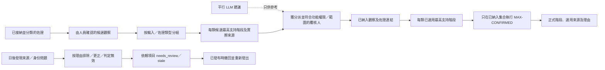

### 同儕互評

同儕互評必須由教師或教學助理明確分派。記錄包括被評學生、同儕覆核人、分派人、活動、表格版本、限期、狀態及是否需要再覆核。挑選同儕的方法仍須由校方決定。

### 可選 AI 撰寫取向

POC 可先提供三種受控撰寫取向：

1. 學術學習與思考；
2. 非學術參與與個人成長；
3. 人際協作與自我管理。

教師可調整重點、學生年級或班別、語氣、篇幅及需要略去的內容；第一階段不建議讓所有教師直接修改完整的系統提示詞。

每次生成均須記錄模型及提示詞版本，並分開保存 `generated_text`、`teacher_edited_text` 及 `final_published_text`，連同修改人、時間及修訂紀錄。教師可以改善語氣，但原有 AI 草稿不可被覆蓋。AI 內容只屬草稿；身份配對、證據接納及正式能力階段仍須由人員確認。

Portfolio 預設不顯示原始相片、錄音或文件，只可顯示證據引用或附件數目。真正開啟媒體須另行檢查存取權限。

## 操作流程圖

### 平台角色及系統邊界

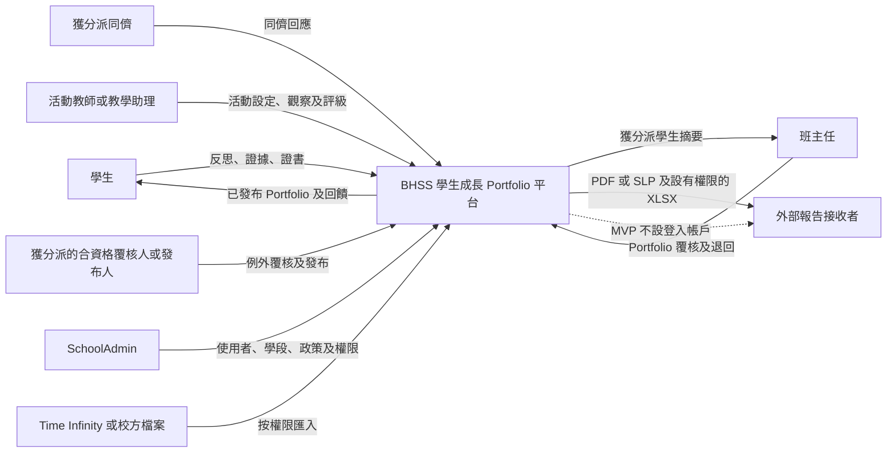

MVP 不會為外部接收者提供登入帳戶。同一位職員可以兼任多個角色，但系統仍要記錄每項操作所採用的角色及權限範圍。

### 一項活動涉及的人員及資料

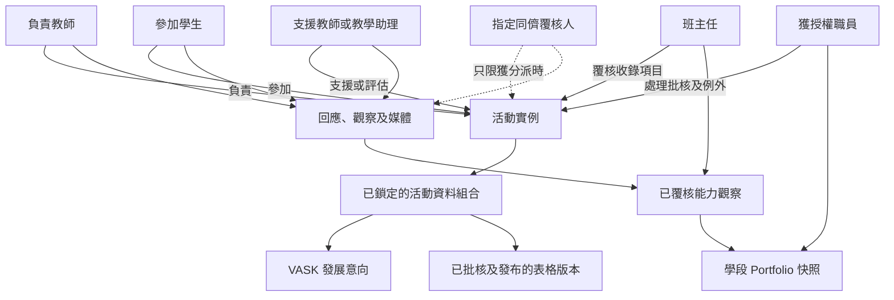

參加活動不代表可以查看所有媒體或 Portfolio 資料。媒體同意、覆核分派、班別範圍及發布狀態均是獨立控制。

### 活動完整流程

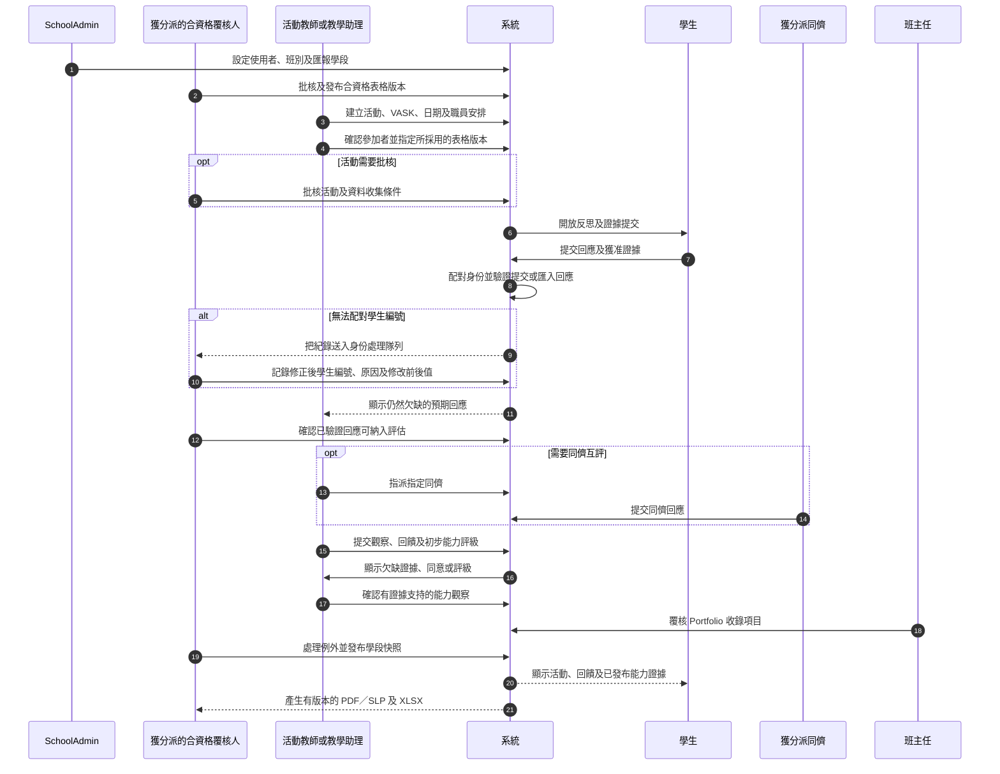

以上圖保留整體教育流程；實際批核不再硬編碼為「職員才可處理」。校方分別設定流程模式、所需功能權限、工作範圍、自行批核及發布分工，再由系統建立具名分派。一般老師如符合權限、範圍及分派，也可作批核人。

精簡 MVP 只使用一套共用批核機制、四種模式及最多兩個順序人工步驟。它比原 SRS 的「一律由職員批核」固定流程更靈活，但遠比平行批核、法定人數、條件分支或由學校自行編寫工作流程簡單。活動、表格、提交及 Portfolio 仍各自保留生命週期；共用批核資料只處理資格、分派、決定及升級處理歷史。

### 每項活動需要連繫的資料

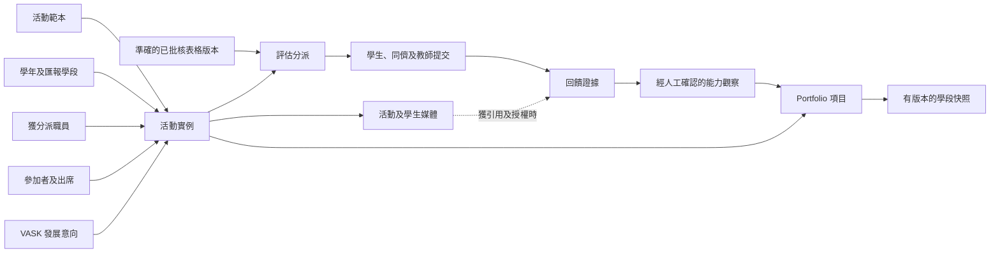

活動是所有資料的共同背景，但表格版本、填寫者、證據、覆核人和發布紀錄仍須逐項追查。

### 證據如何進入 Portfolio

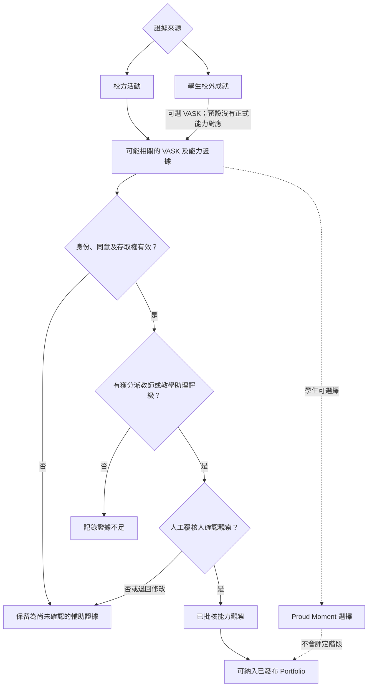

自評、同儕互評、問卷分數、學科成績、媒體擷取及 AI 建議只可提供輔助證據，不可獨立設定已發布的 1 至 16 階段。

### 各自獨立的狀態流程

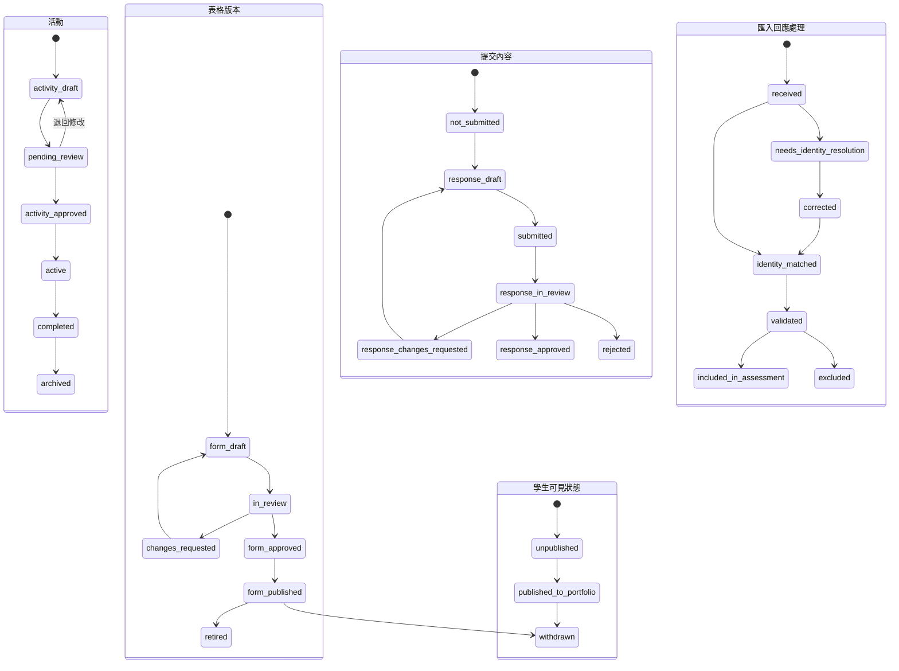

批核、納入評估及向學生發布是三個不同操作。發布表格不會發布學生回應；把匯入紀錄納入評估不會令學生立即看見；通過一項 Portfolio 內容，也不會自動發布整個學段快照。

### 已發布內容被退回修改

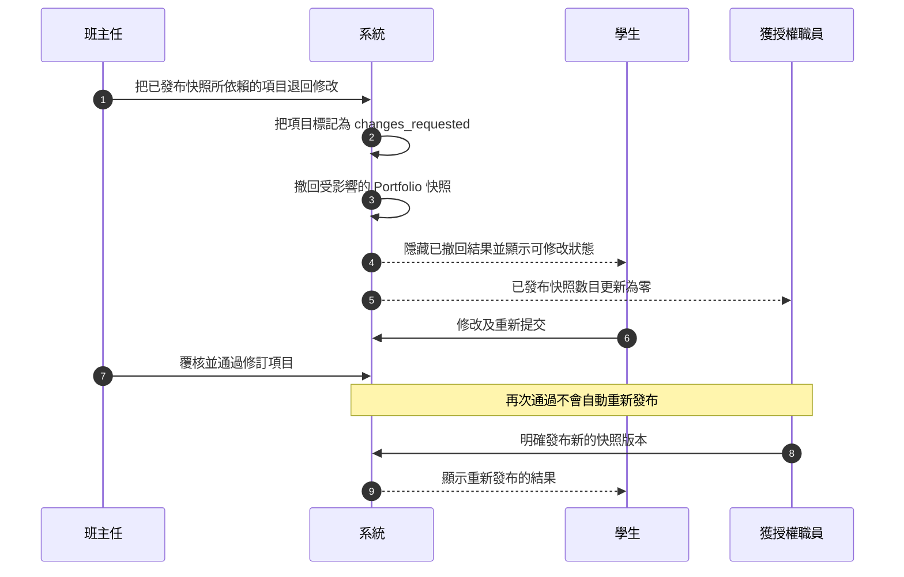

撤回會保留原有操作及歷史快照，不會刪除紀錄，也不會沿用先前的發布決定。

### 匯報學段及正式文件

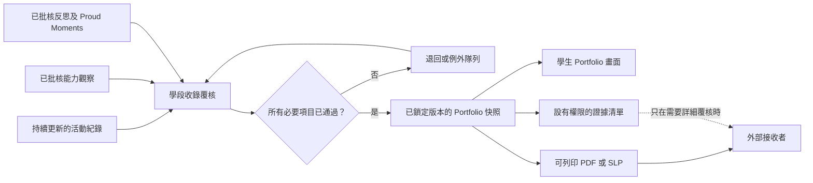

日常活動紀錄可在學段結束後繼續更新。已發布的學段快照及相關文件則要保留當時版本，日後仍可重現。如需修訂，應先撤回舊版本，再重新發布。

### 文件追溯關係

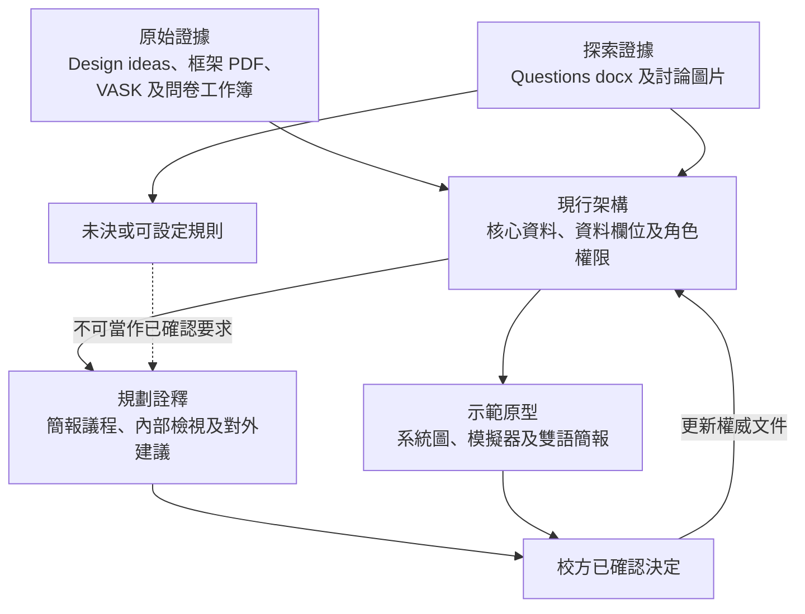

原始證據不可被無聲修改。原型只代表目前理解；只有在決定被正式記錄及更新至架構文件後，才成為系統規則。

## 核心資料關係總覽

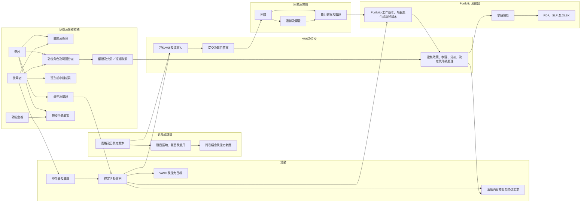

### 2026 年 10 月 28 日權威實體摘要

下表屬本核心文件的權威資料合約；《資料欄位修訂》只供理解修改前／後差異，不是另一套 schema 來源。欄位層匯入示例須與 `output/import-examples/` 的 3.0 合約一致。

| 資料表 | 主要欄位 | 規則 |
|---|---|---|
| `staff_position_definitions` | `position_id`、`school_id`、代碼、中英文名稱、狀態 | 只描述職位／職銜，不直接授權。 |
| `user_position_assignments` | 用戶、職位、可選部門／科目、生效／完結日期 | 同一人可兼任多個職位。 |
| `role_definitions` | 穩定功能角色代碼、名稱、類別、狀態 | 功能角色可以疊加；不以 `approval_staff` 作身份類型。 |
| `user_role_assignments` | 用戶、角色、`scope_type`、`scope_id`、生效期、分派人 | 所有範圍須屬於同一 `school_id`。 |
| `capability_definitions` | 穩定 `capability_key`、資源類型、敏感標記 | 代表伺服器實際驗證的操作。 |
| `role_capabilities` | 角色、權限、允許／拒絕、條件 | 提供角色預設。 |
| `capability_policy_overrides` | 目標角色／群組／用戶、權限、範圍、生效期、原因 | 適用的明確拒絕優先；變更須審計。 |
| `departments`／`subjects`／`department_subjects` | 學校、穩定代碼、名稱、關係及生效期 | 部門及科目是搜尋、分派及授權範圍。 |
| `staff_groups`／`staff_group_memberships` | 學校、群組代碼／用途、可選部門／科目、用戶、成員職責、生效期 | 教師群組與職位／功能角色分開，可作全組政策目標；個別明確拒絕仍然優先。 |

| 批核資料表 | 主要欄位 | 規則 |
|---|---|---|
| `approval_policy_versions` | `workflow_type`、`policy_version`、模式、範圍、自行分派／批核設定、發布分隔、最多人工步驟、預設佇列、升級時限、生效期、設定人 | 每類流程獨立設定；模式只限四種精簡選項。 |
| `approval_policy_steps` | 政策、`step_number`、名稱、`required_capability_id`、`assignee_strategy`、所需決定數目、理由設定、狀態 | 最多兩個順序人工步驟，每步一個決定。 |
| `approval_assignments` | 學校、政策／步驟、目標類型／ID／版本、具名處理人、功能角色分派、分派人、狀態、期限、來源委派及有效期 | 資格不等同實際分派；可設有期限委派。 |
| `approval_decisions` | 分派、學校、步驟、結果、理由、決定人、實際使用的權限／範圍、時間 | 不可改寫；批核與發布是不同事件。 |
| `approval_escalations` | 分派／目標／學段、觸發原因、佇列、狀態、觸發時間、處理人、解決資料 | 處理未分派、被拒接、逾期及 `no_approved_version`。 |

| 活動／Portfolio 資料表 | 主要欄位 | 規則 |
|---|---|---|
| `activity_instances` | 穩定 `activity_id`、學校、建立者、最新修訂、目前已批核修訂、運作狀態 | 內容改動不會更換活動 ID。 |
| `activity_revisions` | 活動、修訂編號、受管制內容、表格／VASK 版本、覆核／發布狀態、建立者 | 重大修改建立後繼修訂並重新批核。 |
| `activity_change_requests` | 活動／基礎修訂、欄位／建議值、原因、提出人、處理結果 | 沒有修改權的獲分派老師使用此流程。 |
| `activity_staff` | 活動、用戶、功能角色分派、關係、`can_edit`、生效期 | 活動關係、修改權及批核權分開。 |
| `portfolio_working_versions` | 學生、學段、版本、前版本、狀態、提交／班主任覆核／具名批核資料 | 草稿與正式版本並存；正式畫面取最新已批核版本，批核人可為符合權限、範圍及分派的老師或其他教職員。 |
| `portfolio_version_items` | 工作版本、項目／來源、作者來源、學生選擇、班主任納入決定、次序 | 班主任可選全部或部分，不可改寫學生原文。 |
| `learner_narrative_versions` | 工作版本、Prompt／來源清單、生成／老師修訂／最終文字、編輯／批核人 | 只可修改受控生成敘述；仍須完成設定批核。 |
| `portfolio_snapshots` | 學生、學段、已批核工作版本、快照版本、發布狀態 | 已發出版本不可靜默覆蓋。 |

## 建議採用的學生歷程模型（H-08 仍待校方確認）

學生身份本身不會因轉班、留級、降級、離校或重返學校而改變；會隨時間改變的是班級配置及在校狀態。POC 已按以下建議方式實作，但完整轉學年政策仍須由校方確認。

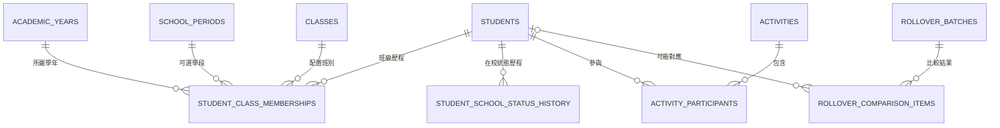

- `students.student_id` 是長期不變的核心身份。轉班、留級、降級、暫時離校、正式退學及重返學校都不應建立另一個學生身份。
- `student_class_memberships` 以 `valid_from` 及 `valid_to` 記錄學生在某學年／學段的班別、級別、變動類型、原因、操作人，以及被取代的上一項記錄。
- `student_school_status_history` 另行記錄在校、休學／暫離、退學、重返及畢業狀態。因此，即使學生離校兩年後回校，原有學生 ID 仍可沿用。
- 活動參加者只保存 `student_id`，不把當前班別抄入活動表。查看過往活動時，系統按活動日期找出當時有效的班級歷程。
- 轉學年批次先把新舊名單分為：沒有改變、轉班、留級／級別調整、重返學校、可能是新生，以及離校／名單遺漏。`new_candidate` 必須經校務人員確認，系統才可建立學生身份及配置班別。
- 匯入修正須保留修改前後值、原因、操作人及時間，不得回寫或改動既有活動紀錄。

這個做法可避免學生現時的班別污染過往活動證據。校方仍須確認轉學年的截數日期、重疊班級記錄處理、學期中途轉班、重複身份核對，以及誰可正式套用已覆核的批次；以上問題繼續由 H-08 跟進。

## 主要約束

- 每種部署均須有穩定 `school_id`。屬於學校的根紀錄須直接保存該 ID，其他紀錄則須經受強制約束的上層關係推導；repository 不可執行沒有學校範圍的租戶查詢。
- `schools.is_disabled` 控制整校營運；`school_feature_policies` 控制個別功能可用狀態。兩者均不取代角色、工作範圍、同意或批核。
- 文字／媒體擷取供應商只可回傳標準化候選；Portfolio 生成器只可接收已接納及合資格的凍結佐證清單，兩者均不可直接寫入正式評估或快照。
- 視覺化及匯出只讀取已批核的凍結 Portfolio 快照 DTO，不直接依賴任何 AI 供應商。
- 每個框架版本包含八項能力，每項能力有 16 個階段。
- 每條題目保存自己的有效能力定義，不固定對應 VASK、RC360 或 Skills Builder，也不保存題目對 Rubric 的權重或階段上限。
- 獲接納的答案先成為佐證清單項目；獲授權人員在 Portfolio 覆核時，才可引用佐證確認所選 Rubric 的具體條件。
- 只有具備有版本的範疇、排序階段及具體條件的 Rubric，才可用作評估及雷達圖。
- Skills Builder 現行結果採用每個範疇最高的已確認符合階段；先前階段不是先決條件，其他計算方法須另建版本。
- 一項活動可有多位學生及多位職員，必須使用接駁表記錄角色、有效日期及狀態。
- 每次評估分派須指向準確且已鎖定的表格版本；分派後不得直接改寫。
- 表格版本只有在已批核、已發布、未停用且仍在有效期內時才可建立新分派。
- 回饋須記錄作者、學生、活動、觀察時間、角度及可見範圍。
- 同一項證據可支持多項能力觀察；每項觀察亦可引用多項證據。
- `observed_step` 與一致性或出現頻率是兩個不同值。
- 媒體本身不是評估證據；只有在回饋證據說明其相關性後才可使用。
- 匯入資料的身份修正不得覆蓋原始內容；原有及修正後學生編號、原因、操作人及時間均須保留。
- 資料驗證、納入評估及向學生發布使用三套獨立狀態。
- 所有正式匯出均指向一個已鎖定、不可直接改寫的 Portfolio 快照。

## 第一階段不包括的分析

- 把多次觀察合併為目前階段的公式。
- 教師、學生、同儕及家長回應的權重。
- 雷達圖快取、趨勢、班級比較或預測模型。
- 直接把問卷總分轉換成能力階段。
- 根據證據數量或時間自動計算信心分數。
- 自動提升技能階段、徽章或里程碑通知；但未分派／被拒接／逾期的批核升級處理佇列屬 P1 必要控制。
- 外部機構登入平台及修改校方已確認結果。

即使日後加入分析層，活動、提交、回饋、證據、人工確認及發布紀錄仍是權威資料來源。
