# 核心資料關係

## 文件範圍

本文件先界定平台的核心操作流程及資料關係。雷達圖彙總、進展計算、自動建議等分析功能不在這一層處理。`Design ideas.docx` 是原始設計資料；`output/Questions.docx` 是後期探索筆記，當中同時包含需求、建議和未決問題，不能全部視為校方已確認的要求。

所有尚待確認的高層次、中層次及操作問題，集中記錄在 `output/Chinese/討論問題.md`。本文件只保存現階段已採用的規則及建議架構；清單內的問題未有正式答案前，不會自動變成系統要求。

系統須完整保留資料脈絡，包括活動內容、參加者、VASK 方向、所採用的表格版本、填寫者、被評估學生、提交答案、行為觀察、證據所支持的能力階段，以及每項紀錄的建立、覆核和批核人員。

學生認為有意義的經歷，與正式能力進展屬於兩類記錄。證書、校外成就或 Proud Moment 可以反映學生的價值、態度、技能及知識，但不會因此自動取得八項能力的正式對應或改變 1 至 16 階段。

## 已採用的操作規則

### 學生校外成就

學生可上載鋼琴比賽等校外證書。除非學校其後正式接納為校方活動，否則應記錄為 `student_external_achievements`，而不是一般活動實例。記錄須分開保存頒發機構、日期、類別、級別或難度、結果類型、證書、學生選擇的 VASK、提交及發布狀態，以及負責覆核的教師或教學助理。

預設 `official_skill_mapping_status` 為 `none`。一級樂器比賽亞軍、八級樂器比賽亞軍及出席證書並不等值，系統不可單憑獎項名稱推斷能力階段。

如教師或教學助理沒有親身觀察該項校外活動，系統仍可保存證書、學生反思及學生自選 VASK，但不可憑空建立教師評級。這類學生自述的價值／態度證據不會與欠缺的教師分數平均計算，預設亦不會改變已發布的 1 至 16 階段。

### Proud Moment

`proud_moment_selections` 記錄學生選擇最能代表自己的活動、成就或證據，以及選擇原因。這是反思及展示安排，不是能力階段評定。若同意、背景或證據不足，獲授權人員可不予發布，但學生介面只顯示中性的覆核或發布狀態。

### 活動與表格的配套

每項校方活動都要配上一個已鎖定的表格版本。表格可包含一個或多個題目區塊；每個區塊或題目可對應一個或多個 VASK 項目和八項能力，亦可標示答案可能涉及的 1 至 16 階段範圍。這些對應只用來指出可能相關的證據，不會直接評定學生的能力階段。

### 題目權重及可支持的階段範圍

現階段已確認每條題目的總權重為 `1.0`。如題目同時對應多項能力，權重按能力數目平均分配：

```text
每項能力的權重 = 題目總權重 / 對應能力數目
```

因此，一項能力得 `1.0`；兩項能力各得 `0.5`；四項能力各得 `0.25`。題目不會因為涵蓋範圍較廣而自動取得較大總影響力。

題目的深淺程度是另一項資料。日後可考慮加入 `evidence_band_min` 及 `evidence_band_max`，說明答案最多可為哪些行為階段提供佐證，但這個範圍不會直接評定學生能力。活動情境、實際回應、行為證據及教師／教學助理確認仍不可缺少。

原始文件沒有指定誰負責批核題目與 VASK、八項能力或階段範圍的對應。現時建議的流程是：

```text
教師或職員提出有版本的對應設定
  -> 指定 SuperTeacher 或職員覆核
  -> 獲授權職員或 SchoolAdmin 批核及發布
```

擬題人可否同時批核，仍屬 `討論問題.md` 的 H-05 未決事項。

### 匯入回應的處理及可見狀態

Google Forms、CSV 或其他來源匯入的回應，先經過以下處理：

```text
received -> identity_matched -> validated -> included_in_assessment
received -> needs_identity_resolution -> corrected -> validated
validated -> excluded
```

`included_in_assessment` 只代表該紀錄可納入評估流程，並不代表學生已可看見教師答案、回饋或 Portfolio 內容。預期收到但仍然欠缺的回應，記錄為 `missing_response` 並通知負責教師，不會當作零分。

學生可見狀態另行處理：

```text
unpublished -> published_to_portfolio -> withdrawn
```

如職員需要修正學生編號，原始匯入資料不可改寫。系統須另存原有及修正後的學生編號、修改前後值、原因、操作人及時間。後續流程可使用已核實身份，但仍可完整追查原來錯誤。

### 人工確認程序

如活動資料會影響已發布的能力階段，每位學生及每項相關能力須有獲分派教師或教學助理的初步評級、來源工具、行為證據、相關表格提交及人工確認。缺少評級時，數值保持空白，不得變成零。學生自評、同儕互評及 AI 建議可保留為未確認證據，但不可獨立決定已發布階段。

### 同儕互評

同儕互評必須由教師或教學助理明確分派。記錄包括被評學生、同儕覆核人、分派人、活動、表格版本、限期、狀態及是否需要再覆核。挑選同儕的方法仍須由校方決定。

### 可選 AI 撰寫取向

POC 可先提供三種受控撰寫取向：

1. 學術學習與思考；
2. 非學術參與與個人成長；
3. 人際協作與自我管理。

教師可調整重點、學生年級或班別、語氣、篇幅及需要略去的內容；第一階段不建議讓所有教師直接修改完整的系統提示詞。

每次生成均須記錄模型及提示詞版本，並分開保存 `generated_text`、`teacher_edited_text` 及 `final_published_text`，連同修改人、時間及修訂紀錄。教師可以改善語氣，但原有 AI 草稿不可被覆蓋。AI 內容只屬草稿；身份配對、證據接納及正式能力階段仍須由人員確認。

Portfolio 預設不顯示原始相片、錄音或文件，只可顯示證據引用或附件數目。真正開啟媒體須另行檢查存取權限。

## 操作流程圖

### 平台角色及系統邊界

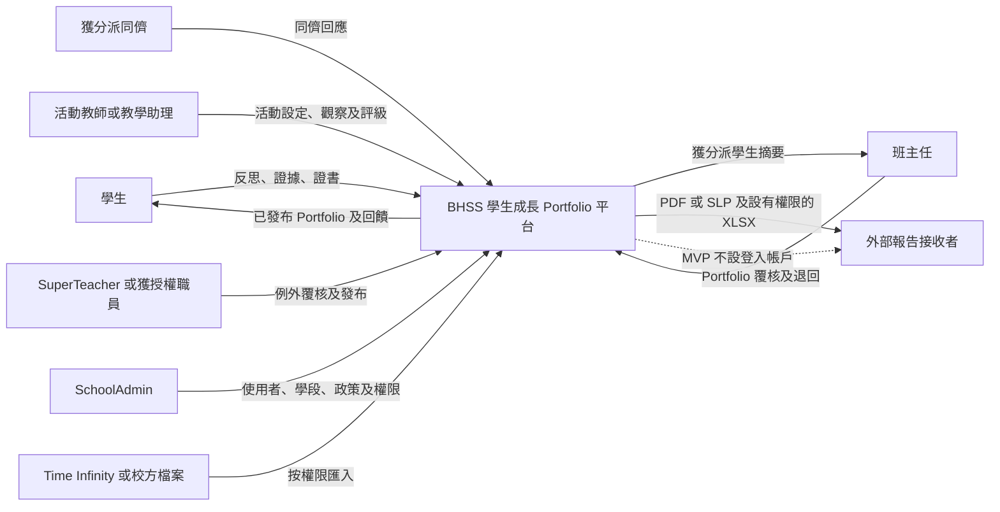

MVP 不會為外部接收者提供登入帳戶。同一位職員可以兼任多個角色，但系統仍要記錄每項操作所採用的角色及權限範圍。

### 一項活動涉及的人員及資料

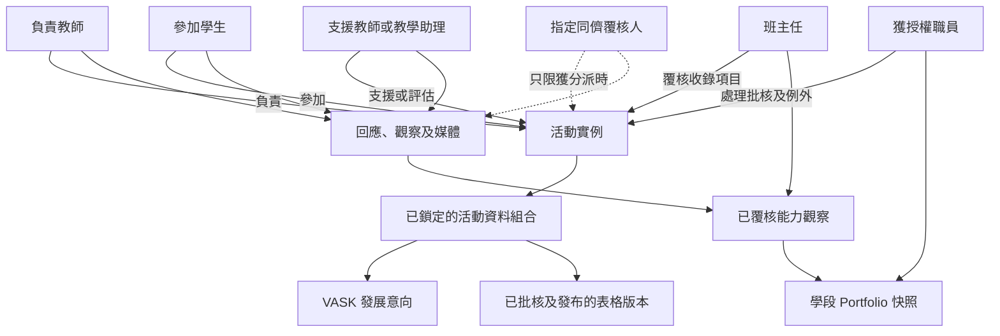

參加活動不代表可以查看所有媒體或 Portfolio 資料。媒體同意、覆核分派、班別範圍及發布狀態均是獨立控制。

### 活動完整流程

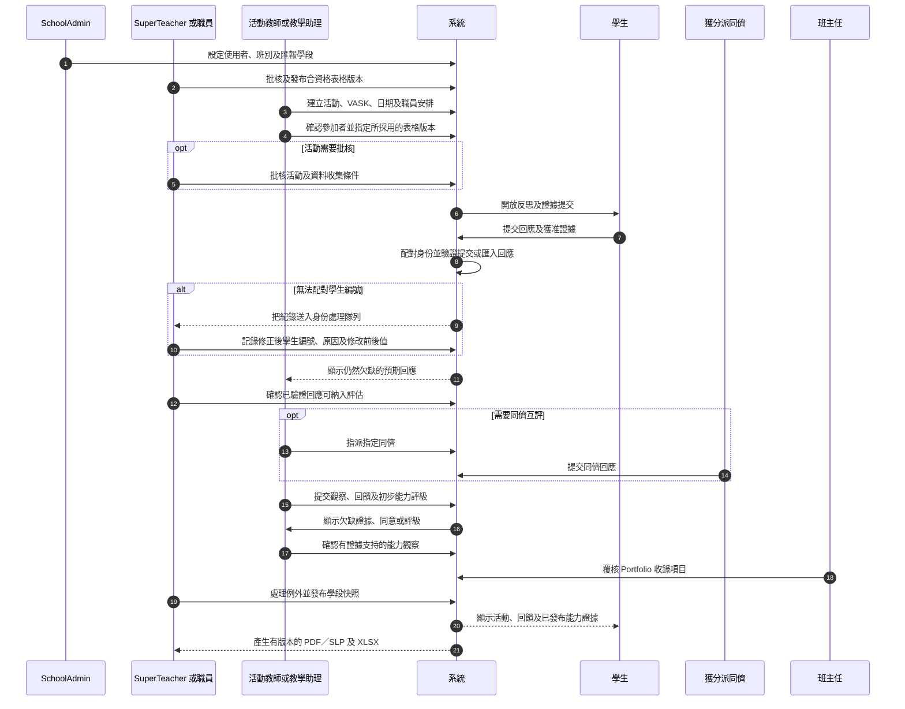

這是目前建議的操作流程。校方仍須決定每項批核由哪類職員負責，以及一般活動可否按既定政策自動通過。

### 每項活動需要連繫的資料

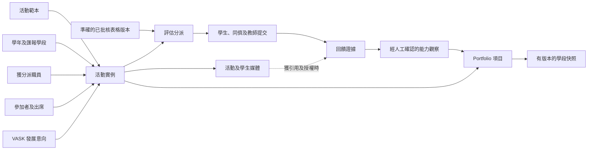

活動是所有資料的共同背景，但表格版本、填寫者、證據、覆核人和發布紀錄仍須逐項追查。

### 證據如何進入 Portfolio

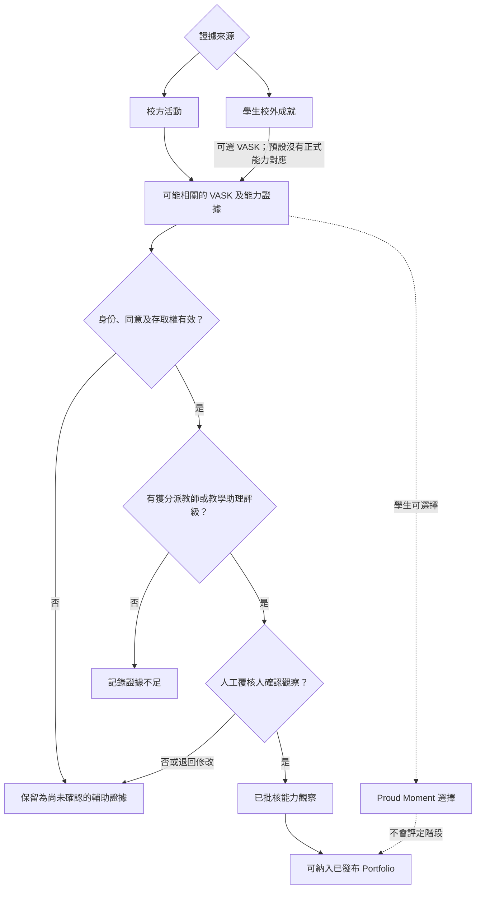

自評、同儕互評、問卷分數、學科成績、媒體擷取及 AI 建議只可提供輔助證據，不可獨立設定已發布的 1 至 16 階段。

### 各自獨立的狀態流程

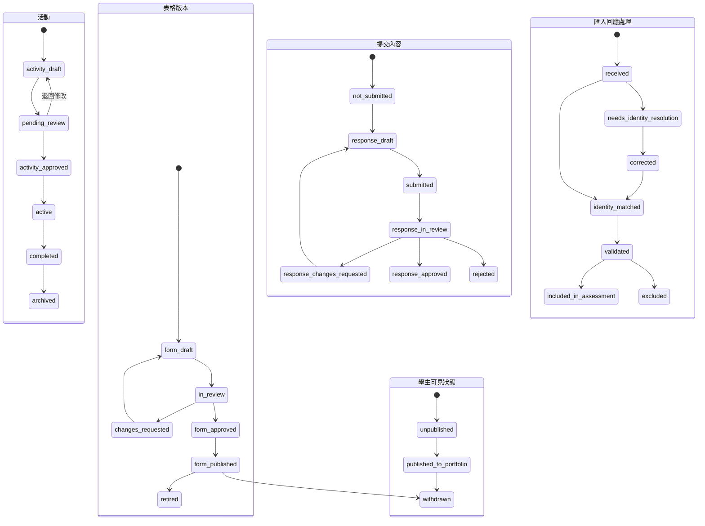

批核、納入評估及向學生發布是三個不同操作。發布表格不會發布學生回應；把匯入紀錄納入評估不會令學生立即看見；通過一項 Portfolio 內容，也不會自動發布整個學段快照。

### 已發布內容被退回修改

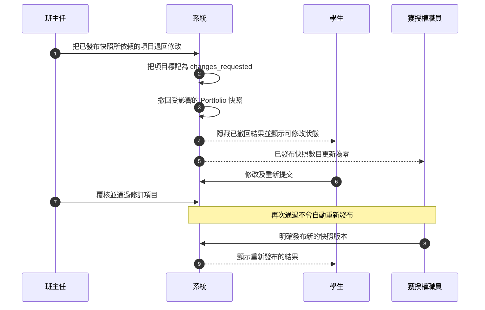

撤回會保留原有操作及歷史快照，不會刪除紀錄，也不會沿用先前的發布決定。

### 匯報學段及正式文件

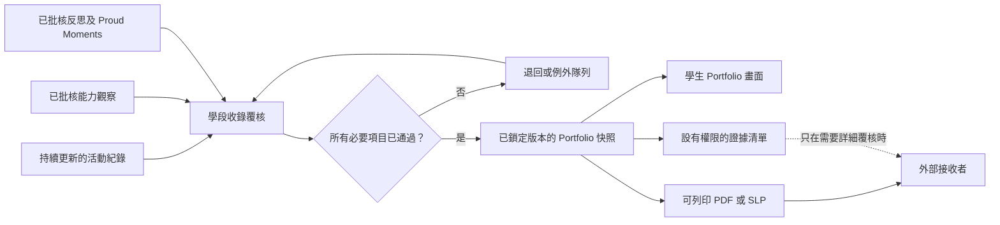

日常活動紀錄可在學段結束後繼續更新。已發布的學段快照及相關文件則要保留當時版本，日後仍可重現。如需修訂，應先撤回舊版本，再重新發布。

### 文件追溯關係

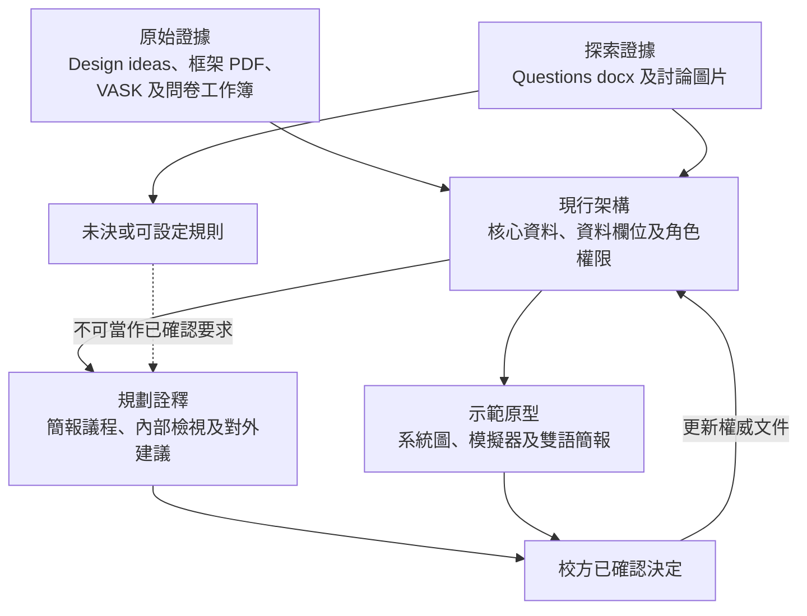

原始證據不可被無聲修改。原型只代表目前理解；只有在決定被正式記錄及更新至架構文件後，才成為系統規則。

## 核心資料關係總覽

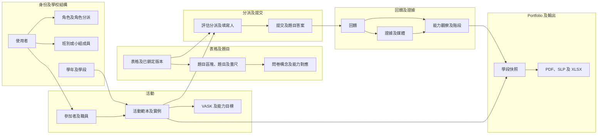

詳細欄位、主鍵及多對多接駁表見 `output/Chinese/資料欄位修訂.md`。英文版本的 ER 圖及完整技術欄位見 `output/English/Core data relationships.md`。

## 建議採用的學生歷程模型（H-08 仍待校方確認）

學生身份本身不會因轉班、留級、降級、離校或重返學校而改變；會隨時間改變的是班級配置及在校狀態。POC 已按以下建議方式實作，但完整轉學年政策仍須由校方確認。

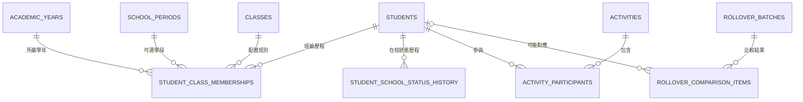

- `students.student_id` 是長期不變的核心身份。轉班、留級、降級、暫時離校、正式退學及重返學校都不應建立另一個學生身份。
- `student_class_memberships` 以 `valid_from` 及 `valid_to` 記錄學生在某學年／學段的班別、級別、變動類型、原因、操作人，以及被取代的上一項記錄。
- `student_school_status_history` 另行記錄在校、休學／暫離、退學、重返及畢業狀態。因此，即使學生離校兩年後回校，原有學生 ID 仍可沿用。
- 活動參加者只保存 `student_id`，不把當前班別抄入活動表。查看過往活動時，系統按活動日期找出當時有效的班級歷程。
- 轉學年批次先把新舊名單分為：沒有改變、轉班、留級／級別調整、重返學校、可能是新生，以及離校／名單遺漏。`new_candidate` 必須經校務人員確認，系統才可建立學生身份及配置班別。
- 匯入修正須保留修改前後值、原因、操作人及時間，不得回寫或改動既有活動紀錄。

這個做法可避免學生現時的班別污染過往活動證據。校方仍須確認轉學年的截數日期、重疊班級記錄處理、學期中途轉班、重複身份核對，以及誰可正式套用已覆核的批次；以上問題繼續由 H-08 跟進。

## 主要約束

- 每個框架版本包含八項能力，每項能力有 16 個階段。
- 題目可對應多項能力；每題總權重預設為 `1.0`，並在所對應能力之間平均分配。對應權重只表示證據相關性，不是自動評分公式。
- 題目與 VASK、八項能力及階段範圍的對應須有獨立版本、覆核分派、批核狀態及批核紀錄；最終批核角色仍待校方確認。
- 一項活動可有多位學生及多位職員，必須使用接駁表記錄角色、有效日期及狀態。
- 每次評估分派須指向準確且已鎖定的表格版本；分派後不得直接改寫。
- 表格版本只有在已批核、已發布、未停用且仍在有效期內時才可建立新分派。
- 回饋須記錄作者、學生、活動、觀察時間、角度及可見範圍。
- 同一項證據可支持多項能力觀察；每項觀察亦可引用多項證據。
- `observed_step` 與一致性或出現頻率是兩個不同值。
- 媒體本身不是評估證據；只有在回饋證據說明其相關性後才可使用。
- 匯入資料的身份修正不得覆蓋原始內容；原有及修正後學生編號、原因、操作人及時間均須保留。
- 資料驗證、納入評估及向學生發布使用三套獨立狀態。
- 所有正式匯出均指向一個已鎖定、不可直接改寫的 Portfolio 快照。

## 第一階段不包括的分析

- 把多次觀察合併為目前階段的公式。
- 教師、學生、同儕及家長回應的權重。
- 雷達圖快取、趨勢、班級比較或預測模型。
- 直接把問卷總分轉換成能力階段。
- 根據證據數量或時間自動計算信心分數。
- 自動升級、徽章或里程碑通知。
- 外部機構登入平台及修改校方已確認結果。

即使日後加入分析層，活動、提交、回饋、證據、人工確認及發布紀錄仍是權威資料來源。
