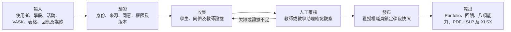
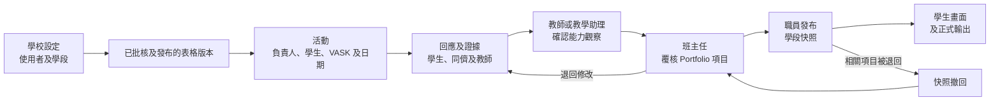

# BHSS 學生成長 Portfolio 簡報議程

## 文件目的

本文件把現有資料整理成一套清晰的簡報次序，並把原始設計、目前的系統理解、第一階段建議和仍待校方確認的問題分開說明。詳細資料關係見 `output/Chinese/核心資料關係.md`，角色權限見 `output/Chinese/角色及權限.md`。

## 現有資料分類

### 框架及用語

| 資料 | 用途 |
| --- | --- |
| `Assessment/UF2.0 Cantonese Framework.pdf` | 八項能力及每項 16 階段 |
| `Assessment/VASK清單.docx` | 描述活動希望培養的價值、態度、技能及知識 |
| `Assessment/10份技能問卷整理總表.xlsx` | 問卷題目、構念及量尺例子 |
| `output/Chinese/資料欄位修訂.md` | 資料實體、命名及中英文概念對照 |

### 設計及探索證據

| 資料 | 用途 |
| --- | --- |
| `Design ideas.docx` | 原始產品方向及 Portfolio 構想 |
| `output/Questions.docx` | 後期探索問題、建議流程及未確認數值 |
| `output/Chinese/核心資料關係.md` | 目前核心架構及人工覆核規則 |
| `output/Chinese/角色及權限.md` | 學生、教師、職員及管理員權限 |

### 示範及資料交換

- `output/D1 bhss-skills-navigator/`：八項能力及階段瀏覽。
- `output/D2 evidence-growth-system-map.html`：由上載至 Portfolio 的系統圖。
- `output/D2 vask-skill-map/`：VASK 與八項能力的示範對應。
- `D3 bhss-portfolio-ppt/`：雙語簡報及互動 POC。
- `output/import-examples/`：CSV 匯入、狀態列舉及分派例子。

## 建議平台功能

1. 身份、學校結構及登入保安。
2. 學年及匯報學段。
3. VASK、八項能力、16 階段及問卷構念等參考資料。
4. 活動範本、活動實例、參加者、職員及出席。
5. 表格版本、題目區塊、題目、量尺、分派及提交。
6. 媒體、同意、存取、文字擷取及證據連結。
7. 教師回饋、人工能力觀察及同儕互評。
8. AI 協助擷取文字及整理可能相關的資料，但不作最終評定。
9. Portfolio、學段快照、PDF／SLP 及 XLSX。
10. 匯入、設定、操作紀錄及行政管理。

## 建議角色

### 學生

查看自己的活動及已發布 Portfolio；提交反思、證據、校外證書及獲分派互評；選擇 Proud Moments；不可批核或查看其他學生私人資料。

### 教師

管理獲分派活動及學生；使用已批核表格；提交觀察、回饋及初步能力評級；按同意範圍查看所需證據。

### SuperTeacher 或獲授權職員

處理活動、表格、證據及評估例外；覆核題目對應；退回資料修改；在獲授權範圍內發布或撤回內容。

### SchoolAdmin

管理使用者、角色、班別、學段、匯入、同意、保存、登入及操作紀錄；不會因管理員身份而自動取得所有原始媒體。

## 輸入、處理及輸出

平台要清楚顯示：經覆核的活動證據，如何逐步成為學生成長紀錄的一部分。單是參加活動或取得某個問卷分數，都不會直接轉換成能力階段。

### 主要輸入

- 使用者、角色、班別、學年、學段及來源系統。
- 活動類別、日期、地點、負責人、支援職員及參加者。
- 活動 VASK、能力目標及準確表格版本。
- 題目、六分量尺、教師評語、學生反思及同儕互評。
- 文字、相片、錄音、影片、文件、學生作品及 Time Infinity 記錄。
- 證據來源、學生身份、活動、時間、同意及存取資料。

### 建議處理次序

1. 接收或匯入資料，記錄來源及原始內容。
2. 驗證使用者、活動、學段、檔案格式及參照資料。
3. 套用同意、可見範圍及保存政策。
4. 進行獲准的 OCR、轉錄或資料擷取。
5. 由獲授權人員確認身份及證據相關性。
6. 只把已批核、已發布並已鎖定的表格版本分派至活動。
7. 收集教師、學生、同儕及學生作品等不同來源的資料。
8. 把相關題目及證據連接至八項能力。
9. 由教師或教學助理按行為描述確認能力階段。
10. 由班主任覆核 Portfolio 收錄項目。
11. 由獲授權職員發布學段快照及正式輸出。
12. 保留版本、分派、修訂、批核、撤回及操作紀錄。

### 活動生命週期

### 主要輸出

- 學生：活動歷史、Proud Moments、已發布回饋、證據及能力發展。
- 教師：獲分派活動、待辦評估、欠缺資料、學生摘要及下一步建議。
- 職員：活動及表格覆核、例外隊列、能力觀察衝突及發布狀態。
- SchoolAdmin：使用者、學段、匯入、政策、保安及全校資料完整情況。
- 外部接收者：已批核 PDF／SLP；需要詳細覆核時才提供設有權限控制的 XLSX。

最終成果是一份持續累積、並可按學段鎖定版本的學生成長 Portfolio。它應讓使用者清楚看到學生參加過甚麼活動、完成過甚麼、相關證據、確認人員、涉及的能力，以及下一步可加強的方向。

## 第一階段建議範圍

- 使用者匯入、角色管理、密碼雜湊、安全登入工作階段及基本操作紀錄。
- 學年、學段、活動範本、活動實例、職員及參加者。
- 一份預設活動表格及已批核例外版本。
- 已鎖定的表格版本、覆核歷史、可見範圍及分派資格檢查。
- 表格分派、提交、題目答案、開放文字及教師回饋。
- 媒體資料、同意、存取、證據連結及停用記錄。
- CSV／XLSX 匯入、Time Infinity 模擬資料及 Portfolio 示範。

即時 Time Infinity API、大規模錄音轉錄、聲音身份配對、自動能力階段建議、外部登入平台及複雜多來源計分公式列入後續階段。

## 尚待確認事項

完整及權威的問題清單見 `output/Chinese/討論問題.md`。以下內容只用作簡報分類；投影片及講稿應引用固定的 `H-xx`、`M-xx` 及 `L-xx` 編號，不另設第二份決定清單。

### 目的及正式輸出

- Portfolio、SLP、雷達圖、PDF 及 Excel 哪一項是正式紀錄？
- 每個輸出的接收者、批核標準及保存期是甚麼？
- 第一份 Portfolio 在何時發布？

### 評估及進展

- 哪些活動一定要提供教師或教學助理評級？
- HKEAA 是參考框架、外部評估來源，還是正式批核角色？
- 多次觀察如何彙總為一個學段的八項能力狀態？
- 學生、同儕及學科成績是否只作輔助證據？

### 表格及題目

- 預設表格的最終題目、量尺及填寫者是誰？
- 哪些題目可直接或輔助對應八項能力？
- 何種修改必須建立新版本並重新批核？

### 活動及權限

- 哪類活動可自動通過？
- 誰可退回、撤回及重新發布 Portfolio？
- 班主任可查看學生全部活動，還是只看已發布摘要？
- 同儕如何選擇及避免不當互評？

### 私隱及技術

- 相片、錄音、轉錄及 AI 推論的同意、保存及刪除規則是甚麼？
- 系統由單一電腦、校內伺服器還是共用網上服務提供？
- Time Infinity 有哪些欄位、識別碼、更新頻率及錯誤處理？

## 建議簡報次序

1. 項目目的及原始設計方向。
2. 現有資料來源及目前痛點。
3. 平台要做甚麼及不做甚麼。
4. VASK、問卷構念、八項能力及 16 階段的分別。
5. 活動、表格、題目區塊及題目的關係。
6. 活動由建立、提交、覆核至發布的流程。
7. 學生、教師、職員及 SchoolAdmin 的頁面及權限。
8. 媒體、同意、證據及人工確認。
9. 學段、跨年度紀錄及正式輸出。
10. 第一階段範圍、人日估算及需要校方決定的事項。

## 來源追溯方式

- `DI-xx`：`Design ideas.docx` 的原始設計證據。
- `RCI-xx`：使用者提供的 RC360 討論圖片。
- `PI-xx`：目前產品理解或建議，未必是原始文件的明確要求。
- `Open decision`：仍待校方決定，簡報不可當作已確認要求。

每項正式規則應盡量保存原句或準確意譯、頁碼、章節及目前解讀。原始來源、架構文件及原型之間的關係見 `output/Chinese/核心資料關係.md` 的文件追溯圖。
