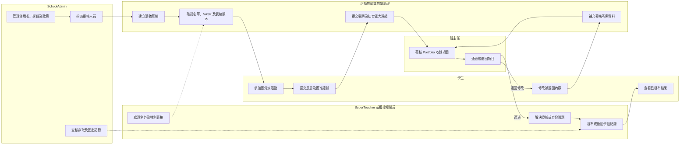
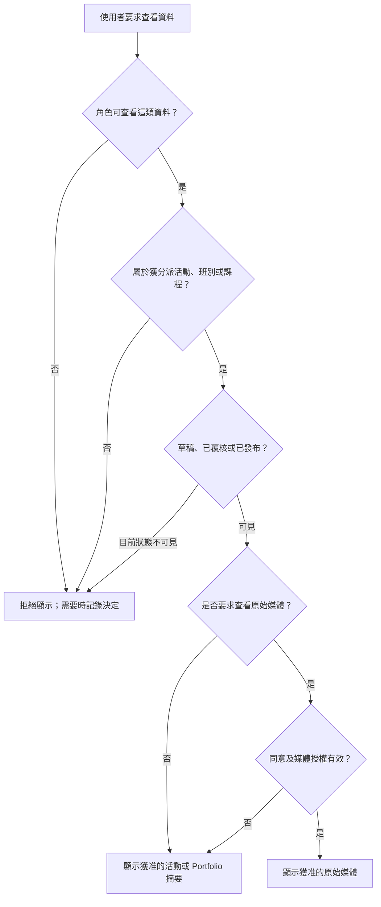

# 角色及權限

## 文件目的

本文件說明 BHSS 學生成長及 Portfolio 平台第一階段的角色權限。使用者可以查看某項活動，不代表可以查看活動內所有原始媒體。活動資料、評估資料、已發布摘要及原始媒體須分開授權。

## 角色定義

### 學生

學生既是自己成長紀錄的資料當事人，也會為紀錄提供內容。

- 查看自己獲分派或已參加的活動。
- 查看自己的已發布活動摘要、回饋、能力證據及 Portfolio。
- 提交自我反思、自評及獲准上載的作品或媒體。
- 只在教師分派後填寫同儕互評，不會因此取得另一位學生的完整紀錄。
- 要求更正錯誤歸入自己名下的證據或不準確的個人資料。
- 不可批核活動、表格範本、題目能力定義、佐證或發展階段。
- 不可查看其他學生的私人 Portfolio、原始媒體、教師內部備註或身份覆核資料。

### 教師

教師可因應工作安排，擔任活動負責人、支援教師、評估者或班主任。

- 建立及修改自己負責的活動草稿。
- 使用已批核的預設活動表格，或申請使用已批核的其他版本。
- 查看獲分派的活動及參加學生。
- 在媒體同意及權限範圍內查看評估所需證據。
- 提交觀察、評估、回饋及證據確認結果。
- 在確實掌握相關情況時，確認錄音、文字紀錄或媒體屬於哪位學生。
- 按校方政策提出或確認能力階段證據，但不可在沒有正式程序下修改已批核框架或已發布的歷史結果。
- 不會因為是教師而自動查看全校學生及活動。

### SuperTeacher 或獲授權職員

`SuperTeacher` 是系統角色名稱，可代表高級教師、課程統籌、科主任、班級統籌或資料覆核人員；日後可改用校方慣用名稱。

- 在獲分派的課程、班別或活動組別內行使相應的教師權限。
- 按校方政策覆核及批核活動、特別表格及問卷版本。
- 接受、拒絕或完成指定的表格覆核工作。
- 要求修改、批核或拒絕版本，並記錄理由。
- 在獲授權範圍內發布、撤回或停用表格版本。
- 在獲分派範圍內覆核題目能力定義、佐證清單、由人員提出的 Rubric 觀察、矛盾證據及身份疑問。
- 查看獲分派範圍內學生的已發布摘要。
- 重新開啟或退回評估，要求教師補充資料。
- 不可管理全校登入設定，也不可自行取得不受限制的全校權限。

### SchoolAdmin

SchoolAdmin 管理學校帳戶身份、共用角色定義、具生效日期的角色分派、學年學段、匯入資料及權限政策。**Discussed on Meeting Oct 26 - kickstart：** 角色身份與具名工作批核分派須分開保存。

- 匯入、建立、更新、暫停及封存使用者。
- 分派角色、班別、課程及活動權限範圍。
- 設定學年、匯報學段及轉年度安排。
- 設定預設活動表格及批核政策。
- 指派合資格的 SuperTeacher 或 SchoolAdmin 覆核表格版本。
- 管理活動、問卷及框架版本狀態。
- 發布、撤回或停用已批核表格版本，並設定可見範圍及有效日期。
- 設定同意類別、媒體權限、保存期及刪除流程。
- 覆核匯入批次、Time Infinity 暫存資料、操作紀錄及驗證失敗。
- 撤銷登入工作階段及重設帳戶存取。
- 查看全校行政資料及已發布摘要；原始媒體仍須另行授權。

### 外部機構或報告接收者

建議的 MVP 不會為外部機構設立平台帳戶。獲授權職員會輸出附有版本記錄的 SLP／PDF；如確實需要詳細覆核，才提供設有權限控制的 XLSX 證據清單。日後如需開放外部帳戶，必須另行設計身份驗證、帳戶有效期、轉授權、同意及媒體存取安排。

## 職責流程

同一人可以同時是活動教師及班主任，但系統須記錄每項操作所使用的職責及權限範圍。

## 可見範圍及媒體存取

能夠查看已發布摘要，不代表可以查看相片、錄音、文字紀錄或內部覆核備註。

## 權限矩陣

| 功能 | 學生 | 教師 | SuperTeacher 或職員 | SchoolAdmin |
| --- | --- | --- | --- | --- |
| 查看自己的 Portfolio | 可以 | 獲分派學生 | 獲分派範圍 | 按政策 |
| 查看活動 | 已參加活動 | 獲分派活動 | 獲分派課程或班別 | 全校行政資料 |
| 查看原始媒體 | 自己及獲准內容 | 獲分派且獲准 | 覆核範圍且獲准 | 按政策 |
| 提交自我反思 | 可以 | 不可以 | 不可以 | 不可以 |
| 提交同儕互評 | 獲分派時 | 不可以 | 不可以 | 不可以 |
| 提交教師評估 | 不可以 | 獲分派範圍 | 獲分派範圍 | 一般不需要 |
| 建立活動草稿 | 不可以 | 可以 | 可以 | 可以 |
| 批核活動 | 不可以 | 預設不可以 | 權限範圍內可以 | 可以或設定政策 |
| 批核表格或問卷版本 | 不可以 | 不可以 | 權限範圍內可以 | 可以 |
| 指派表格覆核人 | 不可以 | 預設不可以 | 獲轉授權範圍 | 可以 |
| 發布或撤回表格版本 | 不可以 | 不可以 | 獲轉授權時 | 可以 |
| 確認能力階段證據 | 不可以 | 按政策提出或確認 | 覆核及批核 | 設定政策 |
| 管理使用者及學段 | 不可以 | 不可以 | 預設不可以 | 可以 |
| 查看操作紀錄 | 自己的提交 | 自己的操作 | 獲分派覆核範圍 | 可以 |

## 活動可見範圍建議

1. 教師只在自己是負責教師、支援教師、指定評估者或獲明確授權時查看活動。
2. 班主任可查看班內學生的已發布摘要，但不會自動取得原始媒體。
3. SuperTeacher 只查看獲分派課程、班別、級別或覆核隊列。
4. SchoolAdmin 可查看全校行政資料，但敏感媒體仍須獨立授權。

## 活動批核建議

採用按風險批核，不要求所有活動使用同一程序。使用預設表格且沒有新增媒體收集的一般校內活動，可按校方政策自動通過。使用特別表格、收集相片或錄音、校外進行、加入外部參加者、修改預期 Rubric 範疇標籤或引入新保存要求的活動，須由人員批核。

建議狀態為 `draft → pending_review → approved → active → completed → archived`。

## 表格權限及發布規則

1. 教師可以建立或修訂表格草稿，但預設不可批核自己的版本。
2. 獲授權的 SuperTeacher 或 SchoolAdmin 把版本指派給具資格的覆核人。
3. 覆核人接受工作後，記錄 `approved`、`changes_requested` 或 `rejected`，並填寫理由。
4. 批核只確認內容有效，不會自動發布。
5. 獲授權人員把已批核版本發布至指定可見範圍。
6. 活動只可引用已批核、已發布、未停用且在有效日期內的版本。
7. 修改已發布版本會建立新的草稿版本；歷史分派及提交仍保留原版本。

## 基本保安要求

- 只儲存密碼雜湊，不儲存明文密碼。
- 匯入使用者時建立邀請或啟用程序，不在匯入檔案內存放密碼。
- 使用短期登入工作階段、安全 Cookie 及伺服器端撤銷。
- 記錄登入、匯入、角色變更、活動批核、媒體存取、證據更正、評估發布及刪除操作。
- 按活動、班別、課程及媒體用途採用最小權限。
- 把聲音身份、學生相片、錄音、文字紀錄及 AI 推論視為敏感資料，並設定政策及操作追蹤。
