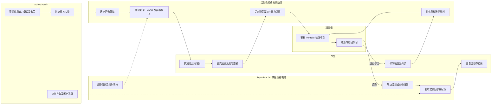
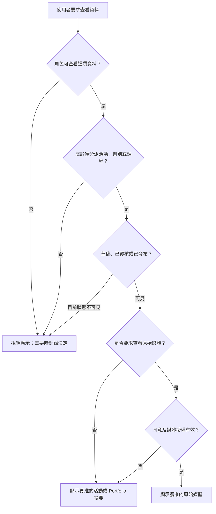

# 角色及權限

## 文件目的

本文件說明 BHSS 學生成長及 Portfolio 平台第一階段的存取權限。使用者可以查看某項活動，不代表可以查看活動內所有原始媒體。活動資料、評估資料、已發布摘要及原始媒體須分開授權。

**權責狀態：** 以下職位／功能角色／工作範圍及可設定批核模型，是系統分析員於 2026 年 10 月 28 日批准的內部架構決定，並非 BHSS 或 JC 已確認政策。權威資料實體及關係以《核心資料關係》為準。

## 職位、功能角色及工作範圍

平台須分開處理三個概念：

1. **職位或職銜**：描述校內任命，例如科任老師、導師、科主任／科組主管、校長、副校長或教學助理。同一人可在不同生效期兼任多個職位。
2. **功能角色／權限能力**：描述可執行的工作，例如建立活動、覆核表格、批核活動、覆核 Portfolio 或發布 Portfolio。功能角色可以疊加，不可把職銜永久等同某項權限。
3. **分派範圍**：限制權限適用位置，包括 `school`、`department`、`subject`、`year`、`class`、`group`、`programme`、`activity` 及 `student`。

部門、科目及教職員群組均是校本核心資料。學校可透過功能角色授權，再按群組或個別人員設定較窄的允許／拒絕規則；同一情況下，明確拒絕優先於允許。職位、角色、範圍及覆蓋規則均須有生效日期及審計紀錄。

第一階段沿用同一個老師工作介面；按實際權限及範圍顯示不同按鈕、佇列及資料，毋須為每種老師職銜另設畫面。

## 角色定義

### 學生

學生既是自己成長紀錄的資料當事人，也會為紀錄提供內容。

- 查看自己獲分派或已參加的活動。
- 查看自己的已發布活動摘要、回饋、能力證據及 Portfolio。
- 提交自我反思、自評及獲准上載的作品或媒體。
- 只在教師分派後填寫同儕互評，不會因此取得另一位學生的完整紀錄。
- 要求更正錯誤歸入自己名下的證據或不準確的個人資料。
- 不可批核活動、表格範本、題目能力定義、佐證或發展階段。
- 不可查看其他學生的私人 Portfolio、原始媒體、教師內部備註或身份覆核資料。

### 教師

教師可因應工作安排，擔任活動負責人、支援教師、評估者或班主任。

- 在適用範圍獲授予 `activity.create` 後建立活動草稿；科任老師、班主任、教學助理或其他職員均可按校方設定取得這項權限，而不是由職銜自動決定。
- 修改自己建立或明確獲授權修改的活動草稿。如活動由其他人控制，只可提交修改要求，不可直接改動已批核內容。
- 使用已批核的預設活動表格，或申請使用已批核的其他版本。
- 查看獲分派的活動及參加學生。
- 在媒體同意及權限範圍內查看評估所需證據。
- 提交觀察、評估、回饋及證據確認結果。
- 在確實掌握相關情況時，確認錄音、文字紀錄或媒體屬於哪位學生。
- 按校方政策提出或確認能力階段證據，但不可在沒有正式程序下修改已批核框架或已發布的歷史結果。
- 不會因為是教師而自動查看全校學生及活動。
- 獲分派為班主任時，可覆核學生已提交的 Portfolio 工作版本，選取全部或部分項目、退回修正，並把已覆核版本提交至校方設定的職員批核步驟。
- 班主任只可修改獲授權的 LLM「作為學習者的我」生成文字／Prompt 內容；不可藉此改寫學生原文或其他教育人員的觀察。

### SuperTeacher 或獲授權職員

`SuperTeacher` 是舊有技術名稱，代表一組獲委派功能權限，並非職銜或另一類帳戶。科任老師或一般老師可在較窄範圍獲授相同批核權；校長或副校長亦不會單憑職銜自動取得內容批核權。

- 在獲分派的課程、班別或活動組別內行使相應的教師權限。
- 按校方政策覆核及批核活動、特別表格及問卷版本。
- 接受、拒絕或完成指定的表格覆核工作。
- 要求修改、批核或拒絕版本，並記錄理由。
- 在獲授權範圍內發布、撤回或停用表格版本。
- 在獲分派範圍內覆核題目能力定義、佐證清單、由人員提出的 Rubric 觀察、矛盾證據及身份疑問。
- 獲分派為評估覆核人時，比較各輸入／佐證類型的最高支持階段，並逐項納入或排除佐證連結／觀察及記錄理由。
- 在獲委派範圍內更正或以新紀錄取代錯誤身份／佐證關聯，並處理其依賴影響覆核；不可藉此建立沒有來源的階段覆蓋值。
- 查看獲分派範圍內學生的已發布摘要。
- 重新開啟或退回評估，要求教師補充資料。
- 不可管理全校登入設定，也不可自行取得不受限制的全校權限。

系統不設獨立 `approval_staff` 用戶類型或資料表。批核資格由有效功能角色／權限、工作範圍、委派日期及該次具名流程分派共同決定。

### SchoolAdmin

SchoolAdmin 管理學校帳戶身份、共用角色定義、具生效日期的角色分派、學年學段、匯入資料及權限政策。**Discussed on Meeting Oct 26 - kickstart：** 角色身份與具名工作批核分派須分開保存。

- 匯入、建立、更新、暫停及封存使用者。
- 維護職位定義及任命；分派功能角色、部門、科目、班別、群組、課程、活動及學生範圍。
- 設定全校角色權限及較窄的群組／個別用戶覆蓋，包括明確拒絕某位原本因群組繼承權限的教學助理或初級老師。
- 設定學年、匯報學段及轉年度安排。
- 設定預設活動表格，並為各類流程分別設定批核政策。
- 如管理員另有批核統籌權，可指派任何合資格老師／職員覆核已提交表格版本；獲分派人仍須具備所需功能權限及範圍。
- 管理活動、問卷及框架版本狀態。
- 發布、撤回或停用已批核表格版本，並設定可見範圍及有效日期。
- 設定同意類別、媒體權限、保存期及刪除流程。
- 覆核匯入批次、Time Infinity 暫存資料、操作紀錄及驗證失敗。
- 撤銷登入工作階段及重設帳戶存取。
- 查看學校實際可用的功能，並只可在獲委派政策範圍內提出／設定變更；一般 SchoolAdmin 不可重新啟用多校服務內已停用的整間學校。
- 查看全校行政資料及已發布摘要；原始媒體仍須另行授權。
- SchoolAdmin 負責設定批核／評估權責及審計政策，但不會單憑管理員身份批核內容或決定學生階段；如要作出決定，仍須另有合資格功能角色及具名流程分派。

### 平台營運管理員

平台營運管理員是服務層權限，不是校內評估角色。多校服務需要這項權限；單校本地部署則可透過受控部署設定執行相同操作。

- 以有審計紀錄的操作停用或重新啟用學校。
- 按穩定 `feature_key` 設定某校在指定期間可使用的功能。
- 只查看執行上述工作所需的服務層學校及功能政策資料。
- 預設不會取得校內內容、原始媒體、教學、佐證接納或評估權限。
- 不可利用功能開關繞過角色、工作範圍、生命週期、同意或批核規則。

### 外部機構或報告接收者

建議的 MVP 不會為外部機構設立平台帳戶。獲授權職員會輸出附有版本記錄的 SLP／PDF；如確實需要詳細覆核，才提供設有權限控制的 XLSX 證據清單。日後如需開放外部帳戶，必須另行設計身份驗證、帳戶有效期、轉授權、同意及媒體存取安排。

## 職責流程

同一人可以同時擔任活動老師、班主任及批核人，但系統須記錄每項操作所依據的功能權限、範圍及流程分派。建立活動不等於取得全校權限。

## 可見範圍及媒體存取

能夠查看已發布摘要，不代表可以查看相片、錄音、文字紀錄或內部覆核備註。

## 權限矩陣

以下矩陣只涵蓋校內角色。平台營運權限只控制租戶／功能是否可用，不會繼承校內內容權限，因此不列入矩陣。

| 功能 | 學生 | 教師 | SuperTeacher 或職員 | SchoolAdmin |
| --- | --- | --- | --- | --- |
| 查看自己的 Portfolio | 可以 | 獲分派學生 | 獲分派範圍 | 按政策 |
| 查看活動 | 已參加活動 | 獲分派活動 | 獲分派課程或班別 | 全校行政資料 |
| 查看原始媒體 | 自己及獲准內容 | 獲分派且獲准 | 覆核範圍且獲准 | 按政策 |
| 提交自我反思 | 可以 | 不可以 | 不可以 | 不可以 |
| 提交同儕互評 | 獲分派時 | 不可以 | 不可以 | 不可以 |
| 提交教師評估 | 不可以 | 獲分派範圍 | 獲分派範圍 | 一般不需要 |
| 建立活動草稿 | 不可以 | 可以 | 可以 | 可以 |
| 批核活動 | 不可以 | 另獲權限及分派時 | 另獲權限及分派時 | 設定政策；另獲權限及分派才可決定 |
| 批核表格或問卷版本 | 不可以 | 另獲權限及分派時 | 另獲權限及分派時 | 設定政策；另獲分派才可決定 |
| 指派表格覆核人 | 不可以 | 預設不可以 | 獲轉授權範圍 | 可以 |
| 發布或撤回表格版本 | 不可以 | 不可以 | 獲轉授權時 | 可以 |
| 確認能力階段證據 | 不可以 | 按政策提出或確認 | 覆核及批核 | 設定政策 |
| 為 Rubric 結果納入／排除佐證 | 提出更正 | 在獲分派範圍內提出 | 獲分派時決定；必須填寫理由 | 只設政策；另獲分派除外 |
| 更正錯誤身份／佐證關聯 | 提出更正 | 直接負責時提出／確認 | 在獲分派範圍內決定及處理影響 | 行政更正；另獲分派才可作評估決定 |
| 覆核 Portfolio 工作版本 | 只限本人提交 | 獲分派班主任／學生範圍 | 委派覆核範圍 | 另獲分派時 |
| 發布已批核 Portfolio | 不可以 | 另獲權限及分派時 | 另獲權限及分派時 | 設定政策；另獲權限及分派才可發布 |
| 管理職位、角色、範圍及學段 | 不可以 | 不可以 | 預設不可以 | 可以 |
| 查看操作紀錄 | 自己的提交 | 自己的操作 | 獲分派覆核範圍 | 可以 |

## 活動可見範圍建議

1. 老師只有在有效功能權限及工作範圍准許，而且沒有適用的明確拒絕時，才可查看活動。擁有者、支援／評估分派、科目、部門或教職員群組均可提供範圍依據。
2. 班主任可查看班內學生的已發布摘要，但不會自動取得原始媒體。
3. 獲授權覆核人可查看具名分派所列部門、科目、級別、班別、群組、課程、活動、學生或佇列範圍內的活動。
4. SchoolAdmin 可查看全校行政資料，但敏感媒體仍須獨立授權。

## 活動批核建議

學校須分別設定活動、表格、提交、Portfolio 及發布批核。P1 只支援 `not_required`、`automatic`、`single_reviewer` 及 `two_stage_sequential` 四種模式；每個流程最多兩個順序人工決定。平行投票、法定人數及任意流程編程不屬精簡 MVP。

使用預設表格且沒有新增媒體收集的一般校內活動，可按校方政策自動通過。使用特別表格、收集相片或錄音、校外進行、加入外部參加者、修改預期 Rubric 範疇標籤或引入新保存要求的活動，須由人員批核。

校方可把批核與發布分開，亦可把兩項權限交予同一合資格人員。是否容許自行批核按流程及範圍設定；如容許，合資格活動作者可把自己列為批核人，但仍須有具名分派、理由及審計紀錄。未分派、被拒接或逾期項目進入預設／升級處理佇列，由批核統籌人跟進；亦支援有期限的委派。

建議狀態為 `draft → pending_review → approved → active → completed → archived`。

## 活動擁有權、修訂及穩定身份

- `activity_id` 代表穩定活動容器；更改描述或其他受管制內容不會產生新活動 ID。
- 受管制內容保存為不可變更的活動修訂版本。佐證、提交及媒體繼續連繫穩定活動，並可另記當時修訂版本。
- 老師建立的草稿按政策顯示「提交批核／要求發布」。已批核後作重大改動，須建立後繼修訂及重新批核；新版本未獲批前，正式畫面仍採用上一個已批核版本。
- 獲分派老師如發現由其他人建立／控制的活動有錯，須向擁有人或獲授權編輯者提交修改要求；單憑活動分派不可直接改寫內容。

## Portfolio 工作版本及批核規則

1. 學生編寫包含本人內容及難忘活動選擇的工作版本，然後提交。
2. 獲分派班主任可退回內容、選取全部或部分項目，再把已覆核版本提交至校方設定的批核流程。
3. 獲授權職員／老師按校方 Portfolio 政策批核；批核與發布可分屬不同權限，即使同一人同時獲分派兩者。
4. 學生工作區可顯示本人最新草稿／提交；所有正式或對外畫面只採用最新已批核版本，未批核版本絕不可覆蓋已批核版本。
5. 如從未有已批核版本，Portfolio 標記為 `no_approved_version`，並列入可篩選的職員及升級處理佇列。
6. 學生原文保留申報作者身份；如清楚標示為學生自述，毋須為文字本身提供外部佐證。LLM／系統生成陳述及由 Rubric 推導的內容必須有可追溯來源／佐證及版本記錄。
7. 「作為學習者的我」須分開保存生成、老師修訂及最終批核版本。班主任或其他獲授權編輯者只可修改這個生成敘述欄位，最終文字仍須完成校方設定的老師／職員批核。

## 表格權限及發布規則

1. 教師可以建立或修訂表格草稿，但預設不可批核自己的版本。
2. 獲授權批核統籌人把版本指派給具資格覆核人；一般老師如功能權限及範圍相符亦可擔任。
3. 覆核人接受工作後，記錄 `approved`、`changes_requested` 或 `rejected`，並填寫理由。
4. 批核只確認內容有效，不會自動發布。
5. 具備獨立表格發布權及相符範圍的人員把已批核版本發布至指定可見範圍；政策容許時可由同一覆核人兼任。
6. 活動只可引用已批核、已發布、未停用且在有效日期內的版本。
7. 修改已發布版本會建立新的草稿版本；歷史分派及提交仍保留原版本。

## 基本保安要求

- 只儲存密碼雜湊，不儲存明文密碼。
- 匯入使用者時建立邀請或啟用程序，不在匯入檔案內存放密碼。
- 使用短期登入工作階段、安全 Cookie 及伺服器端撤銷。
- 記錄登入、匯入、角色變更、活動批核、媒體存取、證據更正、評估發布及刪除操作。
- 按活動、班別、課程及媒體用途採用最小權限。
- 把聲音身份、學生相片、錄音、文字紀錄及 AI 推論視為敏感資料，並設定政策及操作追蹤。
- 每個受保護要求及背景工作均須解析至不可變的 `SchoolId`。伺服器須拒絕跨校識別碼、已停用學校及不可用功能；只在介面隱藏入口並不構成控制。
