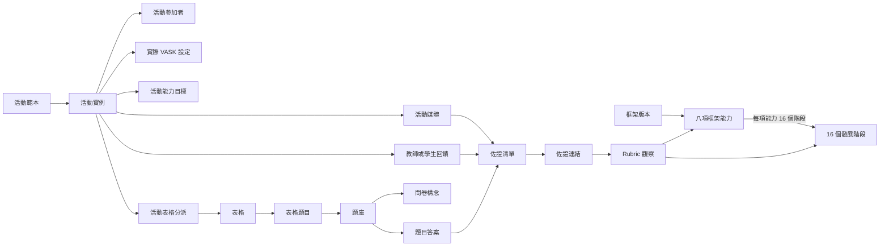

# 資料欄位修訂

## 文件目的

本文件是獨立的繁體中文版，方便與原始 `Aspects`、廣東話版技能框架及技能問卷逐項比較。內容按香港常用語重新整理，並非英文版本的逐句直譯。

整個資料模型分為四層：

1. **活動設計**：記錄活動希望培養甚麼，包括 VASK 和預期觀察的框架能力。
2. **框架標準**：記錄八項能力，以及每項能力的 16 個發展階段。
3. **評估工具**：記錄問卷、題目、評分量尺及題目本身的有效能力定義；到 Portfolio 覆核時才按選用的 Rubric 解讀佐證。
4. **觀察結果**：記錄教師實際看到的行為、選定的階段、出現頻率和文字證據。

## 命名方式

### 修改前

- 資料表名稱混合單數和複數，例如 `Activities`、`Media`、`Form`、`FormQuestions`、`User`。
- 欄位名稱混合不同寫法，例如 `activityId`、`upload/updateBy`、`accessBy`。
- `activityVASK`、`mediaList` 等欄位會把多項資料放進同一欄。
- `respondantId` 拼寫錯誤，正確英文是 `respondent_id`。

### 修改後

- 資料表統一使用複數 snake_case，例如 `activity_instances`、`media_assets`。
- 欄位統一使用單數 snake_case，例如 `activity_instance_id`。
- 主鍵及外鍵才使用 `_id`。
- 時間欄位統一使用 `created_at`、`updated_at`、`starts_at`、`ends_at`。
- 多對多關係使用中介表，不在單一欄位儲存陣列。
- 已提交的評估保留當時使用的版本，不會因日後修改範本而改變。

## 必須分開的兩套能力分類

### Skills Builder 通用技能框架的八項能力

這八項能力是雷達圖的八條軸。每項能力均有 16 個階段。

| 排序 | 代碼 | 中文名稱 | 英文名稱 |
|---:|---|---|---|
| 1 | `listening` | 聆聽 | Listening |
| 2 | `speaking` | 說話 | Speaking |
| 3 | `problem_solving` | 解難 | Problem-solving |
| 4 | `creativity` | 創意 | Creativity |
| 5 | `adaptability` | 適應力 | Adaptability |
| 6 | `planning` | 計劃能力 | Planning |
| 7 | `leadership` | 領導力 | Leadership |
| 8 | `teamwork` | 團隊協作 | Teamwork |

### 技能問卷的十項評估構念

問卷中的十項技能不等於雷達圖的八項能力。

| 代碼 | 中文名稱 | 題目數量 | 可能的語意關聯；不是系統固定對應 |
|---|---|---:|---|
| `adaptability` | 適應能力 | 12 | 語意上與適應力相近 |
| `collaboration` | 合作能力 | 18 | 語意上與團隊協作相近 |
| `communication` | 溝通能力 | 16 | 可為聆聽或說話提供背景資料 |
| `creativity` | 創造力 | 18 | 語意上與創意相近 |
| `critical_thinking` | 批判思維能力 | 18 | 可為推理或解難提供背景資料 |
| `curiosity` | 探究能力／好奇心 | 18 | 可為創意或解難提供背景資料 |
| `growth_mindset` | 成長型思維 | 12 | 可為適應力或計劃能力提供背景資料 |
| `leadership` | 領導力 | 22 | 語意上與領導力相近 |
| `perseverance` | 堅毅 | 14 | 可為適應力或計劃能力提供背景資料 |
| `problem_solving` | 問題解決能力 | 18 | 語意上與解難相近 |

因此，不應再用一個含糊的 `skill` 欄位同時代表多套分類。問卷構念、題目能力、VASK 及 Rubric 範疇應分開保存。**Discussed on Meeting Oct 26 - kickstart：** 題目不再固定對應 VASK／RC360／Skills Builder；獲接納的答案先成為佐證，再於 Portfolio 覆核時按所選 Rubric 解讀。

---

## 一 活動

### 修改前

```text
Activities
    activityId
    activityVASK
    activityType
    date (by School year)
    uploadDate
    upload/updateBy
    updateDate
```

### 問題

- 活動範本和實際舉行的一次活動混在一起。
- 一個 `date` 無法表示課堂、旅行或為期兩週的項目。
- `activityVASK` 無法清楚儲存多個 VASK 項目。
- 建立者和最後更新者混在同一欄位。

### 修改後

#### `activity_templates` 活動範本

儲存可重複使用的活動設計。

| 欄位 | 中文意思 |
|---|---|
| `activity_template_id` | 活動範本主鍵 |
| `name_zh` | 中文名稱 |
| `name_en` | 英文名稱，可留空 |
| `description` | 活動說明 |
| `activity_type_id` | 活動類型 |
| `default_duration_minutes` | 預設時長 |
| `status` | 草稿、啟用或封存 |
| `version_number` | 範本版本 |
| `created_by_user_id` | 建立者 |
| `created_at` | 建立時間 |
| `updated_by_user_id` | 最後更新者 |
| `updated_at` | 最後更新時間 |

#### `activity_instances` 活動實例

代表某班學生實際參與的一次活動。

| 欄位 | 中文意思 |
|---|---|
| `activity_instance_id` | 活動實例主鍵 |
| `activity_template_id` | 所使用的活動範本，可留空 |
| `template_version_number` | 當時使用的範本版本 |
| `title` | 本次活動名稱 |
| `activity_type_id` | 活動類型 |
| `academic_period_id` | 由伺服器按活動開始／完結日期自動找出的學段 |
| `period_resolution_status` | `resolved`、`cross_period_exception`、`no_match` 或 `exception_approved` |
| `group_id` | 班別、隊伍或項目小組 |
| `starts_at` | 開始時間 |
| `ends_at` | 結束時間 |
| `lead_teacher_user_id` | 主責教師 |
| `status` | 已計劃、進行中、已完成或已取消 |

---

## 二 活動參加者和教師

### 修改前

```text
ActivityData
    Activity.activityId
    mediaList (formId, mediaId)
    teacherId (single or array)
    studentId (single or array)
```

### 問題

- `ActivityData` 沒有代表一個清楚的實體。
- 教師和學生不應以陣列方式放進一個欄位。
- 表格和媒體是不同資料，不應放在同一個 `mediaList`。

### 修改後

#### `activity_participants` 活動參加者

| 欄位 | 中文意思 |
|---|---|
| `activity_participant_id` | 主鍵 |
| `activity_instance_id` | 活動實例 |
| `user_id` | 參加者 |
| `participant_role` | 學生、同儕評估者、觀察者或訪客 |
| `participation_status` | 已邀請、已出席、缺席或退出 |

#### `activity_staff` 活動工作人員

| 欄位 | 中文意思 |
|---|---|
| `activity_staff_id` | 主鍵 |
| `activity_instance_id` | 活動實例 |
| `user_id` | 教師或行政人員 |
| `staff_role` | 主責教師、教師、觀察者或批核者 |

---

## 三 媒體檔案

### 修改前

```text
Media
    mediaId
    Activities.activityId
    mediaType
    path
    uploadDate
    uploadedBy
```

### 修改後

#### `media_assets` 媒體資產

| 欄位 | 中文意思 |
|---|---|
| `media_asset_id` | 主鍵 |
| `owner_user_id` | 原始擁有人 |
| `uploaded_by_user_id` | 上載者 |
| `file_name` | 原始檔案名稱 |
| `display_name` | 顯示名稱 |
| `media_type` | 圖片、影片、聲音、文件或其他 |
| `mime_type` | 真實檔案格式 |
| `storage_provider` | 儲存服務 |
| `storage_key` | 儲存位置識別碼 |
| `file_size_bytes` | 檔案大小 |
| `checksum_sha256` | 完整性檢查值 |
| `visibility` | 私人、活動教師、活動參加者或全校 |
| `moderation_status` | 待批核、已批核或已拒絕 |
| `created_at` | 上載時間 |
| `updated_at` | 更新時間 |

#### `activity_media` 活動媒體連結

用來連接媒體和活動。`relationship_type` 可分為活動指示、學生證據、教師證據或活動成果。

學生上載的內容預設為私人及待批核，教師批核後才可進入活動共用媒體區。

---

## 四 媒體存取權限

### 修改前

`MediaInfo` 重複儲存更新日期和上載者，`accessBy` 又把教師、班別和教師小組混在一個欄位。

### 修改後

核心資料留在 `media_assets`。只有需要額外權限時，才使用 `media_access_grants`：

| 欄位 | 中文意思 |
|---|---|
| `media_access_grant_id` | 主鍵 |
| `media_asset_id` | 媒體資產 |
| `grantee_type` | 使用者、小組或角色 |
| `grantee_id` | 被授權對象 |
| `permission` | 檢視、評論或管理 |
| `granted_by_user_id` | 授權者 |
| `expires_at` | 權限到期時間，可留空 |

---

## 五 媒體文字擷取

### 修改前

`mediaText` 和 `extract` 意思重疊，也沒有處理狀態、語言、工具版本或錯誤記錄。

### 修改後

#### `media_extractions` 媒體擷取結果

| 欄位 | 中文意思 |
|---|---|
| `media_extraction_id` | 主鍵 |
| `media_asset_id` | 原始媒體 |
| `extraction_type` | OCR、轉錄、摘要、標籤或其他 |
| `content_text` | 純文字結果 |
| `content_json` | 時間碼、區域或結構化結果 |
| `language_code` | 語言，例如 `zh-Hant` |
| `source_type` | 系統、教師、學生或匯入 |
| `processor_name` | 處理工具或模型名稱 |
| `processor_version` | 工具或模型版本 |
| `confidence_score` | 工具提供的可信度 |
| `status` | 排隊中、處理中、完成、失敗或已審閱 |
| `error_message` | 錯誤資料 |

---

## 六 共用媒體資料夾

### 修改前

原始文件只留下 `(SharedMediaFolder)`，沒有欄位。

### 修改後

使用 `media_collections` 儲存資料夾資料，並使用 `media_collection_items` 連接多個媒體檔案。

`media_collections` 包括名稱、說明、擁有人、相關活動、可見範圍、建立及更新時間。

`media_collection_items` 包括資料夾、媒體檔案、顯示次序、加入者和加入時間。

---

## 七 表格

### 修改前

```text
Form
    activityId
    formId
    formQuestionId(array)
    uploaded/updatedBy
    teacherId(array for access)
    formType
    respondantId
    peerId
```

### 問題

- 表格定義、活動分派、填寫者、檢視者和答案混在一起。
- 題目陣列不能妥善處理題目次序和版本。
- `isPeerReview`、`isTeacherReview` 等布林值可能同時衝突。

### 修改後

#### `forms` 表格範本

代表一份可重用表格的固定身份，包括名稱、說明、表格類型、建立者和時間。版本內容和批核狀態另存在 `form_versions`。

表格類型建議使用：

- `teacher_observation` 教師觀察
- `teacher_review` 教師評估
- `peer_review` 同儕互評
- `student_reflection` 學生反思
- `activity_rewind` 活動回顧

#### `form_versions` 表格版本

每次修改已批核或已發布的表格，都建立新草稿版本，不直接改動舊版本。

- `review_status`：`draft`、`in_review`、`changes_requested`、`approved`、`rejected`、`retired`。
- `publication_status`：`unpublished`、`published`、`withdrawn`。
- `visibility_scope`：`private_draft`、`reviewers_only`、`school_catalogue`、`assigned_activities_only`、`public_external`。
- `valid_from` 和 `valid_until`：控制可分派日期。
- `supersedes_form_version_id`：指出新版本取代哪一個舊版本。

只有「已批核＋已發布＋仍在有效期」的版本才可建立新的活動表格分派。`public_external` 不屬於第一階段，必須另訂校方政策。

#### `form_review_events` 表格審閱紀錄

每次提交審閱、要求修改、批核、拒絕、發布、撤回、退役或建立修訂版本，都保存成不可覆寫的事件，並記錄執行者、時間和理由。

#### `form_review_assignments` 表格審閱分派

把一個鎖定後不可直接修改的表格版本，分派給具備相應角色及權限範圍的審閱人員。角色資料決定誰有資格審閱；本表則記錄實際負責人、分派人、期限、接受時間及處理結果。

狀態包括：`assigned`、`accepted`、`in_review`、`changes_requested`、`approved`、`rejected`、`cancelled`、`expired`。預設不允許表格版本作者批核自己的版本。

#### `form_questions` 表格題目次序

連接一個指定 `form_version_id` 和題庫題目，記錄顯示次序、是否必答及所屬部分。表格題目不再保存對 Rubric 的權重。

#### `activity_form_assignments` 活動表格分派

記錄哪一次活動使用哪一個已批核及已發布的表格版本、由誰分派、開放時間、截止時間、分派狀態及有效性檢查結果。

「內容已批核」、「版本已發布」、「版本的可見範圍」和「已分派給活動」是四個不同概念，不能只用一個 `status` 欄位表示。

#### `form_assignment_recipients` 填寫及評核關係

分開記錄：

- `respondent_user_id`：實際填表者。
- `subject_user_id`：被評估的學生。
- `reviewer_user_id`：只有檢視或審閱權限的人。

#### `form_submissions` 表格提交

分開記錄三類狀態：

- `content_status`：草稿、已提交、覆核中、退回修改、已通過或拒絕。
- `processing_status`：已接收、身份待處理、身份已配對、已修正、已驗證、已納入評估或排除。
- `visibility_status`：未發布、已發布至 Portfolio 或已撤回。

「內容已通過」、「可納入評估」及「學生可看見」不可合併成一個 `status`。

---

## 八 題目和六分量尺

### 修改前

```text
FormQuestions
    questionId
    questionIndex
    questionText
    questionType
    skill (ch/en)
    negativeQuestion
```

### 修改後

#### `questions` 題庫

主要欄位包括：

- `question_code`：穩定的題目代碼。
- `question_text_zh`：中文題目。
- `question_text_en`：英文題目。
- `question_type`：單選、多選、量尺、短答、長答或下拉選單。
- `response_scale_id`：所使用的量尺。
- `questionnaire_construct_id`：主要問卷構念。
- `construct_subcategory_id`：問卷內的「範疇」。
- `ability_code`：題目能力的穩定代碼。
- `ability_name_zh`／`ability_name_en`：題目能力名稱。
- `ability_description_zh`／`ability_description_en`：說明題目可以合理詢問或觀察甚麼。
- `is_negatively_worded`：是否負向表述。
- `requires_reverse_scoring`：計算分數時是否需要反向計分。

題目次序改由 `form_questions.display_order` 管理。

#### `response_scales` 和 `response_scale_options`

來源檔案包含兩種六分量尺：

| 量尺 | 1 | 2 | 3 | 4 | 5 | 6 |
|---|---|---|---|---|---|---|
| 頻率／效果 | 幾乎從不 | 很少 | 偶爾 | 經常 | 通常 | 幾乎總是 |
| 同意程度 | 非常不同意 | 不同意 | 略為不同意 | 略為同意 | 同意 | 非常同意 |

#### 題目能力與佐證清單的分界

**Discussed on Meeting Oct 26 - kickstart。** 現行模型移除 `question_framework_mappings`、`question_vask_mappings`、標準化對應權重及固定階段範圍。題目版本保存自己的有效能力定義；答案提交並獲接納後，建立來源為 `question_response` 的 `proof_item`。其後可透過 `proof_links`，把該項佐證連至由人員確認的 `rubric_observation`。因此，歷史題目的意思保持不變，同一項佐證亦可按日後採用的有版本 Rubric 重新覆核。

#### `question_responses` 題目答案

分別儲存原始答案、文字答案、選項答案及反向計分後的數值，避免覆蓋原始輸入。

---

## 九 八項框架能力和 16 個階段

### 修改前

原始資料模型沒有框架、八項能力或 16 個階段的獨立資料表。

### 修改後

#### `frameworks` 框架版本

儲存框架代碼、名稱、版本、語言和狀態，例如：

```text
code: skills_builder_uf_2_0_zh_hant
version: 2.0
language_code: zh-Hant
```

#### `framework_skills` 八項能力

每項記錄包括：

- `code`
- `name_zh`
- `name_en`
- `description_zh`
- `display_order`

#### `framework_steps` 發展階段

每個階段包括：

- `framework_skill_id`：所屬能力。
- `step_number`：1 至 16。
- `step_title_zh`：例如「質疑」。
- `descriptor_zh`：完整的「我能……」句子。
- `development_band`：入門、初階、高階或精通。

每項能力的 `step_number` 不可重複。

| 階段 | 分層代碼 | 中文名稱 |
|---:|---|---|
| 1–4 | `entry` | 入門 |
| 5–8 | `intermediate` | 初階 |
| 9–12 | `advanced` | 高階 |
| 13–16 | `mastery` | 精通 |

教師在評估時只選擇階段，不應直接修改標準句子。若需要修訂翻譯，應新增框架版本。

#### `activity_framework_targets` 活動能力目標

記錄某次活動希望學生練習哪些能力、預期階段、優先程度，以及該能力是否會被正式評估。

---

## 十 教師回饋和能力觀察

### 修改前

教師回饋只被視為一種特殊表格，沒有獨立的觀察事件、證據、階段選擇或出現頻率。

### 修改後

#### `feedback` 回饋主記錄

一筆回饋代表某人在一個時間點，對一名學生作出的一次回饋。

| 欄位 | 中文意思 |
|---|---|
| `feedback_id` | 回饋主鍵 |
| `activity_instance_id` | 相關活動，可留空 |
| `subject_user_id` | 被評估學生 |
| `author_user_id` | 撰寫者 |
| `feedback_type` | 教師觀察、教師評估、同儕互評、學生反思或系統匯入 |
| `overall_comment` | 整體文字回饋 |
| `observed_at` | 行為發生時間 |
| `status` | 草稿、已提交、已審閱或作廢 |
| `visibility` | 可見範圍 |

原先構想的 `feedback_list` 應改為 `feedback`。所謂「列表」只是介面顯示或資料查詢，不是另一個資料實體。

#### `feedback_evidence` 觀察證據

可儲存：

- 具體行為文字。
- 相片、影片、聲音或文件。
- 表格答案。
- 學生作品。

#### `feedback_skill_observations` 能力觀察

每項能力觀察分開記錄：

- 八項能力中的哪一項。
- 教師選擇的 1 至 16 階段。
- 1 至 6 的出現頻率或效果。
- 教師對這項能力的文字評語。
- 建議的下一階段。
- 可選的判斷信心。

階段和頻率不可合併：

```text
觀察階段：第 9 階段
出現頻率：4/6 經常
```

這代表學生曾展示第 9 階段的行為，而且在觀察期內「經常」出現。它不是 9 加 4，也不應被換算成一個沒有清楚意義的總分。

---

## 十一 VASK 活動設定

### 修改前

只有一個未定義的 `activityVASK` 欄位。

### 修改後

#### `vask_items` VASK 項目

每項資料包括：

- 類別：價值、態度、技能或知識。
- 中文名稱。
- 英文名稱，可留空。
- 狀態。
- 用詞版本。

#### `activity_template_vask_items` 活動範本的預設 VASK

由教師或行政人員為活動範本設定預設 VASK。

#### `activity_instance_vask_items` 某次活動實際使用的 VASK

當教師建立一項活動時，系統會複製範本的預設 VASK。教師可增加、刪除或調整該次活動的設定，但不會改動過往或其他活動。

`source` 可記錄該項目來自：

- `template_default` 範本預設。
- `teacher_added` 教師新增。
- `teacher_modified` 教師修改。

---

## 十二 使用者、角色和班別

### 修改前

```text
User
    userId
    userType(stud, teacher, Admin)
    enabled
    classId
    classNo
```

### 問題

- 一個人可能同時有多個角色。
- 班別會隨學年改變，不應直接寫在使用者主記錄。
- `classNo` 屬於班別成員資料。

### 修改後

#### `users` 使用者

儲存使用者主鍵、外部系統識別碼、顯示名稱、電郵、狀態和時間資料。

#### `roles` 和 `user_roles`

角色包括學生、教師、行政人員和家長。`user_roles` 讓一個使用者在不同學校或時段擁有不同角色。

#### `groups` 和 `group_memberships`

`groups` 可代表班別、隊伍、教師小組或項目小組。

`group_memberships` 儲存使用者、小組、成員角色、班號、開始日期和結束日期，保留歷史班別資料。

---

## 十三 登入紀錄及操作紀錄

### 修改前

原始文件未定義，但系統需要這兩類記錄。

### 修改後

#### `login_events` 登入事件

記錄使用者、時間、成功或失敗結果、驗證方式、IP 地址和瀏覽器資料。應另行制定私隱及保存期政策。

#### `audit_events` 系統操作紀錄

記錄：

- 哪一位使用者或系統執行操作。
- 操作代碼，例如 `feedback.submitted`。
- 受影響的資料類型和記錄主鍵。
- 發生時間。
- 必要而不過量的修改摘要。

#### `import_record_corrections` 匯入資料更正紀錄

如職員需要修正匯入回應的學生編號，原始資料不可改寫，須另加一筆更正紀錄，包括：

- 原始匯入記錄主鍵。
- 欄位名稱及修改前後值。
- 原有及已核實學生編號。
- 更正原因。
- 操作人及時間。

後續流程可使用已核實學生編號，但系統仍須完整保留來源錯誤。

---

## 十四 雷達圖資料

### 修改前

未定義雷達圖數據來源。

### 修改後

雷達圖的八個值應由 `feedback_skill_observations` 推算，不應只儲存八個可以任意修改的分數。

每個顯示值應可追溯至：

- 框架能力。
- 目前有證據支持的階段。
- 觀察日期。
- 來源回饋。
- 證據數量。
- 使用的計算規則版本。

未觀察的能力應顯示「未有證據」，不應當作第 0 階段。

如系統效能需要使用快取，可加入 `student_skill_snapshots`，但它只是衍生結果，不能取代教師回饋和證據。

---

## 十五 建議的資料關係



這幅圖顯示資料關係，並不代表自動評分。答案、回饋或媒體參照先成為具類型的佐證清單項目；只有獲授權人員引用該項佐證、確認 Rubric 條件並完成獨立發布流程後，才可影響正式結果。

## 十五 A 校外成就、發布狀態及 AI 草稿

### 學生校外成就

學生自行上載的證書及校外成就，與校方活動分開保存。資料包括頒發機構、日期、類別、級別／難度、結果、證書、學生自選 VASK、提交及發布狀態，以及覆核人。預設不設正式八項能力對應。

如沒有教師或教學助理親身觀察，學生反思及自選 VASK 只列作自述證據。系統不可建立不存在的教師評級，亦不可把欠缺評級當作零分或加入平均數，預設不會改變已發布的 1 至 16 階段。

### 回應處理及可見狀態

回應內容覆核、納入評估及學生可見狀態分開保存。匯入回應須先完成身份配對及驗證，才可進入 `included_in_assessment`；向學生顯示則另行採用 `unpublished`、`published_to_portfolio` 及 `withdrawn`。

### AI 草稿及修改紀錄

AI 摘要或報告草稿須記錄所選取向及提示詞版本，並分開保存 `generated_text`、`teacher_edited_text` 及 `final_published_text`。POC 的三種取向為「學術學習與思考」、「非學術參與與個人成長」及「人際協作與自我管理」。教師修改內容後，原有 AI 草稿仍須保留。

## 十六 最小可行版本

第一階段建議先建立：

1. 使用者、角色、小組和成員關係。
2. 活動範本、活動實例和參加者。
3. 框架、八項能力和 128 個階段記錄。
4. 表格、題庫、表格題目和六分量尺。
5. 表格分派、填寫者、提交和題目答案。
6. 回饋、觀察證據和能力觀察。
7. 十項問卷構念及每條題目本身的能力定義。
8. 角色定義、具生效日期的使用者角色分派，以及獨立工作批核分派。
9. Rubric 目錄、範疇、階段、具體條件及有版本的彙總政策。
10. 佐證類型定義、佐證清單、佐證連結、Rubric 觀察及已發布結果。
11. 回望／展望記憶設定及每次產生內容時凍結的來源項目。
12. 來源系統、匯入批次、原始匯入記錄及不可覆寫的學生編號更正紀錄。

媒體自動擷取、共用資料夾、詳細權限、VASK、雷達圖快取和進階審計記錄可按產品開發次序加入。

## 十七 需要產品團隊決定的設定

- 教師可否修改活動範本的 VASK，還是只能修改某次活動的副本。
- 已提交的階段觀察可否直接修改，還是必須建立修訂版本。
- 已提交的 Rubric 觀察可否直接修改，還是必須建立修訂版本。
- 除 `MAX-CONFIRMED` 外，日後可啟用哪些有版本的彙總政策。
- 教師評語、同儕互評、學生反思和媒體分別由誰查看。
- 登入、操作、媒體擷取及評估資料的保存期。
