# Core data relationships

## Scope

This document describes the core operational data model before analytics, aggregation, radar-chart snapshots, recommendations, or progress calculations are introduced.

`Design ideas.docx` remains the original design source. `output/Questions.docx` is a later discovery document containing proposed workflows, implementation questions, and unconfirmed values. Items from the latter are labelled below rather than treated automatically as approved requirements.

The model preserves the original source of proof:

- what activity took place;
- who participated;
- which VASK items and framework skills the activity intended to develop;
- which assessment instrument was assigned;
- who completed it and about whom;
- what answers were submitted;
- what behaviour was observed;
- which framework step the evidence supports; and
- who created, reviewed, or approved each record.

It also separates student-selected meaning from formal skill progression. A certificate, external achievement, or Proud Moment may be valuable evidence of identity, values, attitudes, skills, or knowledge without having an official Skills Builder mapping or changing a 1–16 step.

## Revised rules from the RC360 discussion image

### Student-owned external achievements

A student may upload an external certificate or achievement, such as a piano competition result. Store it as `student_external_achievements`, not as an ordinary school-owned activity instance unless the school later adopts it as one.

Each external achievement must preserve:

- issuer, date, category, grade or difficulty, and result type;
- the original certificate or supporting media;
- a completed external-achievement form;
- student-selected VASK items;
- submission, review, and publication status; and
- the assigned teacher or teaching assistant review where publication is requested.

The default `official_skill_mapping_status` is `none`. A piano Grade 1 first runner-up, a piano Grade 8 first runner-up, and an attendance certificate are not equivalent. The result label must never be used alone to infer a framework step.

### Proud Moments and meaningful events

`proud_moment_selections` records a student's choice of an activity, external achievement, or evidence item that best represents the student. This selection is a presentation and reflection decision. It is not a skill-step award.

The internal model may allow an authorized reviewer to exclude or withhold an item from publication when it lacks sufficient context, consent, or evidence quality. Student-facing presentation must describe publication or review status neutrally and must not expose internal exclusion heuristics.

### Activity form package

Every school-owned activity must be packaged with one immutable form version. The form contains one or more question blocks. Each question block may:

- target one or more approved VASK items;
- contain the BHSS dummy questions by default;
- add a small number of questions to improve VASK coverage for the proof of concept;
- map individual questions to one or more of the eight framework skills; and
- optionally define the 1–16 step range that an answer may provide evidence about.

An activity does not receive a framework step merely because its form has a mapping. The mapping identifies candidate evidence. A teacher or assigned teaching assistant remains the human reviewer.

### Shared submission and publication workflow

Questionnaire submissions, student reflection, and term `回顧與展望` use the same lifecycle:

```text
not_submitted -> draft -> submitted -> in_review
    -> changes_requested -> submitted
    -> approved -> published
    -> rejected
published -> withdrawn
```

The content version lifecycle remains separate from the response lifecycle. A published form template can still have an individual student submission that is not submitted, under review, or unpublished.

### HKEAA input and the human review gate

The RC360 image states that the Skills component is partially assessed or validated with HKEAA involvement, while teachers perform final review and confirmation. The current scope therefore requires:

1. an initial teacher or teaching-assistant rating for each activity, student, and skill that is intended to contribute to a 1–16 step;
2. the source instrument or authority, such as `HKEAA-10-SKILLS`, recorded with that rating;
3. linked behavioural evidence and the relevant form submission;
4. teacher or teaching-assistant confirmation before the activity affects the published skill state; and
5. a missing-rating state rather than a calculated zero.

If the required human rating is missing, student self-review and peer review remain visible as unconfirmed evidence. They do not independently set the published 1–16 step. This prevents the AI layer or a respondent from becoming the final assessor by default.

### Peer-review assignment

Peer review is not automatically available to every participant. `peer_review_assignments` records the subject student, named peer reviewer, assigning teacher or teaching assistant, due date, form version, status, and whether moderation is required. The policy for how teachers choose peers remains an open school decision.

## Operational requirements identified in Questions docx

The following additions are needed because `output/Questions.docx` goes beyond the original design concept and describes day-to-day operation.

### Confirmed structural needs

- Keep the source system on every imported record so Time Infinity, school-based activities, academic results, and manual entries remain distinguishable.
- Keep attendance or participation state separate from assessment completion.
- Give each activity configurable student-access opening, closing, and due times. The suggested event-day 3 p.m. release is a policy value, not a hard-coded rule.
- Record who reviewed and corrected OCR or transcription output before it can be cited as evidence.
- Publish a versioned portfolio snapshot rather than rebuilding an official output from mutable live data.
- Generate controlled export packages for an external recipient without making that recipient a platform user in the MVP.

### Proposed policies requiring school confirmation

- File size and MIME-type rules belong in configurable upload policy. The suggested 5 MB image limit and JPEG/PNG list are not yet confirmed.
- Student, teacher, and staff upload permissions must be configurable by evidence type. “Student can upload certificates only” is not assumed globally.
- A maximum number of Proud Moments belongs in portfolio policy. The suggested maximum of 24 is not hard-coded.
- Insufficient evidence must produce `not_enough_evidence`, not a low or zero skill result. The school must decide whether the first portfolio is published only after the first term.
- An external or professional assessment can be recorded as another rated source. It cannot silently override the school decision until the authority, scope, and appeal policy are confirmed.
- Automated reminders and an exact student-unlock schedule are workflow enhancements, not prerequisites for storing valid evidence.

## Cardinality legend

| Mermaid symbol | Meaning |
|---|---|
| `||--||` | Exactly one to exactly one |
| `||--o|` | One to zero or one |
| `||--o{` | One to zero or many |
| `||--|{` | One to one or many |
| `o{--o{` | Many to many conceptually; implement through a junction table |

In the diagrams below, many-to-many relationships are made explicit using junction entities.

## Complete core relationship overview

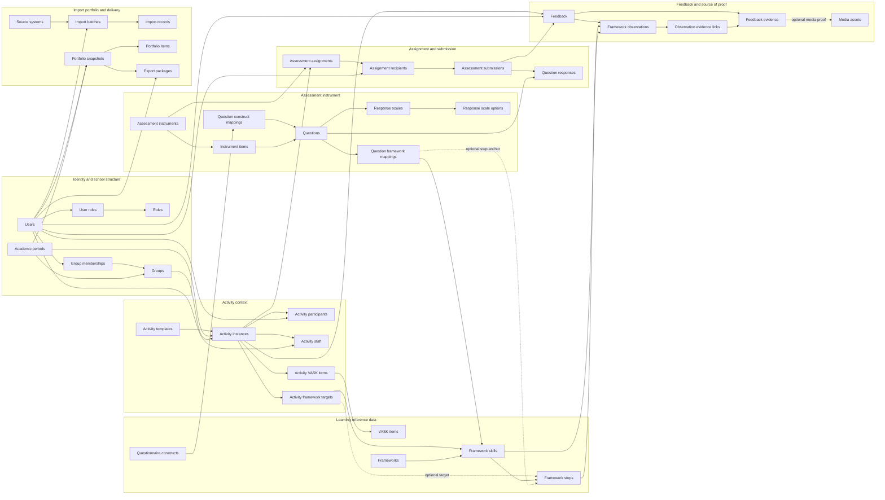

The arrows in this overview show direction of reference and workflow. The ER diagrams below show exact cardinalities.

---

## 1 Identity and school structure

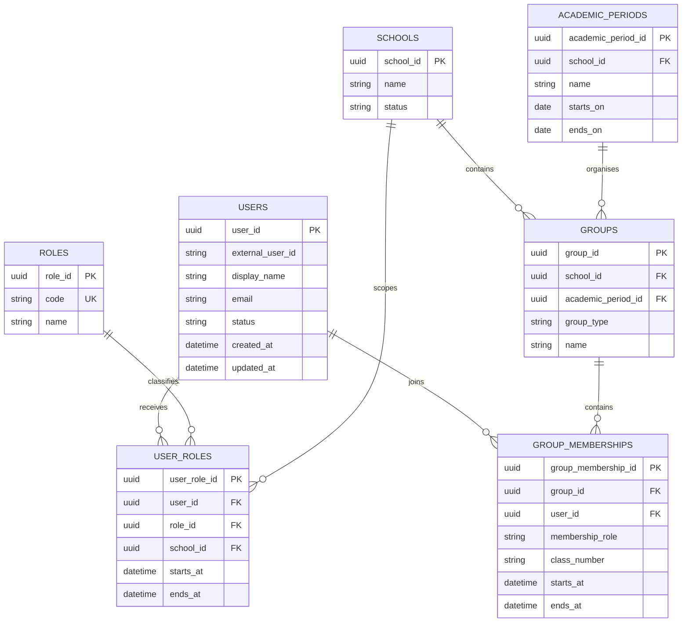

### Key relationships

| Relationship | Type | Explanation |
|---|---|---|
| Users to roles | Many-to-many | One user may be a teacher and administrator; one role belongs to many users. `user_roles` resolves the relationship. |
| Users to groups | Many-to-many | A student can join different classes or project groups over time. `group_memberships` preserves this history. |
| Academic period to groups | One-to-many | One school year or term can contain many groups. |

---

## 2 Activities, participants, VASK, and framework targets

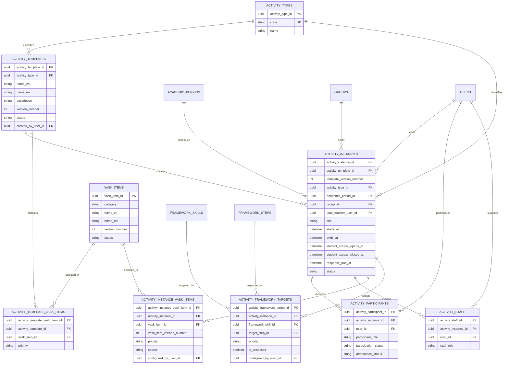

### Key relationships

| Relationship | Type | Explanation |
|---|---|---|
| Activity template to activity instance | One-to-many | A reusable activity can be run many times. Each actual run is a separate instance. |
| Activity instance to users | Many-to-many | An activity has many participants and a user can attend many activities. `activity_participants` resolves it. |
| Activity instance to staff | Many-to-many | An activity can have several teachers; a teacher can support many activities. `activity_staff` resolves it. |
| Activity template to VASK items | Many-to-many | A template can contain several default VASK items, and one VASK item can be used by many templates. |
| Activity instance to VASK items | Many-to-many | The actual VASK selection is copied and may be modified for a particular activity run. |
| Activity instance to framework skills | Many-to-many | An activity can target several framework skills. Each skill can be targeted by many activities. |
| Activity framework target to framework step | Many-to-zero-or-one | A target may name an exact expected step, or only name the skill. |

---

## 3 Framework reference data

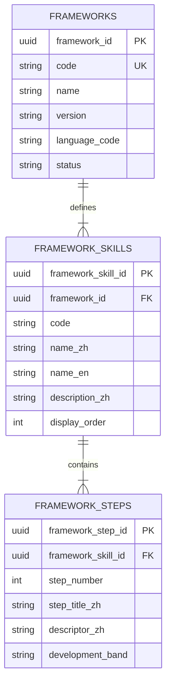

### Constraints

- One framework version contains eight framework skills.
- One framework skill contains 16 framework steps.
- `framework_id + code` is unique in `framework_skills`.
- `framework_skill_id + step_number` is unique in `framework_steps`.
- A step always belongs to exactly one framework skill.
- A new translation or structural revision should create a new framework version instead of overwriting historical wording.

---

## 4 Assessment instruments, questions, constructs, and scales

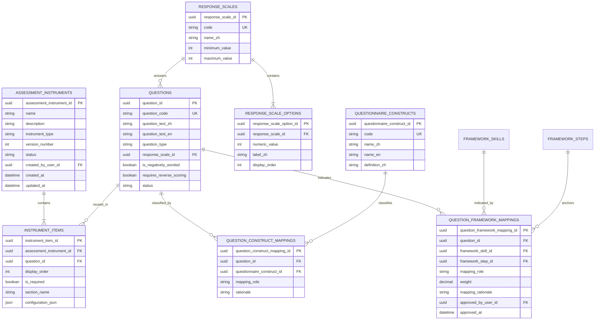

### Important distinctions

| Entity | What it represents |
|---|---|
| `assessment_instruments` | A reusable questionnaire, observation checklist, reflection, or review definition. |
| `questions` | Individual prompts in a reusable question bank. |
| `instrument_items` | The placement and order of a question in an instrument. |
| `questionnaire_constructs` | General qualities measured by groups of questions, such as communication confidence. |
| `response_scales` | How a question is answered, such as 1–6 frequency or agreement. |
| `question_framework_mappings` | Which framework abilities or optional exact steps a question may provide evidence about. |

### Many-to-many relationships

- One assessment instrument contains many questions, and one question may be reused in many instruments. `instrument_items` resolves this relationship.
- One question may relate to several constructs, and one construct contains many questions. `question_construct_mappings` resolves it.
- One question may indicate several framework skills, and one framework skill may be indicated by many questions. `question_framework_mappings` resolves it.

A question-to-framework mapping does not by itself award a framework step. It states where the answer may provide evidence. An exact `framework_step_id` is used only for a deliberately step-anchored question.

### Form version authority and publication

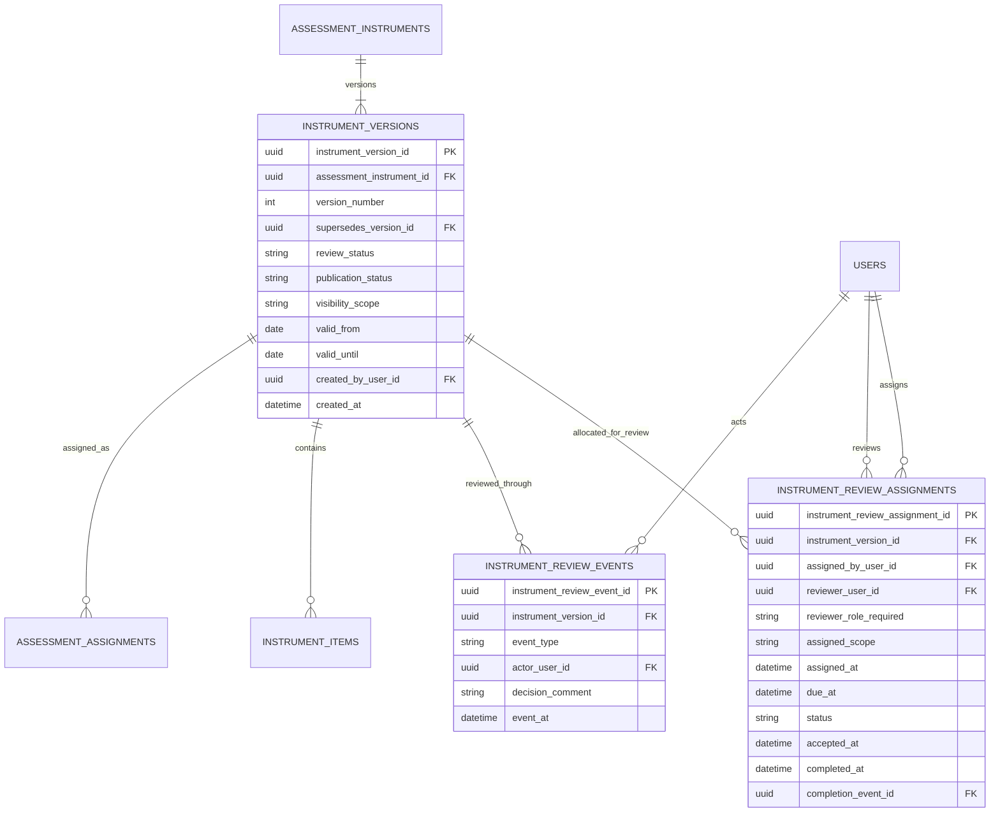

These are separate controls:

1. `review_status` says whether the version's content is valid: `draft`, `in_review`, `changes_requested`, `approved`, `rejected`, or `retired`.
2. `publication_status` says whether the approved version is available for new use: `unpublished`, `published`, or `withdrawn`.
3. `visibility_scope` says who can discover it: `private_draft`, `reviewers_only`, `school_catalogue`, `assigned_activities_only`, or `public_external`.
4. An assignment points to one exact immutable version. It is allowed only when the version is approved, published, within its validity dates, and not retired.

Role membership grants authority to review. `instrument_review_assignments` allocates one review to one actual reviewer. `instrument_review_events` records the decision that resulted. These records must not be collapsed into a single status field.

Editing an approved or published version creates a successor draft. It never changes the questions or interpretation attached to historical assignments and submissions.

---

## 5 Assignment, submission, and responses

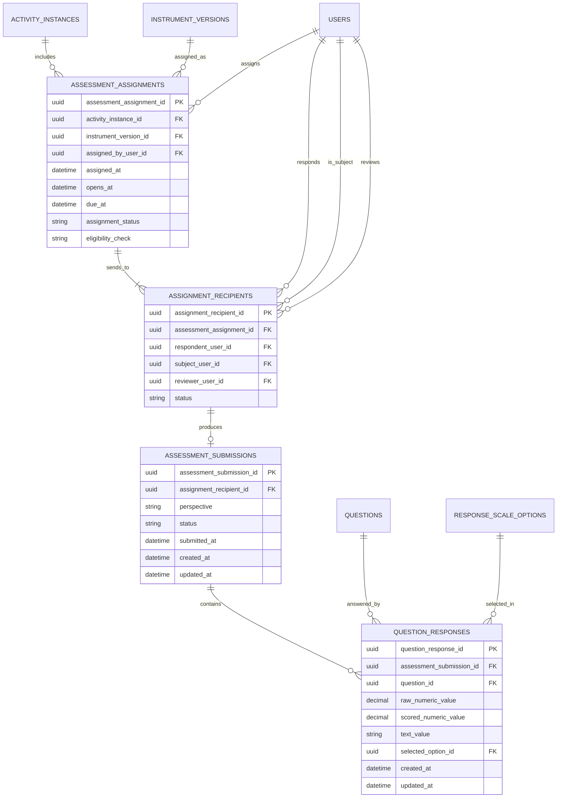

### Perspective examples

`assessment_submissions.perspective` should identify the source of the judgement:

- `student_self_report`
- `teacher_observation`
- `peer_observation`
- `guardian_observation`

Student and teacher submissions remain separate records even when they use the same instrument and concern the same student.

### Key relationships

| Relationship | Type | Explanation |
|---|---|---|
| Activity instance to assessment assignments | One-to-many | One activity can assign several instruments. |
| Instrument version to assignments | One-to-many | The same approved, published version can be used in many activities. |
| Assignment to recipients | One-to-many | One assignment may be sent to an entire class. |
| Recipient to submission | One-to-zero-or-one | A recipient may not have submitted yet. |
| Submission to responses | One-to-many | One completed submission contains answers to many questions. |
| Question to responses | One-to-many | The same question is answered in many submissions. |

An assignment with an unapproved, unpublished, expired, withdrawn, or retired version must be stored as `blocked` or rejected before recipients are created.

---

## 6 Feedback, framework observations, and evidence

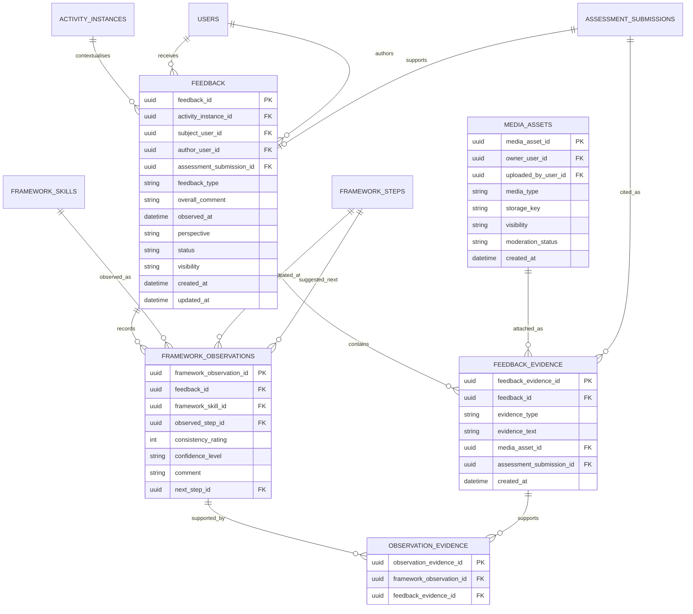

### Source-of-proof rules

1. `feedback` identifies the subject, author, perspective, activity context, and observation time.
2. `feedback_evidence` stores the actual proof: a behaviour description, submitted form, work product, or media item.
3. `framework_observations` records the teacher's, student's, or peer's interpretation of that proof against one framework skill.
4. `observation_evidence` explicitly states which evidence supports which observation.
5. One evidence item may support several observations.
6. One observation may rely on several evidence items.
7. `observed_step_id` and `consistency_rating` remain separate values.

### Example

```text
Feedback
    subject: Student A
    author: Teacher B
    activity: Two-week problem-solving project
    perspective: teacher_observation

Evidence 1
    “The student compared two proposals and explained the likely consequences.”

Observation 1
    skill: Problem-solving
    observed step: 7, Evaluate options
    consistency: 4/6, Often
    supported by: Evidence 1

Observation 2
    skill: Speaking
    observed step: 8, Use facts
    consistency: 3/6, Occasionally
    supported by: Evidence 1
```

The same evidence supports two observations, but the step and consistency values are recorded independently for each skill.

---

## 7 Media and evidence attachments

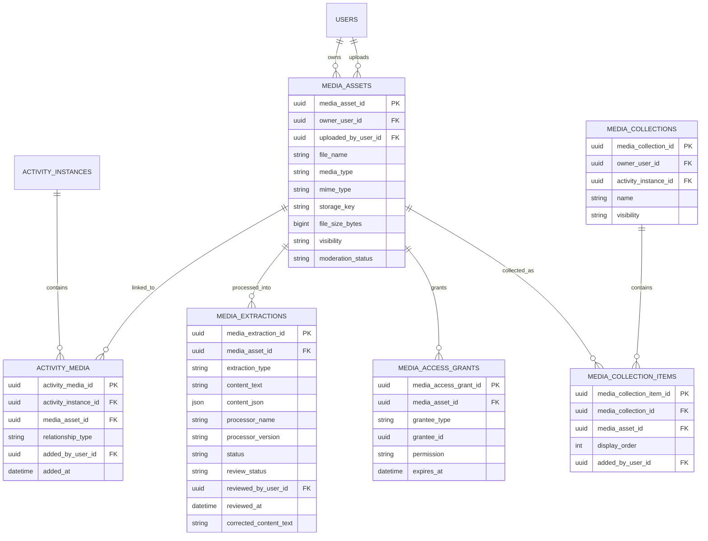

Media is not proof by itself. It becomes assessment evidence only when a `feedback_evidence` record cites it and describes its relevance.

---

## 8 End-to-end creation flow

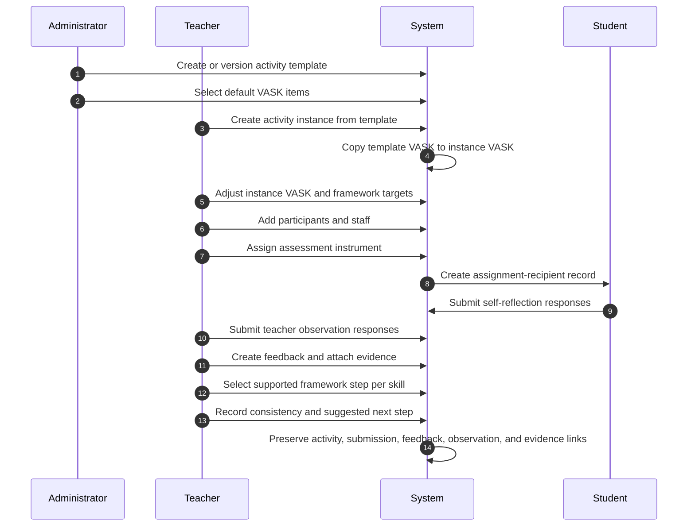

## 9 Integration portfolio publication and external delivery

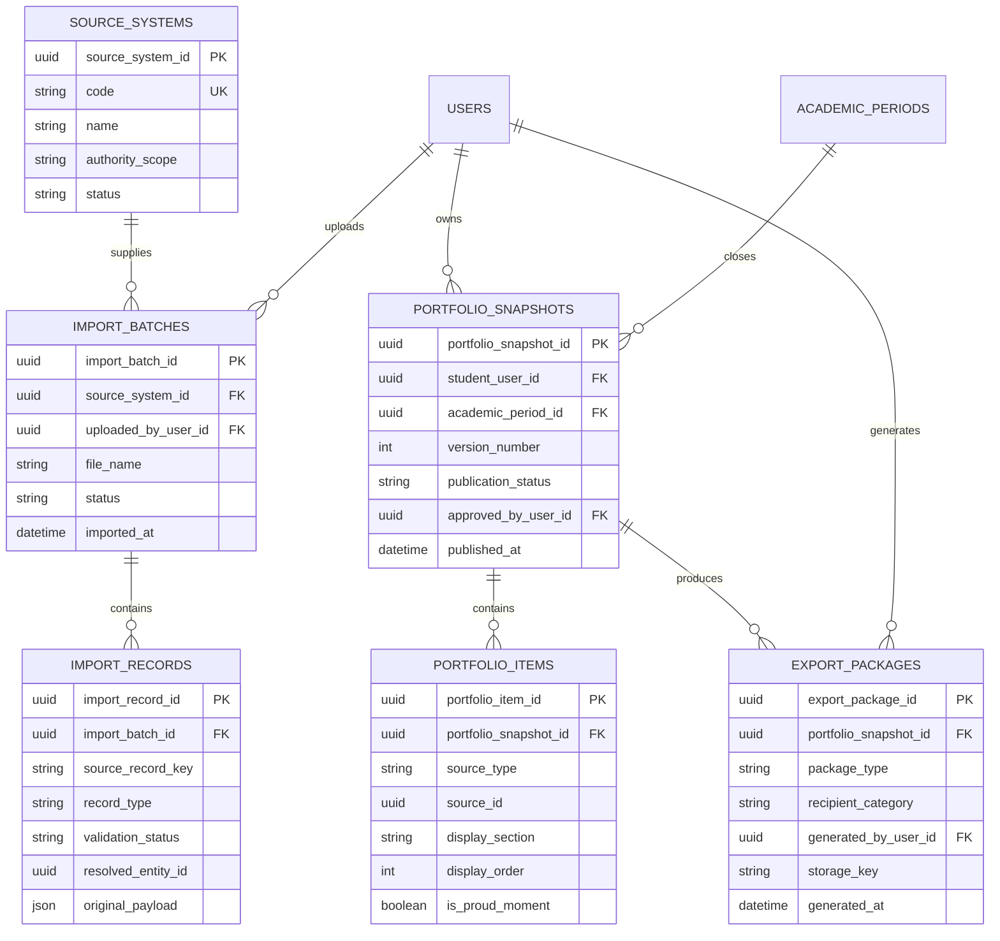

`source_systems` and import records preserve provenance and validation failures. An imported record must not overwrite reviewed platform data without an explicit reconciliation decision.

`portfolio_snapshots` freeze the approved content for a reporting period. The live student timeline may continue to change, while an issued SLP or period report remains reproducible.

For the lean MVP, an external authority is a `recipient_category`, not an authenticated role. The platform produces a printable PDF/SLP and, where audit detail is required, an XLSX evidence register. Any later external portal requires a separate identity, consent, access, expiry, and audit design.

## 10 What is intentionally excluded

The following belong to the later analytics design and are not part of this core model:

- combining several observations into one current stage;
- weighting teacher, student, peer, or guardian perspectives;
- calculating radar-chart snapshots;
- trend calculations;
- cohort comparisons;
- prediction or recommendation models;
- statistical conversion from questionnaire totals to framework steps;
- confidence scoring based on observation quantity or recency;
- badges, milestones, or progression notifications.
- automated reminder scheduling and escalation;
- an authenticated portal for external authorities; and
- automatic external-authority override of a school-confirmed skill step.

The operational records above should remain the authoritative source even after analytics tables are added.
