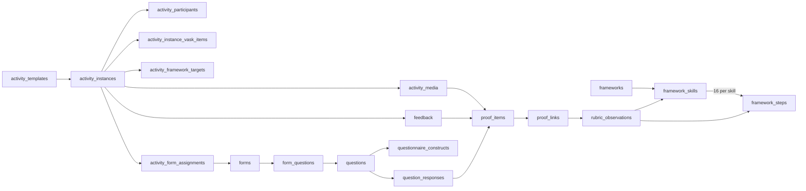

# Aspects updated

## Purpose

This document compares the original entity notes with an updated relational model for activities, media, forms, teacher feedback, the eight Universal Framework skills, their 16 steps, questionnaire constructs, and optional VASK configuration.

The central distinction is:

- **Activity design** records what an activity intends to develop.
- **Framework skills and steps** provide the eight developmental axes and 16 ordered stages per axis.
- **Questionnaire constructs and questions** provide reusable observation prompts and six-point response scales.
- **Feedback and evidence** record what a teacher actually observed about one student in one activity context.
- **Radar-chart results** are derived from supported framework-step observations. They are not stored as the only assessment record.

## Naming convention

### Before

- Entity names mix singular and plural forms: `Activities`, `Media`, `Form`, `FormQuestions`, `User`.
- Field names mix styles: `activityId`, `upload/updateBy`, `accessBy`, `respondantId`.
- Some fields contain several concepts, such as `activityVASK` and `mediaList`.
- Some references are written as dotted labels, such as `Activity.activityId`, rather than foreign-key fields.

### After

- Use **plural snake_case** table names: `activities`, `media_assets`, `forms`, `users`.
- Use **singular snake_case** field names: `activity_id`, `uploaded_by_user_id`.
- Use `_id` only for primary and foreign keys.
- Use `created_at`, `updated_at`, `starts_at`, and `ends_at` for timestamps.
- Use join tables for many-to-many relationships instead of array fields.
- Use reference tables or validated enums for controlled vocabularies.
- Preserve historical definitions through versioned templates and immutable submitted records.

## Important model distinction

The source questionnaire and the Universal Framework do not contain the same skill set.

### Eight Universal Framework radar axes

| Code | English name | Chinese name | Steps |
|---|---|---|---:|
| `listening` | Listening | 聆聽 | 16 |
| `speaking` | Speaking | 說話 | 16 |
| `problem_solving` | Problem-solving | 解難 | 16 |
| `creativity` | Creativity | 創意 | 16 |
| `adaptability` | Adaptability | 適應力 | 16 |
| `planning` | Planning | 計劃能力 | 16 |
| `leadership` | Leadership | 領導力 | 16 |
| `teamwork` | Teamwork | 團隊協作 | 16 |

### Ten questionnaire constructs

| Code | English name | Chinese name | Questions | Possible semantic overlap; not a system mapping |
|---|---|---|---:|---|
| `adaptability` | Adaptability | 適應能力 | 12 | Semantically overlaps adaptability |
| `collaboration` | Collaboration | 合作能力 | 18 | Semantically overlaps teamwork |
| `communication` | Communication | 溝通能力 | 16 | May provide context relevant to listening or speaking |
| `creativity` | Creativity | 創造力 | 18 | Semantically overlaps creativity |
| `critical_thinking` | Critical Thinking | 批判思維能力 | 18 | May provide context relevant to reasoning or problem solving |
| `curiosity` | Curiosity | 探究能力／好奇心 | 18 | May provide context relevant to creativity or problem solving |
| `growth_mindset` | Growth Mindset | 成長型思維 | 12 | May provide context relevant to adaptability or planning |
| `leadership` | Leadership | 領導力 | 22 | Semantically overlaps leadership |
| `perseverance` | Perseverance | 堅毅 | 14 | May provide context relevant to adaptability or planning |
| `problem_solving` | Problem-Solving | 問題解決能力 | 18 | Semantically overlaps problem solving |

Do not put both lists in one `skill` column. Store questionnaire constructs, question-owned abilities, VASK and rubric axes as separate concepts. **Discussed on Meeting Oct 26 - kickstart:** questions no longer have a fixed VASK/RC360/Skills Builder mapping; accepted responses become proof and are interpreted against the rubric selected during Portfolio review.

---

## 1 Activities

### Before

```text
Activities
    activityId
    activityVASK
    activityType
    date (by School year)
    uploadDate
    upload/updateBy
    updateDate
```

### Issues

- A reusable activity definition and an actual occurrence are mixed together.
- One `date` field cannot represent a lesson, trip, or two-week project.
- `activityVASK` would contain multiple records in one field.
- Creator and updater are combined.
- The school period should be resolved from the activity start/end dates against configured period boundaries, with an exception when the range crosses periods.

### After

#### `activity_templates`

Reusable definitions such as “Communication lesson” or “Two-week problem-solving project.”

| Field | Type | Notes |
|---|---|---|
| `activity_template_id` | UUID | Primary key |
| `name_zh` | text | Required |
| `name_en` | text, nullable | Optional English name |
| `description` | text, nullable | Intended activity design |
| `activity_type_id` | UUID | References `activity_types` |
| `default_duration_minutes` | integer, nullable | Useful for lessons |
| `status` | enum | `draft`, `active`, `archived` |
| `version_number` | integer | Starts at 1 |
| `created_by_user_id` | UUID | References `users` |
| `created_at` | timestamp | Required |
| `updated_by_user_id` | UUID | References `users` |
| `updated_at` | timestamp | Required |

#### `activity_instances`

One actual occurrence of an activity.

| Field | Type | Notes |
|---|---|---|
| `activity_instance_id` | UUID | Primary key |
| `activity_template_id` | UUID, nullable | Null for a standalone observation |
| `template_version_number` | integer, nullable | Preserves the version used |
| `title` | text | Display name for this occurrence |
| `activity_type_id` | UUID | References `activity_types` |
| `academic_period_id` | UUID | Server-resolved from `starts_at`/`ends_at`; references `academic_periods` |
| `period_resolution_status` | enum | `resolved`, `cross_period_exception`, `no_match`, `exception_approved` |
| `group_id` | UUID, nullable | Class, team, or project group |
| `starts_at` | timestamp | Required |
| `ends_at` | timestamp, nullable | Supports multi-day activities |
| `lead_teacher_user_id` | UUID | References `users` |
| `status` | enum | `planned`, `active`, `completed`, `cancelled` |
| `created_at` | timestamp | Required |
| `updated_at` | timestamp | Required |

#### `activity_types`

Examples: `class_lesson`, `extracurricular`, `school_trip`, `project`, `sports`, `standalone_observation`.

---

## 2 Activity participants and staff

### Before

```text
ActivityData
    Activity.activityId
    mediaList (formId, mediaId)
    teacherId (single or array)
    studentId (single or array)
```

### Issues

- `ActivityData` does not describe one clear entity.
- Teacher and student arrays prevent relational constraints and efficient queries.
- Forms and media are different entities and should not share one array.

### After

#### `activity_participants`

| Field | Type | Notes |
|---|---|---|
| `activity_participant_id` | UUID | Primary key |
| `activity_instance_id` | UUID | References `activity_instances` |
| `user_id` | UUID | Usually a student |
| `participant_role` | enum | `student`, `peer_reviewer`, `observer`, `guest` |
| `joined_at` | timestamp, nullable | Optional attendance information |
| `participation_status` | enum | `invited`, `attended`, `absent`, `withdrawn` |

Unique constraint: `activity_instance_id + user_id + participant_role`.

#### `activity_staff`

| Field | Type | Notes |
|---|---|---|
| `activity_staff_id` | UUID | Primary key |
| `activity_instance_id` | UUID | References `activity_instances` |
| `user_id` | UUID | Teacher or administrator |
| `staff_role` | enum | `lead_teacher`, `teacher`, `observer`, `approver` |

Media and form links belong in their own tables described below.

---

## 3 Media

### Before

```text
Media
    mediaId
    Activities.activityId
    mediaType
    path
    uploadDate
    uploadedBy
```

### Issues

- A media item may relate to an activity, feedback record, form response, or student portfolio.
- A raw path is insufficient for cloud storage, integrity, and access control.
- There is no title, MIME type, file size, status, or ownership information.

### After

#### `media_assets`

| Field | Type | Notes |
|---|---|---|
| `media_asset_id` | UUID | Primary key |
| `owner_user_id` | UUID | Original owner |
| `uploaded_by_user_id` | UUID | User who performed the upload |
| `file_name` | text | Original file name |
| `display_name` | text, nullable | Human-readable label |
| `media_type` | enum | `image`, `video`, `audio`, `document`, `other` |
| `mime_type` | text | Actual MIME type |
| `storage_provider` | text | Storage system identifier |
| `storage_key` | text | Provider-specific object key; do not expose as public URL |
| `file_size_bytes` | bigint | Validation and quotas |
| `checksum_sha256` | text, nullable | Integrity and duplicate detection |
| `visibility` | enum | `private`, `activity_staff`, `activity_participants`, `school` |
| `moderation_status` | enum | `pending`, `approved`, `rejected` |
| `created_at` | timestamp | Upload time |
| `updated_at` | timestamp | Metadata update time |

#### `activity_media`

| Field | Type | Notes |
|---|---|---|
| `activity_instance_id` | UUID | References `activity_instances` |
| `media_asset_id` | UUID | References `media_assets` |
| `relationship_type` | enum | `instruction`, `student_evidence`, `teacher_evidence`, `result` |
| `added_by_user_id` | UUID | References `users` |
| `added_at` | timestamp | Required |

For student uploads, default `visibility` to `private` and `moderation_status` to `pending`. A permitted teacher can approve the asset for wider activity access.

---

## 4 Media information and access

### Before

```text
MediaInfo
    Media.mediaId
    modifyDate
    updatedDate
    uploadedBy
    accessBy(teacher, class, teacher group)
```

### Issues

- Upload and update data duplicate fields from `Media`.
- `modifyDate` and `updatedDate` are ambiguous duplicates.
- `accessBy` combines users, groups, and roles in one field.

### After

Keep core metadata in `media_assets`. Add access grants only when the normal activity visibility rules are insufficient.

#### `media_access_grants`

| Field | Type | Notes |
|---|---|---|
| `media_access_grant_id` | UUID | Primary key |
| `media_asset_id` | UUID | References `media_assets` |
| `grantee_type` | enum | `user`, `group`, `role` |
| `grantee_id` | UUID | Validated according to `grantee_type` |
| `permission` | enum | `view`, `comment`, `manage` |
| `granted_by_user_id` | UUID | References `users` |
| `created_at` | timestamp | Required |
| `expires_at` | timestamp, nullable | Optional temporary access |

---

## 5 Media extraction

### Before

```text
MediaExtract
    mediaId
    mediaText
    extractType
    extract
    createdDate
    updatedDate
    createdBy
```

### Issues

- `mediaText` and `extract` overlap.
- There is no processing status, model/version provenance, language, confidence, or error information.
- Human-created and machine-generated extractions are not distinguished.

### After

#### `media_extractions`

| Field | Type | Notes |
|---|---|---|
| `media_extraction_id` | UUID | Primary key |
| `media_asset_id` | UUID | References `media_assets` |
| `extraction_type` | enum | `ocr`, `transcription`, `summary`, `tagging`, `other` |
| `content_text` | text, nullable | Extracted or generated text |
| `content_json` | json, nullable | Timecodes, regions, labels, or structured output |
| `language_code` | text, nullable | For example `zh-Hant` |
| `source_type` | enum | `system`, `teacher`, `student`, `import` |
| `processor_name` | text, nullable | Service or model name |
| `processor_version` | text, nullable | Reproducibility |
| `confidence_score` | decimal, nullable | Only when supplied by the processor |
| `status` | enum | `queued`, `processing`, `completed`, `failed`, `reviewed` |
| `error_message` | text, nullable | Processing failure details |
| `created_by_user_id` | UUID, nullable | Null for automated system jobs |
| `created_at` | timestamp | Required |
| `updated_at` | timestamp | Required |

---

## 6 Shared media folders

### Before

```text
SharedMediaFolder
    information missing
```

### After

#### `media_collections`

| Field | Type | Notes |
|---|---|---|
| `media_collection_id` | UUID | Primary key |
| `name` | text | Required |
| `description` | text, nullable | Optional |
| `owner_user_id` | UUID | References `users` |
| `activity_instance_id` | UUID, nullable | Optional activity context |
| `visibility` | enum | Same controlled vocabulary as media |
| `created_at` | timestamp | Required |
| `updated_at` | timestamp | Required |

#### `media_collection_items`

| Field | Type | Notes |
|---|---|---|
| `media_collection_id` | UUID | References `media_collections` |
| `media_asset_id` | UUID | References `media_assets` |
| `display_order` | integer | Stable ordering |
| `added_by_user_id` | UUID | References `users` |
| `added_at` | timestamp | Required |

---

## 7 Forms

### Before

```text
Form
    (associated)activityId
    formId
    formQuestionId(array)
    uploaded/updatedBy
    teacherId(array for access)
    formType: isPeerReview, isTeacherReview, activityRewind
    respondantId (have access and can update)
    peerId (viewOnly)
```

### Issues

- Form definition, activity assignment, respondents, reviewers, and submitted responses are mixed together.
- Question arrays prevent ordering, versioning, and reuse.
- Boolean-style form types can conflict with one another.
- `respondantId` is misspelled; the correct term is `respondent_id`.
- Access and submission status need separate records.

### After

#### `forms`

Stable identity for a reusable form. Editable content and governance status belong to an immutable form version.

| Field | Type | Notes |
|---|---|---|
| `form_id` | UUID | Primary key |
| `name` | text | Required |
| `description` | text, nullable | Optional |
| `form_type` | enum | `teacher_observation`, `teacher_review`, `peer_review`, `student_reflection`, `activity_rewind` |
| `created_by_user_id` | UUID | References `users` |
| `created_at` | timestamp | Required |
| `updated_at` | timestamp | Required |

#### `form_versions`

One immutable content version of a form. Modifying an approved or published version creates a new draft version rather than changing historical assignments.

| Field | Type | Notes |
|---|---|---|
| `form_version_id` | UUID | Primary key |
| `form_id` | UUID | References `forms` |
| `version_number` | integer | Unique within one form |
| `supersedes_form_version_id` | UUID, nullable | Prior version |
| `review_status` | enum | `draft`, `in_review`, `changes_requested`, `approved`, `rejected`, `retired` |
| `publication_status` | enum | `unpublished`, `published`, `withdrawn` |
| `visibility_scope` | enum | `private_draft`, `reviewers_only`, `school_catalogue`, `assigned_activities_only`, `public_external` |
| `valid_from` | date, nullable | Earliest assignment date |
| `valid_until` | date, nullable | Latest assignment date |
| `created_by_user_id` | UUID | Version author |
| `created_at` | timestamp | Required |

Only a version with `review_status = approved`, `publication_status = published`, and a current validity window is eligible for a new activity assignment. `public_external` is outside the initial scope and requires a separate school policy.

#### `form_review_events`

Immutable review and publication history.

| Field | Type | Notes |
|---|---|---|
| `form_review_event_id` | UUID | Primary key |
| `form_version_id` | UUID | References `form_versions` |
| `event_type` | enum | `submitted`, `changes_requested`, `approved`, `rejected`, `published`, `withdrawn`, `retired`, `created_revision` |
| `actor_user_id` | UUID | Authorized reviewer, publisher, or author |
| `decision_comment` | text, nullable | Review rationale |
| `event_at` | timestamp | Required |

#### `form_review_assignments`

Assigns one immutable form version to a specific authorized reviewer. Role permissions determine who is eligible; this table records who actually owns the review work item.

| Field | Type | Notes |
|---|---|---|
| `form_review_assignment_id` | UUID | Primary key |
| `form_version_id` | UUID | References `form_versions` |
| `assigned_by_user_id` | UUID | User who allocated the review |
| `reviewer_user_id` | UUID | Specific reviewer |
| `reviewer_role_required` | enum | Usually `super_teacher` or `school_admin` |
| `assigned_scope` | text | School, programme, year, class, or other authorized scope |
| `assigned_at` | timestamp | Required |
| `due_at` | timestamp, nullable | Review deadline |
| `status` | enum | `assigned`, `accepted`, `in_review`, `changes_requested`, `approved`, `rejected`, `cancelled`, `expired` |
| `accepted_at` | timestamp, nullable | Reviewer acceptance |
| `completed_at` | timestamp, nullable | Completion time |
| `completion_event_id` | UUID, nullable | References the resulting `form_review_events` decision |

A reviewer must hold the required role within the assignment scope. By default, the author of a form version cannot approve their own version.

#### `form_questions`

Orders reusable questions within a form.

| Field | Type | Notes |
|---|---|---|
| `form_question_id` | UUID | Primary key |
| `form_version_id` | UUID | References `form_versions` |
| `question_id` | UUID | References `questions` |
| `display_order` | integer | Required |
| `is_required` | boolean | Required |
| `section_name` | text, nullable | Optional grouping |
| `configuration_json` | json, nullable | UI-only settings, not core scoring data |

#### `activity_form_assignments`

| Field | Type | Notes |
|---|---|---|
| `activity_form_assignment_id` | UUID | Primary key |
| `activity_instance_id` | UUID | References `activity_instances` |
| `form_version_id` | UUID | References one immutable `form_versions` record |
| `assigned_by_user_id` | UUID | References `users` |
| `assigned_at` | timestamp | Required |
| `opens_at` | timestamp, nullable | Optional |
| `due_at` | timestamp, nullable | Optional |
| `assignment_status` | enum | `scheduled`, `open`, `closed`, `cancelled`, `blocked` |
| `eligibility_check` | enum | `passed`, `failed_form_not_approved`, `failed_form_not_published`, `failed_outside_validity`, `failed_form_retired` |

Approval, publication, visibility, and assignment are separate decisions. Approval means the content is valid; publication makes that approved version available within a defined scope; assignment connects that exact version to an activity.

#### `form_assignment_recipients`

| Field | Type | Notes |
|---|---|---|
| `form_assignment_recipient_id` | UUID | Primary key |
| `activity_form_assignment_id` | UUID | References assignment |
| `respondent_user_id` | UUID | Person who completes the form |
| `subject_user_id` | UUID, nullable | Student being assessed |
| `reviewer_user_id` | UUID, nullable | Person with review-only access |
| `status` | enum | `assigned`, `in_progress`, `submitted`, `reviewed`, `cancelled` |

#### `form_submissions`

| Field | Type | Notes |
|---|---|---|
| `form_submission_id` | UUID | Primary key |
| `form_assignment_recipient_id` | UUID | References recipient record |
| `feedback_id` | UUID, nullable | Connects assessment responses to feedback |
| `submitted_at` | timestamp, nullable | Null until submitted |
| `content_status` | enum | `draft`, `submitted`, `in_review`, `changes_requested`, `approved`, `rejected` |
| `processing_status` | enum | `received`, `needs_identity_resolution`, `identity_matched`, `corrected`, `validated`, `included_in_assessment`, `excluded` |
| `visibility_status` | enum | `unpublished`, `published_to_portfolio`, `withdrawn` |
| `created_at` | timestamp | Required |
| `updated_at` | timestamp | Required |

Content review, assessment inclusion, and student visibility are separate decisions. A validated response may count without being visible in the Portfolio.

---

## 8 Questions, scales, and form comparison

### Before

```text
FormQuestions
    questionId
    questionIndex
    questionText
    questionType (radio, spectrum, text, dropdown, openEnd)
    skill (ch/en)
    negativeQuestion
    specialized Teacher observation and comments
```

### Issues

- `skill (ch/en)` combines language labels and an ambiguous skill model.
- Questionnaire constructs are not the same as the eight framework skills.
- The two six-point scales need reusable definitions.
- Negative wording and reverse scoring are related but should remain explicit.
- Question order belongs to `form_questions`, not the reusable question itself.
- Teacher comments are assessment evidence, not a special question type.

### After

#### `questions`

| Field | Type | Notes |
|---|---|---|
| `question_id` | UUID | Primary key |
| `question_code` | text | Stable human-readable identifier |
| `question_text_zh` | text | Required |
| `question_text_en` | text, nullable | Optional |
| `question_type` | enum | `single_choice`, `multiple_choice`, `scale`, `short_text`, `long_text`, `dropdown` |
| `response_scale_id` | UUID, nullable | Required for scaled questions |
| `questionnaire_construct_id` | UUID, nullable | Primary questionnaire construct |
| `construct_subcategory_id` | UUID, nullable | Workbook “範疇” value |
| `ability_code` | text | Stable code for the ability expressed by this question |
| `ability_name_en` / `ability_name_zh` | text | Required bilingual ability label |
| `ability_description_en` / `ability_description_zh` | text | Explains the question's valid meaning and use |
| `is_negatively_worded` | boolean | Matches source wording |
| `requires_reverse_scoring` | boolean | True only when scoring requires reversal |
| `status` | enum | `draft`, `active`, `retired` |
| `created_at` | timestamp | Required |
| `updated_at` | timestamp | Required |

#### `response_scales`

| Field | Type | Notes |
|---|---|---|
| `response_scale_id` | UUID | Primary key |
| `code` | text | For example `frequency_effect_6` |
| `name_zh` | text | `頻率／效果` or `同意程度` |
| `minimum_value` | integer | 1 |
| `maximum_value` | integer | 6 |

#### `response_scale_options`

| Field | Type | Notes |
|---|---|---|
| `response_scale_option_id` | UUID | Primary key |
| `response_scale_id` | UUID | References scale |
| `numeric_value` | integer | 1 through 6 |
| `label_zh` | text | Scale label |
| `display_order` | integer | Required |

The source scales are:

| Scale | 1 | 2 | 3 | 4 | 5 | 6 |
|---|---|---|---|---|---|---|
| Frequency/effect | 幾乎從不 | 很少 | 偶爾 | 經常 | 通常 | 幾乎總是 |
| Agreement | 非常不同意 | 不同意 | 略為不同意 | 略為同意 | 同意 | 非常同意 |

#### `questionnaire_constructs`

Stores the 10 questionnaire skills separately from the eight framework skills.

| Field | Type | Notes |
|---|---|---|
| `questionnaire_construct_id` | UUID | Primary key |
| `code` | text | Stable code |
| `name_zh` | text | Chinese label |
| `name_en` | text | English label |
| `definition_zh` | text | Source definition |

#### `questionnaire_construct_subcategories`

| Field | Type | Notes |
|---|---|---|
| `construct_subcategory_id` | UUID | Primary key |
| `questionnaire_construct_id` | UUID | Parent construct |
| `name_zh` | text | Workbook “範疇” |
| `display_order` | integer | Required |

#### Question ability and Proof List boundary

**Discussed on Meeting Oct 26 - kickstart.** `question_framework_mappings`, `question_vask_mappings`, normalized mapping weights and fixed evidence bands are removed from the current model. The question version itself stores a valid ability definition. A submitted and accepted response creates a `proof_item` with source type `question_response`; `proof_links` may later connect it to a human-confirmed `rubric_observation`. This keeps historical question meaning stable while allowing the same evidence to be reviewed against an interchangeable, versioned rubric.

#### `question_responses`

| Field | Type | Notes |
|---|---|---|
| `question_response_id` | UUID | Primary key |
| `form_submission_id` | UUID | References `form_submissions` |
| `question_id` | UUID | References `questions` |
| `numeric_value` | decimal, nullable | Scale or numeric response |
| `text_value` | text, nullable | Written response |
| `selected_option_id` | UUID, nullable | Choice response |
| `raw_numeric_value` | decimal, nullable | Preserves original answer |
| `scored_numeric_value` | decimal, nullable | Reverse-scored value where applicable |
| `created_at` | timestamp | Required |
| `updated_at` | timestamp | Required |

---

## 9 Framework skills and steps

### Before

No separate framework entities exist. `FormQuestions.skill` is expected to carry skill information, but it cannot represent:

- Eight framework axes.
- Sixteen ordered developmental steps for every axis.
- The difference between a questionnaire construct and a framework skill.
- The exact step selected by a teacher.

### After

#### `frameworks`

| Field | Type | Notes |
|---|---|---|
| `framework_id` | UUID | Primary key |
| `code` | text | For example `skills_builder_uf_2_0_zh_hant` |
| `name` | text | Framework title |
| `version` | text | `2.0` |
| `language_code` | text | `zh-Hant` |
| `status` | enum | `active`, `retired` |

#### `framework_skills`

| Field | Type | Notes |
|---|---|---|
| `framework_skill_id` | UUID | Primary key |
| `framework_id` | UUID | References `frameworks` |
| `code` | text | One of the eight canonical codes |
| `name_zh` | text | Canonical Chinese label |
| `name_en` | text | Canonical English label |
| `description_zh` | text | Framework skill description |
| `display_order` | integer | 1 through 8 |

Unique constraint: `framework_id + code`.

#### `framework_steps`

| Field | Type | Notes |
|---|---|---|
| `framework_step_id` | UUID | Primary key |
| `framework_skill_id` | UUID | References `framework_skills` |
| `step_number` | integer | 1 through 16 |
| `step_title_zh` | text | For example `質疑` |
| `descriptor_zh` | text | Exact “I can” statement |
| `development_band` | enum | `entry`, `intermediate`, `advanced`, `mastery` |

Unique constraint: `framework_skill_id + step_number`.

Recommended band derivation:

| Steps | Band code | Chinese label |
|---:|---|---|
| 1–4 | `entry` | 入門 |
| 5–8 | `intermediate` | 初階 |
| 9–12 | `advanced` | 高階 |
| 13–16 | `mastery` | 精通 |

The step title and descriptor should be reference data. Teachers select a step; they do not edit the canonical sentence inside an assessment.

#### `activity_framework_targets`

Stores what an activity is designed to practise.

| Field | Type | Notes |
|---|---|---|
| `activity_framework_target_id` | UUID | Primary key |
| `activity_instance_id` | UUID | References `activity_instances` |
| `framework_skill_id` | UUID | References `framework_skills` |
| `target_step_id` | UUID, nullable | Optional expected step |
| `priority` | enum | `primary`, `secondary`, `exposure_only` |
| `is_assessed` | boolean | Distinguishes practice from formal observation |
| `configured_by_user_id` | UUID | Teacher or administrator |
| `created_at` | timestamp | Required |

---

## 10 Teacher feedback and observed framework levels

### Before

Teacher feedback is mentioned only as a possible specialised form. There is no parent feedback record, evidence structure, framework-step selection, or separation between stage and response frequency.

### After

#### `feedback`

One feedback event about one subject in an optional activity context.

| Field | Type | Notes |
|---|---|---|
| `feedback_id` | UUID | Primary key |
| `activity_instance_id` | UUID, nullable | Null for standalone feedback |
| `subject_user_id` | UUID | Student being assessed |
| `author_user_id` | UUID | Teacher, peer, or student |
| `feedback_type` | enum | `teacher_observation`, `teacher_review`, `peer_review`, `self_reflection`, `system_import` |
| `overall_comment` | text, nullable | General free-text feedback |
| `observed_at` | timestamp | When the behaviour occurred |
| `status` | enum | `draft`, `submitted`, `reviewed`, `voided` |
| `visibility` | enum | `author_only`, `staff`, `student_and_staff`, `guardian_and_staff` |
| `created_at` | timestamp | Required |
| `updated_at` | timestamp | Required |

Yes, this replaces the proposed `feedback_list`. The list is a UI view or query; the stored entity is `feedback`.

#### `feedback_evidence`

| Field | Type | Notes |
|---|---|---|
| `feedback_evidence_id` | UUID | Primary key |
| `feedback_id` | UUID | References `feedback` |
| `evidence_type` | enum | `text`, `media`, `form_response`, `work_product`, `other` |
| `evidence_text` | text, nullable | Specific observable behaviour |
| `media_asset_id` | UUID, nullable | References `media_assets` |
| `form_submission_id` | UUID, nullable | References `form_submissions` |
| `created_at` | timestamp | Required |

At least one evidence payload should be present according to `evidence_type`.

#### `feedback_skill_observations`

| Field | Type | Notes |
|---|---|---|
| `feedback_skill_observation_id` | UUID | Primary key |
| `feedback_id` | UUID | References `feedback` |
| `framework_skill_id` | UUID | Radar axis |
| `observed_step_id` | UUID, nullable | Selected 1–16 framework step |
| `consistency_rating` | integer, nullable | 1–6 frequency/effect rating |
| `confidence_level` | enum, nullable | `low`, `medium`, `high`; optional |
| `comment` | text, nullable | Skill-specific comment |
| `next_step_id` | UUID, nullable | Suggested developmental step |

Validation rules:

- `observed_step_id` must belong to `framework_skill_id`.
- `next_step_id` must belong to the same framework skill.
- `consistency_rating` must be between 1 and 6.
- Stage and consistency remain separate. Stage 8 with rating 5 is not the same as stage 5 with rating 8, and rating 8 is invalid.

#### `feedback_observation_evidence`

Many-to-many link when one evidence item supports several skill observations.

| Field | Type |
|---|---|
| `feedback_skill_observation_id` | UUID |
| `feedback_evidence_id` | UUID |

---

## 11 VASK activity configuration

### Before

`activityVASK` exists as one unspecified field.

### Issues

- It cannot distinguish Value, Attitude, Skill, and Knowledge.
- It cannot support multiple selected items.
- It cannot distinguish default template settings from teacher-edited activity settings.
- Historical activities could change if a global VASK item is edited in place.

### After

#### `vask_items`

| Field | Type | Notes |
|---|---|---|
| `vask_item_id` | UUID | Primary key |
| `category` | enum | `value`, `attitude`, `skill`, `knowledge` |
| `name_zh` | text | Required |
| `name_en` | text, nullable | Optional |
| `status` | enum | `active`, `retired` |
| `version_number` | integer | Supports wording changes |

#### `activity_template_vask_items`

Default selection for a reusable template.

| Field | Type | Notes |
|---|---|---|
| `activity_template_id` | UUID | References template |
| `vask_item_id` | UUID | References VASK item |
| `priority` | enum | `primary`, `secondary` |

#### `activity_instance_vask_items`

The actual selection used for one activity occurrence.

| Field | Type | Notes |
|---|---|---|
| `activity_instance_vask_item_id` | UUID | Primary key |
| `activity_instance_id` | UUID | References activity instance |
| `vask_item_id` | UUID | References VASK item |
| `vask_item_version_number` | integer | Historical wording reference |
| `priority` | enum | `primary`, `secondary` |
| `source` | enum | `template_default`, `teacher_added`, `teacher_modified` |
| `configured_by_user_id` | UUID | References `users` |

Changing an activity template or VASK reference record must not retroactively change an existing activity instance.

---

## 12 Users and school membership

### Before

```text
User
    userId
    userType(stud, teacher, Admin)
    enabled
    classId
    classNo
```

### Issues

- One `userType` cannot represent users with several roles.
- Class membership changes over time and should not be stored directly on the user.
- `classNo` is membership data, not identity data.
- External Time Infinity identifiers need their own namespace and provenance.

### After

#### `users`

| Field | Type | Notes |
|---|---|---|
| `user_id` | UUID | Primary key |
| `external_user_id` | text, nullable | Time Infinity or other source identifier |
| `external_source` | text, nullable | Source system name |
| `display_name` | text | Required |
| `email` | text, nullable | Unique when present |
| `status` | enum | `invited`, `active`, `disabled`, `archived` |
| `created_at` | timestamp | Required |
| `updated_at` | timestamp | Required |

#### `roles`

Examples: `student`, `teacher`, `administrator`, `guardian`.

#### `user_roles`

| Field | Type |
|---|---|
| `user_id` | UUID |
| `role_id` | UUID |
| `school_id` | UUID, nullable |
| `starts_at` | timestamp |
| `ends_at` | timestamp, nullable |

#### `groups`

| Field | Type | Notes |
|---|---|---|
| `group_id` | UUID | Primary key |
| `school_id` | UUID | References `schools` |
| `academic_period_id` | UUID | References `academic_periods` |
| `group_type` | enum | `class`, `team`, `teacher_group`, `project_group` |
| `name` | text | Required |

#### `group_memberships`

| Field | Type | Notes |
|---|---|---|
| `group_membership_id` | UUID | Primary key |
| `group_id` | UUID | References `groups` |
| `user_id` | UUID | References `users` |
| `membership_role` | enum | `student`, `teacher`, `leader`, `member` |
| `class_number` | text, nullable | Former `classNo` |
| `starts_at` | timestamp | Required |
| `ends_at` | timestamp, nullable | Preserves history |

---

## 13 Login and action logs

### Before

Not defined in the original file, but identified as a requirement.

### After

#### `login_events`

| Field | Type | Notes |
|---|---|---|
| `login_event_id` | UUID | Primary key |
| `user_id` | UUID, nullable | May be null for unknown login attempt |
| `occurred_at` | timestamp | Required |
| `result` | enum | `success`, `failure`, `locked`, `logout` |
| `authentication_method` | text | Password, SSO, etc. |
| `ip_address` | protected value | Apply retention and privacy policy |
| `user_agent` | text, nullable | Diagnostic data |

#### `audit_events`

| Field | Type | Notes |
|---|---|---|
| `audit_event_id` | UUID | Primary key |
| `actor_user_id` | UUID, nullable | Null for system actions |
| `action_code` | text | For example `feedback.submitted` |
| `entity_type` | text | For example `feedback` |
| `entity_id` | UUID | Affected record |
| `occurred_at` | timestamp | Required |
| `change_summary_json` | json, nullable | Avoid storing unnecessary sensitive content |

Login events and audit events should not be used as the primary source for ordinary product analytics. If detailed behavioural analytics are required, define a separate event model and retention policy.

#### `import_record_corrections`

When staff resolve an imported response with an incorrect student ID, keep the original import immutable and append a correction record.

| Field | Type | Notes |
|---|---|---|
| `import_record_correction_id` | UUID | Primary key |
| `import_record_id` | UUID | References the untouched imported row |
| `field_name` | text | Usually the student identifier field |
| `before_value` | text | Original imported value |
| `after_value` | text | Resolved value used by later processing |
| `original_student_id` | text, nullable | Identifier supplied by the source |
| `resolved_student_id` | text, nullable | Confirmed platform identifier |
| `correction_reason` | text | Required |
| `corrected_by_user_id` | UUID | Staff member who made the decision |
| `corrected_at` | timestamp | Required |

---

## 14 Radar chart and reporting

### Before

No reporting entity is defined.

### After

The eight-axis radar chart should normally be generated from `feedback_skill_observations` and not manually stored as eight editable marks.

Each plotted value should include:

- `framework_skill_id`
- current supported `step_number`
- observation date
- source feedback records
- number of supporting evidence items
- optional consistency rating summary
- calculation rule version

If performance requires cached results, use:

#### `student_skill_snapshots`

| Field | Type | Notes |
|---|---|---|
| `student_skill_snapshot_id` | UUID | Primary key |
| `student_user_id` | UUID | Student |
| `framework_skill_id` | UUID | Radar axis |
| `academic_period_id` | UUID | Reporting period |
| `step_number` | integer, nullable | Null means no evidence, not zero |
| `calculation_rule_id` | UUID | Versioned aggregation rule |
| `calculated_at` | timestamp | Required |

Treat the snapshot as derived data. Source feedback and evidence remain authoritative.

---

## 15 Recommended core relationship flow



The diagram shows storage relationships, not automatic scoring. A response, feedback record or media reference first becomes a typed Proof List item. It affects a framework result only after an authorized human cites it, confirms a rubric condition and completes the separate publication workflow.

## 15A Student achievements Proud Moments and human review

### `student_external_achievements`

Student-uploaded certificates and external achievements are separate from school-owned activities. They use the external-achievement VASK form and do not receive an official framework-skill mapping by default.

Required fields include the issuer, date, category, level or grade, result type, certificate media, selected VASK items, submission status, publication status, and reviewer. Store the level and result separately. An attendance certificate, Grade 1 first runner-up, and Grade 8 first runner-up must not be treated as equivalent evidence.

If no teacher or teaching assistant observed the external activity, keep the student reflection and selected VASK as self-reported evidence. Do not invent or average a missing teacher rating, and do not change a published 1–16 step by default.

### `proud_moment_selections`

A Proud Moment links one student to an activity, external achievement, or evidence item and records why the student selected it. This is a student-expression and presentation record. It does not set a 1–16 framework step.

Internal moderation may prevent publication when context, consent, or evidence is insufficient. Keep the moderation rationale in restricted review metadata and show only a neutral review or publication state on student-facing screens.

### Activity form package and question blocks

Every school-owned activity references one immutable form version. A form version contains question blocks. For the proof of concept:

- use the BHSS dummy questions as the default question source;
- give each question version its own valid ability code, bilingual name and description;
- select or write questions whose meaning fits the activity and respondent;
- create a Proof List item from an accepted response; and
- interpret that proof against the selected rubric only during authorized Portfolio review.

### Submission review and publication states

Questionnaire responses, student reflection, and `回顧與展望` share response states: `not_submitted`, `draft`, `submitted`, `in_review`, `changes_requested`, `approved`, and `rejected`. Publication is separate: `unpublished`, `published`, or `withdrawn`.

### Teacher and teaching-assistant initial ratings

`rubric_observations` records the activity, student, rubric/version, axis, satisfied level condition, observer, evidence summary, Proof List links and confirmation status. When an activity is intended to contribute to the published 1–16 skill state, the current scope requires a confirmed observation from an authorized person.

If human confirmation is missing, keep the value missing. Do not convert it to zero and do not let self-review, peer review, or AI inference set the published step. Under the active `MAX-CONFIRMED` policy, the published result is the highest human-confirmed satisfied level for that axis; earlier levels are not prerequisites.

### `peer_review_assignments`

Peer review requires an explicit assignment containing the subject student, peer reviewer, assigning teacher or teaching assistant, activity, form version, due date, status, and moderation requirement. The school still needs to choose the assignment policy.

### AI drafting provenance

For AI-assisted summaries and report drafts, retain the selected profile and prompt version together with separate `generated_text`, `teacher_edited_text`, and `final_published_text`. The POC profiles are academic learning and reasoning; non-academic participation and personal growth; and interpersonal collaboration and intrapersonal development. Teacher editing never erases the original generated draft.

## 16 Minimum viable implementation

The first database release does not need every optional table. A workable minimum is:

1. `users`
2. `roles`
3. `user_roles`
4. `groups`
5. `group_memberships`
6. `activity_templates`
7. `activity_instances`
8. `activity_participants`
9. `frameworks`
10. `framework_skills`
11. `framework_steps`
12. `forms`
13. `questions`
14. `form_questions`
15. `activity_form_assignments`
16. `form_assignment_recipients`
17. `form_submissions`
18. `question_responses`
19. `feedback`
20. `feedback_evidence`
21. `feedback_skill_observations`
22. `questionnaire_constructs`
23. `role_definitions`
24. `user_role_assignments`
25. `rubric_catalogues`, axes, levels and level conditions
26. `rubric_aggregation_policies`
27. `proof_type_definitions`
28. `proof_items`
29. `proof_links`
30. `rubric_observations`
31. `published_rubric_results`
32. `review_outlook_memory_settings` and frozen memory items
33. `source_systems`, import batches, import records and correction history

Add media processing, shared collections, detailed access grants, VASK tables, cached radar snapshots, and advanced audit data as the corresponding product features are implemented.

## 17 Decisions that should remain configurable

- Whether teachers can change activity-template VASK defaults or only activity-instance copies.
- Whether a submitted framework-stage observation can be edited or must be superseded by a new revision.
- Whether a submitted rubric observation can be edited or must be superseded by a new revision.
- Which future aggregation policies may be activated in addition to `MAX-CONFIRMED`.
- Who can view teacher comments, peer reviews, student reflections, and attached media.
- How long login, audit, media-extraction, and assessment data are retained.

These decisions should not be hidden inside JSON or application code. Store them in versioned configuration or explicit policy tables when the product requirements are finalised.

---

