# Core data relationships

## Scope

This document describes the core operational data model before analytics, aggregation, radar-chart snapshots, recommendations, or progress calculations are introduced.

`Design ideas.docx` remains the original design source. `output/Questions.docx` is a later discovery document containing proposed workflows, implementation questions, and unconfirmed values. Items from the latter are labelled below rather than treated automatically as approved requirements.

Open and mid-level decisions are maintained in `output/English/Discussion questions.md`. This Core document records confirmed working rules and recommended architecture only; a question listed there does not become a system requirement until its decision is recorded here.

The 26 October 2026 kickstart update is isolated in `output/English/Current findings and questions v2.md`. Its four registers distinguish meeting-confirmed direction, approved architecture interpretation, product proposals, and unresolved dependencies.

## 26 October 2026 kickstart working architecture

**Status: approved architecture interpretation, pending the formal RC360 source and production privacy decisions.**

- The product has one core activity input contract. It does not include a versioned per-school schema mapper. Schools sanitize incoming data; the platform publishes required fields, validates, previews, and records approval.
- An activity stores its public description, optional private context, time, student-upload window, cover treatment, planned participants, approval state, and media state. Private context may improve evidence association but is not silently shown to students or sent to a processor.
- Teachers confirm actual attendance against the planned roster. A planned participant recorded absent creates a staff-approval exception. No absence-explanation form is assumed.
- VASK and activity-type catalogues are descriptive. A rubric catalogue becomes assessment-capable only if it defines versioned axes, levels, evidence rules, and publication authority. Selecting a rubric-axis label records observation intent, not a score.
- The first reliable path is serial: Skills Builder eight skills and 16 steps. Rubric/version keys preserve later parallel RC360 results, but the system does not average unlike rubrics by default.
- One activity form may contain teacher, student, and peer question blocks. Each response assignment separately records respondent, perspective, and subject. Draft blocks remain author-only until published.
- Image preview, face matching, speech transcription, and rubric suggestions use observable jobs. A completed job produces candidates only; authorized people confirm identity, speaker, evidence, and any published assessment.
- Learner-profile claims retain evidence links, rubric/version, prompt/model where relevant, editor, approver, and timestamps. An S3 cumulative view may cite S1–S3 snapshots without rewriting older versions.
- A student introduction starts from sentence starters or a generated draft, is edited and submitted by the student, and is approved or returned by the assigned teacher.

The POC may use school-supplied isolated test photos to demonstrate face confirmation. This does not settle production consent, retention, guardian approval, reference-photo sources, or provider terms.

### Approved linked-data revision

**Status: confirmed working architecture, tagged `Discussed on Meeting Oct 26 - kickstart`.**

- **Roles:** account identity, role definitions and effective user-role assignments are separate. An assignment records scope and effective dates. Approval assignments remain separate workflow records; holding a role does not prove that a particular approval was assigned.
- **School periods:** staff enter activity start and end dates. The server resolves the single containing period, such as `2025-26-P1`. A cross-period range creates an exception that must be split or explicitly approved; staff do not silently choose a convenient period.
- **Questions:** every question preserves its source, wording, meaning and a valid ability definition. There is no fixed Question → VASK, RC360 or Skills Builder mapping and no normalized mapping weight. The Portfolio cites the question, response, respondent, activity and linked proof, then applies the chosen rubric during authorized review.
- **Rubrics:** one catalogue may be usable for labelling, assessment, both, or neither. Assessment and radar output require versioned axes, ordered levels and concrete level conditions. A vocabulary such as VASK may provide LLM context without becoming a score.
- **Progression rule:** the active Skills Builder policy uses the highest human-confirmed satisfied level for each axis. A learner may satisfy step 8 without satisfying every earlier step. Alternative rules such as an average must be stored as separately versioned policies and are not active by default.
- **Proof List:** responses, teacher/peer/self feedback, observations, platform media, external references and certificates are normalized through `proof_type_definitions`, `proof_items` and `proof_links`. Adding a source type does not require rewriting the rubric algorithm.
- **AI boundary:** an LLM may draft positive, source-linked candidate statements only. It cannot downgrade a learner, accept proof, or publish a rubric level. Human confirmation remains mandatory.
- **Review / outlook memory:** a teacher selects the school-period range and which source classes are remembered: activity descriptions, confirmed/distilled outcomes, accepted proof summaries and published rubric results. Each generated review/outlook record freezes the exact source items and prompt version used.

### Product boundary and intended outcome

**Status: product direction, tagged `Discussed on Meeting Oct 26 - kickstart`; contractual terms remain open under H-11 to H-14.**

- BHSS is the lead solution proposer/reference school. JC may approve and fund programme operation or adoption. Octopus Infotech defines, owns and supplies the reusable product baseline, subject to written ownership, licence, branding and support terms.
- The platform must produce a usable evidence-backed Portfolio. It is designed to reduce reliance on academic results and memory-based staff discussion by making otherwise overlooked participation, abilities, interests and growth visible to authorized educators.
- The system consolidates school, teacher, student and authorized-staff contributions with media and other proof. It preserves differing perspectives and provenance rather than flattening them into an unsupported conclusion.
- Product requirements may be defined by Octopus Infotech, but school assessment policy, consent, access, publication authority and local operating rules still require explicit school decisions.

### Federated media sources

**Status: partly addressed, tagged `Discussed on Meeting Oct 26 - kickstart`; provider details remain open under L-08 and V2-D15.**

Media may remain in one or more school-approved stores. A `media_source_connector` records provider type, school scope, authentication reference, allow-listed root or endpoint, capabilities and status. A `media_asset` stores an opaque external reference plus available metadata, hash and provenance. It must not expose a raw filesystem path or storage credential to a browser client.

The server-side connector may resolve the reference by returning metadata, issuing a short-lived authorized URL, or proxy-streaming the media. Every resolution must enforce role and assignment scope, consent, lifecycle state and source availability, and must append an access audit. Connector failure leaves the evidence reference visible as unavailable; it must not silently remove the historical citation or assessment provenance.

The model preserves the original source of proof:

- what activity took place;
- who participated;
- which VASK items and framework skills the activity intended to develop;
- which assessment instrument was assigned;
- who completed it and about whom;
- what answers were submitted;
- what behaviour was observed;
- which framework step the evidence supports; and
- who created, reviewed, or approved each record.

It also separates student-selected meaning from formal skill progression. A certificate, external achievement, or Proud Moment may be valuable evidence of identity, values, attitudes, skills, or knowledge without having an official Skills Builder mapping or changing a 1–16 step.

## Revised rules from the RC360 discussion image

### Student-owned external achievements

A student may upload an external certificate or achievement, such as a piano competition result. Store it as `student_external_achievements`, not as an ordinary school-owned activity instance unless the school later adopts it as one.

Each external achievement must preserve:

- issuer, date, category, grade or difficulty, and result type;
- the original certificate or supporting media;
- a completed external-achievement form;
- student-selected VASK items;
- submission, review, and publication status; and
- the assigned teacher or teaching assistant review where publication is requested.

The default `official_skill_mapping_status` is `none`. A piano Grade 1 first runner-up, a piano Grade 8 first runner-up, and an attendance certificate are not equivalent. The result label must never be used alone to infer a framework step.

Where the teacher or teaching assistant did not observe the external activity, the certificate, student reflection, and student-selected VASK remain valid student-owned evidence, but no teacher rating is invented. This VA/self-reflection evidence is not averaged with a missing teacher score and does not change a published 1–16 step by default.

### Proud Moments and meaningful events

`proud_moment_selections` records a student's choice of an activity, external achievement, or evidence item that best represents the student. This selection is a presentation and reflection decision. It is not a skill-step award.

The internal model may allow an authorized reviewer to exclude or withhold an item from publication when it lacks sufficient context, consent, or evidence quality. Student-facing presentation must describe publication or review status neutrally and must not expose internal exclusion heuristics.

### Activity form package

Every school-owned activity must be packaged with one immutable form version. The form contains one or more question blocks for teacher, student or peer respondents. Each question keeps its source, bilingual wording, audience, order, scale and its own ability code, name and description. The ability explains what the question can validly ask or observe; it is not a VASK label, rubric axis or assessment result.

The working form-authoring flow uses two deliberately separate spreadsheet contracts:

```text
review the activity purpose and available question abilities
  -> select or write questions whose meaning fits that context
  -> download form-definition XLSX
  -> edit wording, audience, order, scale or ability definition
  -> upload and validate a staged row-level diff
  -> create a successor draft form version
  -> explicitly publish the version
```

The form-definition XLSX contains no student answers. The response-entry XLSX is generated only for entering answers against a published form. Importing a definition never changes student visibility; students stay on the last published version until the successor is explicitly published.

### Question evidence and rubric-time interpretation

**Status: confirmed working architecture, tagged `Discussed on Meeting Oct 26 - kickstart`.**

A submitted answer is registered as a source-linked Proof List item with its question, respondent, subject, activity, form version and provenance. At Portfolio processing time, an authorized reviewer may cite that proof when confirming a condition in the rubric then selected. The system does not pre-allocate question weight or an evidence-band ceiling. Approval of the form/question version and confirmation/publication of a rubric observation remain separate decisions.

### Shared submission review workflow

Questionnaire submissions, student reflection, and term `回顧與展望` use the same lifecycle:

```text
not_submitted -> draft -> submitted -> in_review
    -> changes_requested -> submitted
    -> approved
    -> rejected
```

The content version lifecycle remains separate from the response lifecycle. A published form template can still have an individual student submission that is not submitted or under review. Student-facing publication uses the separate visibility lifecycle below.

### Imported-response processing and visibility

An imported response is processed separately from whether the result is visible to the student:

```text
received -> identity_matched -> validated -> included_in_assessment
received -> needs_identity_resolution -> corrected -> validated
validated -> excluded
```

`included_in_assessment` means that the record may be counted by the assessment process. It does not publish teacher answers, feedback, or a portfolio item. Expected responses that have not arrived are recorded as `missing_response`, never zero, and are shown to the responsible teacher.

Student-facing visibility uses a separate lifecycle:

```text
unpublished -> published_to_portfolio -> withdrawn
```

When staff resolve an incorrect student ID, the imported payload remains immutable. The system records the original and resolved student IDs, before and after values, correction reason, correcting user, and timestamp. Published or counted records use the resolved identity without erasing the source error.

### HKEAA input and the human review gate

The RC360 image states that the Skills component is partially assessed or validated with HKEAA involvement, while teachers perform final review and confirmation. The current scope therefore requires:

1. an initial teacher or teaching-assistant rating for each activity, student, and skill that is intended to contribute to a 1–16 step;
2. the source instrument or authority, such as `HKEAA-10-SKILLS`, recorded with that rating;
3. linked behavioural evidence and the relevant form submission;
4. teacher or teaching-assistant confirmation before the activity affects the published skill state; and
5. a missing-rating state rather than a calculated zero.

If the required human rating is missing, student self-review and peer review remain visible as unconfirmed evidence. They do not independently set the published 1–16 step. This prevents the AI layer or a respondent from becoming the final assessor by default.

### Peer-review assignment

Peer review is not automatically available to every participant. `peer_review_assignments` records the subject student, named peer reviewer, assigning teacher or teaching assistant, due date, form version, status, and whether moderation is required. The policy for how teachers choose peers remains an open school decision.

## Operational requirements identified in Questions docx

The following additions are needed because `output/Questions.docx` goes beyond the original design concept and describes day-to-day operation.

### Confirmed structural needs

- Keep the source system on every imported record so Time Infinity, school-based activities, academic results, and manual entries remain distinguishable.
- Keep attendance or participation state separate from assessment completion.
- Give each activity configurable student-access opening, closing, and due times. The suggested event-day 3 p.m. release is a policy value, not a hard-coded rule.
- Record who reviewed and corrected OCR or transcription output before it can be cited as evidence.
- Publish a versioned portfolio snapshot rather than rebuilding an official output from mutable live data.
- Generate controlled export packages for an external recipient without making that recipient a platform user in the MVP.

### Proposed policies requiring school confirmation

- File size and MIME-type rules belong in configurable upload policy. The suggested 5 MB image limit and JPEG/PNG list are not yet confirmed.
- Student, teacher, and staff upload permissions must be configurable by evidence type. “Student can upload certificates only” is not assumed globally.
- A maximum number of Proud Moments belongs in portfolio policy. The suggested maximum of 24 is not hard-coded.
- Insufficient evidence must produce `not_enough_evidence`, not a low or zero skill result. The school must decide whether the first portfolio is published only after the first term.
- An external or professional assessment can be recorded as another rated source. It cannot silently override the school decision until the authority, scope, and appeal policy are confirmed.
- Automated reminders and an exact student-unlock schedule are workflow enhancements, not prerequisites for storing valid evidence.

### Selectable AI-assisted drafting

The POC may provide three controlled drafting profiles:

1. academic learning and reasoning;
2. non-academic participation and personal growth; and
3. interpersonal collaboration and intrapersonal development.

Teachers may adjust controlled inputs such as emphasis, student age or class, tone, length, and information to omit. The first release should not expose an unrestricted production system prompt to every teacher.

Every generated result records the model and prompt-profile version. The system preserves `generated_text`, `teacher_edited_text`, and `final_published_text` separately, together with the editor, edit time, and revision history. A teacher edit improves the final wording without erasing what the system generated. AI output remains a draft and never becomes an identity decision, accepted evidence, or published framework step without the relevant human review.

Original media is hidden from the Portfolio by default. A published Portfolio may show an evidence reference or attachment count; access to the actual image, audio, or document remains a separate permission decision.

## Operational visual guide

The entity diagrams later in this document define storage and cardinality. The following diagrams show how people use those records and where human decisions occur.

### Platform actors and boundaries

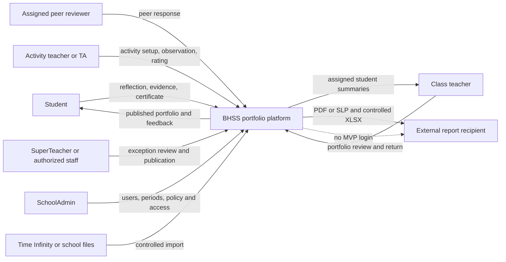

An external report recipient is outside the authenticated MVP boundary. One staff member may hold several roles, but each action is recorded under the role and scope used for that action.

### People and records around one activity

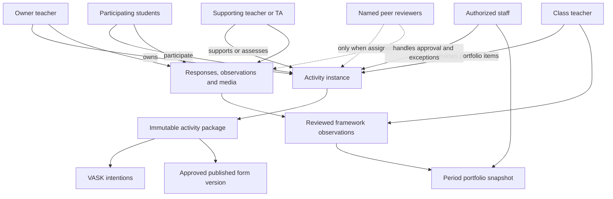

Activity membership does not grant unrestricted media or portfolio access. Media consent, reviewer assignment, class scope, and publication state remain separate controls.

### End-to-end activity swimlane

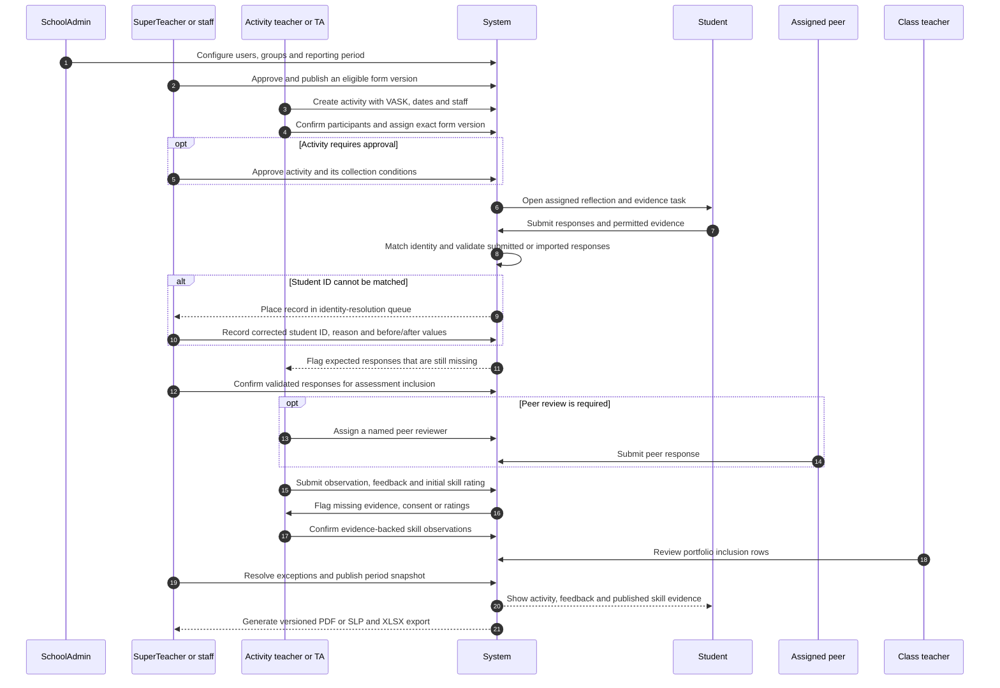

This is the recommended operating flow. The school must still confirm which staff role owns each approval and whether routine activities can be approved automatically.

### Activity data package

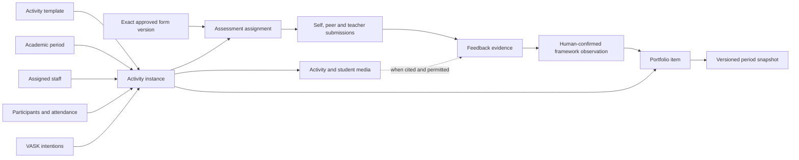

The activity is the shared context, but the form version, respondent, evidence, reviewer, and publication record remain individually traceable.

### Evidence decision flow

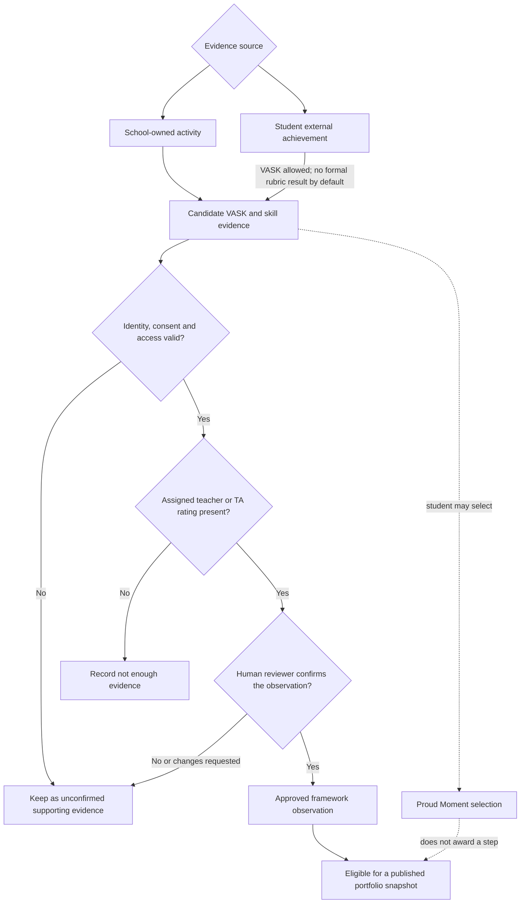

Self-review, peer review, questionnaire scores, grades, media extraction, and AI suggestions can support a decision. They cannot independently set the published 1–16 step.

### Independent lifecycle states

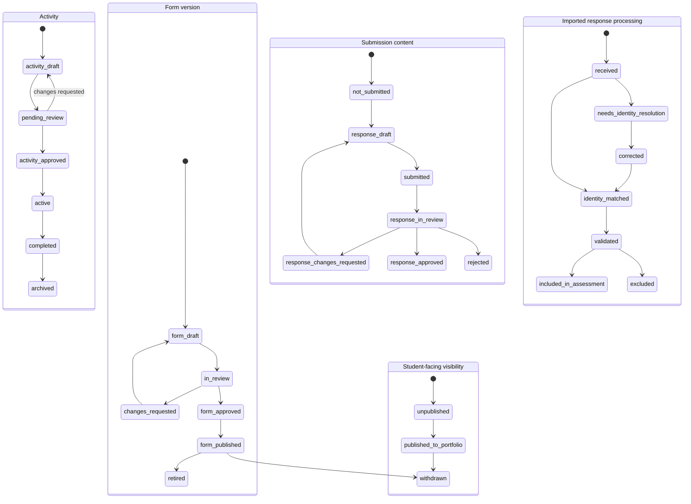

Approval, assessment inclusion, and publication are separate. Publishing a form does not publish a student's response; including an imported record in assessment does not make it student-visible; and approving a portfolio item does not automatically publish a period snapshot.

### Return after publication

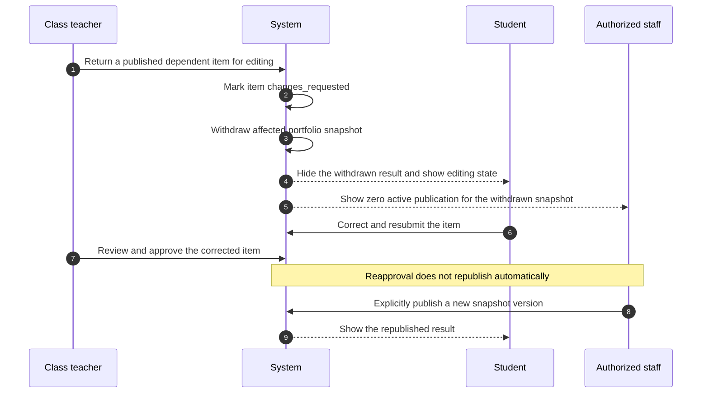

The withdrawal preserves the earlier audit record. It does not delete the previous snapshot or silently reuse its approval.

### Reporting period and official output

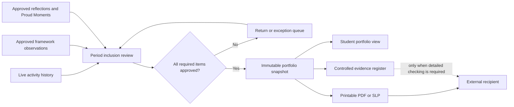

The live timeline may continue to change after a reporting period closes. A published snapshot and its exports remain reproducible until an authorized withdrawal creates a new publication event.

### Documentation traceability

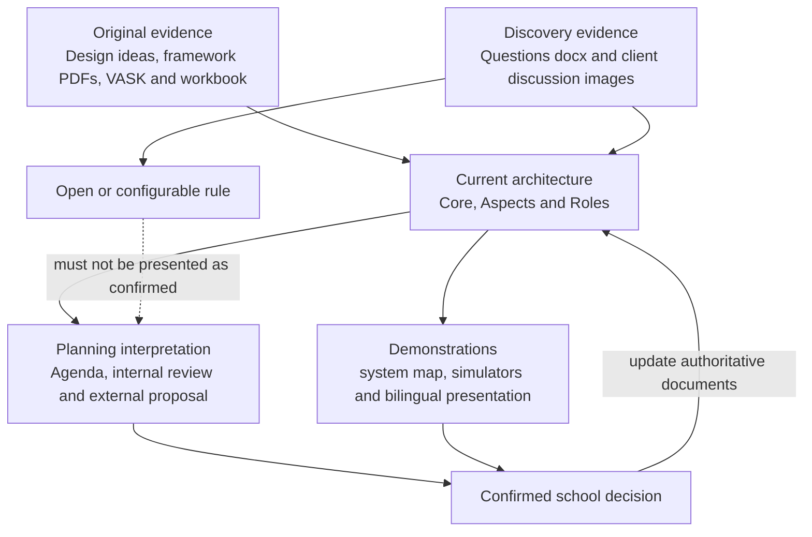

Original evidence is not silently rewritten. A prototype demonstrates an interpretation; it becomes an authoritative rule only after the decision is recorded in the architecture documents.

## Cardinality legend

| Mermaid symbol | Meaning |
|---|---|
| `||--||` | Exactly one to exactly one |
| `||--o|` | One to zero or one |
| `||--o{` | One to zero or many |
| `||--|{` | One to one or many |
| `o{--o{` | Many to many conceptually; implement through a junction table |

In the diagrams below, many-to-many relationships are made explicit using junction entities.

## Complete core relationship overview

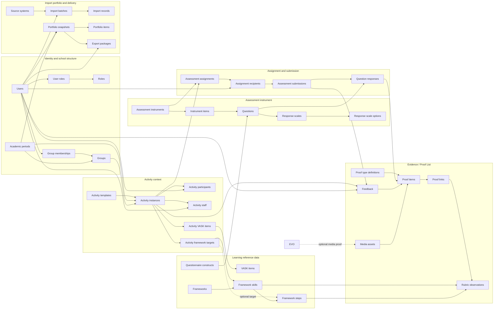

The arrows in this overview show direction of reference and workflow. The ER diagrams below show exact cardinalities.

---

## 1 Identity and school structure

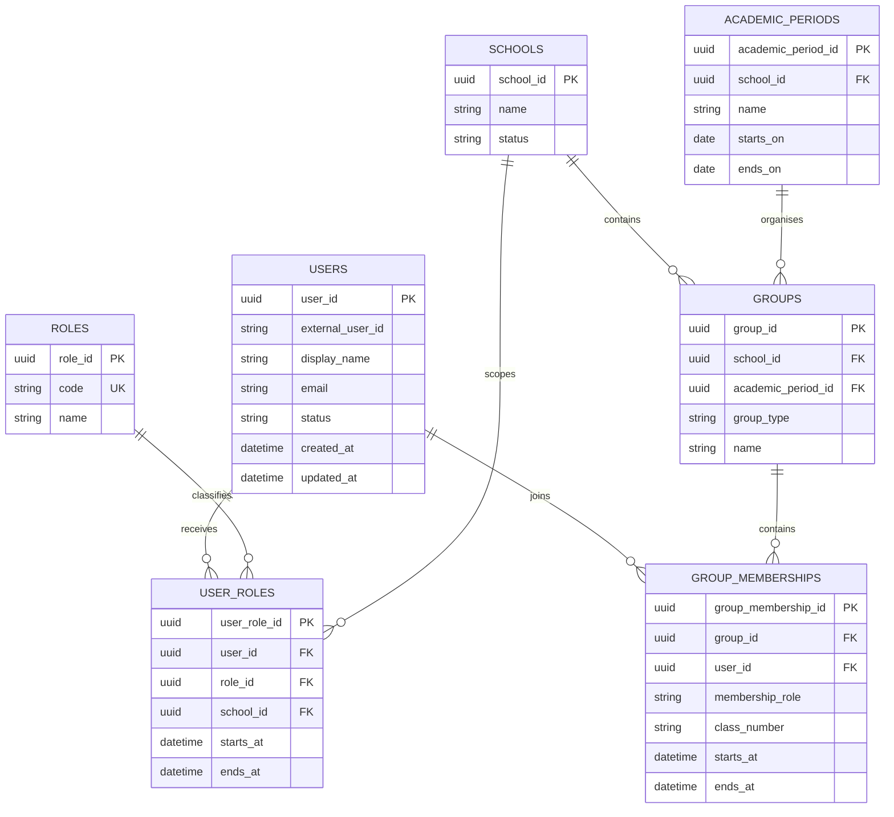

### Key relationships

| Relationship | Type | Explanation |
|---|---|---|
| Users to roles | Many-to-many | One user may be a teacher and administrator; one role belongs to many users. `user_roles` resolves the relationship. |
| Users to groups | Many-to-many | A student can join different classes or project groups over time. `group_memberships` preserves this history. |
| Academic period to groups | One-to-many | One school year or term can contain many groups. |

### Recommended temporal student model — school confirmation still required (H-08)

The student's identity is stable; placement and school status are time-bounded histories. The POC implements this as a recommended interpretation while the school's full rollover policy remains open.

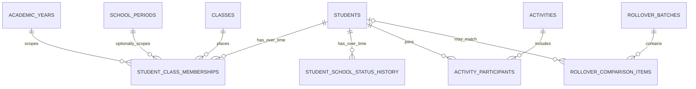

- `students.student_id` remains the core identity through class moves, retention, regrading, leave, withdrawal and return.
- `student_class_memberships` records `class_id`, grade, academic year or period, `valid_from`, `valid_to`, change type, reason, actor and an optional superseded membership.
- `student_school_status_history` separately records active, leave, withdrawn, returned and graduated states. A student may therefore leave for two years and return without creating a new identity.
- Activities store the participant's `student_id`, not a copied current class. To show the historical class, resolve the membership whose effective dates contain the activity date.
- A year-transition batch compares the old and proposed rosters as unchanged, class move, retained/regraded, returning, new candidate, or outgoing/missing. A `new_candidate` must be explicitly confirmed before the system creates a student and assigns a class.
- Imports and corrections retain before/after values, actor, reason and time in the audit trail. They do not rewrite earlier activity records.

This design prevents current class changes from contaminating historical activity evidence. The school must still confirm rollover cut-off dates, overlapping-membership rules, late transfers, duplicate-identity resolution and who may apply a reviewed batch; those decisions remain under H-08.

---

## 2 Activities, participants, VASK, and framework targets

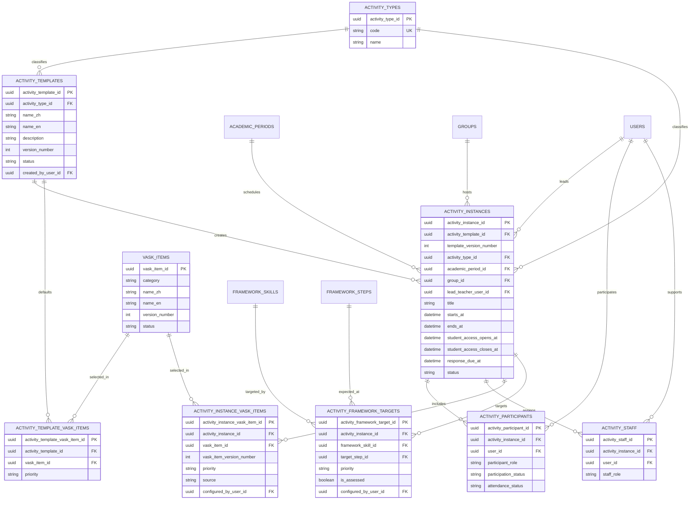

### Key relationships

| Relationship | Type | Explanation |
|---|---|---|
| Activity template to activity instance | One-to-many | A reusable activity can be run many times. Each actual run is a separate instance. |
| Activity instance to users | Many-to-many | An activity has many participants and a user can attend many activities. `activity_participants` resolves it. |
| Activity instance to staff | Many-to-many | An activity can have several teachers; a teacher can support many activities. `activity_staff` resolves it. |
| Activity template to VASK items | Many-to-many | A template can contain several default VASK items, and one VASK item can be used by many templates. |
| Activity instance to VASK items | Many-to-many | The actual VASK selection is copied and may be modified for a particular activity run. |
| Activity instance to framework skills | Many-to-many | An activity can target several framework skills. Each skill can be targeted by many activities. |
| Activity framework target to framework step | Many-to-zero-or-one | A target may name an exact expected step, or only name the skill. |

---

## 3 Framework reference data

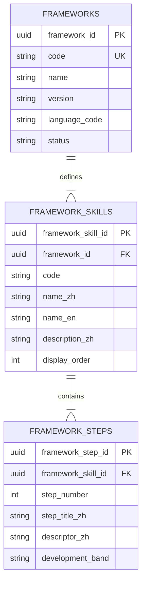

### Constraints

- One framework version contains eight framework skills.
- One framework skill contains 16 framework steps.
- `framework_id + code` is unique in `framework_skills`.
- `framework_skill_id + step_number` is unique in `framework_steps`.
- A step always belongs to exactly one framework skill.
- A new translation or structural revision should create a new framework version instead of overwriting historical wording.

---

## 4 Assessment instruments, question abilities, constructs, scales, and proof

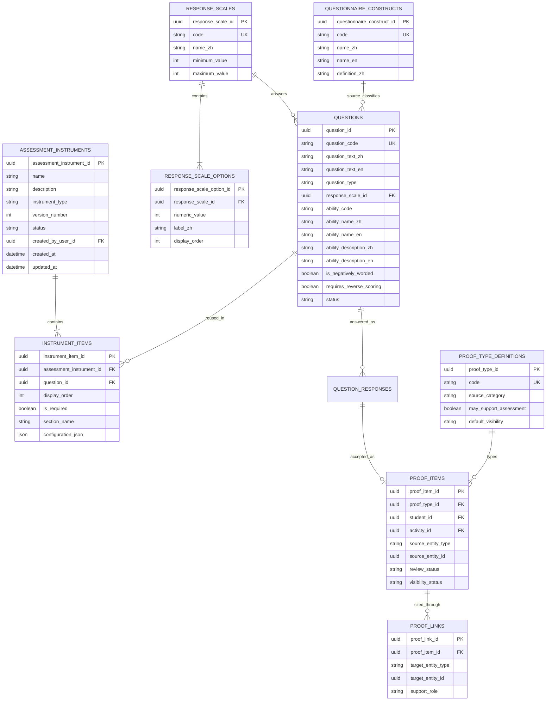

### Important distinctions

| Entity | What it represents |
|---|---|
| `assessment_instruments` | A reusable questionnaire, observation checklist, reflection, or review definition. |
| `questions` | Individual prompts in a reusable question bank. |
| `instrument_items` | The placement and order of a question in an instrument. |
| `questionnaire_constructs` | General qualities measured by groups of questions, such as communication confidence. |
| `response_scales` | How a question is answered, such as 1–6 frequency or agreement. |
| `proof_type_definitions` | Extensible source classes for responses, feedback, observations, media, certificates and external records. |
| `proof_items` | Source-linked evidence with provenance, review and visibility state. |
| `proof_links` | Typed links from proof to rubric observations, Portfolio claims or other reviewed targets. |

### Many-to-many relationships

- One assessment instrument contains many questions, and one question may be reused in many instruments. `instrument_items` resolves this relationship.
- Each question version has one primary source construct and one question-owned ability definition; this does not create a rubric mapping.
- One proof item may support several reviewed targets, and one target may cite several proof items. `proof_links` resolves this relationship.
- Role membership and workflow review assignment remain separate; holding a role does not prove that a form, proof item or rubric result was assigned to that user.

**Discussed on Meeting Oct 26 - kickstart:** there is no fixed question-to-framework mapping or normalized question weight. A response becomes a Proof List item and is interpreted only when an authorized reviewer confirms a concrete condition in the selected rubric.

### Form version authority and publication

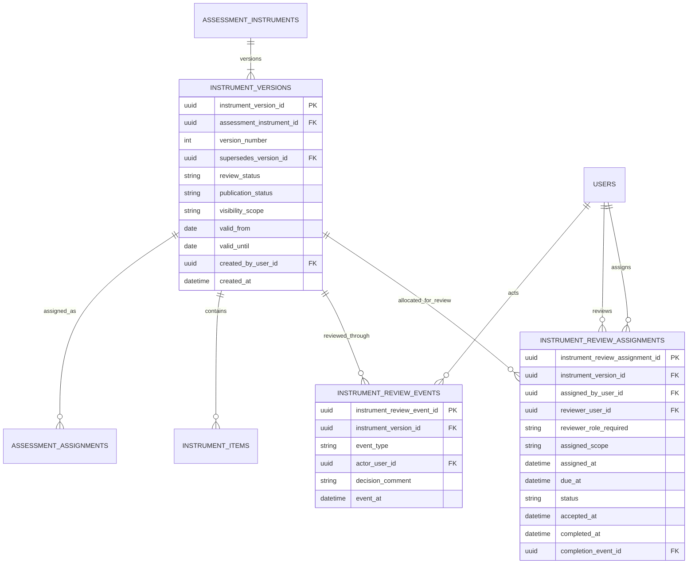

These are separate controls:

1. `review_status` says whether the version's content is valid: `draft`, `in_review`, `changes_requested`, `approved`, `rejected`, or `retired`.
2. `publication_status` says whether the approved version is available for new use: `unpublished`, `published`, or `withdrawn`.
3. `visibility_scope` says who can discover it: `private_draft`, `reviewers_only`, `school_catalogue`, `assigned_activities_only`, or `public_external`.
4. An assignment points to one exact immutable version. It is allowed only when the version is approved, published, within its validity dates, and not retired.

Role membership grants authority to review. `instrument_review_assignments` allocates one review to one actual reviewer. `instrument_review_events` records the decision that resulted. These records must not be collapsed into a single status field.

Editing an approved or published version creates a successor draft. It never changes the questions or interpretation attached to historical assignments and submissions.

---

## 5 Assignment, submission, and responses

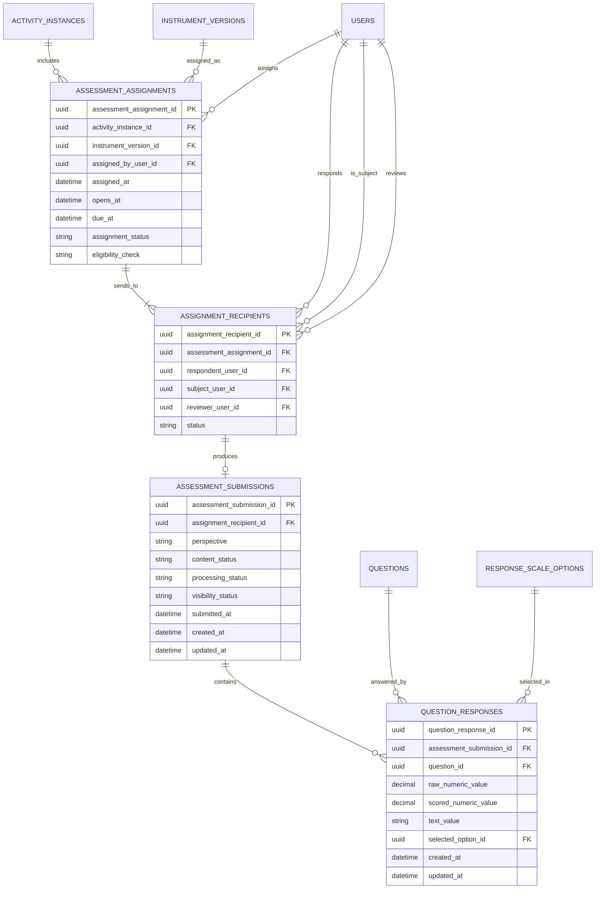

### Perspective examples

`assessment_submissions.perspective` should identify the source of the judgement:

- `student_self_report`
- `teacher_observation`
- `peer_observation`
- `guardian_observation`

Student and teacher submissions remain separate records even when they use the same instrument and concern the same student.

`content_status` tracks drafting and review. `processing_status` tracks identity matching, validation, and assessment inclusion. `visibility_status` tracks whether approved content is unpublished, visible in the Portfolio, or withdrawn. These fields must not be collapsed into one generic `status`.

### Key relationships

| Relationship | Type | Explanation |
|---|---|---|
| Activity instance to assessment assignments | One-to-many | One activity can assign several instruments. |
| Instrument version to assignments | One-to-many | The same approved, published version can be used in many activities. |
| Assignment to recipients | One-to-many | One assignment may be sent to an entire class. |
| Recipient to submission | One-to-zero-or-one | A recipient may not have submitted yet. |
| Submission to responses | One-to-many | One completed submission contains answers to many questions. |
| Question to responses | One-to-many | The same question is answered in many submissions. |

An assignment with an unapproved, unpublished, expired, withdrawn, or retired version must be stored as `blocked` or rejected before recipients are created.

---

## 6 Feedback, framework observations, and evidence

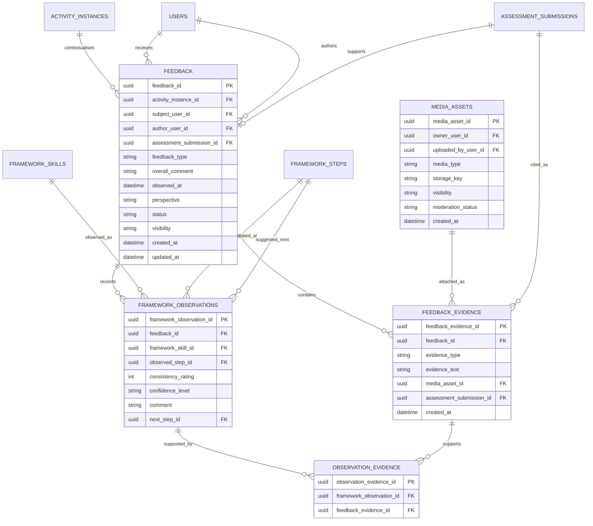

### Source-of-proof rules

1. `feedback` identifies the subject, author, perspective, activity context, and observation time.
2. `feedback_evidence` stores the actual proof: a behaviour description, submitted form, work product, or media item.
3. `framework_observations` records the teacher's, student's, or peer's interpretation of that proof against one framework skill.
4. `observation_evidence` explicitly states which evidence supports which observation.
5. One evidence item may support several observations.
6. One observation may rely on several evidence items.
7. `observed_step_id` and `consistency_rating` remain separate values.

### Example

```text
Feedback
    subject: Student A
    author: Teacher B
    activity: Two-week problem-solving project
    perspective: teacher_observation

Evidence 1
    “The student compared two proposals and explained the likely consequences.”

Observation 1
    skill: Problem-solving
    observed step: 7, Evaluate options
    consistency: 4/6, Often
    supported by: Evidence 1

Observation 2
    skill: Speaking
    observed step: 8, Use facts
    consistency: 3/6, Occasionally
    supported by: Evidence 1
```

The same evidence supports two observations, but the step and consistency values are recorded independently for each skill.

---

## 7 Media and evidence attachments

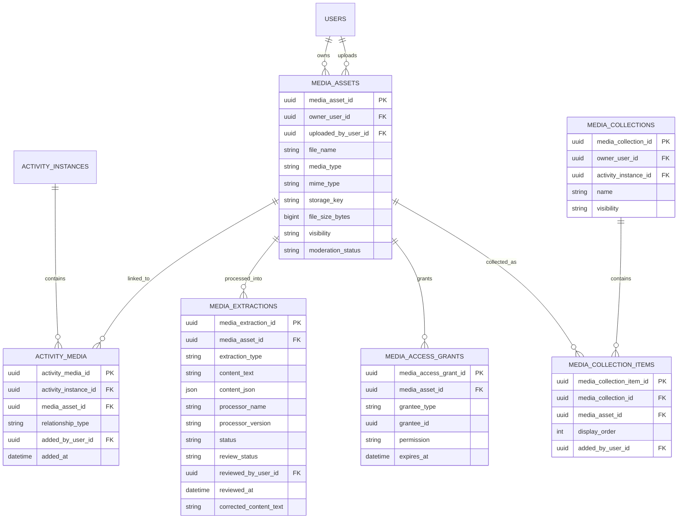

Media is not proof by itself. It becomes assessment evidence only when a `feedback_evidence` record cites it and describes its relevance.

---

## 8 End-to-end creation flow

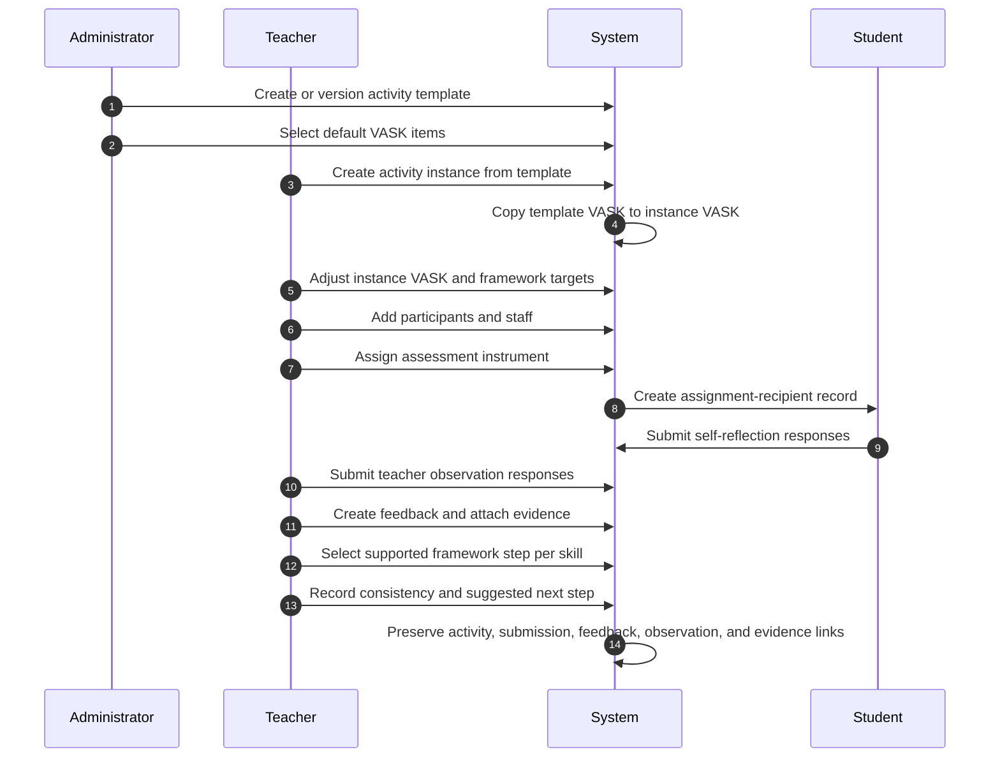

## 9 Integration portfolio publication and external delivery

```mermaid
erDiagram
    SOURCE_SYSTEMS ||--o{ IMPORT_BATCHES : supplies
    IMPORT_BATCHES ||--o{ IMPORT_RECORDS : contains
    IMPORT_RECORDS ||--o{ IMPORT_RECORD_CORRECTIONS : corrected_by
    USERS ||--o{ IMPORT_BATCHES : uploads
    USERS ||--o{ IMPORT_RECORD_CORRECTIONS : records

    USERS ||--o{ PORTFOLIO_SNAPSHOTS : owns
    ACADEMIC_PERIODS ||--o{ PORTFOLIO_SNAPSHOTS : closes
    PORTFOLIO_SNAPSHOTS ||--o{ PORTFOLIO_ITEMS : contains
    PORTFOLIO_SNAPSHOTS ||--o{ EXPORT_PACKAGES : produces
    USERS ||--o{ EXPORT_PACKAGES : generates

    SOURCE_SYSTEMS {
        uuid source_system_id PK
        string code UK
        string name
        string authority_scope
        string status
    }

    IMPORT_BATCHES {
        uuid import_batch_id PK
        uuid source_system_id FK
        uuid uploaded_by_user_id FK
        string file_name
        string status
        datetime imported_at
    }

    IMPORT_RECORDS {
        uuid import_record_id PK
        uuid import_batch_id FK
        string source_record_key
        string record_type
        string validation_status
        uuid resolved_entity_id
        json original_payload
    }

    IMPORT_RECORD_CORRECTIONS {
        uuid import_record_correction_id PK
        uuid import_record_id FK
        string field_name
        string before_value
        string after_value
        string original_student_id
        string resolved_student_id
        string correction_reason
        uuid corrected_by_user_id FK
        datetime corrected_at
    }

    PORTFOLIO_SNAPSHOTS {
        uuid portfolio_snapshot_id PK
        uuid student_user_id FK
        uuid academic_period_id FK
        int version_number
        string publication_status
        uuid approved_by_user_id FK
        datetime published_at
    }

    PORTFOLIO_ITEMS {
        uuid portfolio_item_id PK
        uuid portfolio_snapshot_id FK
        string source_type
        uuid source_id
        string display_section
        int display_order
        boolean is_proud_moment
    }

    EXPORT_PACKAGES {
        uuid export_package_id PK
        uuid portfolio_snapshot_id FK
        string package_type
        string recipient_category
        uuid generated_by_user_id FK
        string storage_key
        datetime generated_at
    }
```

`source_systems` and import records preserve provenance and validation failures. An imported record must not overwrite reviewed platform data without an explicit reconciliation decision. Identity corrections append an `import_record_corrections` row; they never rewrite `original_payload`. The resolved identity may be used by later processing while the original student ID and every before/after value remain auditable.

`portfolio_snapshots` freeze the approved content for a reporting period. The live student timeline may continue to change, while an issued SLP or period report remains reproducible.

For the lean MVP, an external authority is a `recipient_category`, not an authenticated role. The platform produces a printable PDF/SLP and, where audit detail is required, an XLSX evidence register. Any later external portal requires a separate identity, consent, access, expiry, and audit design.

## 10 What is intentionally excluded

The following belong to the later analytics design and are not part of this core model:

- combining several observations into one current stage;
- weighting teacher, student, peer, or guardian perspectives;
- calculating radar-chart snapshots;
- trend calculations;
- cohort comparisons;
- prediction or recommendation models;
- statistical conversion from questionnaire totals to framework steps;
- confidence scoring based on observation quantity or recency;
- badges, milestones, or progression notifications.
- automated reminder scheduling and escalation;
- an authenticated portal for external authorities; and
- automatic external-authority override of a school-confirmed skill step.

The operational records above should remain the authoritative source even after analytics tables are added.
