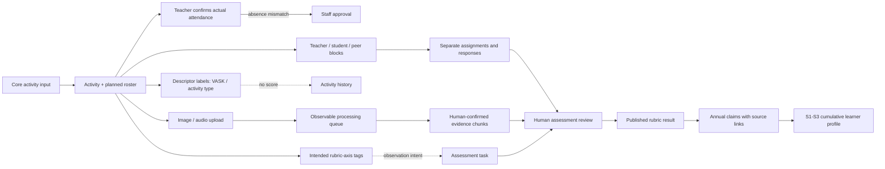

# Current findings and questions v2

## Purpose

This register isolates the 26 October 2026 kickstart meeting update from the original evidence and the earlier question register. It does not overwrite `Design ideas.docx`, `output/Questions.docx`, or `Discussion questions.md`.

Traceability tag used below: **Discussed on Meeting Oct 26 - kickstart**.

- **A — meeting-confirmed direction:** stated in the latest meeting.
- **B — approved architecture interpretation:** approved for the POC.
- **C — product proposal:** designed to serve BHSS first and remain reusable for other schools.
- **D — unresolved dependency:** not yet supplied or authorized.

## A — meeting-confirmed direction

| Done | ID | Finding | Consequence |
| --- | --- | --- | --- |
| [x] | V2-A01 | Use one core activity input contract, not a versioned per-school field-mapping engine. | Schools sanitize source data. The platform publishes required columns, validates, previews resolved identities, and records approval. |
| [x] | V2-A02 | Core activity input includes activity name, public description, time, student-upload availability, media approval, activity approval, and participant/attendance confirmation. | Optional cover treatment and private LLM context remain activity-description attributes, not a separate content system. |
| [x] | V2-A03 | Teachers confirm actual attendance against the planned roster. | If a planned participant is absent, staff approve the final attendance list. No absence-explanation form is assumed. |
| [x] | V2-A04 | VASK is reference vocabulary and an activity descriptor. | It can describe an experience but has no levels and cannot assess progress by itself. |
| [x] | V2-A05 | Skills Builder 8 × 16 and the forthcoming RC360 are assessment references. | Descriptive labels and assessment-capable rubrics must be distinct. |
| [x] | V2-A06 | Image and audio uploads enter immediate or queued processing. | Retain job status, retries, input manifest, processor, candidate output, and human decision. |
| [x] | V2-A07 | Photos may identify which students appear even when an activity has a participant list. | A proposed face match becomes student evidence only after human confirmation. |
| [x] | V2-A08 | Speech is mainly Cantonese, English, and Mandarin, with occasional extra languages. | Use timestamped speaker chunks and allow teachers to correct speaker roles or identities. |
| [x] | V2-A09 | One activity form may contain teacher, student, and peer blocks. | Each block has an audience; assignments separately record respondent and subject. |
| [x] | V2-A10 | A cumulative S1–S3 learner profile may freeze at S3. | Annual claims remain traceable; S3 cites earlier snapshots without rewriting them. |
| [x] | V2-A11 | The RC360 source and real student inputs arrive later. | Detailed day-by-day planning starts after receipt and inspection. |

## B — approved architecture interpretation

| Done | ID | Decision | Guardrail |
| --- | --- | --- | --- |
| [x] | V2-B01 | Use catalogues for VASK, activity-type labels, and rubric axes. | A tag describes intent; an assessment records a reviewed result. Tagging a rubric axis does not create a score. |
| [x] | V2-B02 | A catalogue is assessment-capable only when it has a versioned rubric, axes, valid levels, evidence rules, and publication authority. | VASK remains non-assessing. RC360 remains `pending_source`. |
| [x] | V2-B03 | Prove one serial Skills Builder 1–16 path first. | Keep rubric/version keys for later parallel RC360 results. Do not average unlike rubrics by default. |
| [x] | V2-B04 | The activity teacher submits attendance; staff approve mismatches. | Absence is a mismatch in the POC. Late and partial attendance remain explicit actual statuses. |
| [x] | V2-B05 | Use durable processing jobs for preview, face matching, transcription, and rubric suggestions. | Completion produces candidates only; it is not publication or assessment approval. |
| [x] | V2-B06 | Face matching is provider-neutral and human-confirmed. | Return face regions, candidate student IDs, and confidence; a teacher/staff user confirms, rejects, or marks unknown/non-student. |
| [x] | V2-B07 | Speech evidence uses two suggestion passes. | Preserve original and cleaned text; suggest a broad skill, then a potential step. Show every contributing chunk to the reviewer. |
| [x] | V2-B08 | Every generated conclusion carries provenance. | Show evidence chunks, activity context, rubric/version, prompt/model, confidence, human decision, editor, and timestamps under “Why this output?”. |
| [x] | V2-B09 | Student introductions start from sentence starters or a generated draft. | The student edits and submits; the assigned teacher approves or returns it. Preserve the generation input manifest. |
| [x] | V2-B10 | Teacher/student/peer blocks coexist in one form. | Draft blocks are author-only; students see a block only after publication and assignment. |
| [x] | V2-B11 | Each question keeps its own source, meaning and valid ability definition; it has no fixed VASK, RC360 or Skills Builder mapping. | **Discussed on Meeting Oct 26 - kickstart.** Accepted responses become proof and are interpreted against the selected rubric during authorized Portfolio review. |
| [x] | V2-B12 | Labelling capability and assessment capability are independent catalogue flags. | **Discussed on Meeting Oct 26 - kickstart.** Radar eligibility requires versioned axes, ordered levels and concrete conditions. |
| [x] | V2-B13 | Use a typed Evidence / Proof List between source records and rubric observations. | **Discussed on Meeting Oct 26 - kickstart.** New response, feedback, media, certificate or external-system types can be added without rewriting the assessment algorithm. |
| [x] | V2-B14 | The active Skills Builder aggregation policy is `MAX-CONFIRMED`; levels are not prerequisites. | **Discussed on Meeting Oct 26 - kickstart.** Publish the highest human-confirmed satisfied level per axis. A future average or other method requires a separate policy version. |
| [x] | V2-B15 | AI outputs are positive, source-linked candidates only. | **Discussed on Meeting Oct 26 - kickstart.** AI cannot downgrade a learner, accept proof or publish a rubric result. |
| [x] | V2-B16 | Review/outlook generation uses a teacher-selected school-period memory range and source classes. | **Discussed on Meeting Oct 26 - kickstart.** Freeze the exact activity descriptions, confirmed outcomes, accepted proof summaries, published results and prompt version used. |
| [x] | V2-B17 | Account identity, role definitions, effective role assignments and approval assignments are separate. | **Discussed on Meeting Oct 26 - kickstart.** Scope and effective dates do not substitute for a named workflow responsibility. |
| [x] | V2-B18 | Activity period is resolved from staff-entered start/end dates. | **Discussed on Meeting Oct 26 - kickstart.** One containing period is assigned automatically; a cross-period range must be split or explicitly approved as an exception. |

## C — product and learner-profile proposal

| Done | ID | Proposal | Current POC treatment |
| --- | --- | --- | --- |
| [x] | V2-C01 | Treat BHSS as the first example school while keeping activity, catalogue, processing, evidence, and Portfolio components reusable. | One core contract plus configurable catalogues; no arbitrary school-defined schemas in the current scope. |
| [x] | V2-C02 | Adapt the information architecture in the Rethinking Assessment learner-profile reference, not its exact visual design. | Identity/introduction, skill radar, learner claims, Building Blocks, courses/project, testimonials, selected work, achievements, interests, and year versions. |
| [x] | V2-C03 | Build each learner-profile sentence as a claim linked to one or more sources. | Sources may include self, teacher, peer, transcript chunks, approved media, projects, or earlier annual claims. |
| [x] | V2-C04 | Keep original media out of the default Portfolio surface. | Show approved claims and references; media access remains separately permission-controlled. |
| [x] | V2-C05 | Let rubric-axis labels be selected while creating an activity. | They indicate intended observation areas only; formal assessment is a separate reviewed record. |
| [x] | V2-C06 | BHSS acts as the lead solution proposer/reference school for a product that Octopus Infotech intends to provide; JC may approve and fund programme operation or adoption. | **Discussed on Meeting Oct 26 - kickstart.** Treat this as product direction, not evidence that JC has approved the product or accepted contractual obligations. |
| [x] | V2-C07 | Octopus Infotech defines and owns the reusable product baseline and is the product provider; BHSS validates the lead-school use case rather than defining every technical requirement. | **Discussed on Meeting Oct 26 - kickstart.** School policies, assessment authority, consent and local workflows still require explicit confirmation. Legal title, licence and procurement terms require written agreement. |
| [x] | V2-C08 | The core outcome is an evidence-backed Portfolio that helps teachers see students whose abilities, participation or growth may be missed by academic results and memory-based staff discussion. | **Discussed on Meeting Oct 26 - kickstart.** Gather school, teacher, student and authorized-staff evidence in one traceable view; do not promise that the system will manufacture positive findings where evidence is absent. |
| [x] | V2-C09 | Evidence may remain in school-approved external storage instead of being copied into one platform store. | **Discussed on Meeting Oct 26 - kickstart.** Use configurable source connectors and authorized media references or proxy delivery; never expose raw server paths, credentials or bypass consent/access checks. |

## D — unresolved dependencies and untouched questions

| Done | ID | Question or dependency | Current handling |
| --- | --- | --- | --- |
| [ ] | V2-D01 | What are RC360's official axes, levels, descriptors, scoring, evidence rules, and publication authority? | Await the expected source. No official RC360 score is simulated. |
| [ ] | V2-D02 | What real student/activity files will the school supply, and what quality problems do they contain? | Start detailed implementation-day planning after profiling them. |
| [ ] | V2-D03 | Which consent, guardian, retention, deletion, reference-photo, and vendor rules permit production face processing? | Use isolated school-supplied test photos only. This proves interaction, not production compliance. |
| [ ] | V2-D04 | Will each school use Google, another provider, or a school-hosted face service? | Keep a provider adapter plus human confirmation. |
| [ ] | V2-D05 | Which extra exchange-programme languages and quality thresholds are required? | POC prioritises Cantonese, English, and Mandarin and exposes language detection. |
| [ ] | V2-D06 | May cleaned speech affect a rubric suggestion, or is it reading help only? | Preserve original, cleaned text, and removal log; require review. |
| [ ] | V2-D07 | Is a teacher's initial step mandatory, and how are teacher, self, and peer views combined? | Keep perspectives separate; never replace a missing teacher rating with a student/peer average. |
| [ ] | V2-D08 | Who approves labels, rubric intent, evidence, and the final published step? | Role membership alone is not an approval assignment. |
| [ ] | V2-D09 | What is the S1/S2/S3 freeze calendar, and how is a frozen claim corrected? | Proposed: immutable snapshots and new correction versions. |
| [ ] | V2-D10 | What is the source and taxonomy for “My interests”? | Mark unresolved; do not infer silently from activities. |
| [ ] | V2-D11 | Which Portfolio sections are mandatory, and who approves testimonials, selected work, interests, and achievements? | Keep configurable with provenance and approval status. |
| [ ] | V2-D12 | What queue capacity, retries, notifications, and concurrency are needed for 400–600 students? | POC shows states only; size after real volume and services are known. |
| [ ] | V2-D13 | What are the signed ownership, licensing, support and post-funding terms among Octopus Infotech, BHSS and JC? | Product ownership by Octopus Infotech is the current internal direction. **Discussed on Meeting Oct 26 - kickstart.** Contractual confirmation is still required. |
| [ ] | V2-D14 | Will the product name or trademark be Octopus-owned, co-branded, or licensed as JC-exclusive? | The System Analyst considers JC-exclusive branding plausible, but this is an assumption only. **Discussed on Meeting Oct 26 - kickstart.** Do not use JC branding without written approval. |
| [ ] | V2-D15 | Which external stores and APIs must be supported, and do they return a media reference, a temporary URL, metadata, or the media bytes? | Define connector authentication, allow-listed roots/endpoints, identity matching, consent, retention, availability, caching, revocation and audit behaviour. **Discussed on Meeting Oct 26 - kickstart.** |

## Relationship summary

