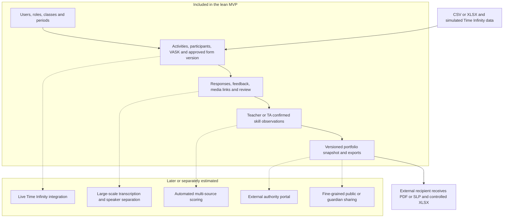

# BHSS internal system review and manday estimate

## Purpose and conclusion

This note compares `output/Questions.docx` with `Design ideas.docx` and the updated architecture. It is for internal planning. The questions document is directionally aligned with the design idea, but it is not yet a fluid questionnaire or an approved requirements specification. It combines confirmed needs, implementation proposals, policy questions, and numerical suggestions in one list.

The lowest-risk interpretation is to build a school-operated evidence and portfolio workflow, not a fully automated AI scoring platform. Teachers and students use a small number of web pages; staff control setup, review, and publication. External authorities do not receive accounts in the first release. They receive an approved printable SLP/PDF and, when detailed checking is needed, an XLSX evidence register.

## 1 Document alignment

### Strongly aligned

| Area | Design ideas | Questions document | Assessment | Source |
|---|---|---|---|---|
| Purpose | Continuous academic and non-academic growth record | SLP, activities, personal growth, portfolio | Aligned | DI-01–04, page 1 |
| Evidence | Reflection, media, work, teacher, self, and peer assessment | Media, certificates, reflections, teacher and peer input | Aligned | DI-02, page 1; DI-09, page 2 |
| Existing systems | Keep Time Infinity and add a central/local AI layer | Connect Local AI to Time Infinity | Aligned | DI-05–06, page 2; DI-18, page 7 |
| Activity context | Classroom, projects, social work, extracurricular and other experiences | In-school, out-school, personal, group and one-to-one cases | Aligned and more detailed | DI-12, page 4 |
| VASK | VASK is the analysis and development reference | Activities are configured with VASK | Aligned | DI-08, page 2; DI-15–16, page 5 |
| Skills framework | Skills Builder levels/descriptions support assessment | Question responses and other proof are reviewed against versioned rubric conditions | Aligned under the Oct 26 revision | DI-11, page 2; DI-20, page 9 |
| AI role | OCR, transcription, classification, mapping and draft reports with school-owned rules | OCR, extraction, LLM summary and radar text | Aligned if human review remains mandatory | DI-10, page 2 |
| Longitudinal output | Portfolio and continuing growth record | Proud Moments, skill summary and portfolio | Aligned | DI-03, page 1; DI-07, page 2; DI-17, page 5 |

### Partially aligned or unresolved

| Topic | Finding |
|---|---|
| Direct user access | The original design favors preserving current systems but also says students can upload evidence. It does not decide whether all teachers/students use the new platform directly. |
| Local server | The design mentions a Local AI computer or server but explicitly leaves technical architecture, privacy, and permissions open. |
| Step calculation | Both documents identify the need; neither defines a valid formula combining teacher, self, peer, questionnaire, and external assessment. |
| Authority | HKEAA or another professional authority may contribute validation, but no source defines an override rule. |
| Publication timing | First-term release and staff-controlled publication are plausible but not confirmed in the original design. |
| Academic marks | Academic and non-academic performance must be presented, but marks are not defined as automatic 1–16 step inputs. |

### Additions found only in Questions docx

- Student access opening around 3 p.m. after an activity.
- Staff-managed roster changes and teacher attendance.
- Suggested 5 MB image limit and JPEG/PNG support.
- Suggested DOCX, PDF, and text upload support.
- Human correction of OCR and transcript extraction.
- Student upload limited to certificate images.
- First-term withholding when evidence is insufficient.
- Maximum 24 visible Proud Moments.
- Portfolio preview or staff freeze behavior.
- Potential authoritative override of a school skill level.

These are discovery inputs. They should remain configurable or open until confirmed.

The `DI-xx` identifiers and Microsoft Word page numbers follow the source register in `output/English/Presentation agenda.md`. `Questions.docx` currently presents these additions on its single continuous note page without stable section numbering; they are therefore cited by topic rather than assigned false source-page precision.

## 2 Why the current question flow feels uneven

The document moves repeatedly between five different levels:

1. Product outcome: SLP, portfolio, radar, growth record.
2. School policy: who may submit, approve, publish, or override.
3. User workflow: create activity, unlock reflection, upload evidence, review.
4. Data model: VASK, questions, skills, steps, Proud Moments.
5. Technical detail: Local AI, file limits, OCR, formats, Time Infinity.

A better discovery sequence is:

1. Confirm the official outputs and recipients.
2. Confirm authoritative source systems and data owners.
3. Confirm activity and evidence workflow.
4. Confirm roles, visibility, consent, and approval.
5. Confirm assessment and step-publication rules.
6. Confirm portfolio curation and reporting periods.
7. Confirm integration, AI, storage, deployment, and retention.
8. Confirm pilot scope, acceptance criteria, and rollout.

## 3 Complete component inventory

### A Identity and access

- Users, school membership, classes/groups, academic periods.
- Student, Teacher, Staff/SuperTeacher, and SchoolAdmin roles.
- Assignment-based activity access and separate raw-media access.
- Login, password reset, session expiry/revocation, and audit log.
- Consent and correction request handling.

### B Source data and integration

- Time Infinity source definition.
- CSV/XLSX import batch, validation, error report, and reconciliation.
- Academic result import as supporting evidence.
- Manual school-activity creation.
- Provenance on every imported record.

### C Activity management

- Activity templates and actual activity instances.
- Type, academic/non-academic category, date, location, owner, staff, roster, and attendance.
- VASK intentions and optional eight-skill targets.
- Student access opening, closing, and response due times.
- Risk-based activity approval.

### D Form and question management

- One immutable form version assigned to each school-owned activity.
- Ordered question sections/blocks and reusable questions.
- Response type, scale, audience, required state, source and question-owned ability definition; no fixed VASK/rubric mapping or question-to-skill weight.
- Draft, review, approval, publication, assignment, retirement, and historical version retention.
- Default BHSS form first; custom form editing can be restricted to staff.

### E Assignment and submission

- Teacher observation, student reflection, peer review, and staff review assignments.
- Named peer reviewer assignment and moderation.
- Draft, submitted, in-review, changes-requested, approved, published, rejected, and withdrawn states.
- Missing submission and missing human rating shown as missing, not zero.

### F Evidence and media

- Image, audio, document, text, work product, and certificate metadata.
- Activity, student, feedback, submission, and portfolio linkage.
- Configurable file policy, moderation, consent, visibility, retention, and soft disable.
- OCR/transcription output with reviewer, correction, and approval state.
- Evidence citations connecting a claim to the exact source.

### G External achievements

- Student-entered award/certificate with issuer, date, level/difficulty, result, and VASK.
- Default formal rubric contribution of none; accepted certificate evidence enters the Proof List.
- Teacher/staff review before publication.

### H Assessment and framework observations

- Eight framework skills and 16 reference steps per skill.
- Teacher/TA observed step, consistency, comment, evidence, and next step.
- Self and peer perspectives retained separately.
- HKEAA/source-instrument field retained without automatic override.
- Human confirmation gate before evidence changes a published step.

### I Portfolio and reporting

- Student activity timeline.
- Academic and non-academic sections.
- Published feedback and evidence-backed skill state.
- Student-selected Proud Moments.
- Period review and outlook.
- Versioned portfolio snapshot and printable SLP/PDF.
- XLSX evidence register for internal or authorized review.

### J Staff operations

- Review queues, data-quality exceptions, missing ratings, and unpublished submissions.
- Period close and portfolio publication.
- User/activity/form imports and exports.
- Audit, consent, retention, and soft-delete review.

### K AI-assisted processing

- Optional OCR and transcription.
- Optional speaker separation with human identity confirmation.
- Draft evidence tags, summaries, or report text.
- No automatic step award, identity decision, or authoritative override.

### L Platform operations

- Hosting, database, object storage, backups, monitoring, logs, and recovery.
- Environment configuration, deployment, and support process.
- Data retention and deletion jobs.

## 4 Proposed pages by audience

### Student pages

1. **Home and tasks** — due reflections, peer reviews, returned items, and newly published feedback.
2. **My activities** — filterable academic/non-academic activity history.
3. **Activity detail** — activity VASK, form, reflection, permitted evidence upload, teacher feedback, and status.
4. **External achievement** — certificate and contextual information submission.
5. **Peer review task** — only the assigned subject and questions, with no broader record access.
6. **Proud Moments** — select from reviewed activities/evidence and write why each matters.
7. **My portfolio** — published period snapshot, eight-skill view, evidence and next steps.
8. **Privacy and corrections** — consent state and request to correct identity/evidence errors.

### Teacher pages

1. **Teacher dashboard** — assigned activities, due assessments, returned work, and missing ratings.
2. **Activities** — create a routine activity or open an assigned activity.
3. **Activity workspace** — roster, attendance, VASK, assigned form, access dates, and media.
4. **Bulk assessment** — compact table plus CSV/XLSX download and upload for one activity roster.
5. **Student evidence review** — responses, media, extraction, certificate, and evidence citations.
6. **Feedback and step confirmation** — comment, skill, 1–16 observed step, consistency, source, and next step.
7. **Peer assignment** — name the reviewer and subject; view completion and moderation state.
8. **Assigned students** — published summaries without automatic access to all raw media.

### Staff or SuperTeacher pages

1. **Operations dashboard** — activity, form, evidence, extraction, assessment, and publication queues.
2. **Activity catalogue and approval** — templates, instances, risk flags, approval, and roster issues.
3. **Form library** — default form, question blocks, version review, publication, and assignment.
4. **Evidence moderation** — student uploads, OCR/transcript corrections, consent, and soft disable.
5. **Assessment review** — conflicting evidence, missing ratings, corrections, and step publication.
6. **Portfolio release** — period close, preview, approve, publish, withdraw, and regenerate exports.
7. **Imports and data quality** — Time Infinity, users, results, validation failures, and reconciliation.
8. **Reports and exports** — SLP/PDF generation and XLSX evidence registers.

### SchoolAdmin pages

Use the same staff console with extra privileged sections rather than a separate application:

1. **Users groups and periods**.
2. **Roles and access scopes**.
3. **Consent retention and upload policy**.
4. **Source systems and import configuration**.
5. **Audit sessions and security events**.

### External authority or reviewer

Do not create an account or portal in the MVP. Provide:

- an approved, printable SLP/PDF for the official human-readable record; and
- a protected XLSX evidence register only when detailed checking is required.

Paper should be an output, not an input. A paper assessment process creates manual re-entry, validation, and version-control work. If a wet signature is legally or procedurally required, print the generated SLP/PDF after staff approval.

## 5 Recommended lean workflow

```text
Staff imports users periods and Time Infinity activities
  -> Staff creates or confirms the activity and default form
  -> Teacher confirms roster attendance VASK and access dates
  -> Student submits reflection or permitted evidence
  -> Assigned peer submits moderated feedback where required
  -> Teacher reviews evidence and records the skill observation
  -> Staff resolves exceptions and closes the reporting period
  -> Staff publishes a frozen portfolio snapshot
  -> System generates student portfolio PDF SLP and evidence XLSX
```

The default form is used for all pilot activities. Creating a new form builder, complex question bank, external portal, and automatic scoring engine at the same time would materially increase cost and risk.

### MVP system boundary



Dashed connections identify later capabilities, not dependencies required for the pilot. This boundary keeps the estimate based on a school-operated, human-reviewed workflow.

## 6 Manday estimate

### Estimating assumptions

- One school and one responsive web application.
- Four internal roles using one identity store.
- CSV/XLSX import before live Time Infinity API integration.
- One approved default activity form; staff can version it, but there is no general drag-and-drop form designer.
- Manual teacher/TA confirmation of 1–16 steps.
- Basic file upload with configurable policy; no large-scale audio pipeline in the MVP.
- System-generated PDF/SLP and XLSX export; no external-authority portal.
- Existing framework text and BHSS questions are supplied and approved by the school.
- One manday means one productive person-day. The estimate excludes school decision waiting time, hardware procurement, bulk historical data cleaning, and legal review.

### Recommended lean MVP

| Workstream | Mandays |
|---|---:|
| Discovery, workflow confirmation, acceptance criteria | 8–10 |
| Platform foundation, authentication, roles, sessions, audit | 10–14 |
| Users, groups, periods, CSV/XLSX and Time Infinity staging | 8–12 |
| Activities, roster, attendance, VASK and access dates | 10–13 |
| Default form version, assignment, submissions and responses | 12–16 |
| Media, certificates, consent, review and soft disable | 10–14 |
| Teacher feedback, evidence citation and step confirmation | 10–14 |
| Student pages, Proud Moments, portfolio and PDF/SLP | 10–14 |
| Staff queues, publication and XLSX export | 7–10 |
| Testing, security checks, UAT fixes, deployment and handover | 10–13 |
| **Total** | **95–130** |

At two productive developers plus intermittent design/QA support, this is roughly 10–14 elapsed weeks after policies and source data are available. Calendar time will increase if one person performs development, QA, deployment, and stakeholder clarification.

### Access-control impact

The 95–130 mandays already includes basic role and assignment checks. Access control becomes expensive when every media item, comment, class, activity, and external recipient has a different visibility rule.

| Additional requirement | Additional mandays |
|---|---:|
| External-authority login with invitation, expiry, scoped records and audit | 15–25 |
| Fine-grained per-file sharing and guardian consent withdrawal propagation | 12–20 |
| Delegated approval chains and substitute/reassignment rules | 8–14 |
| Public or parent-facing portfolio links | 10–18 |

The low-mandays solution is therefore assignment-based internal access plus generated exports for external recipients.

### AI-assisted extension estimate

The original design identifies OCR, transcription, classification, mapping, summaries, and report drafting as possible AI-assisted functions. The figures below are engineering assumptions for planning; they do not turn those possibilities into confirmed requirements. They assume human review, no model training, and reuse of the MVP's authentication, activity, upload, evidence, and audit components.

| AI-assisted capability | Incremental mandays |
|---|---:|
| OCR for images/PDFs, extraction status, correction and approval UI | 7–12 |
| Audio transcription and transcript correction | 8–14 |
| Speaker separation and manual speaker-identity confirmation | 10–18 |
| Classification and evidence/VASK tagging | 7–11 |
| Three selectable summary profiles, preview and teacher editing | 10–16 |
| Suggested rubric/eight-skill matching with evidence citations | 12–20 |
| Portfolio/report drafting and revision history | 10–16 |
| Shared job queue, retry, audit, prompt/model version and monitoring | 14–22 |
| Evaluation with BHSS samples and prompt calibration | 12–20 |

These rows share infrastructure and must not be added mechanically. Reasonable combined ranges are:

| AI scope | Combined incremental estimate |
|---|---:|
| Human-reviewed AI POC without speaker separation | 70–105 |
| Add speaker separation and stronger production controls | 90–135 |
| Local deployment, 400–600-record batch processing, and media-heavy multimodal analysis | 120–180+ |

The POC should offer three controlled drafting profiles: academic learning and reasoning; non-academic participation and personal growth; and interpersonal collaboration and intrapersonal development. Teachers may adjust controlled emphasis, class or age, tone, length, and exclusions. Supporting arbitrary teacher-written production prompts would require additional prompt security, evaluation, version review, and rollback work.

Every run must retain the prompt/profile version and separate `generated_text`, `teacher_edited_text`, and `final_published_text`. AI suggestions remain drafts; identity matching, evidence acceptance, and official 1–16 step publication remain human decisions.

### Larger interpretations

| Scope | Mandays | Meaning |
|---|---:|---|
| Spreadsheet/PDF-led proof of concept | 55–75 | Staff-heavy, limited student workflow, no production-grade integration or AI pipeline |
| Recommended lean MVP | 95–130 | Usable teacher/student/staff workflow with human-reviewed steps and official exports |
| Full interpretation of both documents | 180–260 | Live integration, flexible form builder, granular access, notifications, OCR/audio, advanced approvals and wider reporting |

### Revised AI-enabled pilot plan to Easter 2027

This scenario was added on 28 October 2026 after the SRS introduced school isolation, school feature-policy enforcement, provider-neutral extraction and Portfolio-generation contracts, independently reviewable AI candidates, and dependency review after source correction. It addresses a different delivery objective from the 95–130 manday lean MVP above: selected AI features must use a real provider and be proven end to end, rather than remaining deterministic POC output or P1 contracts and test doubles.

The delivery principle is to implement the BHSS pilot workflow first while retaining versioned records, stable provider contracts, feature controls and human-review boundaries for later extension. The pilot does not need a general-purpose configuration interface for every future form, rubric, provider, approval chain or school workflow.

#### Staged delivery and cumulative planning range

| Target outcome | Intended timing | Cumulative mandays | Acceptance boundary |
|---|---|---:|---|
| Scope lock and POC technical audit | 27 October–13 November 2026 | 8–12 | Pilot scenario, real-AI feature set, sample data, provider and acceptance matrix agreed. |
| Secure kernel and December survival slice | By 11 December 2026 | 42–60 | One end-to-end path from activity/evidence through real AI output, human review, one confirmed skill observation and one cited Portfolio draft. |
| Limited AI-enabled MVP | By 22 January 2027 | 75–105 | BHSS staff can operate the selected activity, evidence, assessment, AI review and frozen-Portfolio workflow without direct database intervention. |
| Feature-complete pilot candidate | By 19 February 2027 | 100–140 | All agreed pilot-critical functions are complete; generalized flexibility remains deferred. |
| UAT-hardened pre-Easter release | 19–22 March 2027 | **125–175** | At least one month of scenario-based UAT, AI evaluation, security checks, fixes, deployment rehearsal, training and handover completed. |

The ranges are cumulative and shall not be added together. They assume useful POC code is retained only after technical audit, one school, one primary Skills Builder path, one controlled production AI-provider choice, HTML/XLSX as the initial verified outputs, and prompt decisions plus representative BHSS samples being available on time.

#### Component planning range for the AI-enabled pilot

| Component | Mandays |
|---|---:|
| Requirements lock, POC audit and acceptance design | 8–12 |
| Platform kernel, sessions, school isolation and feature policy | 14–20 |
| School structure, users, periods and imports | 8–12 |
| Activities, roster, attendance and VASK | 10–14 |
| Forms, questions, versions and publication | 10–14 |
| Assignments, submissions and peer workflow | 9–13 |
| Evidence, media, consent, Proof List and correction | 12–17 |
| Rubrics, observations and official-result review | 11–16 |
| AI job framework and provider adapters | 15–22 |
| AI extraction, suggestion and review UI | 12–18 |
| AI Portfolio generation and claim provenance | 10–15 |
| Learner profile, snapshot, HTML and XLSX output | 10–15 |
| Staff queues and operational pages | 7–11 |
| Deployment, monitoring, backup and security hardening | 8–12 |
| UAT support, fixes, training and handover | 20–30 |
| **Component-by-component planning total before overlap/reuse adjustment** | **164–239** |

The component total is deliberately conservative and includes shared foundations from more than one view. For schedule and commercial planning, overlap, reuse and controlled scope reduce the recommended pre-Easter AI-enabled pilot range to **125–175 mandays**. A broader production interpretation with face/speaker processing, multiple providers, local high-volume media processing or generalized flexibility remains **180–250+ mandays**.

The minimum real-AI proof should include one extraction route, source-linked evidence or rubric candidates, source-linked Portfolio generation, provider/prompt provenance, human correction and approval, and manual fallback. Production face matching and speaker identification remain outside the committed pilot unless privacy authority, provider terms, production-data permission and acceptance samples are confirmed.

With approximately sixteen to seventeen effective build weeks before a one-month UAT period, the 125–175 manday plan normally requires two productive developers plus part-time analyst/QA support; a third AI/integration specialist materially reduces the December/January acceleration risk. One developer may produce the controlled demonstration but makes the pre-Easter pilot target high risk.

## 7 Architecture reconciliation completed

`output/English/Core data relationships.md` has been updated to include:

- provenance for later source-system/import records;
- activity student-access and due dates;
- attendance separated from participation;
- human review and correction of media extraction;
- versioned portfolio snapshots and export packages; and
- the rule that external authorities receive exports rather than platform accounts in the lean MVP.

The updated core still intentionally excludes the final analytics formula. The questions document raises that problem but does not answer it.

## 8 Decisions required before estimation becomes a quotation

1. Confirm the official output: portfolio, SLP/PDF, Excel register, or a defined set of all three.
2. Confirm whether student and teacher direct login is required in the pilot.
3. Confirm which activity types enter the pilot and who owns each roster.
4. Confirm the default form and which questions each audience answers.
5. Confirm who can approve and publish activities, forms, observations, and portfolio snapshots.
6. Confirm the evidence threshold for publishing a skill state and the meaning of insufficient evidence.
7. Confirm whether HKEAA supplies an instrument, validates mappings, or makes final decisions.
8. Confirm consent, retention, upload types, and whether students can upload more than certificates.
9. Confirm the actual Time Infinity export fields and matching identifier.
10. Confirm hosting, backup, recovery, and whether Local AI is required in the first release.
