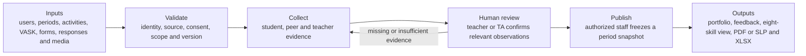
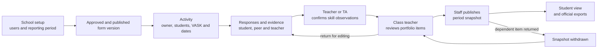

# BHSS platform presentation plan

## Purpose of this document

This is a planning document for the future presentation. It consolidates the existing HTML visualizations, Markdown specifications, source-framework interpretation, import examples, and open product questions. It does not attempt to create the PowerPoint yet.

The proposed central message is:

> The platform visualizes multi-source evidence of student learning and growth to create a trustworthy, continuing student portfolio and guide the next learning step.

The platform is not intended to turn every activity into a score. It connects activities, reflections, observations, media, feedback, and framework steps while preserving the underlying evidence and human review.

**Product framing — Discussed on Meeting Oct 26 - kickstart:** BHSS is the lead solution proposer/reference school; JC may approve and fund programme operation or adoption; Octopus Infotech intends to own and supply the reusable product. Present this as current product direction, with ownership, licence and branding subject to written agreement. The educational proposition is to make evidence of overlooked student participation, abilities and growth visible beyond academic results and staff memory.

The integration story must allow school-approved media to remain in several stores. Show a server-side connector resolving an opaque reference to metadata, a short-lived authorized URL or streamed media. Do not show raw storage paths or imply that external media bypasses consent and role checks.

---

## 1. Existing materials grouped by purpose

### A. Framework and terminology

| Artifact | Purpose | Presentation use |
|---|---|---|
| `Assessment/UF2.0 Cantonese Framework.pdf` | Eight Skills Builder skills and 16 steps for each skill | Explain the developmental framework and radar axes |
| `Assessment/VASK清單.docx` | Values, attitudes, skills, and knowledge reference | Explain intended activity-development areas |
| `Assessment/10份技能問卷整理總表.xlsx` | Ten source assessment constructs and 166 questions | Explain the source questionnaire and why it differs from the eight framework skills |
| `output/English/Aspects updated.md` | Updated entities, terminology, and versioning | Main data-model and terminology reference |
| `output/D1 bhss-skills-navigator/index.html` | Interactive view of the eight skills and framework steps | Demonstration of the skills framework |

### B. System relationships and governance

| Artifact | Purpose | Presentation use |
|---|---|---|
| `output/English/Core data relationships.md` | Cardinalities and end-to-end entity relationships | Explain how users, activities, forms, evidence, feedback, and framework observations connect |
| `output/English/Roles and permissions.md` | Student, Teacher, SuperTeacher, and SchoolAdmin responsibilities | Explain visibility, approvals, media access, and security boundaries |
| `output/D2 evidence-growth-system-map.html` | Interactive upload-to-portfolio system and decision map | Main interactive presentation companion |

### C. Import and integration examples

The `output/import-examples/` directory contains example CSV structures for:

- Upload manifests and source recognition.
- User creation and updates.
- Academic periods.
- Activities and activity participants/staff.
- Default and specialized form templates.
- Form items.
- Media and evidence metadata.
- Source questions.
- Question-owned ability definitions and Proof List registration.
- A simulated Time Infinity activity export.

### D. Portfolio example

| Artifact | Purpose | Presentation use |
|---|---|---|
| `BHSS-portfolio.json` | Example portfolio data export containing a student, evidence, AI proposals, assessments, and contributions | Explain the difference between stored portfolio data and the final portfolio presentation |

---

## 2. Proposed platform parts

### Part 1: Identity, school structure, and security

- Users and school membership.
- Students, teachers, staff, and administrators.
- Classes, groups, and academic-year membership.
- Authentication, password hashes, sessions, and session revocation.
- Role-based and scope-based access control.
- Login, action, approval, media-access, and correction logs.

### Part 2: Academic years and reporting periods

- Academic year as the long-lived school-year container.
- Configurable reporting periods such as P1, P2, P3, and Summer.
- Period transitions without overwriting historical classes, roles, or results.
- Activity, period, annual, and longitudinal reporting levels.

### Part 3: Framework and reference configuration

- VASK reference items used to design activities.
- Eight framework skills used as the radar-chart axes.
- Sixteen developmental steps for each framework skill.
- Ten source questionnaire constructs stored separately from the eight skills.
- Response scales, question types, negative wording, and reverse-scoring configuration.
- Rubric-time interpretation of source-linked proof, with versioned conditions and human approval.

### Part 4: Activity management

- Reusable activity templates.
- Actual activity instances.
- Responsible and supporting teachers.
- Participating students and groups.
- Activity VASK intentions and framework targets.
- Activity lifecycle and approval status.
- A default form for all activities unless an approved override is specified.

### Part 5: Forms, sections, questions, and submissions

Proposed terminology:

- **Source questionnaire:** the complete assessment instrument represented by the supplied Excel workbook.
- **Form template:** the platform version of the instrument or data-collection workflow.
- **Question section:** a section within a form, such as Communication, Collaboration, teacher observation, student reflection, or peer feedback.
- **Question:** an individual reusable item with a source, question type, scale, audience, version and valid ability definition; it has no fixed rubric mapping.
- **Activity form assignment:** connects one form version to one activity and its intended respondents.
- **Form submission:** one respondent's saved or submitted copy.
- **Question response:** one answer inside a submission.

The proposed relationship is:

```text
Source questionnaire
    -> imported as a form template
        -> question sections
            -> questions

Activity instance
    -> activity form assignment
        -> form template version
            -> recipients
                -> submissions
                    -> question responses
```

The source questionnaire can become one whole form template. Its ten source constructs can become sections inside that form. Other activity forms may also contain reflection, observation, upload, or approval sections that are not part of the original questionnaire.

#### Form authority and publication lifecycle

```text
Draft version
    -> submit for review
        -> assign a specific authorized reviewer
            -> reviewer accepts and reviews
                -> changes requested / rejected / approved
                    -> publish to a defined visibility scope
                        -> assign the exact published version to activities
                            -> withdraw or retire from new use
```

Approval means the content is valid. Publication means the approved version is available within a defined scope. Assignment connects that exact immutable version to an activity. Modifying an approved or published version creates a new draft version; it does not change historical assignments or submissions.

Role membership determines who is eligible to review. A separate form-review assignment records who was actually given responsibility, the deadline, whether they accepted, and which review event completed the work item.

### Part 6: Media and evidence

- Student or teacher uploads.
- Image, audio, video, documents, and student work.
- Activity, student, feedback, and portfolio linkage.
- Consent status and permitted use.
- Separate access to original media, derived transcript, evidence extract, and published summary.
- Retention, deletion, correction, and auditability.

### Part 7: Feedback, assessment, and evidence review

- Teacher observation and teacher review.
- Student reflection and self-evaluation.
- Peer feedback.
- Task results and media evidence.
- Specific observed behaviour rather than only a general score.
- Human confirmation of student identity, evidence relevance, and framework-step alignment.
- Conflicting or negative evidence shown as current consistency or support needs rather than an automatic historical downgrade.

### Part 8: AI-assisted processing

- OCR and document extraction.
- Speech-to-text.
- Speaker separation such as Speaker A, B, and C.
- Candidate identity suggestions, subject to human confirmation.
- Candidate evidence extraction.
- Candidate questions, question-owned abilities, activity VASK labels, and later rubric observations kept as separate concepts.
- Summary and report drafting.

AI should propose. Authorized staff should confirm identity, evidence, framework steps, and published feedback.

### Part 9: Portfolio and reporting

- Activity evidence summary.
- Reporting-period snapshot.
- Annual growth report.
- Longitudinal student portfolio.
- Eight-skill radar summary.
- Direct links from a displayed result back to the observations and evidence supporting it.
- Student-facing strengths, meaningful moments, and next steps.
- Teacher-facing evidence coverage, current observations, contradictions, and missing evidence.

### Part 10: Integration and administration

- CSV staging and validation.
- User import and update.
- Time Infinity activity import.
- Import-batch status, errors, and reconciliation.
- Form, rubric, proof-type, role-assignment, period, and policy-version administration.
- Dummy data for initial demonstrations and acceptance testing.

---

## 3. Proposed roles

### Student

- View enrolled activities and their own published portfolio.
- Submit reflection, self-evaluation, work, and permitted media.
- Complete assigned peer feedback.
- Select a significant or memorable moment and explain what it demonstrates.
- Request correction of misidentified evidence.

### Teacher

- Create and manage assigned activity drafts.
- Use the approved default activity form.
- Request a form override where necessary.
- View assigned activities, participants, and permitted evidence.
- Record observations, feedback, and proposed framework-step evidence.
- Confirm transcript or media identity when the teacher has direct knowledge.

### SuperTeacher (staff)

This is a working system name for authorized senior teaching or programme staff. A school-preferred name may replace it.

- Review activities within an assigned programme, class, or year level.
- Approve higher-risk activities.
- Review customized forms, question abilities, Proof List items, and rubric observations.
- Resolve conflicting evidence and identity uncertainty.
- Review or approve framework-step observations within assigned scope.

### SchoolAdmin

- Manage users, roles, classes, periods, and imports.
- Configure default forms and approval policies.
- Manage consent categories, access scopes, retention, and deletion.
- Review system audit records and revoke sessions.
- Manage school-wide configuration without automatically receiving unrestricted raw-media access.

---

## 4. What we think the inputs are

### School and identity inputs

- User and role records.
- Student number, staff number, class, group, and academic year.
- User updates and membership changes.
- Consent and media-use restrictions.

### Activity inputs

- Activity template and actual occurrence.
- Activity type, dates, location, duration, owner, supporting staff, and participants.
- Intended VASK items.
- Intended framework skills and observable step range.
- Default form or approved form override.
- Exact form version, review status, publication status, visibility scope, and validity dates.

### Assessment inputs

- Source questions and question sections.
- Six-point scale responses.
- Teacher comments and behaviour observations.
- Student reflection and self-evaluation.
- Peer feedback.
- Task results and contributions.

### Evidence inputs

- Text, photographs, audio, video, documents, and student work.
- Time Infinity participation records.
- Transcript segments and AI extractions.
- Evidence identity, source, activity, timestamp, consent, and access metadata.

---

## 5. What we think the process is



The platform visualizes how reviewed activity evidence contributes to a student's growth record. It does not convert activity completion or one questionnaire score directly into a framework step.

```text
1. Receive or upload data
2. Identify the source and record type
3. Validate schema, users, activity, period, and references
4. Apply consent, visibility, and retention rules
5. Store the original record and provenance
6. Run permitted OCR, transcription, or extraction
7. Match records to activities and candidate students
8. Ask an authorized person to confirm identity and evidence
9. Assign the submitted form version to a specific authorized reviewer
10. Review and approve form content
11. Publish an approved form version to a defined visibility scope
12. Assign only an eligible immutable form version to the activity
13. Collect teacher, student, peer, and task perspectives
14. Map relevant questions and evidence to the eight framework skills
15. Compare observed behaviour with the 16 step descriptions
16. Record evidence status: clue, emerging, demonstrated, secure, or transferred
17. Aggregate approved observations for a reporting period
18. Present the result with links to the supporting evidence
19. Preserve versions, assignments, corrections, approvals, publication events, and audit history
```

The recommended progression model is evidence-gated rather than a single weighted average. Questionnaire scores can organize and summarize responses, but they should not automatically promote or demote a student within the 16 framework steps.

### Activity lifecycle for the presentation



The detailed actor, state, evidence, and publication diagrams are maintained in `output/English/Core data relationships.md`.

---

## 6. What we think the outputs are

### Student output

- Personal activity history.
- Selected significant moments.
- Published feedback and supporting evidence.
- Eight-skill summary with understandable next steps.
- Period, annual, and longitudinal portfolio views.

### Teacher output

- Assigned activity and student views.
- Outstanding observations and submissions.
- Evidence awaiting identity or relevance confirmation.
- Current framework observations and missing evidence.
- Period summaries and suggested next learning opportunities.

### SuperTeacher output

- Activity and form approval queues.
- Mapping and framework-observation review queues.
- Conflicting evidence and correction requests.
- Programme, class, or year-level published summaries.

### SchoolAdmin output

- User, role, class, period, import, and policy management.
- Import validation and reconciliation reports.
- Session, audit, consent, retention, and access-management views.
- School-wide coverage summaries without treating unobserved skills as zero.

### Ultimate output

A living student-growth portfolio that can answer:

- What learning experiences did the student have?
- What did the student do?
- What evidence supports the claim?
- Who observed or confirmed it?
- Which skills and steps are relevant?
- How has the evidence changed over time?
- What should the student practise next?

---

## 7. Proposed initial scope boundary

### In the first milestone

- User import/update and role management.
- Password hashing, secure sessions, session revocation, and basic audit logging.
- Academic years and configurable reporting periods.
- Activity templates, activity instances, staff, and participants.
- One default activity form with approved overrides.
- Immutable form versions, review history, publication scope, and assignment eligibility checks.
- Form assignment, submissions, question responses, and open-text feedback.
- Media metadata and linkage, with basic consent and access states.
- Source question import with preserved construct and question-owned ability definition.
- Time Infinity simulated CSV staging.
- Dummy activity, student, period, and portfolio visualizations.

### Later milestones

- Live Time Infinity API synchronization.
- Automated audio transcription and speaker separation at scale.
- Voice-based identity matching.
- Automated framework-step recommendations.
- Advanced analytics and cohort comparison.
- Public or externally shared portfolios.
- Complex mobile/offline capture workflows.

---

## 8. What we do not know yet

The authoritative checklist is `output/English/Discussion questions.md`. The items below are presentation groupings only; use the stable `H-xx`, `M-xx`, and `L-xx` identifiers in slides and speaker notes rather than creating a second decision register.

### Purpose and output decisions

1. Is the primary deliverable an internal learning record, a student-owned portfolio, a formal school report, or all three?
2. Which outputs must be interactive pages, PDFs, JSON exports, or printable documents?
3. Who is the audience for each output: student, parent, teacher, school leader, or external party?

### Assessment and progression decisions

4. How many observations, activities, contexts, or weeks are required before a step is demonstrated or secure?
5. Can one major activity confirm a step?
6. Can a confirmed step be revised, and under what correction or review process?
7. How should contradictory or negative evidence affect current status?
8. How are activity opportunities distinguished from actual demonstrated performance?
9. Which observations contribute to the radar chart: highest verified step, most recent step, period status, or another rule?
10. How should “no evidence” differ visually from “not yet demonstrated”?

### Form and question decisions

11. Does the supplied source questionnaire become one school-wide form or several forms for different roles?
12. Are its ten constructs ten sections in one form?
13. Which questions are appropriate for students, peers, and teachers?
14. Which questions directly map to one framework skill, and which provide supporting evidence for several?
15. Who approves a changed form, question section, scale, negative item, or question ability definition?
16. Does the same role approve content and publish it, or should those authorities be separated?
17. Which visibility scopes are allowed in the MVP: reviewers, school catalogue, or assigned activities only?
18. Are validity start/end dates required for every published form version?
19. Who may assign a reviewer, and can a reviewer decline or reassign the work item?
20. Must the reviewer always be different from the form-version author?

### Activity and approval decisions

21. Which activities can be automatically approved?
22. Which conditions force human approval: trips, media, custom forms, external participants, or changed intended rubric labels?
23. May teachers change VASK and skill targets for one activity instance without changing the reusable template?

### Role and access decisions

24. What school term should replace the working role name `SuperTeacher`?
25. May class teachers see every activity completed by their students, or only published summaries?
26. Who may see teacher comments, peer feedback, student reflections, transcripts, and original media?
27. Does SchoolAdmin receive raw-media access by default, or only administrative metadata?

### Consent, privacy, and retention decisions

28. What consent is required for image, audio, video, transcription, AI analysis, and voice identity processing?
29. Can a student or guardian withdraw consent, and what happens to existing derived evidence?
30. How long are original media, transcripts, extractions, assessments, login records, and action logs retained?
31. What is the correction and deletion procedure for misidentified student evidence?

### Integration and technical decisions

32. What fields and identifiers does the real Time Infinity export provide?
33. Will integration begin as CSV import or a live API?
34. Which system is authoritative for users, classes, activities, and attendance?
35. What local AI hardware, storage, backup, and disaster-recovery capacity is available?
36. Is offline activity capture required in the initial scope?

---

## 9. Proposed presentation agenda

### Slide 1 — Project purpose

Explain the educational problem and the intended student-growth outcome.

### Slide 2 — Current information landscape

Show that evidence currently comes from lessons, activities, Time Infinity, reflections, media, work, teachers, students, and peers.

### Slide 3 — What the platform is and is not

Position it as an evidence and portfolio platform rather than only a questionnaire, scoring system, or radar chart.

### Slide 4 — The four conceptual layers

Introduce activity design, framework standards, assessment tools, and observed evidence/results.

### Slide 5 — VASK, ten source constructs, and eight framework skills

Show why these models remain separate and how individual questions may connect them.

### Slide 6 — End-to-end lifecycle

Visualize upload → validation → consent/access → AI assistance → human review → framework observation → portfolio.

### Slide 7 — Activities and the common form

Explain activity templates, activity instances, the default form, approved overrides, and activity approval.

### Slide 8 — Source questionnaire, form, section, and question

Explain that the source questionnaire can become one form template, its constructs can become sections, and its items become questions. Show the separate draft, review, approval, publication, assignment, withdrawal, and retirement controls.

### Slide 9 — People and roles

Present Student, Teacher, SuperTeacher/staff, and SchoolAdmin responsibilities and visibility boundaries.

### Slide 10 — Evidence and media

Explain the evidence types, consent, access, identity confirmation, and traceability.

### Slide 11 — How assessment contributes to the eight skills

Compare teacher observation, student reflection, peer feedback, task results, questionnaire responses, and direct evidence.

### Slide 12 — Framework steps and progression

Explain the 16 steps for every skill, evidence status, and why a response score does not automatically equal a framework step.

### Slide 13 — Student and teacher outputs

Show activity summaries, meaningful moments, next steps, teacher review queues, and evidence-linked radar summaries.

### Slide 14 — Reporting periods and the long-term portfolio

Show activity, configurable period, annual, and longitudinal outputs.

### Slide 15 — Initial MVP scope

Present the proposed first milestone and what is intentionally deferred.

### Slide 16 — Open decisions

Group the unresolved decisions into assessment, forms, permissions, consent, integration, and reporting.

### Slide 17 — Proposed next decisions and milestones

Identify the decisions needed before database implementation, prototype screens, real-data integration, and pilot activities.

---

## 10. Recommended presentation flow

The presentation should move from educational purpose to system mechanics:

```text
Why the platform exists
    -> what information enters it
        -> how activities, forms, and evidence are connected
            -> how people review the information
                -> how the eight skills and steps are interpreted
                    -> what students, teachers, and the school receive
                        -> what must still be decided
```

This keeps the discussion focused on the platform outcome before introducing database entities or technical architecture.

---

## 11. Source traceability convention

The presentation and future product documentation should distinguish three kinds of statements:

- **Source requirement** — stated in the original `Design ideas.docx`; cite the source ID, page, and section.
- **Proposed interpretation** — inferred from the source document and the current HTML or Markdown specifications; cite both the source ID and the relevant project artifact.
- **Open decision** — not settled by the source document; state the decision owner and do not present it as an approved requirement.

Use this short citation format on slides and diagrams:

```text
[DI-01 · p.1 · 期望]
[DI-07 · p.5 · 第六步：整合學生的成長資料]
```

Use the full original sentence in speaker notes or the traceability appendix. Page numbers below refer to the 10-page pagination displayed by Microsoft Word for the current `Design ideas.docx`. If the source document is reformatted, re-check the page numbers while retaining the source IDs.

### Original design source register

| Source ID | Page | Section | Original sentence | Product meaning |
|---|---:|---|---|---|
| DI-01 | 1 | 期望 | 主要目的是全面記錄及呈現學生在學術與非學術範疇的學習表現、個人成長及發展歷程。 | The primary output is a broad growth record, not only a score report. |
| DI-02 | 1 | 期望 | 系統除了記錄學生參與的課堂、活動及學習成果外，亦希望整合以下資料：學生的學習反思及個人感受、活動相片、錄音、作品或其他學習證據、學生在小組或共同學習過程中的分享、教師的觀察及評估、學生個人自評、同儕互評。 | Portfolio evidence includes activity records, media, work, reflections, teacher assessment, self-assessment, and peer assessment. |
| DI-03 | 1 | 期望 | 最終希望為每位學生建立一套較完整、持續及具個人特色的成長紀錄，讓學生、教師及學校能夠更全面地了解學生的發展情況。 | The record is continuous and personalized and has student, teacher, and school audiences. |
| DI-04 | 1 | 期望 | 收集不同來源資料 → 按學生分類 → 完成多元評估 → 整合成長紀錄 → 跨系統呈現 | This is the source-level end-to-end flow. |
| DI-05 | 2 | 現況／中央 AI 層的定位 | 學校現時的學生資料分散於 Time Infinity、活動紀錄、校本課程、學生作品、反思、錄音、相片，以及教師評估、學生自評和同儕互評等不同來源。 | The platform must integrate several existing sources instead of assuming one source system. |
| DI-06 | 2 | 現況／中央 AI 層的定位 | 學校傾向保留現有系統，另建一個中央 AI 層，從不同來源抽取、分類、整合和呈現資料，避免同事需要重新學習一整套新系統。 | The proposed platform is an integration and presentation layer around existing systems. |
| DI-07 | 2 | 現況／中央 AI 層的定位 | 平台最終需同時呈現學生的學術及非學術表現，形成個人 Portfolio 及長期成長紀錄。 | The intended surface combines academic and non-academic development in a longitudinal portfolio. |
| DI-08 | 2 | 現況／中央 AI 層的定位 | RC360 的分析框架以 VASK 為核心，即價值觀（Values）、態度（Attitudes）、技能（Skills）及知識（Knowledge）。 | VASK is an analysis and activity-development reference; its exact operational use still needs school confirmation. |
| DI-09 | 2 | Portfolio、反思及評估流程 | 學生可上載文字反思、相片、錄音、作品及其他學習證據；教師、學生本人及同儕可按需要作不同形式的評估。 | Multiple contributors and evidence types feed the portfolio. |
| DI-10 | 2 | Portfolio、反思及評估流程 | 學校希望 AI 協助處理 OCR、語音轉文字、證據分類、摘要、Rubrics 配對及報告草擬，但最終評估規則和準則須由學校提供或共同制訂。 | AI assists with processing and drafts; the school owns assessment rules and criteria. |
| DI-11 | 2 | Portfolio、反思及評估流程 | 學校已有 Skills Builder 的技能框架、級別及描述語句，亦有校本反思問題，可作為 AI 評估及學習指導的基礎。 | The eight skills and 16 steps are a separate developmental framework grounded in the supplied Skills Builder material. |
| DI-12 | 4 | 第一步：收集不同來源的資料 | 收集來自正規課堂、課時內項目、社工活動、課外活動、境外交流及其他學習經歷的資料。 | Activity scope includes lesson, in-school, and out-of-school learning experiences. |
| DI-13 | 4 | 第二步：將資料導入 Local AI 系統 | 至於資料安全、權限管理、私隱保障及技術架構，仍需在下一階段進一步研究和確認。 | Security, permissions, privacy, and technical architecture remain open decisions. |
| DI-14 | 4 | 第三步：按學生身份進行分類 | 系統按照學生身份，將不同課堂、活動及項目的紀錄分類至每位學生的個人電子資料夾。 | Evidence must resolve to a student identity before entering the student's record. |
| DI-15 | 5 | 第四步：連結活動與發展範疇 | 每項課堂活動、學習項目或其他學習經歷，可預先連結相應的知識、技能、態度及價值觀。 | VASK intentions can be configured at activity-design time. |
| DI-16 | 5 | 第四步：連結活動與發展範疇 | 活動負責同事可在設計項目時，先訂定活動希望培養或觀察的發展範疇。完成活動後，學生及教師便可按相關範疇進行評估和反思。 | Activity owners define intended development areas before collecting responses. |
| DI-17 | 5 | 第六步：整合學生的成長資料 | 整合的重點並非只計算學生參與活動的次數，而是呈現學生：曾經歷哪些學習機會、在過程中有何反思、展現了哪些知識、技能、態度及價值觀、教師、學生本人及同儕如何評價其表現、不同階段的學習表現和成長變化。 | The portfolio must expose evidence, perspectives, and change over time rather than only participation counts. |
| DI-18 | 7 | 平台上載及處理資料 | 現時學校有一個校內平台 Time infinity，收集學生活動記錄，也是老師記錄及行政跟進平台，因此系統會在 Time Infinity 領取學生走出課室記錄。至於校本課程活動記錄，則需要靠 AI 評台收集。 | Time Infinity is expected to provide outside-class activity records; the new platform is expected to collect school-based curriculum activity records. |
| DI-19 | 7 | 技能發展、觀察與回饋情境 | 學校可考慮以部分具代表性的學習經歷作為起步點，讓學生有較多機會實踐相關能力，並累積觀察及反思證據。 | A pilot can begin with representative whole-grade experiences rather than all activities. |
| DI-20 | 9 | 評估的項目 | VASK 參考 Word 文件；Skills：考評局（10 個技能問卷）＋ Skills Builder。 | The source associates assessment material with VASK and both the ten-skill questionnaire and Skills Builder, but it does not define the calculation between them. |

### Current interpretation register

| Interpretation ID | Current proposal | Evidence basis | Status |
|---|---|---|---|
| PI-01 | Show activity context, teacher feedback, and evidence-linked skill state on the same student surface, with the activity as the primary timeline and marks/step summaries as a secondary layer. | DI-02, DI-07, DI-17; `output/D2 evidence-growth-system-map.html` | Proposed; school must confirm the preferred landing view. |
| PI-02 | Preserve every academic year and reporting period as an immutable historical context; create new memberships, activity assignments, and snapshots when the year changes. | DI-03, DI-07, DI-17; `output/English/Core data relationships.md` | Proposed; reporting calendar and rollover owner are unresolved. |
| PI-03 | Use VASK to state an activity's intended development areas; use the eight Skills Builder skills and their 16 steps to describe evidenced development. | DI-08, DI-11, DI-15, DI-16, DI-20; `output/English/Aspects updated.md` | Working interpretation, not an explicit source rule. |
| PI-04 | Treat activity participation as an opportunity to observe; do not automatically convert completion or a questionnaire score into a skill step. | DI-16, DI-17; `output/D2 evidence-growth-system-map.html` | Proposed assessment safeguard. |
| PI-05 | The portfolio-only scope contains the student timeline, selected evidence, reflection, published teacher/peer feedback, current evidence-backed skill state, meaningful moments, and next steps. It excludes administration queues, raw security logs, and unrestricted original media. | DI-02, DI-03, DI-07, DI-09, DI-17; `output/English/Roles and permissions.md` | Proposed product boundary. |

## 12. Revisions from the RC360 discussion image

The supplied RC360 discussion image adds requirements that were not explicit in the original `Design ideas.docx`. Cite these as `RCI-xx` rather than inventing a page number.

| Source ID | Image statement | Presentation interpretation |
|---|---|---|
| RCI-01 | 學生可以自主記錄校外活動、上載獎項及成就、隨時瀏覽及更新自己的成長歷程。 | Add a student-owned external-achievement pathway with certificate upload and VASK tagging. External achievements become proof but have no formal rubric result by default. |
| RCI-02 | 學期末學生可在平台整理最能代表自己的價值及態度及最具意義的 Proud Moments。 | Proud Moments are student-selected activities or evidence for reflection and presentation, not automatic skill-step awards. |
| RCI-03 | 技能部分由考評局（HKEAA）協助驗證。 | Record the HKEAA-related source instrument or validation authority where applicable. The exact calculation remains unresolved. |
| RCI-04 | 回顧與展望由 AI 生成；教師作最終審視及確認。 | AI may draft `回顧與展望`; an assigned teacher or teaching assistant must confirm it before publication. |
| RCI-05 | 其餘資料將保留於平台，作為學生的成長檔案。 | Not every retained item appears in the selected portfolio view or contributes to a skill step. |

### Required presentation changes

- Add a separate slide for student-uploaded certificates and external achievements.
- Explain that VASK tagging provides context and can exist without a formal Skills Builder result.
- Show Proud Moment selection inside activity history and self-evaluation, not as a direct progression calculation.
- Show the same `not submitted -> review -> approved -> published` response workflow for questionnaire submissions and `回顧與展望`.
- State that every school-owned activity references one immutable form version whose questions each preserve a valid ability definition and create proof when answered and accepted.
- State that BHSS dummy questions are the proof-of-concept default; select or add questions because their meaning fits the activity and respondent, not to fill a fixed VASK/rubric map.
- Show teacher or teaching-assistant initial rating and confirmation as the human gate before activity evidence changes a published framework step.
- Keep the method for excluding a student-selected item from development outputs as an internal moderation rule. Do not expose that rationale in student-facing presentation slides.

### Newly open decisions

1. Is an initial teacher or teaching-assistant step rating mandatory for every mapped skill, or only when an activity is intended to affect progression?
2. Which HKEAA instrument, scale, and validation method is authoritative?
3. Who may act as teaching assistant, and what activity/student scope grants review authority?
4. How does a teacher select peer reviewers: manual named assignment, same-group pairing, reciprocal pairing, or random assignment with exclusions?
5. May proof from an external achievement later support a human-confirmed rubric observation, and who approves publication?
6. Which submission states are visible to students, teachers, and guardians?
