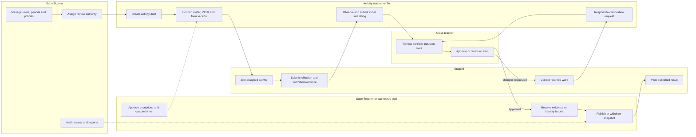
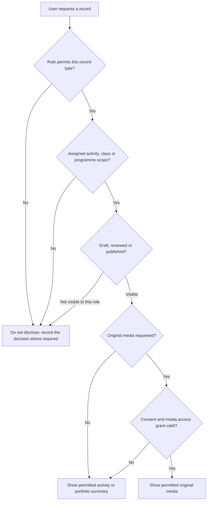

# Roles and permissions

## Purpose

This document defines the initial role-based access model for the BHSS student growth and portfolio platform. Access to an activity does not automatically give access to every original media file. Activity data, assessment data, published summaries, and raw media are separate permissions.

## Role definitions

### Student

A student is the subject and contributor of their own growth record.

- View activities in which they are enrolled.
- View their own published activity summaries, feedback, skill evidence, and portfolio.
- Submit self-reflections, self-evaluations, and permitted media or work.
- Complete assigned peer feedback without receiving administrative access to the other student's record.
- Request correction of misidentified evidence or inaccurate personal information.
- Cannot approve activities, form templates, question ability definitions, proof acceptance, or step attainment.
- Cannot view another student's private portfolio, raw media, teacher-only notes, or identity-review material.

### Teacher

A teacher is assigned to specific activities or students as an owner, supporting teacher, assessor, or class teacher.

- Create and edit draft activities that they own.
- Use the approved default activity form.
- Request an approved form override when an activity needs different questions.
- View assigned activities and participating students.
- View evidence needed for an assigned assessment, subject to media consent and access scope.
- Submit observations, assessments, feedback, and evidence-verification decisions.
- Confirm whether a transcript segment or media item belongs to a student when they have direct knowledge.
- Propose proof-linked rubric observations, but cannot silently change an approved framework or published historical decision.
- Cannot automatically see every student or every activity in the school.

### SuperTeacher (staff)

`SuperTeacher` is a platform role for an authorized senior teacher, programme coordinator, panel head, class-level coordinator, or safeguarding/data-review staff member. The name is a technical role label and can later be replaced with a school-preferred title.

- All Teacher permissions within the programmes, classes, or activity groups assigned to them.
- Review and approve activities when school policy requires human approval.
- Review custom activity forms and questionnaire versions.
- Accept, decline, and complete form-review assignments within the authorized scope.
- Submit change requests, approve or reject form versions, and record a review rationale.
- Publish an approved form version within an authorized internal scope when school policy delegates this permission.
- Retire or withdraw a form version within assigned scope without deleting historical assignments.
- Review question ability definitions, Proof List items and human rubric observations within the assigned scope.
- Review conflicting evidence, identity uncertainty, and requested corrections.
- View published student summaries across their assigned scope.
- Reopen or return an assessment to a teacher for clarification.
- Cannot manage global authentication settings or grant themselves unrestricted school-wide access.

### SchoolAdmin

A SchoolAdmin manages the school tenant, account identities, reusable role definitions, effective role assignments, policies, periods, imports, and access configuration. **Discussed on Meeting Oct 26 - kickstart:** role membership and named workflow approval assignments are separate records.

- Import, create, update, suspend, and archive users.
- Assign roles, classes, programmes, and activity scopes.
- Configure academic years, reporting periods, and period transitions.
- Configure the default activity form and approval policy.
- Assign an eligible SuperTeacher or SchoolAdmin to review a submitted form version.
- Manage activity, questionnaire, and framework version status.
- Publish, withdraw, or retire approved form versions and configure their visibility and validity dates.
- Configure consent categories, media access scopes, retention periods, and deletion workflows.
- Review import batches, Time Infinity staging records, audit logs, and failed validations.
- Revoke sessions and reset account access.
- View school-wide administrative metadata and published summaries.
- Raw media access is still policy-controlled and should not be assumed merely because the user is an administrator.

### External authority or report recipient

An external authority or report recipient is not a platform role in the recommended MVP. Authorized staff generate a versioned printable SLP/PDF and, when detailed evidence checking is required, a protected XLSX evidence register. This avoids maintaining external identities, expiry, delegated access, consent propagation, and raw-media permissions before there is a confirmed requirement. A later external portal requires a separate access-control design.

## Responsibility flow

The same person may act as activity teacher and class teacher, but the system records which responsibility authorized each action. An activity owner cannot gain school-wide access merely because they created the activity.

## Visibility and media-access flow

Access to a published summary does not imply access to its original photograph, audio, transcript, or internal moderation notes.

## Permission matrix

| Capability | Student | Teacher | SuperTeacher (staff) | SchoolAdmin |
| --- | --- | --- | --- | --- |
| View own portfolio | Yes | Assigned students | Assigned scope | Policy-controlled |
| View activity | Enrolled activities | Assigned activities | Assigned programme/class | School-wide metadata |
| View original media | Own/permitted only | Assigned and permitted | Review scope and permitted | Policy-controlled |
| Submit self-reflection | Yes | No | No | No |
| Submit peer feedback | When assigned | No | No | No |
| Submit teacher assessment | No | Assigned scope | Assigned scope | Normally no |
| Create activity draft | No | Yes | Yes | Yes |
| Approve activity | No | No by default | Yes, within scope | Yes/configure policy |
| Use default form | Assigned response only | Yes | Yes | Yes |
| Request form override | No | Yes | Yes | Yes |
| Approve form/questionnaire version | No | No | Yes, within scope | Yes |
| Assign form reviewer | No | No by default | Within delegated scope | Yes |
| Accept review assignment | No | No | Yes | Yes |
| Publish approved form version | No | No | If delegated | Yes |
| Withdraw or retire form version | No | No | If delegated | Yes |
| Assign published form to activity | No | Assigned activities | Assigned scope | Yes |
| Confirm evidence identity | Request correction | When directly responsible | Review/escalation | Administrative correction |
| Confirm skill-step evidence | No | Propose/confirm within policy | Review and approve | Configure policy |
| Manage users and periods | No | No | No by default | Yes |
| View audit logs | Own submissions only | Own actions | Assigned review scope | Yes |

## Recommended activity visibility rule

Use assignment-based access by default:

1. A teacher sees an activity when they are its owner, supporting teacher, assigned assessor, or explicitly granted access.
2. A class teacher may see published summaries for students in their class without automatically receiving access to raw media.
3. A SuperTeacher sees activities inside their assigned programme, class, year level, or review queue.
4. A SchoolAdmin sees administrative records across the school, while sensitive media remains protected by a separate permission.

## Recommended activity approval rule

Use risk-based approval rather than requiring the same approval process for every activity.

- A routine school activity using the approved default form and no new media collection may be automatically approved if school policy allows it.
- An activity requires human approval when it uses a custom form, collects image/audio/video, occurs off-site, imports external participants, changes intended rubric-axis labels, or introduces a new data-retention requirement.
- Suggested lifecycle: `draft → pending_review → approved → active → completed → archived`.

## Form authority and publication rule

Form governance is separate from activity approval:

1. A Teacher may create or revise a draft form but cannot approve their own version by default.
2. An authorized SuperTeacher or SchoolAdmin assigns the submitted version to a specific eligible reviewer.
3. The reviewer accepts the work item and records `approved`, `changes_requested`, or `rejected` with a rationale.
4. Approval confirms that the content is valid. It does not automatically publish the version.
5. An authorized SuperTeacher or SchoolAdmin publishes the approved version to a defined visibility scope.
6. An activity can reference only an approved, published, non-retired version within its validity dates.
7. Editing a published version creates a new draft. Existing assignments and submissions retain the exact historical version.

## Security baseline

- Store password hashes, never plaintext passwords.
- User import files should create an invitation or activation process rather than contain a password.
- Use short-lived authenticated sessions with secure cookie settings and server-side revocation.
- Log sign-in, import, role change, activity approval, media access, evidence correction, assessment publication, and deletion actions.
- Apply least privilege. Permissions should be scoped by activity, class, programme, and media-access purpose.
- Treat speaker identification, student images, recordings, transcripts, and AI-derived claims as sensitive data requiring explicit policy and auditability.
