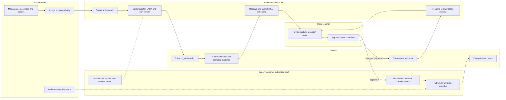
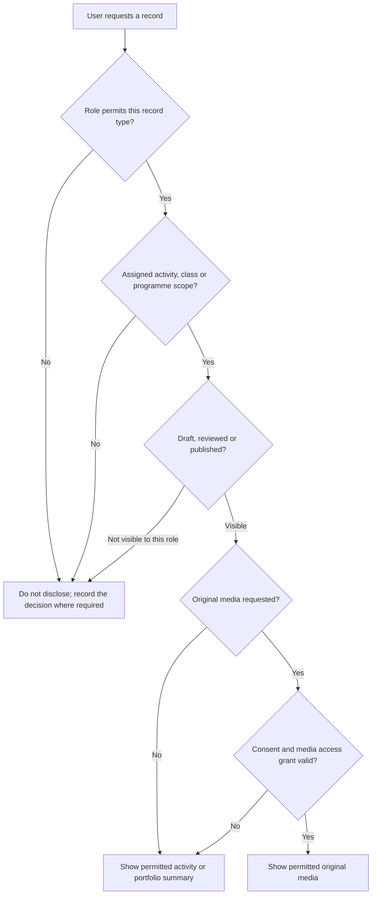

# Roles and permissions

## Purpose

This document defines the initial access model for the BHSS student growth and portfolio platform. Access to an activity does not automatically give access to every original media file. Activity data, assessment data, published summaries, and raw media are separate permissions.

**Authority status:** the position/role/scope and configurable-approval model below is an approved System Analyst architecture decision dated 28 October 2026. It is an internal product interpretation, not a BHSS or JC policy approval. The authoritative entities and relationships are maintained in `Core data relationships.md`.

## Position, functional role and scope

The platform shall keep three different concepts separate:

1. **Position or job title** describes a person's school appointment, for example subject teacher, mentoring teacher, subject leader/panel head, principal, vice principal or teaching assistant. A user may hold several effective-dated positions.
2. **Functional role/capability** describes what the person may do, for example create an activity, review a form, approve an activity, review a Portfolio or publish a Portfolio. Functional roles are stackable and are not inferred permanently from a job title.
3. **Assignment scope** limits where the capability applies: `school`, `department`, `subject`, `year`, `class`, `group`, `programme`, `activity` or `student`.

Department, subject and staff-group membership are first-class school records. A school may grant a capability through a functional role and then apply a narrower group or individual allow/deny override. An explicit applicable deny wins over an allow. Position, role, scope and override changes are effective-dated and audited.

The first release uses one common Teacher workspace. Buttons, queues and records differ according to effective capability and scope; the system does not require a separate interface for each teacher title.

## Role definitions

### Student

A student is the subject and contributor of their own growth record.

- View activities in which they are enrolled.
- View their own published activity summaries, feedback, skill evidence, and portfolio.
- Submit self-reflections, self-evaluations, and permitted media or work.
- Complete assigned peer feedback without receiving administrative access to the other student's record.
- Request correction of misidentified evidence or inaccurate personal information.
- Cannot approve activities, form templates, question ability definitions, proof acceptance, or step attainment.
- Cannot view another student's private portfolio, raw media, teacher-only notes, or identity-review material.

### Teacher

A teacher is assigned to specific activities or students as an owner, supporting teacher, assessor, or class teacher.

- Create activity drafts when `activity.create` is granted in the applicable scope; this capability may be given to subject teachers, class teachers, TAs or other staff independently of job title.
- Edit the current draft of an activity that they created or are explicitly allowed to edit. For an activity owned by another person, submit a change request rather than silently changing approved content.
- Use the approved default activity form.
- Request an approved form override when an activity needs different questions.
- View assigned activities and participating students.
- View evidence needed for an assigned assessment, subject to media consent and access scope.
- Submit observations, assessments, feedback, and evidence-verification decisions.
- Confirm whether a transcript segment or media item belongs to a student when they have direct knowledge.
- Propose proof-linked rubric observations, but cannot silently change an approved framework or published historical decision.
- Cannot automatically see every student or every activity in the school.
- When assigned as class teacher, review a student's submitted Portfolio working version, select all or only part of the submitted items, return items for correction, and submit the reviewed version to the configured staff approval step.
- A class teacher may edit only the authorized prompt/content field of an LLM-generated `Me as a learner` narrative. Student-authored text and other educators' observations retain their own authorship and cannot be rewritten under that permission.

### SuperTeacher (staff)

`SuperTeacher` is a legacy technical label for a bundle of delegated capabilities, not a job title or a separate kind of account. A subject teacher or another ordinary teacher may receive the same approval capability in a narrower scope; a principal or vice principal receives no content approval merely from the position title.

- All Teacher permissions within the programmes, classes, or activity groups assigned to them.
- Review and approve activities when school policy requires human approval.
- Review custom activity forms and questionnaire versions.
- Accept, decline, and complete form-review assignments within the authorized scope.
- Submit change requests, approve or reject form versions, and record a review rationale.
- Publish an approved form version within an authorized internal scope when school policy delegates this permission.
- Retire or withdraw a form version within assigned scope without deleting historical assignments.
- Review question ability definitions, Proof List items and human rubric observations within the assigned scope.
- Compare the maximum level supported by each proof/input type and include or exclude individual proof links or observations with a recorded reason when assigned as the assessment reviewer.
- Correct or supersede false identity/evidence associations and resolve the resulting dependency-review queue within delegated scope; this never permits a source-free level override.
- Review conflicting evidence, identity uncertainty, and requested corrections.
- View published student summaries across their assigned scope.
- Reopen or return an assessment to a teacher for clarification.
- Cannot manage global authentication settings or grant themselves unrestricted school-wide access.

There is no separate `approval_staff` user type or table. Approval eligibility is derived from effective functional roles/capabilities, scope, delegation dates and the named workflow assignment.

### SchoolAdmin

A SchoolAdmin manages the school tenant, account identities, reusable role definitions, effective role assignments, policies, periods, imports, and access configuration. **Discussed on Meeting Oct 26 - kickstart:** role membership and named workflow approval assignments are separate records.

- Import, create, update, suspend, and archive users.
- Maintain position definitions and assignments; assign functional roles, departments, subjects, classes, groups, programmes, activities and student scopes.
- Publish immutable role-template versions and assign an exact version, scope and effective period to a user. A later role-template version affects only new or explicitly migrated assignments.
- Configure school-wide role capability rules and narrower group/user overrides, including explicit denies for a TA or junior teacher who would otherwise inherit access through a group.
- Configure academic years, reporting periods, and period transitions.
- Configure the default activity form and separate approval policy for each workflow type.
- Assign any eligible teacher/staff user to review a submitted form version when the administrator has approval-coordination authority; the assignee still needs the required capability and scope.
- Manage activity, questionnaire, rubric and Portfolio-template version status, plus the effective school/grade/programme assignments that select them.
- Publish, withdraw, or retire approved form versions and configure their visibility and validity dates.
- Configure consent categories, media access scopes, retention periods, and deletion workflows.
- Review import batches, Time Infinity staging records, audit logs, and failed validations.
- Export and commit a school-scoped activity-catalogue delta when `import.export`/`import.commit` are granted. Missing rows have no effect; explicit disable/restore and material successor revisions remain auditable. This operational import authority does not grant content approval.
- Revoke sessions and reset account access.
- View the school's effective feature availability and request/configure changes only within delegated policy; the ordinary SchoolAdmin role cannot re-enable a disabled hosted-service school.
- View school-wide administrative metadata and published summaries.
- Raw media access is still policy-controlled and should not be assumed merely because the user is an administrator.
- SchoolAdmin configures approval/assessment authority and audit policy but does not approve content or choose a student's level merely by holding the administrator role; a separate eligible role and workflow assignment are required.

**Confirmed System Analyst direction, 2 Nov 2026; not BHSS/JC approval.** Account creation does not copy a mutable “example user class” or calculate authority in browser code. The account stores identity only. A separate effective assignment pins an immutable role-template version and scope; the server resolves that version, explicit overrides and record context for every protected request. Frontend navigation/buttons are advisory server-computed affordances and never replace endpoint authorization.

### Platform operations administrator

A platform operations administrator is a service-level authority, not a school assessment role. It exists for a hosted multi-school service; a local deployment may perform the same actions through controlled deployment configuration.

- Disable or re-enable a school through an audited operation.
- Configure time-bounded availability for a stable `feature_key` by school.
- See service-level school and feature-policy metadata needed for that operation.
- Does not receive school content, raw-media, teaching, proof-acceptance or assessment authority by default.
- Cannot use a feature flag to bypass role, scope, lifecycle, consent or approval rules.

### External authority or report recipient

An external authority or report recipient is not a platform role in the recommended MVP. Authorized staff generate a versioned printable SLP/PDF and, when detailed evidence checking is required, a protected XLSX evidence register. This avoids maintaining external identities, expiry, delegated access, consent propagation, and raw-media permissions before there is a confirmed requirement. A later external portal requires a separate access-control design.

## Responsibility flow

The same person may act as activity teacher, class teacher and approver, but the system records which capability, scope and workflow assignment authorized each action. An activity owner cannot gain school-wide access merely because they created the activity.

## Visibility and media-access flow

Access to a published summary does not imply access to its original photograph, audio, transcript, or internal moderation notes.

## Permission matrix

The matrix covers school roles. Platform operations is deliberately excluded because it controls tenant/feature availability only and does not inherit school-content permissions.

| Capability | Student | Teacher | SuperTeacher (staff) | SchoolAdmin |
| --- | --- | --- | --- | --- |
| View own portfolio | Yes | Assigned students | Assigned scope | Policy-controlled |
| View activity | Enrolled activities | Assigned activities | Assigned programme/class | School-wide metadata |
| View original media | Own/permitted only | Assigned and permitted | Review scope and permitted | Policy-controlled |
| Submit self-reflection | Yes | No | No | No |
| Submit peer feedback | When assigned | No | No | No |
| Submit teacher assessment | No | Assigned scope | Assigned scope | Normally no |
| Create activity draft | No | Yes | Yes | Yes |
| Approve activity | No | If separately granted and assigned | If separately granted and assigned | Configure policy; decide only if separately granted and assigned |
| Use default form | Assigned response only | Yes | Yes | Yes |
| Request form override | No | Yes | Yes | Yes |
| Approve form/questionnaire version | No | If separately granted and assigned | If separately granted and assigned | Configure policy; decide only if assigned |
| Assign form reviewer | No | No by default | Within delegated scope | Yes |
| Accept review assignment | No | No | Yes | Yes |
| Publish approved form version | No | No | If delegated | Yes |
| Withdraw or retire form version | No | No | If delegated | Yes |
| Assign published form to activity | No | Assigned activities | Assigned scope | Yes |
| Confirm evidence identity | Request correction | When directly responsible | Review/escalation | Administrative correction |
| Confirm skill-step evidence | No | Propose/confirm within policy | Review and approve | Configure policy |
| Include/exclude proof for a rubric result | Request correction | Propose within assigned scope | Decide when assigned; reason required | Policy only unless separately assigned |
| Correct a false identity/evidence link | Request correction | Propose/confirm when directly responsible | Decide and resolve impact within assigned scope | Administrative correction; assessment decision only if assigned |
| Review Portfolio working version | Own submission only | Class-teacher/student assignment | Delegated review scope | Only if separately assigned |
| Publish approved Portfolio | No | If separately granted and assigned | If separately granted and assigned | Configure policy; publish only if separately granted and assigned |
| Manage positions, roles, scopes and periods | No | No | No by default | Yes |
| View audit logs | Own submissions only | Own actions | Assigned review scope | Yes |

## Recommended activity visibility rule

Use assignment-based access by default:

1. A teacher sees an activity when an effective capability and scope allow it and no applicable explicit deny exists. Ownership, supporting-teacher/assessor assignment, subject, department or teacher-group membership may supply that scope.
2. A class teacher may see published summaries for students in their class without automatically receiving access to raw media.
3. An authorized reviewer sees activities inside the department, subject, year, class, group, programme, activity, student or queue scope named by their assignment.
4. A SchoolAdmin sees administrative records across the school, while sensitive media remains protected by a separate permission.

## Recommended activity approval rule

Each school configures activity approval independently from form, submission, Portfolio and publication approval. P1 supports only four modes: `not_required`, `automatic`, `single_reviewer`, and `two_stage_sequential`. A workflow has at most two sequential human decisions; parallel voting, quorum rules and arbitrary workflow scripting are outside the lean MVP.

- A routine school activity using the approved default form and no new media collection may be automatically approved if school policy allows it.
- An activity requires human approval when it uses a custom form, collects image/audio/video, occurs off-site, imports external participants, changes intended rubric-axis labels, or introduces a new data-retention requirement.
- A policy may separate approval from publication or assign both capabilities to the same eligible person. Self-approval is configurable per workflow and scope; if enabled, an eligible activity author may assign themselves. The decision still requires a named assignment, reason and audit record.

## Activity catalogue import authority

**Confirmed System Analyst direction, 29 Oct 2026; not BHSS/JC approval.** The editable activity export deliberately omits the immutable original author. `created_by_user_id`, current owner, uploader/committer and approval assignee are separate identities. SchoolAdmin may operate the school-scoped delta import when granted import capabilities but does not become the activity author, owner or approver. A material row creates a successor draft and uses the normal named approval assignment. Only explicit `disable` changes canonical availability; excluding the staged row has no lifecycle effect. Disabled activities remain staff-auditable but are denied to participant/student surfaces server-side.
- Unassigned, declined or overdue work enters the default/escalation queue for an approval coordinator. Time-bounded delegation is supported.
- Suggested lifecycle: `draft → pending_review → approved → active → completed → archived`.

## Activity ownership, amendment and stable identity

- `activity_id` identifies the activity container and never changes merely because its description or other governed content changes.
- Governed content is stored in immutable activity revisions. Evidence, submissions and media remain linked to the stable activity and may also record the revision context.
- A teacher-created draft exposes **Submit for approval/Publish request** according to policy. A material edit after approval creates a successor revision and a new approval cycle; the last approved revision remains the official view until the successor is approved.
- An assigned teacher who finds an error in an activity created/controlled by someone else submits a change request to that owner or authorized editor. Assignment alone does not grant silent content editing.

## Portfolio working-version and approval rule

1. A student edits a working version containing student-authored sections and selected memorable activities, then submits it.
2. The assigned class teacher may return content, include all or only selected items, and submit a reviewed version to the configured approval workflow.
3. Authorized staff/teachers approve according to the school's Portfolio policy. Approval and publication may be separate capabilities even if one person is assigned both.
4. The student workspace may show the student's latest draft/submission. Every official or external view resolves the latest approved version; an unapproved version never overwrites it.
5. If no approved version exists, the Portfolio is marked `no_approved_version` and appears in a filterable staff queue and escalation view.
6. Student-authored text retains declared authorship and does not need external proof merely to be shown as the student's own statement. LLM/system-generated claims and rubric-derived statements require resolvable sources/proof and versioned provenance.
7. For `Me as a learner`, preserve generated, teacher-edited and final-approved versions. A class teacher or other authorized editor may edit only that generated narrative field, and the final text still requires the configured teacher/staff approval.
8. The working version pins both the effective school rubric ID/version and Portfolio-template version/manifest hash when it is generated. Review, approval and publication cannot silently switch either; changing an effective assignment affects only later generated working versions.

## Rubric catalogue authority

**Confirmed System Analyst direction, 29 Oct and 2 Nov 2026; not BHSS/JC approval.** An import operator with `import.export` may download the real five-sheet rubric package (including explicit `rubric_levels`) or a separate new-record template. `import.run` may stage and validate a package; `import.commit` may create a successor draft. None of these capabilities assigns the rubric to a school or grants assessment authority. SchoolAdmin with `policy.manage` may assign only a validated successor, by purpose/scope/effective period, and must record a reason. An assigned reviewer with assessment-review capability selects evidence/steps for a particular learner; SchoolAdmin does not receive that learner-assessment power merely by managing the school assignment.

## Form authority and publication rule

Form governance is separate from activity approval:

1. A Teacher may create or revise a draft form but cannot approve their own version by default.
2. An authorized approval coordinator assigns the submitted version to a specific eligible reviewer; an ordinary teacher may be the reviewer when capability and scope match.
3. The reviewer accepts the work item and records `approved`, `changes_requested`, or `rejected` with a rationale.
4. Approval confirms that the content is valid. It does not automatically publish the version.
5. A user with the separate form-publication capability and matching scope publishes the approved version to a defined visibility scope; this may be the reviewer when policy permits.
6. An activity can reference only an approved, published, non-retired version within its validity dates.
7. Editing a published version creates a new draft. Existing assignments and submissions retain the exact historical version.

## Security baseline

- Store password hashes, never plaintext passwords.
- User import files should create an invitation or activation process rather than contain a password.
- Use short-lived authenticated sessions with secure cookie settings and server-side revocation.
- Log sign-in, import, role change, activity approval, media access, evidence correction, assessment publication, and deletion actions.
- Apply least privilege. Permissions should be scoped by activity, class, programme, and media-access purpose.
- Treat speaker identification, student images, recordings, transcripts, and AI-derived claims as sensitive data requiring explicit policy and auditability.
- Resolve an immutable `SchoolId` for every protected request and worker job. Deny cross-school identifiers, disabled schools and unavailable features on the server; UI visibility is not enforcement.
