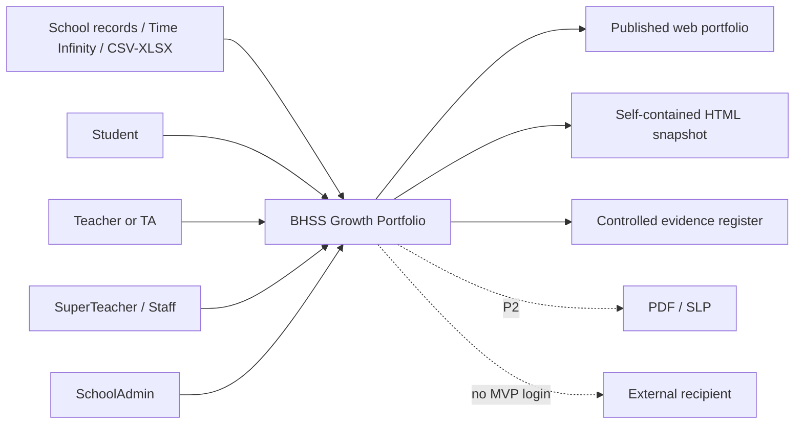

# SRS-00 Product scope and requirements index

## 1. Product objective

The platform records academic and non-academic activities, preserves evidence and review provenance, and publishes an evidence-backed student growth portfolio across eight Universal Framework skills. It helps authorized educators see participation, abilities and growth that academic results or memory-based staff discussion may miss. It is not a marks leaderboard and must not turn questionnaire answers, certificates, AI output, or missing data directly into an official 1–16 step.

Product direction: BHSS is the lead solution proposer/reference school, JC may approve and fund programme operation or adoption, and Octopus Infotech intends to own and supply the reusable product. Ownership, licensing and branding remain subject to written agreement. **Discussed on Meeting Oct 26 - kickstart.**

### 1.1 Requirements authority and validation warning

**This SRS is not a validated market specification.** Except for the current internal direction that Octopus Infotech Limited intends to develop a reusable product, with JC or one or more schools participating in a JC programme as the expected first customer/adoption context, the present product definition, scope, phase plan, priorities, workflows, architecture and cross-school assumptions have been produced through independent internal analysis. No supplied market-research report, interview sample, findings register, validation result, business case, or written BHSS/JC approval currently substantiates those assumptions.

The post-meeting transcript includes an unverified statement that market research had already been done, but it does not identify a responsible owner or a research deliverable. It later discusses obtaining wider school input through JC, a lead school, Victor and Principal Fung; this describes a possible discovery channel and does not prove that a formal study was completed. Until traceable evidence is received, all affected SRS content remains `assumption`, `recommended`, or `open`, as marked, and shall not be represented as a BHSS requirement, JC requirement, validated market need, purchase commitment, or approved product baseline. **Discussed on Meeting Oct 26 - kickstart.**

## 2. Scope by phase

| Phase | Included outcome |
|---|---|
| P0 — POC hardening | Correct navigation and server authorization; explicit field constraints; activity roster and questionnaire imports; JPG/PNG upload and preview; audit of sensitive actions. |
| P1 — Lean MVP | Full activity/form/submission/evidence/assessment lifecycles; scoped review queues; portfolio snapshots; HTML and controlled XLSX export; period rollover; school isolation and feature-policy control; provider-neutral extraction and Portfolio-generation contracts. |
| P2 — Later | Production OCR/transcription and LLM-provider implementations behind the P1 contracts; PDF/SLP layout, audio/video processing, external portal, guardian workflows and analytics. |

## 3. System boundary



## 4. Cross-cutting requirements

| ID | Requirement | Status | Phase |
|---|---|---|---|
| PRD-FR-001 | Every material record shall retain creator, source, timestamps, current lifecycle state and immutable historical references. | Confirmed working decision | P1 |
| PRD-FR-002 | Processing inclusion, content review and student visibility shall be independent states. | Confirmed working decision M-09/M-19 | P0 |
| PRD-FR-003 | Missing, not collected, not applicable, excluded and zero shall not be treated as equivalent. | Confirmed for missing; remaining distinctions Policy TBD M-13 | P1 |
| PRD-FR-004 | A published output shall use a frozen, versioned snapshot rather than mutable live records. | Recommended architecture | P1 |
| PRD-FR-005 | Every page and API action shall enforce role, assignment scope, lifecycle state and, for raw media, consent/access grant. | Recommended architecture | P0 |
| PRD-FR-006 | Every numeric input shall display and enforce its minimum and maximum in UI, API and persistence validation. | Recommended architecture | P0 |
| PRD-FR-007 | Unresolved requirements shall be displayed as `Policy TBD`; temporary caps shall remain configurable and separately labelled. | Confirmed documentation rule | P0 |
| PRD-FR-008 | English and Chinese requirement sets shall share the same IDs, enums, limits and meanings. | Confirmed documentation rule | P0 |
| PRD-FR-009 | The current product shall use one documented core activity contract rather than arbitrary per-school schemas. School sanitation, platform validation, preview, and approval remain separate responsibilities. | Approved POC interpretation V2-A01 | P0 |
| PRD-FR-010 | Descriptive labels and formal assessment records shall remain distinct, even when a label names a rubric axis. | Approved POC interpretation V2-B01 | P0 |
| PRD-FR-011 | Model-assisted processing shall produce review candidates with provenance, never an automatically published identity, evidence claim, or skill step. | Approved POC interpretation V2-B05–B08 | P0 |
| PRD-FR-012 | The Portfolio shall consolidate school, teacher, student and authorized-staff evidence so non-academic participation and demonstrated abilities remain visible and traceable. | Discussed on Meeting Oct 26 - kickstart | P1 |
| PRD-FR-013 | Media may be resolved from school-approved external stores through server-side connectors; raw paths and storage credentials shall not be exposed to browser clients. | Partly addressed L-08; Discussed on Meeting Oct 26 - kickstart | P1 |
| PRD-FR-014 | Every school-owned record shall be bound to a `school_id`, directly or through an enforced parent relation; identifiers from another school shall be rejected without disclosing the record. | Approved System Analyst architecture decision, 27 Oct 2026 | P0 |
| PRD-FR-015 | A disabled school and a disabled/unreleased school feature shall be blocked by server-side policy before its service/use-case runs; hiding a UI control is not enforcement. | Approved System Analyst architecture decision, 27 Oct 2026 | P0/P1 |
| PRD-FR-016 | The kernel shall depend on provider-neutral extraction and Portfolio-generation contracts. It shall validate normalized inputs/outputs, provenance, school scope and human-review state without depending on a provider's internal AI implementation. | Approved System Analyst architecture decision, 27 Oct 2026; follows Discussed on Meeting Oct 26 - kickstart | P1 |
| PRD-FR-017 | Portfolio visualization and export shall consume an approved frozen snapshot DTO; they shall not call an LLM or interpret raw extraction output. | Approved System Analyst architecture decision, 27 Oct 2026 | P1 |
| PRD-FR-018 | An official rubric result shall be distinct from the candidate and included maximum supported levels shown for each proof/input type. The official result shall use only explicitly included, eligible, human-confirmed observations and retain the exact selected sources and reviewer decision. | Approved System Analyst architecture decision, 27 Oct 2026 | P1 |
| PRD-FR-019 | A previously accepted proof, identity association, observation or AI candidate shall remain individually correctable, excludable or supersedable with reason and audit history. Dependent live results shall become `needs_review`/`stale`, and published output shall be withdrawn or replaced through a new approved snapshot rather than silently rewritten. | Approved System Analyst architecture decision, 27 Oct 2026 | P1/P2 |
| PRD-FR-020 | School position/job title, stackable functional role/capability, assignment scope and named approval assignment shall be separate, effective-dated records. Job title shall not itself grant content permission. | Approved System Analyst architecture decision, 28 Oct 2026; not BHSS/JC approval | P0/P1 |
| PRD-FR-021 | Effective authorization shall support school, department, subject, year, class, group, programme, activity and student scopes, with an explicit applicable deny taking precedence over an allow. | Approved System Analyst architecture decision, 28 Oct 2026; not BHSS/JC approval | P1 |
| PRD-FR-022 | Each school shall configure activity, form, submission, Portfolio and publication approval independently using only `not_required`, `automatic`, `single_reviewer` or `two_stage_sequential` in the lean MVP. Approval and publication may be separate capabilities; self-approval is policy-controlled. | Approved System Analyst architecture decision, 28 Oct 2026; not BHSS/JC approval | P1 |
| PRD-FR-023 | Material activity changes shall create a successor revision and reapproval without changing `activity_id` or detaching evidence/media. An unapproved Portfolio working version shall never replace the latest approved version in an official view. | Approved System Analyst architecture decision, 28 Oct 2026; not BHSS/JC approval | P1 |
| PRD-FR-024 | Unassigned, declined, overdue and `no_approved_version` work shall be discoverable through filterable default/escalation queues with named ownership, due state and audit history. | Approved System Analyst architecture decision, 28 Oct 2026; not BHSS/JC approval | P1 |

## 5. Shared lifecycle vocabulary

| Record | States |
|---|---|
| Activity container/revision | Stable `activity_id`; each governed revision follows `draft → pending_review → approved / changes_requested / rejected → superseded`, while operational activity follows `approved → active → completed → archived` |
| Form content | `draft → in_review → changes_requested / approved / rejected → retired` |
| Form publication | `unpublished → published → withdrawn` |
| Submission content | `not_submitted → draft → submitted → in_review → changes_requested / approved / rejected` |
| Imported response | `received → identity_matched / needs_identity_resolution → corrected → validated → included_in_assessment / excluded` |
| Student visibility | `unpublished → published_to_portfolio → withdrawn` |
| Portfolio working version | `draft → student_submitted → class_teacher_review → staff_review → approved / changes_requested / rejected → published / superseded` |

Transitions shall be append-audited. A single generic `status` shall not replace these independent lifecycles.

## 6. Definitive domain ranges

| Field | Minimum | Maximum | Rule/status |
|---|---:|---:|---|
| Framework skill count | 8 | 8 | Fixed source model |
| Framework step number | 1 | 16 | Fixed source model; integer |
| Supplied questionnaire response | 1 | 6 | Source scale; integer |
| Observation consistency rating | 1 | 6 | Confirmed architecture; integer |
| Question ability definitions | 1 | 1 | One valid ability code/name per question version; not a rubric mapping |
| Rubric axes | 1 | Catalogue-defined | Required for assessment/radar eligibility |
| Rubric level order/value | Catalogue-defined | Catalogue-defined | Ordered and versioned; concrete conditions required |
| Proof links per proof item | 0 | Configurable | Typed links; no automatic assessment effect |
| Display order | 1 | 2,147,483,647 | Positive integer; values need not be contiguous |
| Version number | 1 | 9,999 | Temporary technical cap |

Any other response or academic grading scale must declare its own minimum, maximum, labels and direction before data entry is enabled.

## 7. Temporary configurable safety caps

These values are not approved school policy.

| Configuration key | Temporary value | User instruction |
|---|---:|---|
| `text.code.max_chars` | 64 | Maximum 64 characters |
| `text.title.max_chars` | 200 | Maximum 200 characters |
| `text.comment.max_chars` | 4,000 | Maximum 4,000 characters |
| `text.long_report.max_chars` | 20,000 | Maximum 20,000 characters |
| `file.name.max_chars` | 255 | Maximum 255 characters |
| `url.max_chars` | 2,048 | Maximum 2,048 characters |
| `form.blocks.max` | 50 | Maximum 50 question blocks |
| `form.questions.max` | 200 | Maximum 200 questions |
| `question.options.max` | 20 | Maximum 20 response options |
| `activity.participants.max` | 1,000 | Maximum 1,000 participants per activity |
| `import.rows.max` | 5,000 | Maximum 5,000 data rows |
| `import.columns.max` | 100 | Maximum 100 columns |
| `upload.spreadsheet.max_bytes` | 4 MiB | Maximum 4 MB |
| `upload.image.max_bytes` | 8 MiB | Maximum 8 MB |
| `upload.document.max_bytes` | 20 MiB | Maximum 20 MB |
| `upload.audio.max_bytes` | 100 MiB | Maximum 100 MB |
| `upload.video.max_bytes` | 500 MiB | Maximum 500 MB |
| `upload.files_per_action.max` | 20 | Maximum 20 files per upload action |
| `pagination.default` | 20 | 20 rows per page |
| `pagination.max` | 100 | Maximum 100 rows per page |
| `export.sync_rows.max` | 50,000 | Larger exports use a background job |
| `portfolio.proud_moments.max` | 24 | Temporary cap; final policy is open |
| `session.idle_minutes` | 30 | Sign in again after 30 idle minutes |
| `session.absolute_hours` | 8 | Maximum session duration 8 hours |
| `auth.failed_attempts.max` | 5 per 15 minutes | Temporary throttling rule |
| `auth.password.min_chars` | 12 | Minimum 12 characters |
| `auth.password.max_chars` | 128 | Maximum 128 characters |

## 8. Common field contract

Every field specification shall define: data type, unit, requiredness, null meaning, default, minimum, maximum, precision, allowed values, editable roles, lock point, error message and requirement status. Required text is trimmed and must contain at least one non-whitespace character. No UI may present an unconstrained number input.

The API validation error envelope shall be:

```json
{
  "error": {
    "code": "VALIDATION_OUT_OF_RANGE",
    "field": "observed_step",
    "message": "Enter a whole number from 1 to 16.",
    "minimum": 1,
    "maximum": 16
  }
}
```

## 9. Open-decision dependency map

| Area | Decision IDs |
|---|---|
| Official outputs and external recipients | H-01, H-09, L-07 |
| Assessment authority and human gate | H-03, H-04, H-05, M-02, M-07 |
| Questionnaire authority and completeness | H-02, M-03, M-04, M-05, M-06 |
| Consent, files and retention | H-07, L-02 |
| School year and snapshots | H-08 |
| AI boundary | H-10 |
| Activity, classification and locking | M-08, M-12, M-14, L-01, L-04 |
| Missing states and notifications | M-13, L-05 |
| Proof/input type catalogue and rubric eligibility | M-25 |
| Identifiers and import contracts | L-03, L-06 |

## 10. Acceptance criteria

- Every role-facing page is listed in SRS-12 and every action has a corresponding server permission in SRS-01.
- All numeric fields use either the definitive range above or an explicit configured range.
- The UI displays the active maximum next to or within the relevant input.
- A temporary cap is never labelled as an approved school policy.
- All unresolved requirements link to a stable question ID.
- Historical submissions, mappings and published snapshots remain reproducible after later edits.
- Cross-school identifiers, disabled schools and disabled features are rejected consistently by interactive APIs and background workers.
- Contract tests can replace each extraction or Portfolio-generation provider without changing the kernel workflow or visualization DTO.
- A source-type maximum cannot be mistaken for or copied into the official step without the selected human-confirmed observations and source trace.
- Correcting a false face/student association preserves the original decision, identifies every dependant, and requires withdrawal or successor approval for affected published output.

