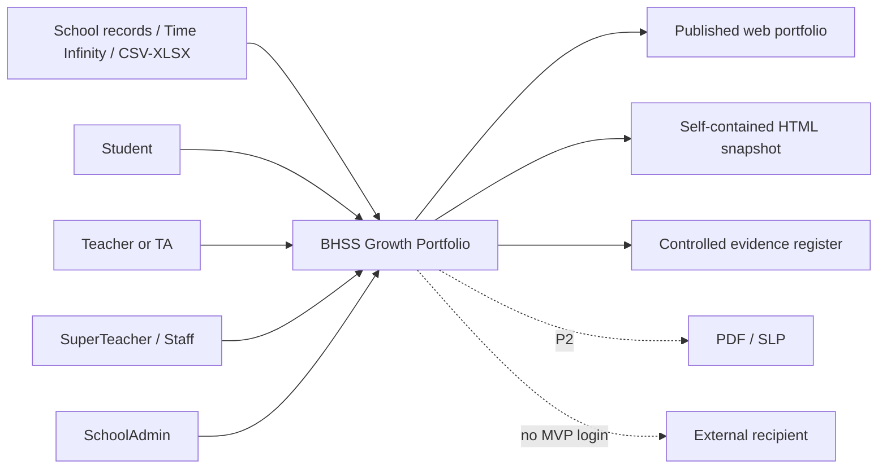

# SRS-00 Product scope and requirements index

## 1. Product objective

The platform records academic and non-academic activities, preserves evidence and review provenance, and publishes an evidence-backed student growth portfolio across eight Universal Framework skills. It is not a marks leaderboard and must not turn questionnaire answers, certificates, AI output, or missing data directly into an official 1–16 step.

## 2. Scope by phase

| Phase | Included outcome |
|---|---|
| P0 — POC hardening | Correct navigation and server authorization; explicit field constraints; activity roster and questionnaire imports; JPG/PNG upload and preview; audit of sensitive actions. |
| P1 — Lean MVP | Full activity/form/submission/evidence/assessment lifecycles; scoped review queues; portfolio snapshots; HTML and controlled XLSX export; period rollover; policy configuration. |
| P2 — Later | Production OCR/transcription, controlled LLM assistance, PDF/SLP layout, audio/video processing, external portal, guardian workflows and analytics. |

## 3. System boundary



## 4. Cross-cutting requirements

| ID | Requirement | Status | Phase |
|---|---|---|---|
| PRD-FR-001 | Every material record shall retain creator, source, timestamps, current lifecycle state and immutable historical references. | Confirmed working decision | P1 |
| PRD-FR-002 | Processing inclusion, content review and student visibility shall be independent states. | Confirmed working decision M-09/M-19 | P0 |
| PRD-FR-003 | Missing, not collected, not applicable, excluded and zero shall not be treated as equivalent. | Confirmed for missing; remaining distinctions Policy TBD M-13 | P1 |
| PRD-FR-004 | A published output shall use a frozen, versioned snapshot rather than mutable live records. | Recommended architecture | P1 |
| PRD-FR-005 | Every page and API action shall enforce role, assignment scope, lifecycle state and, for raw media, consent/access grant. | Recommended architecture | P0 |
| PRD-FR-006 | Every numeric input shall display and enforce its minimum and maximum in UI, API and persistence validation. | Recommended architecture | P0 |
| PRD-FR-007 | Unresolved requirements shall be displayed as `Policy TBD`; temporary caps shall remain configurable and separately labelled. | Confirmed documentation rule | P0 |
| PRD-FR-008 | English and Chinese requirement sets shall share the same IDs, enums, limits and meanings. | Confirmed documentation rule | P0 |

## 5. Shared lifecycle vocabulary

| Record | States |
|---|---|
| Activity | `draft → pending_review → approved → active → completed → archived` |
| Form content | `draft → in_review → changes_requested / approved / rejected → retired` |
| Form publication | `unpublished → published → withdrawn` |
| Submission content | `not_submitted → draft → submitted → in_review → changes_requested / approved / rejected` |
| Imported response | `received → identity_matched / needs_identity_resolution → corrected → validated → included_in_assessment / excluded` |
| Student visibility | `unpublished → published_to_portfolio → withdrawn` |

Transitions shall be append-audited. A single generic `status` shall not replace these independent lifecycles.

## 6. Definitive domain ranges

| Field | Minimum | Maximum | Rule/status |
|---|---:|---:|---|
| Framework skill count | 8 | 8 | Fixed source model |
| Framework step number | 1 | 16 | Fixed source model; integer |
| Supplied questionnaire response | 1 | 6 | Source scale; integer |
| Observation consistency rating | 1 | 6 | Confirmed architecture; integer |
| Skills mapped to one question | 1 | 8 | Fixed by eight-skill model |
| Mapping percentage | 0 | 100 | Two decimal places; mappings per question total exactly 100 |
| Normalized question weight | 0 | 1.0 | Default total is 1.0 and is divided equally across mapped skills |
| Evidence band | 1 | 16 | Optional; minimum must not exceed maximum; candidate evidence only |
| Display order | 1 | 2,147,483,647 | Positive integer; values need not be contiguous |
| Version number | 1 | 9,999 | Temporary technical cap |

Any other response or academic grading scale must declare its own minimum, maximum, labels and direction before data entry is enabled.

## 7. Temporary configurable safety caps

These values are not approved school policy.

| Configuration key | Temporary value | User instruction |
|---|---:|---|
| `text.code.max_chars` | 64 | Maximum 64 characters |
| `text.title.max_chars` | 200 | Maximum 200 characters |
| `text.comment.max_chars` | 4,000 | Maximum 4,000 characters |
| `text.long_report.max_chars` | 20,000 | Maximum 20,000 characters |
| `file.name.max_chars` | 255 | Maximum 255 characters |
| `url.max_chars` | 2,048 | Maximum 2,048 characters |
| `form.blocks.max` | 50 | Maximum 50 question blocks |
| `form.questions.max` | 200 | Maximum 200 questions |
| `question.options.max` | 20 | Maximum 20 response options |
| `activity.participants.max` | 1,000 | Maximum 1,000 participants per activity |
| `import.rows.max` | 5,000 | Maximum 5,000 data rows |
| `import.columns.max` | 100 | Maximum 100 columns |
| `upload.spreadsheet.max_bytes` | 4 MiB | Maximum 4 MB |
| `upload.image.max_bytes` | 8 MiB | Maximum 8 MB |
| `upload.document.max_bytes` | 20 MiB | Maximum 20 MB |
| `upload.audio.max_bytes` | 100 MiB | Maximum 100 MB |
| `upload.video.max_bytes` | 500 MiB | Maximum 500 MB |
| `upload.files_per_action.max` | 20 | Maximum 20 files per upload action |
| `pagination.default` | 20 | 20 rows per page |
| `pagination.max` | 100 | Maximum 100 rows per page |
| `export.sync_rows.max` | 50,000 | Larger exports use a background job |
| `portfolio.proud_moments.max` | 24 | Temporary cap; final policy is open |
| `session.idle_minutes` | 30 | Sign in again after 30 idle minutes |
| `session.absolute_hours` | 8 | Maximum session duration 8 hours |
| `auth.failed_attempts.max` | 5 per 15 minutes | Temporary throttling rule |
| `auth.password.min_chars` | 12 | Minimum 12 characters |
| `auth.password.max_chars` | 128 | Maximum 128 characters |

## 8. Common field contract

Every field specification shall define: data type, unit, requiredness, null meaning, default, minimum, maximum, precision, allowed values, editable roles, lock point, error message and requirement status. Required text is trimmed and must contain at least one non-whitespace character. No UI may present an unconstrained number input.

The API validation error envelope shall be:

```json
{
  "error": {
    "code": "VALIDATION_OUT_OF_RANGE",
    "field": "observed_step",
    "message": "Enter a whole number from 1 to 16.",
    "minimum": 1,
    "maximum": 16
  }
}
```

## 9. Open-decision dependency map

| Area | Decision IDs |
|---|---|
| Official outputs and external recipients | H-01, H-09, L-07 |
| Assessment authority and human gate | H-03, H-04, H-05, M-02, M-07 |
| Questionnaire authority and completeness | H-02, M-03, M-04, M-05, M-06 |
| Consent, files and retention | H-07, L-02 |
| School year and snapshots | H-08 |
| AI boundary | H-10 |
| Activity, classification and locking | M-08, M-12, M-14, L-01, L-04 |
| Missing states and notifications | M-13, L-05 |
| Identifiers and import contracts | L-03, L-06 |

## 10. Acceptance criteria

- Every role-facing page is listed in SRS-12 and every action has a corresponding server permission in SRS-01.
- All numeric fields use either the definitive range above or an explicit configured range.
- The UI displays the active maximum next to or within the relevant input.
- A temporary cap is never labelled as an approved school policy.
- All unresolved requirements link to a stable question ID.
- Historical submissions, mappings and published snapshots remain reproducible after later edits.

