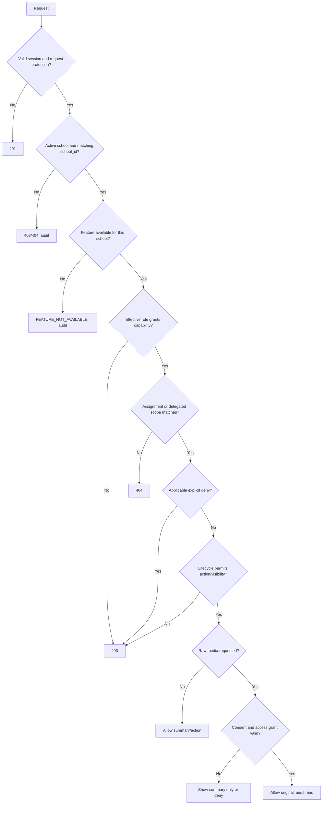

# SRS-01 Identity, sessions and access control

## 1. Purpose

Define who may see or change each record. Authorization is not title- or role-only: every request is evaluated against effective capabilities, assigned scope, explicit overrides, record lifecycle, and media consent/access.

## 2. Actors and scope assignments

| Actor | Default scope |
|---|---|
| Student | Own identity, enrolled activities, assigned tasks and published own records |
| Teacher | Activities or students assigned as owner, supporting teacher, TA, assessor or class teacher |
| SuperTeacher/Staff | Delegated programme, class, year level, review queue or school operation |
| SchoolAdmin | School-wide administrative scope; raw media remains separately controlled |
| Platform operations administrator | Hosted-service school availability and feature-policy operation only; no school content, media or assessment access by default |
| External recipient | No account in P1; receives approved export only |

Account identity, reusable role definitions, effective user-role assignments and named workflow approval assignments are separate records. `class_teacher`, `activity_teacher`, `TA` and `assessor` may be effective-dated role/scope assignments; `reviewer` and `approver` additionally require a named workflow assignment for the record being decided. One user may hold several roles, but every sensitive action records the active role and scope used. **Discussed on Meeting Oct 26 - kickstart.**

Approved System Analyst architecture decision, 28 October 2026: position/job-title assignments (such as subject teacher, mentoring teacher, subject leader, principal, vice principal and TA) are descriptive employment records, not permission grants. Stackable functional roles grant capabilities; department, subject, year, class, group, programme, activity and student assignments provide scope. A separately audited school/group/user override may allow or deny a capability, and an applicable explicit deny wins. This is an internal architecture decision, not BHSS/JC approval.

The school-role matrix below uses broad interface audiences, not fixed job titles. Actual access is capability- and scope-driven. It excludes the platform operations administrator, whose authority is limited to hosted-service school availability and feature policy and does not confer school-content access.

## 3. Functional requirements

| ID | Requirement | Status | Phase |
|---|---|---|---|
| IAM-FR-001 | The server shall authorize every protected request; frontend visibility alone shall never grant access. | Recommended architecture | P0 |
| IAM-FR-002 | Authorization shall require an allowed role, matching assignment scope, permitted lifecycle state and, for originals, a valid media grant/consent. | Recommended architecture | P0 |
| IAM-FR-003 | A denied out-of-scope record shall return `404`; a known action without permission shall return `403`. | Recommended architecture | P0 |
| IAM-FR-004 | Students shall access only their own or explicitly assigned records. | Source-aligned | P0 |
| IAM-FR-005 | A class teacher may see published summaries for current assigned students but shall not automatically see raw media. | Recommended architecture | P0 |
| IAM-FR-006 | An activity teacher or TA may access the assigned activity roster, submissions and evidence needed for assessment. | Source-aligned | P0 |
| IAM-FR-007 | Staff shall access only delegated programmes, classes, year levels or review queues unless separately granted school-wide operational scope. | Recommended architecture | P1 |
| IAM-FR-008 | SchoolAdmin may manage identities and policy but shall not gain raw-media access or teacher-assessment authority merely from the admin role. | Confirmed working model | P1 |
| IAM-FR-009 | Form authors shall not approve their own version by default. | Recommended; final form authority remains open | P1 |
| IAM-FR-010 | Sessions shall be revocable server-side and stored in Secure, HttpOnly, SameSite cookies in production. | Recommended architecture | P0 |
| IAM-FR-011 | Sign-in, sign-out, failed login, role/scope changes, sensitive reads, approvals, imports, exports, corrections and soft deletion shall be audited. | Source-aligned | P0/P1 |
| IAM-FR-012 | Imported users shall receive activation/invitation records; import files shall not contain plaintext passwords. | Source-aligned | P1 |
| IAM-FR-013 | Role definitions, effective role assignments and form/proof/rubric approval assignments shall be stored and audited separately. | Confirmed Oct 26 revision | P0 |
| IAM-FR-014 | Each authenticated request shall resolve exactly one active `school_id`; requested records and referenced identifiers must belong to that school. | Approved System Analyst architecture decision, 27 Oct 2026 | P0 |
| IAM-FR-015 | When `schools.is_disabled = true`, the server shall reject new sessions, protected requests and new background work for that school while retaining data and audit history. | Approved System Analyst architecture decision, 27 Oct 2026 | P0 |
| IAM-FR-016 | Feature availability shall be checked in addition to authorization. A feature enabled for a school does not grant any user permission. | Approved System Analyst architecture decision, 27 Oct 2026 | P0/P1 |
| IAM-FR-017 | Position definitions/assignments, functional role definitions/assignments, capability grants, scope assignments and named workflow assignments shall be separate, effective-dated records. | Approved System Analyst architecture decision, 28 Oct 2026 | P0/P1 |
| IAM-FR-018 | Functional roles shall be stackable. A user may concurrently be a subject teacher, class teacher, activity creator, assessor and Portfolio approver in different scopes without duplicate accounts. | Approved System Analyst architecture decision, 28 Oct 2026 | P1 |
| IAM-FR-019 | Supported scope types shall be `school`, `department`, `subject`, `year`, `class`, `group`, `programme`, `activity` and `student`; all scope IDs shall belong to the active school. | Approved System Analyst architecture decision, 28 Oct 2026 | P1 |
| IAM-FR-020 | Capability policy may be defined at school, role, group or individual level. The evaluator shall select applicable effective records and apply explicit deny over allow; every decision shall be reproducible and audited. | Approved System Analyst architecture decision, 28 Oct 2026 | P1 |
| IAM-FR-021 | Activity creation shall be a capability independent of teacher position. A TA or subject teacher may create activities where granted, while another teacher may be denied in the same group. | Approved System Analyst architecture decision, 28 Oct 2026 | P1 |
| IAM-FR-022 | Approval eligibility shall be derived from capability, scope and effective dates, then confirmed by a named workflow assignment. The system shall not create an `approval_staff` account type. | Approved System Analyst architecture decision, 28 Oct 2026 | P1 |
| IAM-FR-023 | Each workflow policy shall declare whether self-assignment/self-approval is allowed. If allowed, the author still requires the approval capability, matching scope, a named assignment and an audited reason/decision. | Approved System Analyst architecture decision, 28 Oct 2026 | P1 |
| IAM-FR-024 | Approval and publication shall be separately assignable capabilities; one eligible person may hold both when school policy permits. | Approved System Analyst architecture decision, 28 Oct 2026 | P1 |
| IAM-FR-025 | Delegated capabilities shall support effective start/end dates. Expired, declined, unassigned or overdue decisions shall enter the configured escalation queue without granting the coordinator content authority automatically. | Approved System Analyst architecture decision, 28 Oct 2026 | P1 |
| IAM-FR-026 | The staff directory shall support server-side filtering by name/identifier, active state, position, functional role, capability, department, subject, year, class, group, programme and approval-queue eligibility. | Approved System Analyst architecture decision, 28 Oct 2026 | P1 |

## 4. Capability matrix

| Capability | Student | Teacher | Staff | SchoolAdmin |
|---|---|---|---|---|
| View own published portfolio | Own | Assigned students | Delegated scope | Policy-controlled |
| View activity | Enrolled | Assigned | Delegated scope | Metadata school-wide |
| View raw media | Own/permitted | Assigned + permitted | Review scope + permitted | Explicit grant only |
| Submit self-reflection | Own assignment | No | No | No |
| Submit peer review | Named assignment | No | No | No |
| Submit teacher observation | No | Assigned | Assigned/review scope | No by admin role alone |
| Create activity draft | No | Yes | Yes | Yes |
| Approve activity | No | If separately granted and assigned | If separately granted and assigned | Configure policy; decide only if separately assigned |
| Draft form | No | Yes | Yes | Yes |
| Approve/publish form | No | If separately granted and assigned | If separately granted and assigned | Configure policy; act only if separately granted and assigned |
| Resolve identity/import error | Request only | Responsible record | Yes | Yes |
| Publish skill/portfolio output | No | If separately granted and assigned | If separately granted and assigned | Configure policy; act only if separately granted and assigned |
| Manage users/periods/policy | No | No | Limited delegated | Yes |
| View audit | Own submission events | Own actions | Delegated review | School-wide |

## 5. Authorization decision

## 6. Session and credential limits

| Input/policy | Minimum | Maximum | Status |
|---|---:|---:|---|
| Username | 3 characters | 64 characters | Temporary cap |
| Password | 12 characters | 128 characters | Temporary production baseline |
| Idle session | — | 30 minutes | Policy TBD; temporary cap |
| Absolute session | — | 8 hours | Current POC-compatible temporary cap |
| Failed attempts | — | 5 in 15 minutes | Temporary protection |
| Active role/scope selection | 1 | 1 per request context | Recommended architecture |

The POC demo account switching mechanism is development-only and shall not exist in production.

## 7. Interface requirements

- The authenticated-session response shall return user ID, school ID, active role, effective scopes and capabilities, but no sensitive permission internals.
- The response may include effective feature availability for presentation, but the API and workers shall re-evaluate the authoritative policy on use.
- The frontend shall build navigation from capabilities and still handle `403/404` responses.
- Role and scope changes shall invalidate or refresh affected sessions.
- Raw-media endpoints shall check a media-specific permission at read time; URLs shall be short-lived and non-guessable.
- The server, not the browser, shall calculate effective capabilities and directory filters. The common Teacher workspace may hide unavailable actions but shall never infer authority from a displayed title.

## 8. Acceptance scenarios

1. A student requesting another student's URL receives no record disclosure.
2. A class teacher sees a published summary for an assigned student but not an ungranted image.
3. An activity teacher cannot open an unrelated class or activity by editing the URL.
4. A SchoolAdmin without a media grant cannot download raw media.
5. A form author cannot approve their own version under the default separation rule.
6. Revoking a session blocks the next protected request.
7. Every sensitive allow/deny action creates an appropriately minimised audit record.
8. Disabling a school blocks the next protected request and newly claimed job without deleting any school record.
9. Enabling a feature for a demo school does not let an otherwise unauthorized user call it.
10. A subject teacher and class teacher using the same Teacher workspace receive different actions because their effective capabilities/scopes differ.
11. A TA in a permitted teacher group is denied one activity when a narrower effective individual deny applies.
12. A principal without a content-approval capability cannot approve merely because their position is Principal.
13. An ordinary teacher with the matching approval capability, scope and named assignment can decide the approval.

