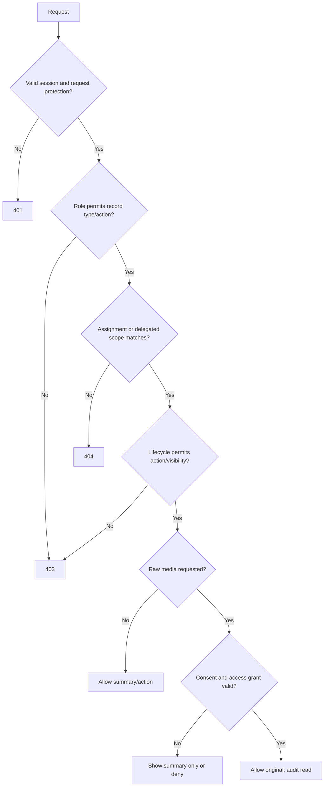

# SRS-01 Identity, sessions and access control

## 1. Purpose

Define who may see or change each record. Authorization is not role-only: every request is evaluated against role, assigned scope, record lifecycle, and media consent/access.

## 2. Actors and scope assignments

| Actor | Default scope |
|---|---|
| Student | Own identity, enrolled activities, assigned tasks and published own records |
| Teacher | Activities or students assigned as owner, supporting teacher, TA, assessor or class teacher |
| SuperTeacher/Staff | Delegated programme, class, year level, review queue or school operation |
| SchoolAdmin | School-wide administrative scope; raw media remains separately controlled |
| External recipient | No account in P1; receives approved export only |

Account identity, reusable role definitions, effective user-role assignments and named workflow approval assignments are separate records. `class_teacher`, `activity_teacher`, `TA` and `assessor` may be effective-dated role/scope assignments; `reviewer` and `approver` additionally require a named workflow assignment for the record being decided. One user may hold several roles, but every sensitive action records the active role and scope used. **Discussed on Meeting Oct 26 - kickstart.**

## 3. Functional requirements

| ID | Requirement | Status | Phase |
|---|---|---|---|
| IAM-FR-001 | The server shall authorize every protected request; frontend visibility alone shall never grant access. | Recommended architecture | P0 |
| IAM-FR-002 | Authorization shall require an allowed role, matching assignment scope, permitted lifecycle state and, for originals, a valid media grant/consent. | Recommended architecture | P0 |
| IAM-FR-003 | A denied out-of-scope record shall return `404`; a known action without permission shall return `403`. | Recommended architecture | P0 |
| IAM-FR-004 | Students shall access only their own or explicitly assigned records. | Source-aligned | P0 |
| IAM-FR-005 | A class teacher may see published summaries for current assigned students but shall not automatically see raw media. | Recommended architecture | P0 |
| IAM-FR-006 | An activity teacher or TA may access the assigned activity roster, submissions and evidence needed for assessment. | Source-aligned | P0 |
| IAM-FR-007 | Staff shall access only delegated programmes, classes, year levels or review queues unless separately granted school-wide operational scope. | Recommended architecture | P1 |
| IAM-FR-008 | SchoolAdmin may manage identities and policy but shall not gain raw-media access or teacher-assessment authority merely from the admin role. | Confirmed working model | P1 |
| IAM-FR-009 | Form authors shall not approve their own version by default. | Recommended; final form authority remains open | P1 |
| IAM-FR-010 | Sessions shall be revocable server-side and stored in Secure, HttpOnly, SameSite cookies in production. | Recommended architecture | P0 |
| IAM-FR-011 | Sign-in, sign-out, failed login, role/scope changes, sensitive reads, approvals, imports, exports, corrections and soft deletion shall be audited. | Source-aligned | P0/P1 |
| IAM-FR-012 | Imported users shall receive activation/invitation records; import files shall not contain plaintext passwords. | Source-aligned | P1 |
| IAM-FR-013 | Role definitions, effective role assignments and form/proof/rubric approval assignments shall be stored and audited separately. | Confirmed Oct 26 revision | P0 |

## 4. Capability matrix

| Capability | Student | Teacher | Staff | SchoolAdmin |
|---|---|---|---|---|
| View own published portfolio | Own | Assigned students | Delegated scope | Policy-controlled |
| View activity | Enrolled | Assigned | Delegated scope | Metadata school-wide |
| View raw media | Own/permitted | Assigned + permitted | Review scope + permitted | Explicit grant only |
| Submit self-reflection | Own assignment | No | No | No |
| Submit peer review | Named assignment | No | No | No |
| Submit teacher observation | No | Assigned | Assigned/review scope | No by admin role alone |
| Create activity draft | No | Yes | Yes | Yes |
| Approve activity | No | No by default | Delegated scope | Policy authority |
| Draft form | No | Yes | Yes | Yes |
| Approve/publish form | No | No by default | Delegated | Yes |
| Resolve identity/import error | Request only | Responsible record | Yes | Yes |
| Publish skill/portfolio output | No | Propose | Delegated | Configure/execute policy |
| Manage users/periods/policy | No | No | Limited delegated | Yes |
| View audit | Own submission events | Own actions | Delegated review | School-wide |

## 5. Authorization decision

## 6. Session and credential limits

| Input/policy | Minimum | Maximum | Status |
|---|---:|---:|---|
| Username | 3 characters | 64 characters | Temporary cap |
| Password | 12 characters | 128 characters | Temporary production baseline |
| Idle session | — | 30 minutes | Policy TBD; temporary cap |
| Absolute session | — | 8 hours | Current POC-compatible temporary cap |
| Failed attempts | — | 5 in 15 minutes | Temporary protection |
| Active role/scope selection | 1 | 1 per request context | Recommended architecture |

The POC demo account switching mechanism is development-only and shall not exist in production.

## 7. Interface requirements

- The authenticated-session response shall return user ID, school ID, active role, effective scopes and capabilities, but no sensitive permission internals.
- The frontend shall build navigation from capabilities and still handle `403/404` responses.
- Role and scope changes shall invalidate or refresh affected sessions.
- Raw-media endpoints shall check a media-specific permission at read time; URLs shall be short-lived and non-guessable.

## 8. Acceptance scenarios

1. A student requesting another student's URL receives no record disclosure.
2. A class teacher sees a published summary for an assigned student but not an ungranted image.
3. An activity teacher cannot open an unrelated class or activity by editing the URL.
4. A SchoolAdmin without a media grant cannot download raw media.
5. A form author cannot approve their own version under the default separation rule.
6. Revoking a session blocks the next protected request.
7. Every sensitive allow/deny action creates an appropriately minimised audit record.

