# SRS-02 School structure and academic periods

## 1. Purpose

Maintain a stable school boundary and student identity while classes, grades, school status, assigned teachers and product-feature availability change over time.

## 2. Functional requirements

| ID | Requirement | Status | Phase |
|---|---|---|---|
| SCH-FR-001 | A student shall have one stable internal `student_id`; class and grade shall be effective-dated memberships. | Recommended architecture | P0 |
| SCH-FR-002 | Membership history shall support transfer, class change, grade repetition, leaving and later return without rewriting activity history. | Confirmed working model | P1 |
| SCH-FR-003 | An activity participation record shall resolve the student's class as at the activity date while retaining its direct participant link. | Recommended architecture | P1 |
| SCH-FR-004 | School years shall contain reporting periods with explicit start, end and close dates. | Recommended architecture | P1 |
| SCH-FR-005 | Rollover shall run as preview, classify continuing/new/outgoing/unmatched rows, require confirmation and then apply atomically. | POC-aligned recommendation | P1 |
| SCH-FR-006 | Closed periods and published snapshots shall remain reproducible after later membership changes. | Confirmed architecture | P1 |
| SCH-FR-007 | The exact overlap, cut-off and cross-year progression rules shall remain configurable. | Policy TBD H-08 | P1 |
| SCH-FR-008 | Staff shall enter activity start/end dates; the server shall resolve the one reporting period containing the complete range. | Confirmed L-09; Oct 26 revision | P0 |
| SCH-FR-009 | A cross-period activity shall create an exception and be blocked until split or explicitly approved by an authorized user. | Confirmed L-09; exception authority open | P0 |
| SCH-FR-010 | The platform shall maintain a stable `schools.school_id` for every deployment. A single-school local deployment shall use one configured school row rather than omit the school boundary. | Approved System Analyst architecture decision, 27 Oct 2026 | P0 |
| SCH-FR-011 | A school shall record `is_disabled`, disable reason, disabling actor and timestamp. Disabling restricts operation; it does not delete or reassign the school's data. | Approved System Analyst architecture decision, 27 Oct 2026 | P0 |
| SCH-FR-012 | A product feature registry shall define each stable `feature_key` and lifecycle (`development`, `pilot`, `released`, `retired`); a school-feature policy shall record the school's effective availability (`disabled`, `pilot`, `enabled`) and its audit metadata. | Approved System Analyst architecture decision, 27 Oct 2026 | P1 |
| SCH-FR-013 | Development, pilot and unknown feature keys shall be unavailable by default unless an authorized platform policy explicitly permits them for that school. | Approved System Analyst architecture decision, 27 Oct 2026 | P1 |
| SCH-FR-014 | Feature policy shall support demo schools selectively testing ready features while withholding unfinished features; it shall never bypass role, scope, lifecycle, consent or approval controls. | Approved System Analyst architecture decision, 27 Oct 2026 | P1 |
| SCH-FR-015 | `SchoolId` shall be an opaque, immutable domain identifier persisted as `school_id`; it shall not be derived from a mutable school name/code and shall be carried in session, job and audit context. | Approved System Analyst architecture decision, 27 Oct 2026 | P0 |

## 3. Core entities

| Entity | Required information |
|---|---|
| School | Stable school ID/code, display name, operating mode (`production`, `demo`, `test`), disabled state/reason/actor/time, timestamps |
| Feature definition | Stable feature key, description, lifecycle, default availability, timestamps |
| School feature policy | School, feature key, availability, optional effective dates/reason, configuring actor and timestamps |
| User | Stable ID, school ID, names, login state, created/archived timestamps |
| Student profile | Stable student number, admission metadata, current school status derived from history |
| Academic year | Code, name, start/end dates, status |
| Reporting period | Academic year, code, name, start/end/close dates, status |
| Class/group | Academic year, class code/name, year level, status |
| Membership | Student, class, effective start/end, change reason, source, actor |
| School-status history | Student, enrolled/left/returned/suspended state, effective dates and reason |
| Staff assignment | User, class/activity/programme, responsibility, effective dates |

## 4. Field rules

| Field | Required | Minimum | Maximum / allowed value |
|---|---|---:|---|
| Student number | Yes | 1 character | 64 characters; authoritative source is Policy TBD L-03 |
| Class/year/period code | Yes | 1 | 64 characters |
| Display name | Yes | 1 | 200 characters |
| Year level | Yes | 1 | 20 temporary safety cap; store as configured code where local naming is not numeric |
| Start/end date | Yes | — | Start must not be after end |
| Concurrent primary class | Yes | 0 | 1 on any date; exceptions require audited override |
| Rollover batch rows | No | 1 | 5,000 |
| Change reason | Yes for correction/transfer | 1 | 4,000 characters |
| School code | Yes | 1 | 64 characters; unique |
| School operating mode | Yes | — | `production`, `demo`, `test` |
| Feature key | Yes | 1 | 128 characters; stable machine-readable key |
| Feature availability | Yes | — | `disabled`, `pilot`, `enabled` |

Effective feature availability is evaluated in this order: a disabled school is always blocked; retired or unknown feature keys are blocked; an explicit school-level `disabled` overrides every default; development/pilot features require an explicit `pilot` or `enabled` policy; and a released feature may use its registry default when no school override exists. Every change is append-audited.

## 5. Rollover flow

```mermaid
flowchart LR
    Upload[Upload next-period roster] --> Validate[Validate identity and class codes]
    Validate --> Compare[Compare effective memberships]
    Compare --> Preview[Continuing / moved / new / outgoing / unmatched]
    Preview --> Correct[Resolve unmatched rows]
    Correct --> Confirm[Authorized staff confirms]
    Confirm --> Apply[Append new memberships and status history]
    Apply --> Audit[Freeze batch result and audit]
```

## 6. Access

- Students see their current class and relevant historical labels, not the class directory.
- Teachers see classes/students covered by an effective assignment.
- Staff see delegated year/programme scope and rollover queues.
- SchoolAdmin manages years, periods, classes, memberships and rollover.
- SchoolAdmin may view effective feature availability and request/configure changes only within delegated policy. Re-enabling a disabled school requires platform-operations authority, not the ordinary SchoolAdmin role alone.

## 7. Acceptance scenarios

- A student moving from 2B to 2C keeps the same ID and earlier 2B activities.
- A student leaving for two years and returning at a lower grade receives new history rows, not a new identity.
- A teacher's access ends when the effective assignment ends, except for explicitly retained historical review access.
- Applying a rollover with unresolved duplicate student IDs is blocked.
- A closed-period portfolio still shows the class label recorded for that snapshot.
- An activity entirely within `2025-26-P1` receives that period automatically; staff do not select it manually.
- An activity crossing P1 and P2 is blocked until it is split or its exception is explicitly approved and audited.
- A local deployment and a hosted deployment enforce the same `school_id` relationship even if the local deployment contains only one school.
- A demo school can use one explicitly enabled pilot feature while another development feature remains unavailable.

