# SRS-02 School structure and academic periods

## 1. Purpose

Maintain a stable school boundary and student identity while classes, grades, school status, assigned teachers and product-feature availability change over time.

## 2. Functional requirements

| ID | Requirement | Status | Phase |
|---|---|---|---|
| SCH-FR-001 | A student shall have one stable internal `student_id`; each ordinary-class membership shall identify its applicable school period, with dates derived from that period. | Confirmed System Analyst direction; not BHSS/JC approval | P0 |
| SCH-FR-002 | Membership history shall support transfer, class change, grade repetition, leaving and later return without rewriting activity history. | Confirmed working model | P1 |
| SCH-FR-003 | An activity participation record shall resolve the student's class as at the activity date while retaining its direct participant link. | Recommended architecture | P1 |
| SCH-FR-004 | School years shall contain reporting periods with explicit start, end and close dates. | Recommended architecture | P1 |
| SCH-FR-005 | Rollover shall run as preview, classify continuing/new/outgoing/unmatched rows, require confirmation and then apply atomically. | POC-aligned recommendation | P1 |
| SCH-FR-006 | Closed periods and published snapshots shall remain reproducible after later membership changes. | Confirmed architecture | P1 |
| SCH-FR-007 | A student may have at most one ordinary class in any given school period. Validate imports and direct entry before commit; block both same-period duplicate/conflicting classes and overlapping effective dates resulting from different period definitions. No automatic or audited override is assumed. Other activity, subject and staff groups are separate. | Confirmed System Analyst direction; not BHSS/JC approval | P0 |
| SCH-FR-008 | Staff enter activity dates. The server automatically resolves an activity wholly contained in one configured period without requiring `selectedPeriod`. Both normal and cross-period activities display default `P0`; the meaning of `P0` is pending clarification. | System Analyst direction; not BHSS/JC approval | P0 |
| SCH-FR-009 | For an activity spanning periods, propose the ending period by default under configurable policy. If no valid `selectedPeriod` has been chosen, request an authorised staff/admin decision; provide a single-activity Excel export for correction, staged re-import, validation and audit. Do not silently treat an unresolved value as a confirmed selection. | System Analyst direction; not BHSS/JC approval | P0 |
| SCH-FR-010 | The platform shall maintain a stable `schools.school_id` for every deployment. A single-school local deployment shall use one configured school row rather than omit the school boundary. | Approved System Analyst architecture decision, 27 Oct 2026 | P0 |
| SCH-FR-011 | A school shall record `is_disabled`, disable reason, disabling actor and timestamp. Disabling restricts operation; it does not delete or reassign the school's data. | Approved System Analyst architecture decision, 27 Oct 2026 | P0 |
| SCH-FR-012 | A product feature registry shall define each stable `feature_key` and lifecycle (`development`, `pilot`, `released`, `retired`); a school-feature policy shall record the school's effective availability (`disabled`, `pilot`, `enabled`) and its audit metadata. | Approved System Analyst architecture decision, 27 Oct 2026 | P1 |
| SCH-FR-013 | Development, pilot and unknown feature keys shall be unavailable by default unless an authorized platform policy explicitly permits them for that school. | Approved System Analyst architecture decision, 27 Oct 2026 | P1 |
| SCH-FR-014 | Feature policy shall support demo schools selectively testing ready features while withholding unfinished features; it shall never bypass role, scope, lifecycle, consent or approval controls. | Approved System Analyst architecture decision, 27 Oct 2026 | P1 |
| SCH-FR-015 | `SchoolId` shall be an opaque, immutable domain identifier persisted as `school_id`; it shall not be derived from a mutable school name/code and shall be carried in session, job and audit context. | Approved System Analyst architecture decision, 27 Oct 2026 | P0 |
| SCH-FR-016 | A school shall maintain versionable department and subject definitions; subjects may belong to one or more departments through effective-dated relationships. | Approved System Analyst architecture decision, 28 Oct 2026 | P1 |
| SCH-FR-017 | Staff groups shall support effective membership independent of position and functional-role assignment, so a school can target policies or activity visibility to a teacher group. | Approved System Analyst architecture decision, 28 Oct 2026 | P1 |
| SCH-FR-018 | Staff position definitions and user-position assignments shall be school-owned, effective-dated and searchable, but shall not directly authorize content actions. | Approved System Analyst architecture decision, 28 Oct 2026 | P1 |
| SCH-FR-019 | Staff functional assignments may refer to department, subject, year, class, group, programme, activity or student scope; a later scope change shall not rewrite historical actions. | Approved System Analyst architecture decision, 28 Oct 2026 | P1 |
| SCH-FR-020 | SchoolAdmin shall be able to apply an audited school-wide capability-policy revision and preview affected users before activation. | Approved System Analyst architecture decision, 28 Oct 2026 | P1 |
| SCH-FR-021 | The school-period table is authoritative for period ID, academic year, start/end dates, sequence and summer flag. Membership dates are derived from its referenced period; imported or entered dates may not independently change those boundaries. | Confirmed System Analyst direction; not BHSS/JC approval | P0 |
| SCH-FR-022 | An assignment may identify a single period, or cover a school year through explicit expansion into the configured applicable period memberships. A year-wide import must preview the exact periods, including any configured summer coverage, before commit; it must not infer missing periods silently. | Confirmed System Analyst direction; not BHSS/JC approval | P1 |
| SCH-FR-023 | The authenticated, school-scoped API shall return the minimum start date and maximum end date across the selected academic year's configured periods. An `include_summer` toggle controls whether periods flagged as summer participate; P3 is included only if configured. Return the included period IDs and indicate absent or ambiguous period configuration; do not invent dates. The range is a bounding span, not a claim that every intervening day belongs to a period. | Confirmed System Analyst direction; not BHSS/JC approval | P1 |

## 3. Core entities

| Entity | Required information |
|---|---|
| School | Stable school ID/code, display name, operating mode (`production`, `demo`, `test`), disabled state/reason/actor/time, timestamps |
| Feature definition | Stable feature key, description, lifecycle, default availability, timestamps |
| School feature policy | School, feature key, availability, optional effective dates/reason, configuring actor and timestamps |
| User | Stable ID, school ID, names, login state, created/archived timestamps |
| Student profile | Stable student number, admission metadata, current school status derived from history |
| Academic year | Code, name, start/end dates, status |
| Reporting period | Academic year, code, name, start/end/close dates, status |
| Class/group | Academic year, class code/name, year level, status |
| Ordinary-class membership | Student, class, school period, derived period start/end, change reason, source, actor; a year-wide assignment expands to the selected period records |
| School-status history | Student, enrolled/left/returned/suspended state, effective dates and reason |
| Staff assignment | User, class/activity/programme, responsibility, effective dates |
| Department | School, stable code/name, status, effective dates |
| Subject | School, stable code/name, status, effective dates |
| Department-subject link | Department, subject, effective dates |
| Staff group/membership | Group, user, membership responsibility, effective dates |
| Staff position assignment | User, position definition, effective dates; descriptive only |
| Functional role assignment | User, functional role, scope type/ID, effective dates and assigning actor |

## 4. Field rules

| Field | Required | Minimum | Maximum / allowed value |
|---|---|---:|---|
| Student number | Yes | 1 character | 64 characters; authoritative source is Policy TBD L-03 |
| Class/year/period code | Yes | 1 | 64 characters |
| Display name | Yes | 1 | 200 characters |
| Year level | Yes | 1 | 20 temporary safety cap; store as configured code where local naming is not numeric |
| Start/end date | Yes | — | Start must not be after end |
| Ordinary class per student and period | Yes | 0 | At most 1 active class; conflicting imports or direct edits are rejected before commit, including overlaps caused by period dates |
| Rollover batch rows | No | 1 | 5,000 |
| Change reason | Yes for correction/transfer | 1 | 4,000 characters |
| School code | Yes | 1 | 64 characters; unique |
| School operating mode | Yes | — | `production`, `demo`, `test` |
| Feature key | Yes | 1 | 128 characters; stable machine-readable key |
| Feature availability | Yes | — | `disabled`, `pilot`, `enabled` |

Membership import validation checks school/year/period ownership and class references, expands an explicitly requested year-wide assignment into the previewed applicable periods, and checks each row against both staged rows and active stored memberships. An exact duplicate is flagged for correction or explicitly treated as unchanged by the import contract; a different class in the same period is an error and cannot be committed. A class change within a period cannot be represented by this period-aligned rule without a separately approved transfer policy.

The school-year date-range endpoint is an additional read API, for example `GET /api/.../academic-years/{yearId}/date-range?include_summer=true|false`. The exact URL is illustrative, not an implemented endpoint. The API enforces the authenticated school and relevant access, and returns the min/max plus included period IDs. A year with no eligible periods returns a clear empty/error state rather than guessed dates. Summer classification, coverage, mid-period transfers and rollover cut-offs remain school decisions under H-08.

Effective feature availability is evaluated in this order: a disabled school is always blocked; retired or unknown feature keys are blocked; an explicit school-level `disabled` overrides every default; development/pilot features require an explicit `pilot` or `enabled` policy; and a released feature may use its registry default when no school override exists. Every change is append-audited.

## 5. Rollover flow

```mermaid
flowchart LR
    Upload[Upload next-period roster] --> Validate[Validate identity and class codes]
    Validate --> Compare[Compare effective memberships]
    Compare --> Preview[Continuing / moved / new / outgoing / unmatched]
    Preview --> Correct[Resolve unmatched rows]
    Correct --> Confirm[Authorized staff confirms]
    Confirm --> Apply[Append new memberships and status history]
    Apply --> Audit[Freeze batch result and audit]
```

## 6. Access

- Students see their current class and relevant historical labels, not the class directory.
- Teachers see classes/students covered by an effective functional assignment and applicable capability policy.
- Staff see delegated department/subject/year/class/group/programme scope and rollover queues.
- SchoolAdmin manages years, periods, departments, subjects, classes, staff groups, memberships and rollover.
- SchoolAdmin may view effective feature availability and request/configure changes only within delegated policy. Re-enabling a disabled school requires platform-operations authority, not the ordinary SchoolAdmin role alone.

## 7. Acceptance scenarios

- A student assigned to S2A in P1 and S2B in P2 keeps the same ID and the historical class for each period.
- An import assigning the same student to S2A and S2B in P1 is rejected before commit; previously stored membership remains unchanged.
- An assignment for P1 takes its dates from P1; a year-wide assignment previews every covered period, including summer only when configured for that assignment.
- A date-range request without summer returns min/max over configured non-summer periods; with summer it includes summer periods. Optional P3 is included only if present, and missing periods do not produce fabricated dates.
- A mid-period transfer is not silently forced into a second ordinary class for the same period; resolve through a separately approved policy.
- A student leaving for two years and returning at a lower grade receives new history rows, not a new identity.
- A teacher's access ends when the effective assignment ends, except for explicitly retained historical review access.
- Applying a rollover with unresolved duplicate student IDs is blocked.
- A closed-period portfolio still shows the class label recorded for that snapshot.
- An activity entirely within `2025-26-P1` receives that period automatically; staff do not select it manually.
- An activity from P1 to P2 proposes P2 under the default policy; without a valid chosen `selectedPeriod`, authorised staff are prompted and may correct a single-activity Excel export. A P1-only activity resolves P1 without an explicit selection. Both display P0 by default, subject to the pending definition of P0.
- A local deployment and a hosted deployment enforce the same `school_id` relationship even if the local deployment contains only one school.
- A demo school can use one explicitly enabled pilot feature while another development feature remains unavailable.
- Changing a teacher's job title does not grant or remove content access until the corresponding functional-role/capability assignment changes.
- Removing a teacher from the English department ends future department-scoped access on the effective date without rewriting their previous audited actions.

## V4 Stage 1 implementation boundary — 18 November 2026

**Status: approved internal System Analyst implementation direction; not BHSS/JC approval.** The owner approved Stage 1 of the relational 18-table plan, React + Vite and a JavaScript backend. The layout is provisional.

V4 uses `schools`, `users`, `roles`, effective-dated `assignments`, typed `school_definitions`, validated `record_links` and shared scalar `change_logs`. Separate logical records do not require separate physical tables. Common physical keys are `id` and `row_version`; later-stage columns are not yet migrated. Refer to `../../../portfolio-poc-v4/README.md` and its planning folder for exact runnable scope and evidence.

Implemented locally: school-scoped sessions/request keys; per-request effective grant/deny checks; own identity; administrative people/role/definition creation; assignment/deassignment; expected-version conflicts; atomic snapshots and historical reconstruction. Period-linked assignments derive dates from the configured period; student memberships require a period. Class membership alone grants no administrative capability. The subject/department relation API validates endpoint kinds and school ownership.

The broader requirements above remain applicable. Stage 1 does not complete workflow-specific reviewer authority, all scope types, school feature-policy management, year-wide period expansion, production identity, full security-event audit or retention. Rubric validation exists in a backend registry; no rubric is active. Tests use synthetic policy and isolated role contexts. Original source documents and legacy examples remain evidence; CSV backups are under `../../import-examples-v2/stage-1/`, and new examples under `../../import-examples/stage-1/`.

## V4 batch class and period update implementation note — 23 November 2026

Admin or an authorised teacher may preview a CSV with `user_id,new_class,class_number,effective_period`. The server validates school ownership, configured class, configured period, duplicate rows and column count, returning row/column errors. Commit is disabled when any error exists; valid rows are committed in one transaction as effective-dated membership assignments. The old assignment is ended by date or retained according to the selected policy; historical responsibility is not erased. This is the current V4 implementation direction and remains subject to school policy confirmation.

### School term terminology and three-term setup — approved System Analyst direction

The V4 administrative label is **School term** (學期). The internal `period` kind and `period_id` remain stable. The school uses three terms; The school-year tab provides two actions: “Add school year” creates the year alone; “Add school year (3 terms)” collects a new year and Term 1–3, with administrator-entered dates and a single confirmation. The combined action saves all four records atomically. Dates are not evenly divided or inferred. Creation is atomic, audited, school-scoped and permission-checked; reject missing dates, inverted ranges, dates outside the year, duplicate codes and overlapping active terms. Individual additional school terms remain supported.

This is the repository owner's approved direction, not an assertion of BHSS/JC approval.
