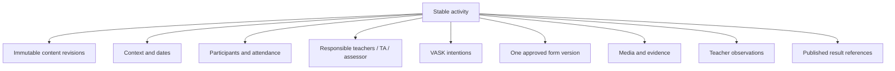

# SRS-04 Activities, participants and VASK

## 1. Purpose

Define a school-owned activity as a stable container connecting versioned context, students, responsible staff, VASK intentions, one immutable form version, evidence and assessment.

## 2. Functional requirements

| ID | Requirement | Status | Phase |
|---|---|---|---|
| ACT-FR-001 | The system shall distinguish reusable activity templates from dated activity instances. | Recommended architecture | P1 |
| ACT-FR-002 | Every school-owned activity shall reference one approved, published, immutable form version before activation. | Confirmed working model | P1 |
| ACT-FR-003 | Activity participants and responsible staff shall be explicit many-to-many assignments. | Confirmed architecture | P0 |
| ACT-FR-004 | Attendance/participation shall remain separate from form completion and assessment. | Confirmed architecture | P1 |
| ACT-FR-005 | An activity may select multiple VASK items with source, rationale, version and approval state. | Confirmed working model | P1 |
| ACT-FR-006 | VASK describes activity intention/context and shall not directly set an eight-skill step. | Confirmed working model | P0 |
| ACT-FR-007 | Optional framework targets identify expected evidence only; they do not award steps. | Confirmed architecture | P1 |
| ACT-FR-008 | Risk flags shall determine whether human activity approval is required. | Recommended architecture; M-14 open | P1 |
| ACT-FR-009 | Student access opening, closing and due times shall be configurable per activity. | Confirmed structural need | P1 |
| ACT-FR-010 | Academic/non-academic classification shall remain configurable pending M-08. | Policy TBD | P1 |
| ACT-FR-011 | Authorized staff shall be able to correct a previously confirmed attendance/participation or student-activity association with before/after values, reason, actor and time; the planned roster remains immutable and affected proof/results enter impact review. | Approved System Analyst architecture decision, 27 Oct 2026 | P1 |
| ACT-FR-012 | `activity_id` shall remain stable across content revisions so evidence, media, submissions and attendance are not detached by a title/description correction. | Approved System Analyst architecture decision, 28 Oct 2026 | P0/P1 |
| ACT-FR-013 | Governed activity content shall be stored as immutable numbered revisions. The activity root shall identify the latest revision and current approved revision separately. | Approved System Analyst architecture decision, 28 Oct 2026 | P1 |
| ACT-FR-014 | A material edit to an approved/active activity shall create a successor draft and new approval cycle. Until approval, official views shall resolve the previous approved revision. | Approved System Analyst architecture decision, 28 Oct 2026 | P1 |
| ACT-FR-015 | Activity creation/editing shall require an effective capability and matching scope, not a specific teacher title. | Approved System Analyst architecture decision, 28 Oct 2026 | P1 |
| ACT-FR-016 | An assigned teacher without edit authority shall submit a versioned change request to the owner/authorized editor, with field, proposed value, reason, actor and resolution. | Approved System Analyst architecture decision, 28 Oct 2026 | P1 |
| ACT-FR-017 | Activity approval policy shall independently support `not_required`, `automatic`, `single_reviewer` and `two_stage_sequential`; approval and publication may be assigned separately or to the same eligible person. | Approved System Analyst architecture decision, 28 Oct 2026 | P1 |
| ACT-FR-018 | Self-assignment/self-approval shall follow the active school policy. Even when allowed, the creator must have approval capability, matching scope and a named audited assignment. | Approved System Analyst architecture decision, 28 Oct 2026 | P1 |

## 3. Activity data package

## 4. Required and conditional fields

| Field | Rule | Limit/status |
|---|---|---|
| Activity code | Required, unique within school | 1–64 characters |
| Title | Required | 1–200 characters |
| Description | Required before review | 1–20,000 characters |
| Category | Required before review | Enum; academic/non-academic dual classification is TBD M-08 |
| Start/end | Required | Start must not exceed end |
| Location | Optional; required for off-site risk review | 0–200 characters |
| Owner | Required | One active responsible owner |
| Other staff | Optional | Maximum 50 temporary cap |
| Participants | Required before activation | 1–1,000 |
| VASK items | Required before activation | 1–100 temporary cap; catalogue-controlled |
| Form version | Required before activation | Exactly one immutable version |
| Access/due times | Conditional | Opening ≤ closing; due time Policy TBD |
| Risk flags | Required before approval | Multi-select configured enum |
| Latest/current approved revision | System managed | Both may differ while a successor awaits approval |
| Change request | Conditional | Required when requester lacks direct edit authority; reason 1–4,000 characters |

The final list of mandatory activity fields remains open under L-01. The table above is the minimum recommended validation for P1.

## 5. Lifecycle and locking

| State | Editable content | Allowed actor |
|---|---|---|
| `draft` | All fields | Owner/authorized staff |
| `pending_review` | Reviewer comments only; author may withdraw | Owner/reviewer |
| `approved` | Access dates and roster until activation; material content changes create a successor revision and re-review | Owner/authorized editor |
| `active` | Attendance, evidence and submissions; form/VASK changes require versioned amendment | Assigned staff |
| `completed` | Review, correction and publication actions only | Assigned reviewers |
| `archived` | Read/export; audited administrative correction only | Authorized staff/admin |

Exact reopen authority remains Policy TBD M-12/L-04.

## 6. Risk-based approval

Routine use of the approved default form with no new sensitive media may follow configured automatic approval. Custom forms, altered mappings, off-site events, external participants, image/audio/video collection or new retention needs require human review. Unassigned, declined or overdue decisions enter the configured default/escalation queue; every human decision and material-change approval requires a reason.

## 7. Acceptance scenarios

- An activity cannot become active without participants, responsible staff, VASK and a valid published form version.
- Editing the linked form after activation does not change the historical activity package.
- A participant may be absent yet still retain a separate submission status.
- Adding video collection raises a review requirement even for an otherwise routine activity.
- An activity can target skills but cannot directly promote a student step.
- Correcting a false student/activity association removes it from current assessment use without deleting the original roster, attendance decision or audit trail.
- Editing an approved description creates revision 2 while revision 1 remains the official view and the same `activity_id` continues to own existing evidence.
- A teacher assigned to a staff-created activity without edit authority can submit a change request but cannot overwrite the description.
- A teacher with the configured approval capability may approve an activity even if their job title is not “staff”; self-approval succeeds only where explicitly allowed.

