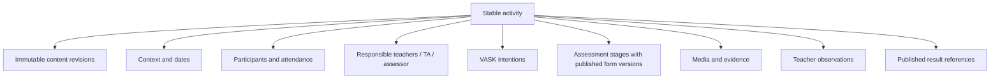

# SRS-04 Activities, participants and VASK

## 1. Purpose

Define a school-owned activity as a stable container connecting versioned context, students, responsible staff, VASK intentions, one or more versioned assessment stages, evidence and assessment.

## 2. Functional requirements

| ID | Requirement | Status | Phase |
|---|---|---|---|
| ACT-FR-001 | The system shall distinguish reusable activity templates from dated activity instances. | Recommended architecture | P1 |
| ACT-FR-002 | Every school-owned activity shall have a default assessment stage; each stage must pin an approved, published form version before release to respondents. | Confirmed working model | P1 |
| ACT-FR-003 | Activity participants and responsible staff shall be explicit many-to-many assignments. | Confirmed architecture | P0 |
| ACT-FR-004 | Attendance/participation shall remain separate from form completion and assessment. | Confirmed architecture | P1 |
| ACT-FR-005 | An activity may select multiple VASK items with source, rationale, version and approval state. | Confirmed working model | P1 |
| ACT-FR-006 | VASK describes activity intention/context and shall not directly set an eight-skill step. | Confirmed working model | P0 |
| ACT-FR-007 | Optional framework targets identify expected evidence only; they do not award steps. | Confirmed architecture | P1 |
| ACT-FR-008 | Risk flags shall determine whether human activity approval is required. | Recommended architecture; M-14 open | P1 |
| ACT-FR-009 | Student access opening, closing and due times shall be configurable per activity. | Confirmed structural need | P1 |
| ACT-FR-010 | Academic/non-academic classification shall remain configurable pending M-08. | Policy TBD | P1 |
| ACT-FR-011 | Authorized staff shall be able to correct a previously confirmed attendance/participation or student-activity association with before/after values, reason, actor and time; the planned roster remains immutable and affected proof/results enter impact review. | Approved System Analyst architecture decision, 27 Oct 2026 | P1 |
| ACT-FR-012 | `activity_id` shall remain stable across content revisions so evidence, media, submissions and attendance are not detached by a title/description correction. | Approved System Analyst architecture decision, 28 Oct 2026 | P0/P1 |
| ACT-FR-013 | Governed activity content shall be stored as immutable numbered revisions. The activity root shall identify the latest revision and current approved revision separately. | Approved System Analyst architecture decision, 28 Oct 2026 | P1 |
| ACT-FR-014 | A material edit to an approved/active activity shall create a successor draft and new approval cycle. Until approval, official views shall resolve the previous approved revision. | Approved System Analyst architecture decision, 28 Oct 2026 | P1 |
| ACT-FR-015 | Activity creation/editing shall require an effective capability and matching scope, not a specific teacher title. | Approved System Analyst architecture decision, 28 Oct 2026 | P1 |
| ACT-FR-016 | An assigned teacher without edit authority shall submit a versioned change request to the owner/authorized editor, with field, proposed value, reason, actor and resolution. | Approved System Analyst architecture decision, 28 Oct 2026 | P1 |
| ACT-FR-017 | Activity approval policy shall independently support `not_required`, `automatic`, `single_reviewer` and `two_stage_sequential`; approval and publication may be assigned separately or to the same eligible person. | Approved System Analyst architecture decision, 28 Oct 2026 | P1 |
| ACT-FR-018 | Self-assignment/self-approval shall follow the active school policy. Even when allowed, the creator must have approval capability, matching scope and a named audited assignment. | Approved System Analyst architecture decision, 28 Oct 2026 | P1 |
| ACT-FR-019 | SchoolAdmin shall select one active, versioned activity-ability labelling set from the catalogues that have passed import validation. Teachers creating or revising an activity shall be offered only labels from that active set. Existing activity revisions retain the exact label-set version originally selected. | Confirmed System Analyst direction, 29 Oct 2026; not BHSS/JC approval | P1 |
| ACT-FR-020 | Activating a new activity-ability labelling set changes available teacher choices only; it shall not relabel existing activities, create assessment results or alter the active skill rubric. | Confirmed System Analyst direction, 29 Oct 2026; not BHSS/JC approval | P0/P1 |
| ACT-FR-021 | VASK shall be the seeded default activity-ability labelling set. When a teacher creates a new activity, the system shall automatically resolve the school's currently active labelling-set version and show its labels; the activity creator shall not ask the teacher to choose between VASK and assessment rubrics. A SchoolAdmin-uploaded successor labelling set affects new revisions only after validation and explicit activation. | Confirmed System Analyst direction, 29 Oct 2026; not BHSS/JC approval | P0/P1 |
| ACT-FR-022 | An activity revision may hold several version-pinned label assignments. Each assignment shall identify its catalogue, axis, role (`descriptor` or `intended_assessment_axis`), source, rationale, approval state, actor and time. A label remains context and never becomes a student result. | Approved System Analyst architecture decision, 30 Oct 2026; not BHSS/JC approval | P1 |
| ACT-FR-023 | New activity and successor-revision requests shall accept only active, selectable labels. A historical revision may continue to reference a disabled catalogue or axis; validation shall return a historical-reference warning rather than rewriting or rejecting the unchanged record. | Approved System Analyst architecture decision, 30 Oct 2026; not BHSS/JC approval | P0/P1 |
| ACT-FR-024 | Activity approval shall confirm that the selected questionnaire version was already approved and published. It shall not approve, publish or change the questionnaire. Activity and form decisions remain separate approval records even where the same person performs both decisions. | Approved System Analyst architecture decision, 30 Oct 2026; not BHSS/JC approval | P0/P1 |
| ACT-FR-025 | Activity-authoring teacher/staff assignment lookups shall be server-filtered and paginated by name/identifier, active state, position, functional role, capability, department, subject, group, programme, scope and approval eligibility as applicable. Search permission shall not grant access to staff administration. | Approved System Analyst architecture decision, 30 Oct 2026; not BHSS/JC approval | P1 |
| ACT-FR-026 | Default student/teacher response due time shall be one calendar month after activity end. Authorised extensions, including after expiry, shall preserve old/new deadline, actor, reason, effective time and required approval. Due time is not an automatic close or an activity-amendment cutoff; exact calendar rules and authority remain open under L-04/M-12. | System Analyst direction; synchronized 18 Nov 2026; not BHSS/JC approval | P1 |
| ACT-FR-027 | The system shall support the stage workflow and immutable stage/form/response context specified below; default one end stage, optional additional assessments, separately governed questionnaire changes and no automatic comparison of unlike instruments. | System Analyst direction, 18 Nov 2026; not BHSS/JC approval | P1 |

### Due dates and extensions

An activity response is due by default one calendar month after the activity ends. An authorised staff member can configure a longer activity-specific deadline, including after the original date has passed. Each change records previous/new deadline, actor, reason, time and required approval as one auditable action. A due date signals lateness; it is not automatically a closing date. The school must confirm authority, exact month-end/timezone rules and any separate hard close. Submission lateness is derived from timestamps and deadline history as specified in SRS-06; published snapshots remain immutable.

## 3. Activity data package

## 4. Required and conditional fields

| Field | Rule | Limit/status |
|---|---|---|
| Activity code | Required, unique within school | 1–64 characters |
| Title | Required | 1–200 characters |
| Description | Required before review | 1–20,000 characters |
| Category | Required before review | Enum; academic/non-academic dual classification is TBD M-08 |
| Start/end | Required | Start must not exceed end |
| Location | Optional; required for off-site risk review | 0–200 characters |
| Owner | Required | One active responsible owner |
| Other staff | Optional | Maximum 50 temporary cap |
| Participants | Required before activation | 1–1,000 |
| VASK items | Required before activation | 1–100 temporary cap; catalogue-controlled |
| Form version | Required before activation | One immutable version per released stage |
| Access/due times | Conditional | Opening ≤ closing when configured; response due default ACT-FR-026; calendar details TBD |
| Risk flags | Required before approval | Multi-select configured enum |
| Latest/current approved revision | System managed | Both may differ while a successor awaits approval |
| Change request | Conditional | Required when requester lacks direct edit authority; reason 1–4,000 characters |

The final list of mandatory activity fields remains open under L-01. The table above is the minimum recommended validation for P1.

## 5. Lifecycle and locking

| State | Editable content | Allowed actor |
|---|---|---|
| `draft` | All fields | Owner/authorized staff |
| `pending_review` | Reviewer comments only; author may withdraw | Owner/reviewer |
| `approved` | Access dates and roster until activation; material content changes create a successor revision and re-review | Owner/authorized editor |
| `active` | Attendance, evidence and submissions; form/VASK changes require versioned amendment | Assigned staff |
| `completed` | Review, correction and publication actions only | Assigned reviewers |
| `archived` | Read/export; audited administrative correction only | Authorized staff/admin |

Exact reopen authority remains Policy TBD M-12/L-04.

## 6. Risk-based approval

Routine use of the approved default form with no new sensitive media may follow configured automatic approval. Custom forms, altered mappings, off-site events, external participants, image/audio/video collection or new retention needs require human review. Unassigned, declined or overdue decisions enter the configured default/escalation queue; every human decision and material-change approval requires a reason.

## 7. Acceptance scenarios

- An activity cannot become active without participants, responsible staff, VASK and a valid published form version.
- Editing the linked form after activation does not change the historical activity package.
- A participant may be absent yet still retain a separate submission status.
- Adding video collection raises a review requirement even for an otherwise routine activity.
- An activity can target skills but cannot directly promote a student step.
- Correcting a false student/activity association removes it from current assessment use without deleting the original roster, attendance decision or audit trail.
- Editing an approved description creates revision 2 while revision 1 remains the official view and the same `activity_id` continues to own existing evidence.
- A teacher assigned to a staff-created activity without edit authority can submit a change request but cannot overwrite the description.
- A teacher with the configured approval capability may approve an activity even if their job title is not “staff”; self-approval succeeds only where explicitly allowed.
- A new activity automatically displays labels from the school's active VASK labelling-set version. Skills Builder and RC360 assessment rubrics do not appear as alternative activity-labelling catalogues.
- Approving an activity that references a published questionnaire creates no questionnaire approval or publication event.
- A disabled label remains visible on an older revision as historical context but cannot be selected for a new revision.
- An activity creator may search an in-scope, paginated assignment directory without gaining staff-administration access.

### Amendment timing clarification

ACT-FR-012–016 already govern activity changes. The one-calendar-month response deadline does not impose an activity edit cutoff. Material edits follow successor revision and reapproval; non-editors request a change. Any separate amendment cutoff remains open under M-12/L-04.

## Multi-stage activity assessment

**System Analyst direction, 18 November 2026; not BHSS/JC approval.** This supersedes the activity-wide one-questionnaire restriction. An activity has one or more assessment/feedback stages. Default to one end-stage assessment scheduled at the relevant reporting-period end; an authorised activity editor may add start, progress, end or custom stages and adjust their dates. A stage may use a different questionnaire from another stage. Each released stage pins one approved, published, immutable form version, which can contain student, teacher and peer blocks. Multiple questionnaires within the same stage are not assumed; use separate named stages where needed.

Activity → assessment stages → stage revisions → form assignments → recipients → submissions → answers/proof. Stage records have a stable stage ID, activity ID, name/type, sequence, review/reporting period, assessment date, evidence-window start/end, opening/due/optional closing times, questionnaire version, respondent groups and named review assignments. Stage revisions preserve their author, reason, approval, publication and superseded revision. Assignments, submissions, proof and observations retain stage identity and exact stage/form revision context. These are conceptual model additions; database migrations and API/UI implementation remain outstanding.

Keep activity period allocation separate from stage review periods. An activity spanning P1–P2 can have a P1 progress assessment and a P2 end assessment under the same activity ID. P1-stage responses remain available for feedback comparison, but an ongoing P1–P2 activity is excluded from the P1 period assessment unless an owner-requested early end has taken effect. Freeze evidence windows and review decisions for any eligible completed activity. A stage is not a new activity, an automatic rubric result or an automatic publication.

Adding or replacing a stage/questionnaire after activity approval is a governed activity amendment: the owner/authorised editor proposes a successor activity/stage revision and submits it for the configured approval. Teachers without editing authority request the change. Draft or unapproved questionnaires cannot be assigned to respondents; questionnaire approval/publication remains independent. Existing stage assignments, responses and published results keep their original versions. A stage with submitted work cannot be relabelled, overwritten or deleted to represent a new assessment; cancel/retire future work with reason, or create a successor stage/assignment with explicit recipients. The last approved configuration remains effective until the successor is approved and released.

A stage assessment date, response due date and closing time are separate. For the default end stage, retain the existing one-calendar-month-after-activity-end response due rule unless explicitly changed. Added stages require explicit opening/due dates and validation against their assessment date; do not silently reuse the final-activity deadline for a start/progress stage. If period-end scheduling and the default response deadline conflict, require an explicit schedule decision before release. Existing audited extension and derived-overdue rules apply per stage. Peer deadlines, default date precedence and exact extension authority remain open under M-28/L-04.

Compare stages side by side with questionnaire/version, question/ability, answer scale, perspective, date and evidence visible. Different questionnaires are permitted, but do not subtract or average unrelated answers. Numerical change requires an explicitly approved comparable question/scale or rubric-version/axis definition; otherwise show qualitative evidence comparison. Reusing the same proof across stages must retain its identity and must not count it twice merely because it appears twice. Stage-specific versus cumulative evidence windows, final-stage replacement versus retention and official aggregation remain configurable questions; no new automatic progression formula is introduced.

### Activity completion and early end

**System Analyst clarification, 18 November 2026; not BHSS/JC approval.** The activity owner may request an early end. Record the proposed actual end date, reason, requester and time, and apply the configured activity amendment/approval workflow. Only an effective completed/ended state qualifies the activity for period assessment; a pending early-end request is not completion. If the owner does not end the activity and it remains ongoing, exclude it from that period’s assessment input and calculation. Show “ongoing — not included” rather than zero; retain its history, media, stage responses and feedback.

This supersedes the earlier assumption that a P1 stage of an ongoing P1–P2 activity may contribute to the P1 official period result. Start/progress stages can still collect and compare feedback, but cannot bypass activity-completion eligibility. An eligible completed activity still requires accepted proof, human-confirmed observations and the normal publication decision; ending it does not automatically award a level. If no eligible results remain, apply the existing inherited/not-yet-assessed display rule.

An effective early-end change records old/new end dates and the treatment of future stages and outstanding tasks. Recalculate the default response deadline from the effective actual end date through the existing audited deadline-change workflow, preserving explicit extensions and submitted history for review rather than silently shortening them. Future stages are explicitly rescheduled or cancelled with reason; they are not silently deleted. Period-end assessment may proceed without an ongoing activity. Exact completion cutoff, treatment of late completion in an already published report, and authority for any separate hard-close/reopen remain open under M-28/L-04. Published results are never silently changed.
