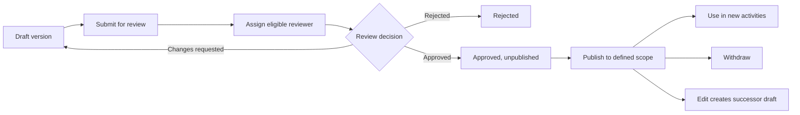

# SRS-05 Forms, question blocks and governance

## 1. Terminology

- A **questionnaire source** is a complete supplied instrument or source workbook.
- A **form** is the versioned digital instrument assigned to an activity.
- A **question block/section** is an ordered group inside a form.
- A **question** is a reusable prompt with response type, scale, audience and mappings.
- A **construct** is a quality measured by source questions; it is not automatically one of the eight framework skills.

## 2. Functional requirements

| ID | Requirement | Status | Phase |
|---|---|---|---|
| FRM-FR-001 | Forms shall contain 1–50 ordered question blocks and 1–200 questions under temporary caps. | Temporary cap; completeness Policy TBD M-06 | P1 |
| FRM-FR-002 | A form assignment shall reference one exact immutable version. | Confirmed architecture | P1 |
| FRM-FR-003 | Editing an approved/published version shall create a successor draft and preserve historical assignments. | Confirmed architecture | P1 |
| FRM-FR-004 | Teachers shall upload completed questionnaire XLSX data for assigned activities; students see results only after validation and publication. | Confirmed POC direction | P0 |
| FRM-FR-005 | Questions may map independently to constructs, VASK and one or more of eight skills. | Confirmed architecture | P1 |
| FRM-FR-006 | Each question has total weight 1.0 by default; the share is equally divided across mapped skills. | Confirmed M-01 | P1 |
| FRM-FR-007 | Optional evidence bands may constrain candidate evidence to 1–16 but shall not award a step. | Recommended; M-02 open | P1 |
| FRM-FR-008 | Mapping versions shall record author, rationale, reviewer, approval state and validity. | Recommended; H-05 open | P1 |
| FRM-FR-009 | Question audience suitability shall be explicit before final production publication. | Policy TBD M-05; interim POC assumes all | P1 |
| FRM-FR-010 | Form approval and form publication shall be separate actions. | Confirmed architecture | P1 |

## 3. Question field contract

| Field | Required | Range/enum |
|---|---|---|
| Question code | Yes | 1–64 characters, unique within version namespace |
| Prompt | Yes | 1–4,000 characters |
| Response type | Yes | `scale`, `single_choice`, `multiple_choice`, `short_text`, `long_text`, `boolean`, `number`, `date`, `file_reference` |
| Audience | Yes before publication | Any approved combination of `student`, `peer`, `teacher`, `staff`; M-05 open |
| Required flag | Yes | Boolean |
| Scale | Conditional | Must declare minimum/maximum; supplied scales use 1–6 |
| Options | Conditional | 2–20 temporary cap |
| Skill mappings | Optional | 1–8; weights total 1.0 / 100% |
| Evidence band | Optional | Both integers 1–16; min ≤ max |
| VASK mappings | Optional | 1–100 temporary cap |
| Display order | Yes | Integer ≥1 |

## 4. Governance lifecycle

Default separation: teacher authors; authorized Staff/SchoolAdmin assigns review; an eligible delegated reviewer decides; authorized Staff/SchoolAdmin publishes. Whether authors may self-approve remains open H-05.

## 5. XLSX questionnaire workflow

1. Assigned teacher downloads the exact activity/form-version template.
2. The file contains student ID, student name for checking, question code, response fields and instructions.
3. Teacher uploads one `.xlsx`/`.csv` file, maximum 4 MiB, 5,000 rows and 100 columns.
4. The system previews matches and validation errors; the teacher may correct staged rows.
5. Teacher submits the batch. Submitted rows are locked except through audited correction.
6. Staff/authorized reviewer validates or resolves exceptions.
7. Inclusion and student publication occur separately.

## 6. Access

- Students answer assigned forms but do not browse the global question bank.
- Teachers see approved questions/forms needed for assigned activities and their own drafts.
- Staff manages delegated form library, mappings and review queues.
- SchoolAdmin configures authorities and publication scopes.

## 7. Acceptance scenarios

- A two-skill question contributes 0.5 candidate share to each, not 1.0 to both.
- A form with an invalid scale or weights totalling 90% cannot be published.
- A student cannot see teacher responses before the batch is published.
- Withdrawing a form prevents new assignment but does not damage earlier submissions.
- A question marked student-only cannot appear in a teacher-observation template after M-05 is activated.

