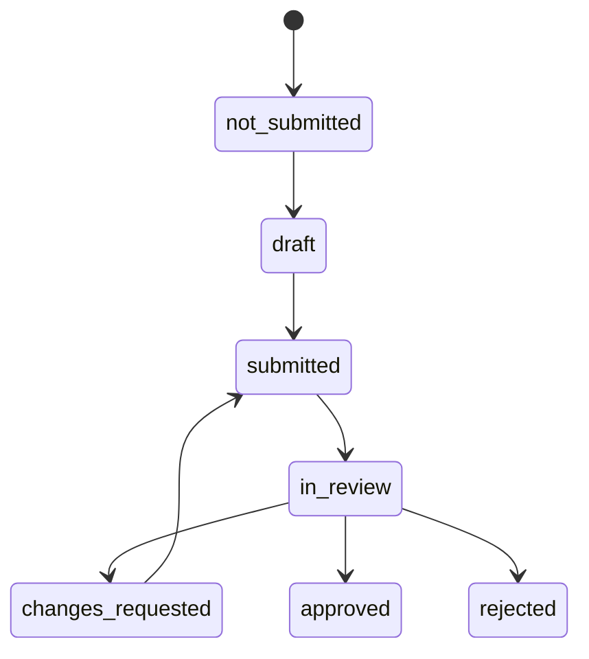

# SRS-06 Assignments, submissions and peer review

## 1. Purpose

Allocate the correct versioned form to a named respondent and subject, preserve the response perspective, and control review and publication independently.

## 2. Functional requirements

| ID | Requirement | Status | Phase |
|---|---|---|---|
| SUB-FR-001 | Each assignment shall identify activity, form version, assigning user, opening time, due time and eligibility rule. | Confirmed architecture | P1 |
| SUB-FR-002 | Each recipient shall identify respondent and subject separately. | Confirmed architecture | P1 |
| SUB-FR-003 | Perspective shall be one of `student_self_report`, `teacher_observation`, `peer_observation` or later configured approved values. | Confirmed architecture | P1 |
| SUB-FR-004 | Content, processing and visibility states shall be independent. | Confirmed M-09/M-19 | P0 |
| SUB-FR-005 | Peer review shall require a named assignment created by an authorized teacher/TA; activity membership alone shall not grant peer access. | Confirmed architecture | P1 |
| SUB-FR-006 | The peer shall see only the assigned subject context and form, not the subject's broader record. | Recommended architecture | P1 |
| SUB-FR-007 | Negative or sensitive peer content shall be held for moderation when policy requires. | Recommended; peer policy open | P1 |
| SUB-FR-008 | Missing submissions shall remain missing and be surfaced to the responsible teacher. | Confirmed M-11 | P0 |
| SUB-FR-009 | Returned work shall create a new submission revision without erasing the prior submitted version. | Recommended architecture | P1 |
| SUB-FR-010 | Submission review shall use the school's independently configured lean workflow; automatic review may be used where policy conditions are satisfied and every exception shall enter a human queue. | Approved System Analyst architecture decision, 28 Oct 2026 | P1 |
| SUB-FR-011 | A human submission decision shall require a named eligible assignment and recorded reason; unassigned, declined or overdue work shall enter the configured escalation queue. | Approved System Analyst architecture decision, 28 Oct 2026 | P1 |

## 3. Lifecycle

Approved does not mean visible. Visibility separately follows `unpublished → published_to_portfolio → withdrawn`.

## 4. Field rules

| Field | Rule | Limit |
|---|---|---|
| Assignment title/instructions | Required | 1–4,000 characters |
| Opens/due time | Required for student/peer tasks | Opens ≤ due; policy timing TBD |
| Respondent | Required | Exactly one active user per recipient row |
| Subject | Required | Exactly one student |
| Peer reviewer | Required for peer perspective | One named reviewer; cannot equal subject |
| Form version | Required | One approved, published, valid version |
| Numeric response | Conditional | Scale-declared min/max only |
| Text response | Conditional | 1–4,000 characters |
| Revision number | Required | Integer 1–9,999 |
| Return/reject reason | Required | 1–4,000 characters |

## 5. Locking and correction

- Draft responses remain editable by the respondent.
- Submission freezes that revision.
- A reviewer may request changes, approve or reject within scope.
- Changes requested create a new editable revision referencing the prior version.
- Administrative correction is append-only and requires reason and actor.
- Exact reopen authority remains Policy TBD L-04/M-12.

## 6. Acceptance scenarios

- A peer cannot discover or review an unassigned classmate.
- A late response is identified as late but not silently rejected unless configured policy says so.
- An approved response remains unpublished until a separate publication action.
- A teacher sees missing recipients without their result being treated as zero.
- Returning a submission preserves both the original and resubmitted versions.

