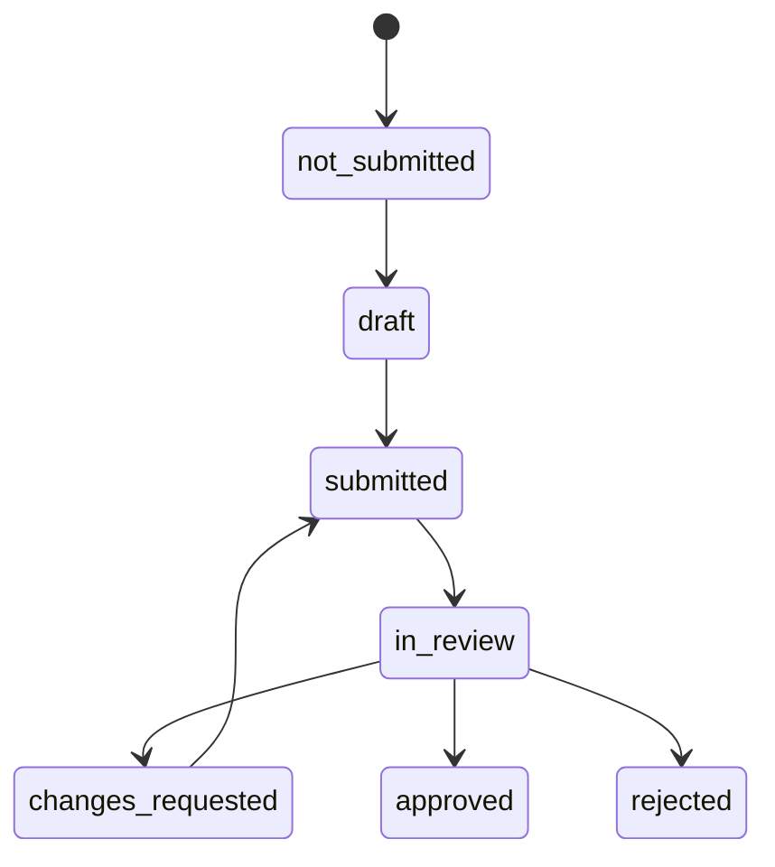

# SRS-06 Assignments, submissions and peer review

## 1. Purpose

Allocate the correct versioned form to a named respondent and subject, preserve the response perspective, and control review and publication independently.

## 2. Functional requirements

| ID | Requirement | Status | Phase |
|---|---|---|---|
| SUB-FR-001 | Each assignment shall identify activity, form version, assigning user, opening time, due time and eligibility rule. | Confirmed architecture | P1 |
| SUB-FR-002 | Each recipient shall identify respondent and subject separately. | Confirmed architecture | P1 |
| SUB-FR-003 | Perspective shall be one of `student_self_report`, `teacher_observation`, `peer_observation` or later configured approved values. | Confirmed architecture | P1 |
| SUB-FR-004 | Content, processing and visibility states shall be independent. | Confirmed M-09/M-19 | P0 |
| SUB-FR-005 | Peer review shall require a named assignment created by an authorized teacher/TA; activity membership alone shall not grant peer access. | Confirmed architecture | P1 |
| SUB-FR-006 | The peer shall see only the assigned subject context and form, not the subject's broader record. | Recommended architecture | P1 |
| SUB-FR-007 | Negative or sensitive peer content shall be held for moderation when policy requires. | Recommended; peer policy open | P1 |
| SUB-FR-008 | Missing submissions shall remain missing and be surfaced to the responsible teacher. | Confirmed M-11 | P0 |
| SUB-FR-009 | Returned work shall create a new submission revision without erasing the prior submitted version. | Recommended architecture | P1 |
| SUB-FR-010 | Submission review shall use the school's independently configured lean workflow; automatic review may be used where policy conditions are satisfied and every exception shall enter a human queue. | Approved System Analyst architecture decision, 28 Oct 2026 | P1 |
| SUB-FR-011 | A human submission decision shall require a named eligible assignment and recorded reason; unassigned, declined or overdue work shall enter the configured escalation queue. | Approved System Analyst architecture decision, 28 Oct 2026 | P1 |
| SUB-FR-012 | Lateness shall be derived from submission timestamps and immutable deadline history. Incomplete tasks use the current effective deadline; submitted revisions distinguish the deadline effective at submission from the current deadline. A later extension shall not erase the historical comparison. | System Analyst direction; synchronized 18 Nov 2026; not BHSS/JC approval | P1 |
| SUB-FR-013 | Overdue drafts may still be saved/submitted unless a separate closing or lifecycle rule blocks them. Submitted content remains frozen until authorised return/reopen creates a successor. A late response shall not silently rewrite a published snapshot. | System Analyst direction; synchronized 18 Nov 2026; not BHSS/JC approval | P1 |
| SUB-FR-014 | The system shall support the stage workflow and immutable stage/form/response context specified below; default one end stage, optional additional assessments, separately governed questionnaire changes and no automatic comparison of unlike instruments. | System Analyst direction, 18 Nov 2026; not BHSS/JC approval | P1 |

## 3. Lifecycle

Approved does not mean visible. Visibility separately follows `unpublished → published_to_portfolio → withdrawn`.

## 4. Field rules

| Field | Rule | Limit |
|---|---|---|
| Assignment title/instructions | Required | 1–4,000 characters |
| Opens/due time | Required for student/peer tasks | Opens ≤ due; policy timing TBD |
| Respondent | Required | Exactly one active user per recipient row |
| Subject | Required | Exactly one student |
| Peer reviewer | Required for peer perspective | One named reviewer; cannot equal subject |
| Form version | Required | One approved, published, valid version |
| Numeric response | Conditional | Scale-declared min/max only |
| Text response | Conditional | 1–4,000 characters |
| Revision number | Required | Integer 1–9,999 |
| Return/reject reason | Required | 1–4,000 characters |

## 5. Locking and correction

- Draft responses remain editable by the respondent.
- Submission freezes that revision.
- A reviewer may request changes, approve or reject within scope.
- Changes requested create a new editable revision referencing the prior version.
- Administrative correction is append-only and requires reason and actor.
- Exact reopen authority remains Policy TBD L-04/M-12.

### Derived overdue status

Default student and teacher activity-response due time is one calendar month after activity end; an authorised activity-specific extension may lengthen it even after expiry. Deadline changes are audited once with old/new values, actor, reason, effective time and any required approval. A due time is distinct from a configured closing time; absent a separate closing rule, an overdue draft can still be saved or submitted. Existing submitted revisions remain frozen until returned or reopened.

Store actual submission timestamps and immutable deadline changes; do not make a submission-level overdue flag authoritative. Derive overdue for an incomplete assignment from now versus the current effective deadline. For a submitted revision, derive and label the comparison to the deadline effective at submission and, when useful, the comparison to the current deadline. Later extensions cannot erase the original audit or change the historic as-submitted comparison. Treat policy and events as school-scoped, check server-side, and preserve published snapshots through successor review. Calendar-month edge cases, cutoff inclusivity, timezone, extension authority, and any hard-close policy require confirmation.

Acceptance example: end 1 March, original due 1 April, submission 5 April, extension applied 10 April to 1 June. The submission is late against the deadline effective on 5 April but on time against the current 1 June deadline; both are calculated rather than persisted as a permanent submission tag.

## 6. Acceptance scenarios

- A peer cannot discover or review an unassigned classmate.
- A late response is identified as late but not silently rejected unless configured policy says so.
- An approved response remains unpublished until a separate publication action.
- A teacher sees missing recipients without their result being treated as zero.
- Returning a submission preserves both the original and resubmitted versions.

### Cross-document decision pending

DOCX student-initiated activity code is internal direction; SRS-06 SUB-FR-005 currently requires teacher/TA assignment. Keep explicit reviewer-to-subject assignment. Who authorises code-generated assignments, expiry and eligibility must be resolved before implementation.

## Multi-stage activity assessment

**System Analyst direction, 18 November 2026; not BHSS/JC approval.** This supersedes the activity-wide one-questionnaire restriction. An activity has one or more assessment/feedback stages. Default to one end-stage assessment scheduled at the relevant reporting-period end; an authorised activity editor may add start, progress, end or custom stages and adjust their dates. A stage may use a different questionnaire from another stage. Each released stage pins one approved, published, immutable form version, which can contain student, teacher and peer blocks. Multiple questionnaires within the same stage are not assumed; use separate named stages where needed.

Activity → assessment stages → stage revisions → form assignments → recipients → submissions → answers/proof. Stage records have a stable stage ID, activity ID, name/type, sequence, review/reporting period, assessment date, evidence-window start/end, opening/due/optional closing times, questionnaire version, respondent groups and named review assignments. Stage revisions preserve their author, reason, approval, publication and superseded revision. Assignments, submissions, proof and observations retain stage identity and exact stage/form revision context. These are conceptual model additions; database migrations and API/UI implementation remain outstanding.

Keep activity period allocation separate from stage review periods. An activity spanning P1–P2 can have a P1 progress assessment and a P2 end assessment under the same activity ID. P1-stage responses remain available for feedback comparison, but an ongoing P1–P2 activity is excluded from the P1 period assessment unless an owner-requested early end has taken effect. Freeze evidence windows and review decisions for any eligible completed activity. A stage is not a new activity, an automatic rubric result or an automatic publication.

Adding or replacing a stage/questionnaire after activity approval is a governed activity amendment: the owner/authorised editor proposes a successor activity/stage revision and submits it for the configured approval. Teachers without editing authority request the change. Draft or unapproved questionnaires cannot be assigned to respondents; questionnaire approval/publication remains independent. Existing stage assignments, responses and published results keep their original versions. A stage with submitted work cannot be relabelled, overwritten or deleted to represent a new assessment; cancel/retire future work with reason, or create a successor stage/assignment with explicit recipients. The last approved configuration remains effective until the successor is approved and released.

A stage assessment date, response due date and closing time are separate. For the default end stage, retain the existing one-calendar-month-after-activity-end response due rule unless explicitly changed. Added stages require explicit opening/due dates and validation against their assessment date; do not silently reuse the final-activity deadline for a start/progress stage. If period-end scheduling and the default response deadline conflict, require an explicit schedule decision before release. Existing audited extension and derived-overdue rules apply per stage. Peer deadlines, default date precedence and exact extension authority remain open under M-28/L-04.

Compare stages side by side with questionnaire/version, question/ability, answer scale, perspective, date and evidence visible. Different questionnaires are permitted, but do not subtract or average unrelated answers. Numerical change requires an explicitly approved comparable question/scale or rubric-version/axis definition; otherwise show qualitative evidence comparison. Reusing the same proof across stages must retain its identity and must not count it twice merely because it appears twice. Stage-specific versus cumulative evidence windows, final-stage replacement versus retention and official aggregation remain configurable questions; no new automatic progression formula is introduced.

### Activity completion and early end

**System Analyst clarification, 18 November 2026; not BHSS/JC approval.** The activity owner may request an early end. Record the proposed actual end date, reason, requester and time, and apply the configured activity amendment/approval workflow. Only an effective completed/ended state qualifies the activity for period assessment; a pending early-end request is not completion. If the owner does not end the activity and it remains ongoing, exclude it from that period’s assessment input and calculation. Show “ongoing — not included” rather than zero; retain its history, media, stage responses and feedback.

This supersedes the earlier assumption that a P1 stage of an ongoing P1–P2 activity may contribute to the P1 official period result. Start/progress stages can still collect and compare feedback, but cannot bypass activity-completion eligibility. An eligible completed activity still requires accepted proof, human-confirmed observations and the normal publication decision; ending it does not automatically award a level. If no eligible results remain, apply the existing inherited/not-yet-assessed display rule.

An effective early-end change records old/new end dates and the treatment of future stages and outstanding tasks. Recalculate the default response deadline from the effective actual end date through the existing audited deadline-change workflow, preserving explicit extensions and submitted history for review rather than silently shortening them. Future stages are explicitly rescheduled or cancelled with reason; they are not silently deleted. Period-end assessment may proceed without an ongoing activity. Exact completion cutoff, treatment of late completion in an already published report, and authority for any separate hard-close/reopen remain open under M-28/L-04. Published results are never silently changed.
