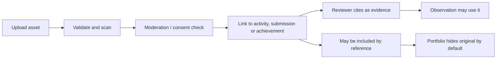

# SRS-07 Evidence, media, consent and external achievements

## 1. Purpose

Preserve evidence safely while keeping ownership, assessment use, portfolio display and access to original media as separate decisions.

## 2. Functional requirements

| ID | Requirement | Status | Phase |
|---|---|---|---|
| EVD-FR-001 | A media asset shall record owner, uploader, source, MIME type, size, hash, storage key, moderation, visibility and timestamps. | Confirmed architecture | P0 |
| EVD-FR-002 | Activity, submission, feedback and portfolio links shall use relationship records rather than duplicate the asset. | Confirmed architecture | P1 |
| EVD-FR-003 | Raw-media access shall require both record scope and an applicable consent/access grant. | Confirmed access model | P0 |
| EVD-FR-004 | Deletion shall default to soft disable with reason, actor and timestamp; historical references remain. | Confirmed working model | P0 |
| EVD-FR-005 | Upload processing shall validate declared MIME, detected content, size, extension and malware status before availability. | Recommended architecture | P1 |
| EVD-FR-006 | JPG/PNG shall receive a safe preview derivative; the original shall not be used directly as the UI preview. | POC-aligned recommendation | P0 |
| EVD-FR-007 | An evidence item affects assessment only when explicitly cited by feedback/observation. | Confirmed architecture | P1 |
| EVD-FR-008 | A student external achievement shall retain issuer, date, category, level/difficulty, result, certificate, reflection and student-selected VASK. | Confirmed H-06/M-15 | P1 |
| EVD-FR-009 | External achievements create Proof List items but no formal rubric result without suitable human observation and publication authority. | Confirmed H-06/M-15; Oct 26 revision | P1 |
| EVD-FR-010 | Consent, retention and guardian rules remain configurable and unresolved. | Policy TBD H-07/L-02 | P1 |
| EVD-FR-011 | An asset may be platform-managed or externally referenced through a school-approved connector. | Partly addressed L-08; Discussed on Meeting Oct 26 - kickstart | P1 |
| EVD-FR-012 | External retrieval shall re-check role/assignment scope, consent, lifecycle state and connector availability on every access. | Recommended architecture | P1 |
| EVD-FR-013 | Connector responses may provide metadata, a short-lived authorized URL or streamed bytes; browser responses shall never contain raw server paths or storage credentials. | Partly addressed L-08; Discussed on Meeting Oct 26 - kickstart | P1 |
| EVD-FR-014 | If an external source is unavailable or revoked, historical evidence linkage and provenance shall remain, while original-media access is marked unavailable. | Recommended architecture | P1 |

## 3. Evidence and visibility model

## 4. Upload limits

| Type | Allowed formats | Maximum | Phase/status |
|---|---|---:|---|
| Image | `.jpg`, `.jpeg`, `.png` | 8 MiB | P0 temporary cap |
| Spreadsheet | `.xlsx`, `.csv` | 4 MiB | P0 temporary cap |
| Document/certificate | `.pdf` plus approved document types | 20 MiB | P1 temporary cap; types TBD |
| Audio | Approved audio types | 100 MiB | P2 temporary cap |
| Video | Approved video types | 500 MiB | P2 temporary cap |
| Files per upload action | Applicable types | 20 | Temporary cap |
| Filename | Any allowed file | 255 characters | Temporary cap |

The UI shall show the active type and maximum before file selection and beside any rejected file. It shall never describe these temporary values as final policy.

## 5. External achievement fields

| Field | Rule | Limit |
|---|---|---|
| Title/issuer/category/result | Required | Each 1–200 characters |
| Achievement date | Required | Valid date, not unreasonably future-dated |
| Grade/difficulty | Optional but prompted | 0–200 characters |
| Reflection | Required for publication request | 1–4,000 characters; meaningful minimum Policy TBD |
| VASK | At least one for submission | 1–100 temporary cap |
| Certificate/evidence | At least one for certificate claim | Max 20 files per action |
| Rubric contribution | Default `none` | Requires a separate human-confirmed observation and authorized publication |

## 6. Access and disable behaviour

- Student: own uploads and permitted activity assets.
- Assigned teacher/TA: evidence required for assigned assessment and permitted by consent.
- Staff: delegated moderation queue.
- SchoolAdmin: metadata and policy; original access requires a grant.
- Disable requires a 1–4,000 character reason and records `disabled_by`, `disabled_at`; restoration is audited.

## 7. Acceptance scenarios

- A renamed executable pretending to be PNG is rejected.
- An image upload receives a preview and the original remains protected.
- A teacher deleting media causes soft disable, with reason and actor visible in audit.
- A piano certificate remains student-owned evidence and does not infer a 1–16 step.
- Withdrawing consent blocks future original-media reads without erasing the historical assessment reference; the exact downstream publication response remains Policy TBD H-07.

