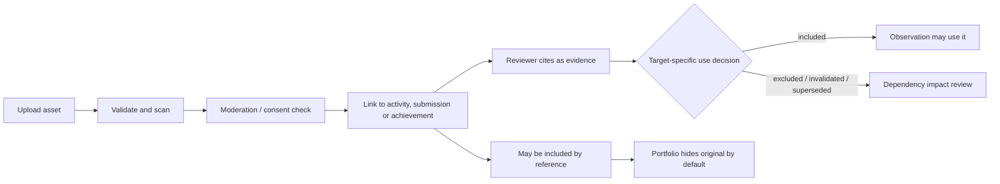

# SRS-07 Evidence, media, consent and external achievements

## 1. Purpose

Preserve evidence safely while keeping ownership, assessment use, portfolio display and access to original media as separate decisions.

## 2. Functional requirements

| ID | Requirement | Status | Phase |
|---|---|---|---|
| EVD-FR-001 | A media asset shall record owner, uploader, source, MIME type, size, hash, storage key, moderation, visibility and timestamps. | Confirmed architecture | P0 |
| EVD-FR-002 | Activity, submission, feedback and portfolio links shall use relationship records rather than duplicate the asset. | Confirmed architecture | P1 |
| EVD-FR-003 | Raw-media access shall require both record scope and an applicable consent/access grant. | Confirmed access model | P0 |
| EVD-FR-004 | Deletion shall default to soft disable with reason, actor and timestamp; historical references remain. | Confirmed working model | P0 |
| EVD-FR-005 | Upload processing shall validate declared MIME, detected content, size, extension and malware status before availability. | Recommended architecture | P1 |
| EVD-FR-006 | JPG/PNG shall receive a safe preview derivative; the original shall not be used directly as the UI preview. | POC-aligned recommendation | P0 |
| EVD-FR-007 | An evidence item affects assessment only when explicitly cited by feedback/observation. | Confirmed architecture | P1 |
| EVD-FR-008 | A student external achievement shall retain issuer, date, category, level/difficulty, result, certificate, reflection and student-selected VASK. | Confirmed H-06/M-15 | P1 |
| EVD-FR-009 | External achievements create Proof List items but no formal rubric result without suitable human observation and publication authority. | Confirmed H-06/M-15; Oct 26 revision | P1 |
| EVD-FR-010 | Consent, retention and guardian rules remain configurable and unresolved. | Policy TBD H-07/L-02 | P1 |
| EVD-FR-011 | An asset may be platform-managed or externally referenced through a school-approved connector. | Partly addressed L-08; Discussed on Meeting Oct 26 - kickstart | P1 |
| EVD-FR-012 | External retrieval shall re-check role/assignment scope, consent, lifecycle state and connector availability on every access. | Recommended architecture | P1 |
| EVD-FR-013 | Connector responses may provide metadata, a short-lived authorized URL or streamed bytes; browser responses shall never contain raw server paths or storage credentials. | Partly addressed L-08; Discussed on Meeting Oct 26 - kickstart | P1 |
| EVD-FR-014 | If an external source is unavailable or revoked, historical evidence linkage and provenance shall remain, while original-media access is marked unavailable. | Recommended architecture | P1 |
| EVD-FR-015 | An extraction provider result shall be stored as an unaccepted candidate linked to the original asset and processing job; it cannot directly create accepted proof, a student identity link or a published assessment. | Approved System Analyst architecture decision, 27 Oct 2026 | P1/P2 |
| EVD-FR-016 | Every asset, external connector, extraction job and derived result shall be school-scoped, and access shall fail if the active `school_id` does not match. | Approved System Analyst architecture decision, 27 Oct 2026 | P0/P1 |
| EVD-FR-017 | Each Proof List item shall use a configurable `proof_type_definition` and retain perspective, source provenance and declared authorship/AI-assistance origin separately. AI analysis output shall be marked derived and shall not become a proof type merely because it suggests a rubric level. | Approved System Analyst architecture decision, 27 Oct 2026 | P1 |
| EVD-FR-018 | An assigned authorized reviewer shall be able to create a target-specific proof-use decision (`included`, `excluded`, `invalidated`, `superseded`) for an observation, Portfolio claim or generation manifest, with reason, actor and time, without deleting the original proof. | Approved System Analyst architecture decision, 27 Oct 2026 | P1 |
| EVD-FR-019 | A globally false identity/evidence association, including an incorrect face match, shall be corrected or invalidated at the association itself; the original candidate and decision history shall remain auditable. | Approved System Analyst architecture decision, 27 Oct 2026 | P1/P2 |
| EVD-FR-020 | Excluding, correcting or invalidating used proof shall trigger a dependency impact check and mark affected suggestions, observations, claims and current snapshots `needs_review` or `stale`; no alternative source or result is selected automatically. | Approved System Analyst architecture decision, 27 Oct 2026 | P1 |
| EVD-FR-021 | Media metadata shall use a stable asset record and separate activity-link records. The asset shall retain title, original filename, media type, source/reference, owner, uploader/upload time, consent, visibility, moderation, processing, capture/retention, update and soft-disable metadata. | Approved System Analyst architecture decision, 30 Oct 2026; not BHSS/JC approval | P0/P1 |
| EVD-FR-022 | Each extraction shall retain the media asset, extraction type, provider/version, requested actor/time, processing state, start time, processed-finish time, candidate content, review state, reviewer/time/reason, correction and supersession link. | Approved System Analyst architecture decision, 30 Oct 2026; not BHSS/JC approval | P1/P2 |
| EVD-FR-023 | Media metadata queries shall be server-filtered and paginated by permitted activity, type, lifecycle, processing, consent and search term. Assignment, capability, school and consent checks shall be applied before rows are returned. Storage references and raw server paths shall not be returned in metadata responses. | Approved System Analyst architecture decision, 30 Oct 2026; not BHSS/JC approval | P0/P1 |
| EVD-FR-024 | Media create, extraction request, extraction review and soft-disable shall be separate protected actions. A queued or incomplete extraction cannot be accepted, and an accepted extraction remains a reviewed candidate rather than an official assessment. | Approved System Analyst architecture decision, 30 Oct 2026; not BHSS/JC approval | P1/P2 |
| EVD-FR-025 | The system shall support per-face-region selection, identity correction, unknown/non-student classification, missed-region editing and downstream impact review as specified below; a correction shall not rename a shared person label. | System Analyst direction, 18 Nov 2026; not BHSS/JC approval | P1 |

## 3. Evidence and visibility model

## 4. Upload limits

| Type | Allowed formats | Maximum | Phase/status |
|---|---|---:|---|
| Image | `.jpg`, `.jpeg`, `.png` | 8 MiB | P0 temporary cap |
| Spreadsheet | `.xlsx`, `.csv` | 4 MiB | P0 temporary cap |
| Document/certificate | `.pdf` plus approved document types | 20 MiB | P1 temporary cap; types TBD |
| Audio | Approved audio types | 100 MiB | P2 temporary cap |
| Video | Approved video types | 500 MiB | P2 temporary cap |
| Files per upload action | Applicable types | 20 | Temporary cap |
| Filename | Any allowed file | 255 characters | Temporary cap |

The UI shall show the active type and maximum before file selection and beside any rejected file. It shall never describe these temporary values as final policy.

## 5. External achievement fields

| Field | Rule | Limit |
|---|---|---|
| Title/issuer/category/result | Required | Each 1–200 characters |
| Achievement date | Required | Valid date, not unreasonably future-dated |
| Grade/difficulty | Optional but prompted | 0–200 characters |
| Reflection | Required for publication request | 1–4,000 characters; meaningful minimum Policy TBD |
| VASK | At least one for submission | 1–100 temporary cap |
| Certificate/evidence | At least one for certificate claim | Max 20 files per action |
| Rubric contribution | Default `none` | Requires a separate human-confirmed observation and authorized publication |

## 6. Access and disable behaviour

- Student: own uploads and permitted activity assets.
- Assigned teacher/TA: evidence required for assigned assessment and permitted by consent.
- Staff: delegated moderation queue.
- SchoolAdmin: metadata and policy; original access requires a grant.
- Disable requires a 1–4,000 character reason and records `disabled_by`, `disabled_at`; restoration is audited.

The same control surface shall offer only the manual actions valid for the record: exclude one use, correct extracted text/speaker, correct or reject identity association, disable/restrict media, supersede an observation, or request withdrawal/reissue of affected publication. These actions preserve the original record and append a decision; “remove” shall not imply hard deletion.

## 7. Acceptance scenarios

- A renamed executable pretending to be PNG is rejected.
- An image upload receives a preview and the original remains protected.
- A teacher deleting media causes soft disable, with reason and actor visible in audit.
- A piano certificate remains student-owned evidence and does not infer a 1–16 step.
- Withdrawing consent blocks future original-media reads without erasing the historical assessment reference; the exact downstream publication response remains Policy TBD H-07.
- Excluding a proof from one rubric observation does not remove it from unrelated valid uses.
- Rejecting a previously confirmed false face match removes the student's derived activity/evidence association and places dependent results in impact review.
- A metadata-only list never exposes an asset storage reference; an opaque reference resembling a local filesystem path is rejected on registration.
- An extraction records request, start and processed-finish stages separately and cannot be reviewed before processing completes.
- Disabling a media asset appends a lifecycle event and preserves activity links, extraction history, actor, reason and timestamp.

### Cross-document decision pending

Unresolved difference: DOCX proposed 50 MB images / 2 GB video and broader extensions; SRS-07 retains 8 MiB images / 500 MiB video temporary caps. Do not silently activate either as approved production policy. L-02 must select and align the final contract.

## Face-region identification and correction

**System Analyst direction, 18 November 2026; not BHSS/JC approval.** Correct the individual face region, not a shared label or the whole photo. A media asset has zero or more detected/manual face regions; each region has a stable ID, source-image/version reference, bounding box in normalised coordinates and detection provenance. Identity candidates and human decisions are separate, versioned records. Reprocessing must not silently move or replace a previously confirmed region/identity link.

An authorised activity owner/teacher opens the image, sees numbered face boxes and the current suggested/confirmed identity or Unknown, selects one box, and searches the existing permitted roster/student identities. Show a crop plus full-image context and a permitted reference image where available. The reviewer can confirm another student, mark non-student/guest (including an elder), leave unknown, or reject a false detection. Existing identity labels are reusable, but an existing positive student label is not required for an unknown face. Do not create a student or guess an elder’s identity from appearance.

The editor supports adding a missed face region and adjusting the selected box, with a reason; the original image remains unchanged. A student can request correction but cannot reassign another person. Teacher title or ownership alone does not replace the required review assignment/capability. Duplicate faces, multiple regions for one student, occlusion and unidentifiable people are valid review cases. A non-rostered student requires roster/identity resolution rather than silent enrolment. Store prior/new association, actor, time and reason; corrections are local to that region and never globally rename a person or update other photos automatically.

Revoke the incorrect student link and recompute permitted associations through review; flag dependent proof, AI candidates, observations and reports for impact review. Preserve the original candidate and prior decision. Published results require withdrawal or a reviewed successor, not silent recalculation. This is an identification workflow, not evidence that a photographed student demonstrated a skill. Detailed production security, retention and biometric/provider policy remain deferred; this section defines functional correction behaviour only.

## Batch two photo purpose and description metadata

**System Analyst clarification, 18 November 2026; not BHSS/JC approval.** The current photo use is to locate a student’s face, obtain human confirmation of the student association, and show the permitted image to that student. A confirmed face association is not confirmation of attendance, behaviour, an activity outcome or a rubric level. Ignore teachers and unknown/non-student people for student matching; they need not be named, enrolled or assigned a person profile. Ignoring their identity does not mean they have been removed or blurred from the original image.

A supplied photo description is desirable but optional. Keep the media title and add a human-supplied caption/description with its source/author, recorded time and revision history. Link the photo to its activity ID and known capture date/time. Distinguish photo-specific context from the activity description and intended VASK labels. A caption states what its author supplied; it does not independently verify the action or identify every person in the image. Missing captions must remain missing and do not block student-photo matching. These are intended metadata requirements, not a claim that the current v2 schema already implements them.

The locally deployed vision model may still scan the scene and produce generic observations such as “two people are interacting”. Store that output separately as an unconfirmed machine description, with model/prompt version, processing time and source image. It must not fill the human-description field, establish identities, infer the activity’s purpose, or assert a named student’s behaviour, intentions, skills or achievement. Do not use the generic scene description as accepted behavioural proof or as a basis for a rubric result. Face matching and scene description are separate outputs and review concerns.

Label-assisted action identification is outside the current scope: do not pass VASK labels or student identity labels to the local model to produce personalised explanations of actions. A client may request this later, but accuracy and privacy concerns require a separate scope decision and validation. Local deployment alone does not establish suitability. This restriction does not remove descriptive activity labels or the student association used to deliver the photo.

The face-region correction workflow remains: an authorised reviewer selects the specific face region and corrects a student association. Teacher/unknown regions are ignored for student delivery; they do not require a guest identity catalogue. Correcting a false student match removes the wrong association and flags its dependants. No automatic assessment follows from a face being present.
