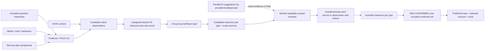

# SRS-08 Assessment, eight skills and sixteen steps

## 1. Purpose

Record evidence-backed observations against interchangeable versioned rubrics while proving the first operational path with the eight Skills Builder skills and their 16 reference steps.

## 2. Fixed framework model

| Rule | Value |
|---|---|
| Skills | Exactly 8, displayed in approved order 1–8 |
| Steps per skill | Exactly 16, integer 1–16 |
| Development display bands | 1–4 entry; 5–8 intermediate; 9–12 advanced; 13–16 mastery |
| Consistency rating | Integer 1–6 |
| Supplied questionnaire scale | Integer 1–6 |

Development bands are display groupings, not separate marks.

## 3. Functional requirements

| ID | Requirement | Status | Phase |
|---|---|---|---|
| ASM-FR-001 | The system shall store framework, skill and step definitions as versioned reference data. | Confirmed architecture | P1 |
| ASM-FR-002 | An observation shall identify student, activity, author, perspective, skill, observed step, consistency, time, comment and evidence links. | Confirmed architecture | P1 |
| ASM-FR-003 | Observed step and consistency shall remain separate numeric values. | Confirmed architecture | P1 |
| ASM-FR-004 | Self, peer, teacher and external/professional perspectives shall remain separate source records. | Confirmed M-07 direction | P1 |
| ASM-FR-005 | Missing evidence or rating shall produce a missing/unconfirmed state, not zero. | Confirmed M-11/H-04 recommendation | P0 |
| ASM-FR-006 | A question response, VASK selection, academic mark, certificate or AI output shall not automatically publish a step. | Confirmed working model | P0 |
| ASM-FR-007 | Human confirmation by a user holding the effective assessor capability, matching scope and named assignment is required before activity evidence changes a published step; a Teacher or TA position alone grants no such authority. | Recommended; final authority H-03/H-04 open; aligned to H-17 | P1 |
| ASM-FR-008 | Academic marks may be supporting evidence only and must use a named grading scheme. | Confirmed working model | P1 |
| ASM-FR-009 | Published step decisions shall cite the evidence and authority/source instrument used. | Confirmed architecture | P1 |
| ASM-FR-010 | The active Skills Builder policy shall select the highest human-confirmed satisfied level per axis from the observations explicitly included by an assigned authorized reviewer; levels are not prerequisites. | Confirmed M-21; clarified by System Analyst architecture decision, 27 Oct 2026 | P0 |
| ASM-FR-011 | Any future average, cap, threshold or decay rule shall be stored as a separately versioned policy and shall not combine unlike rubrics by default. | Confirmed M-21; other methods open | P1 |
| ASM-FR-012 | A catalogue may feed a radar chart only when assessment-capable and complete with versioned axes, ordered levels and concrete conditions. | Confirmed M-20 | P0 |
| ASM-FR-013 | Every proof item used for assessment shall retain a configurable proof/input type, perspective, provenance and declared authorship origin (`human_authored`, `ai_assisted`, `ai_generated`, `unknown`). These dimensions shall not be collapsed into one source label. | Approved System Analyst architecture decision, 27 Oct 2026; taxonomy M-25 open | P1 |
| ASM-FR-014 | For each rubric version and axis, the authorized review view shall group all eligible human-confirmed candidate observations by proof/input type and show every item's current inclusion decision and exact supporting source links. | Approved System Analyst architecture decision, 27 Oct 2026 | P1 |
| ASM-FR-015 | Each source-type group shall show a candidate maximum and, after decisions exist, an included maximum. Both shall be labelled as evidence support rather than an official result; either state shall show `not_enough_evidence` when its relevant set is empty. | Approved System Analyst architecture decision, 27 Oct 2026 | P1 |
| ASM-FR-016 | A named reviewer holding the required capability and matching scope may include or exclude an individual proof-to-observation link or whole observation, with reason, actor and time. A user with an effective assessor capability may propose/confirm within assignment scope; SchoolAdmin has policy authority only unless separately eligible and assigned as a reviewer. | Approved System Analyst architecture decisions, 27–28 Oct 2026; final school authority remains H-03/H-04 | P1 |
| ASM-FR-017 | `MAX-CONFIRMED` shall operate only on included, eligible, unrevoked, human-confirmed observations using the same rubric version and axis. Raw candidates, excluded proof, AI suggestions and unlike rubrics shall not enter the calculation. | Approved System Analyst architecture decision, 27 Oct 2026 | P0/P1 |
| ASM-FR-018 | The official result shall retain the included observation IDs, proof links, source-type breakdown, reviewer decision/rationale and complete calculation trace. | Approved System Analyst architecture decision, 27 Oct 2026 | P1 |
| ASM-FR-019 | The system shall prohibit a source-free level override. A different level may be adopted only through inclusion/exclusion decisions or a new human-confirmed observation linked to eligible proof. | Approved System Analyst architecture decision, 27 Oct 2026 | P0/P1 |
| ASM-FR-020 | If a used proof, identity association or observation is later excluded, corrected, invalidated or superseded, dependent results shall become `needs_review`/`stale`; the system shall not automatically choose a replacement level. | Approved System Analyst architecture decision, 27 Oct 2026 | P1 |

## 4. Observation field contract

| Field | Required | Range |
|---|---|---|
| Skill | Yes | One of exactly 8 active skills |
| Observed step | Conditional | Integer 1–16; null means not rated |
| Consistency | Conditional with observed step | Integer 1–6 |
| Confidence | Optional | Configured enum, not a substitute for consistency |
| Comment | Required when used for progression | 1–4,000 characters |
| Evidence citations | Required when used for progression | 1–100 temporary cap |
| Proof/input type | Required for comparison | One active `proof_type_definition` |
| Authorship origin | Required for submitted work/evidence where applicable | `human_authored`, `ai_assisted`, `ai_generated`, `unknown` |
| Use decision | Required before official aggregation | `included`, `excluded`, `invalidated`, `superseded` |
| Use-decision reason | Required when not included | 1–4,000 characters |
| Suggested next step | Optional | Integer 1–16; normally ≥ observed step, exceptions require rationale |
| Source instrument | Required for formal use | 1–64 character code |

## 5. Evidence-to-publication flow

## 6. Provisional result display

- Candidate/unconfirmed evidence may be shown as such to authorized reviewers.
- The review screen shows each source type's candidate maximum and included maximum separately from the official selected result.
- Parallel LLM suggestions remain staff-only candidates unless converted into a human-reviewed observation with the original proof links.
- Students see teacher answers, comments and skill results only after publication.
- Radar charts use a frozen published snapshot; live draft evidence shall not silently change the chart.
- A return for modification withdraws or supersedes the affected published result according to M-19; the prior version remains auditable.

## 7. Acceptance scenarios

- UI and API reject step 0, 17 and decimal steps with “Enter a whole number from 1 to 16.”
- A 1–6 response is not displayed as a 1–16 step.
- A missing teacher rating leaves self/peer evidence visible to reviewers but unconfirmed.
- One evidence item may support multiple skills, each with a separate observation.
- Recalculation cannot overwrite an issued historical snapshot.
- Step 8 may be published when its condition is human-confirmed even if earlier step conditions were not all satisfied.
- When confirmed levels 4 and 8 exist for one axis, `MAX-CONFIRMED` publishes 8 and records the calculation trace.
- If level 8 is excluded with a recorded reason and level 4 remains included, `MAX-CONFIRMED` publishes 4; it does not store an arbitrary manual override.
- A media/face association later proven to refer to another student marks every dependent observation and current snapshot for review and does not automatically select the next available level.
- Two LLMs may return different suggestions for the same frozen input; both remain visible with provenance and neither overwrites the other or the official result.

